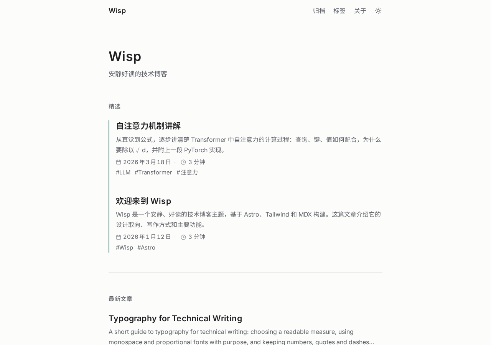
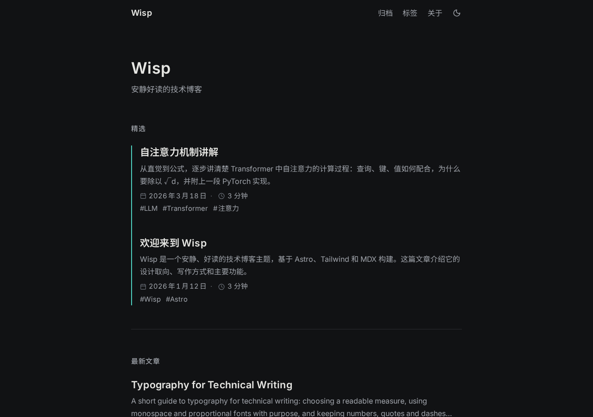
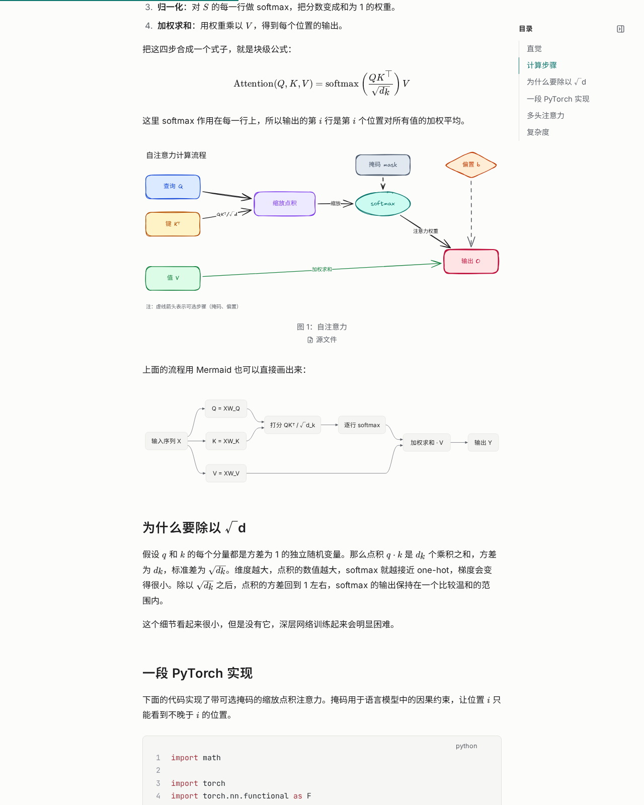
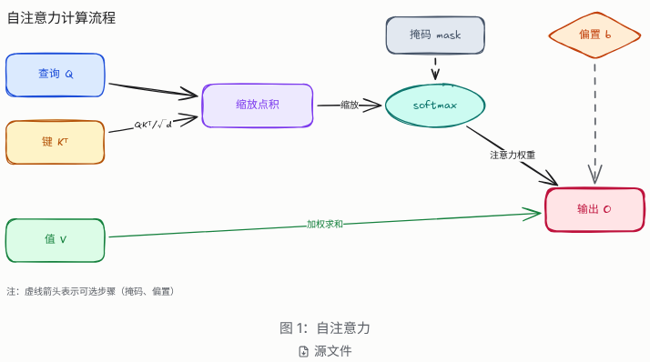
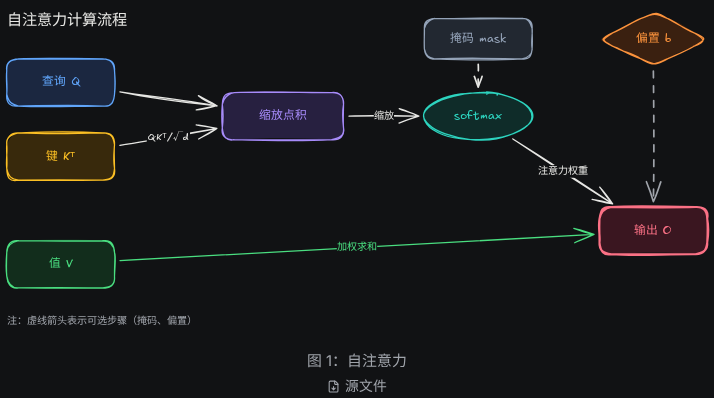
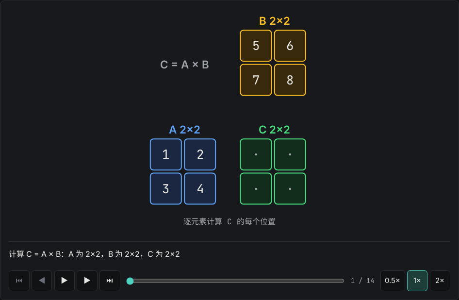
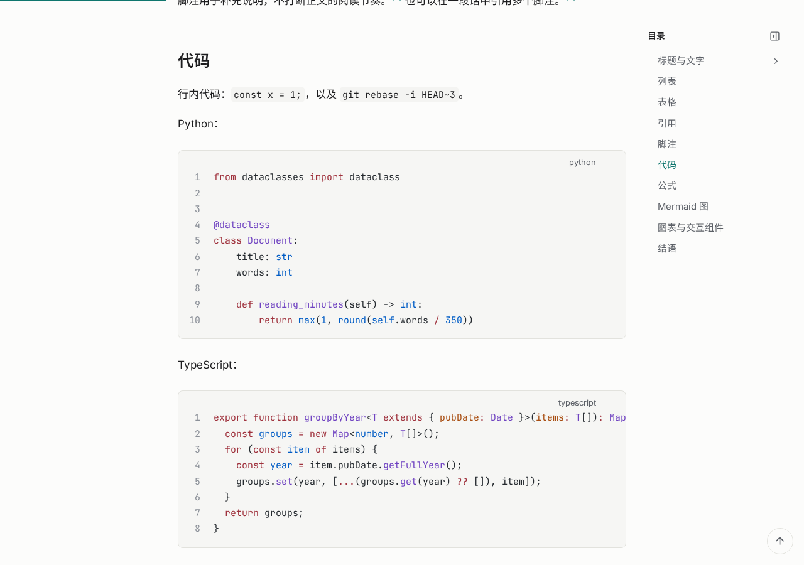
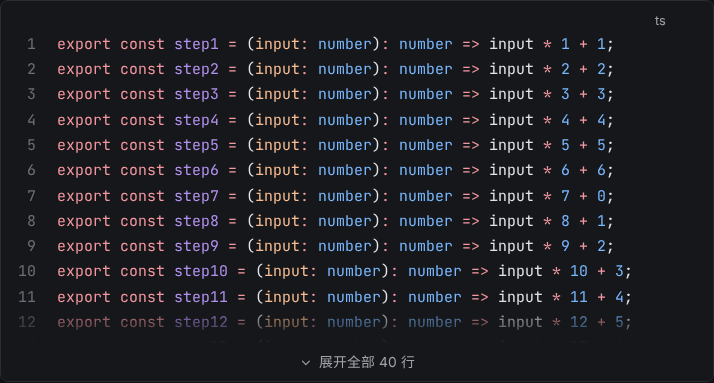
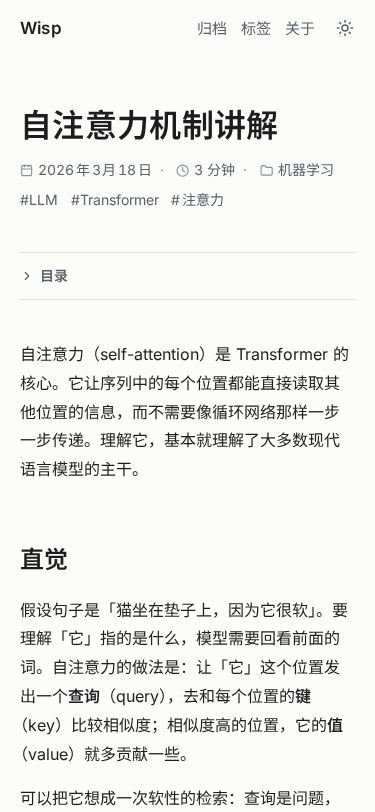
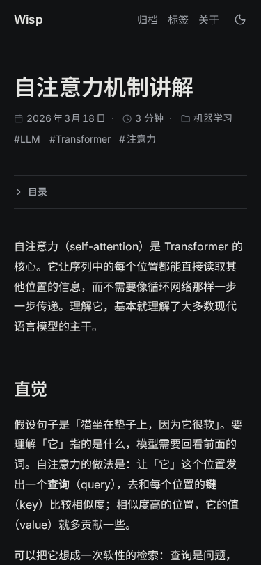

# Wisp

**安静好读的技术博客主题。**

Wisp 基于 Astro 7、Tailwind CSS 4 和 MDX 构建，默认零 JavaScript。它专注于文字的阅读体验：中文排版、代码与公式、构建期生成的图表，以及少量按需加载的交互讲解。

## 截图

<p align="center">
  
  
</p>

<p align="center">
  
</p>

<p align="center">
  
  
</p>

<p align="center">
  
</p>

<p align="center">
  
  
</p>

<p align="center">
  
  
</p>

## 特性

- **Markdown / MDX**：标准 Markdown 与 MDX，脚注、任务列表、表格、标题锚点和目录。
- **公式**：KaTeX，构建期渲染，只有含公式的文章才加载样式。
- **代码**：Shiki 双主题（浅色、深色自动切换），可选行号和一键复制；超过 24 行的代码块默认折叠，可用 `fold` / `nofold` / `fold=N` 单独控制。
- **阅读体验**：宽屏目录可收起并记住状态，h3 分组随阅读位置自动展开；顶部阅读进度条、返回顶部按钮；Lucide 图标（构建期内联）；滚动条随主题配色。
- **Mermaid**：由 [Pele](https://www.npmjs.com/package/pele) 在构建期渲染为内联 SVG，运行时没有 Mermaid.js。
- **图表**：Excalidraw 与 draw.io 源文件经 `pnpm diagram build` 生成可移植、可主题化的 `.wisp.svg`，读者可以下载源文件。
- **交互讲解**：React 19 + Motion 组件（如矩阵乘法逐步演示），以 island 形式按需水合。
- **主题**：浅色、深色、跟随系统三态切换，首屏无闪烁。
- **中文排版**：思源黑体（Noto Sans SC）按 unicode-range 分片自托管，中英文间距自动处理，不做负字距。
- **订阅与搜索引擎**：RSS（默认全文）、Sitemap。
- **无障碍**：跳转链接、语义化结构、键盘可操作的交互组件、尊重 `prefers-reduced-motion`。
- **默认零 JS**：只有主题切换、代码复制等小脚本，以及用到的交互组件才加载 JavaScript。

## 快速开始

环境要求：**Node.js ≥ 22.23.4** 和 **pnpm**。

用模板创建新站点：

```bash
npm create astro@latest -- --template xingcanlee/astro-wisp
```

或者克隆本仓库开发：

```bash
git clone https://github.com/xingcanlee/astro-wisp.git
cd astro-wisp
pnpm install
pnpm dev        # 本地预览，http://localhost:4321
```

更多步骤见 [docs/guide/getting-started.md](docs/guide/getting-started.md)。

## 写一篇文章

每篇文章是 `src/content/posts/` 下的一个目录，入口为 `index.mdx`（或 `index.md`）；也可以直接放一个单文件 `<slug>.md`。

```text
src/content/posts/
└─ my-first-post/
   ├─ index.mdx          # 正文
   ├─ diagrams/          # 图表源文件（.excalidraw / .drawio）和生成的 .wisp.svg
   └─ images/            # 图片
```

frontmatter 字段（以 `src/content.config.ts` 为准）：

| 字段 | 类型 | 必填 | 默认值 | 说明 |
|---|---|---|---|---|
| `title` | string（≤ 80 字） | 是 | — | 标题 |
| `description` | string（≤ 200 字） | 是 | — | 摘要，用于列表和 SEO |
| `pubDate` | 日期 | 是 | — | 发布日期 |
| `updatedDate` | 日期 | 否 | — | 更新日期 |
| `tags` | string[] | 否 | `[]` | 标签 |
| `category` | string | 否 | — | 分类 |
| `draft` | boolean | 否 | `false` | 草稿，生产构建中不出现 |
| `featured` | boolean | 否 | `false` | 出现在首页精选 |
| `cover` | 图片 | 否 | — | 封面图 |
| `lang` | string | 否 | — | 文章语言，覆盖站点语言 |
| `toc` | boolean | 否 | `true` | 是否显示目录 |

文章 id 即目录名（`my-first-post`），URL 为 `/posts/my-first-post/`。完整写作说明见 [docs/guide/writing.md](docs/guide/writing.md)。

## 图表

三种图表各有分工：

| 场景 | 方式 | 源文件 |
|---|---|---|
| 流程图、时序图、状态图等结构化图 | Mermaid 代码块 | 无（正文中直接写） |
| 概念图、示意图（手绘风格） | Excalidraw | `*.excalidraw`（JSON） |
| 精确排版的结构图、多页架构图 | draw.io | `*.drawio`（未压缩 XML） |

Mermaid：

````markdown

````

Excalidraw 或 draw.io，使用标准图片语法引用源文件：

```markdown


```

- alt 文本写入 SVG 的 `<title>`（无障碍名称），应描述图要表达的结论。
- 引号中的文字成为图注。
- `#page=` 选择 draw.io 的页面，可以用页面名或从 1 开始的序号。
- 页面底部会显示“源文件”下载链接，`.excalidraw` 和 `.drawio` 都可以直接下载后再编辑。

修改源文件后执行：

```bash
pnpm diagram build      # 增量生成 .wisp.svg，并更新 scripts/diagram/manifest.json
pnpm diagram check      # 只校验哈希，CI 中使用，不需要浏览器
```

`pnpm diagram` 转调 skill 的 Python 脚本（`uv run skills/wisp-diagram/scripts/wisp_diagram.py`），需要安装 [uv](https://docs.astral.sh/uv/)；构建与导出还需要 Chromium（`uv run --with playwright==1.64.1 playwright install chromium`）。

`.wisp.svg`、源文件和 `manifest.json` 都要提交进仓库。图表的完整说明见 [docs/guide/diagrams.md](docs/guide/diagrams.md)，Agent 绘图流程见 [skills/wisp-diagram/SKILL.md](skills/wisp-diagram/SKILL.md)。

## 交互组件

交互讲解组件是 React 组件，在 MDX 中导入后使用，建议加上 `client:visible`：

```mdx
import MatMul from '@/explainers/react/MatMul';

<MatMul client:visible a={[[1,2],[3,4]]} b={[[5,6],[7,8]]} />
```

当前内置 `MatMul`（矩阵乘法）。新增组件的约定见 [docs/guide/explainers.md](docs/guide/explainers.md)。

## 配置

站点配置位于 `src/wisp.config.ts`，使用 `defineWispConfig()`，未写的字段使用默认值。主要选项：

| 选项 | 类型 | 默认值 | 说明 |
|---|---|---|---|
| `site.title` | string | `Wisp` | 站点标题 |
| `site.description` | string | `安静好读的技术博客` | 站点描述 |
| `site.author` | string | `""` | 作者 |
| `site.lang` | string | `zh-CN` | 站点语言 |
| `site.url` | string | `https://example.com` | 正式域名，用于 Sitemap、RSS 和 draw.io 链接 |
| `nav` | `{label, href}[]` | 归档、标签、关于 | 顶部导航 |
| `social` | `{kind, href, label?}[]` | RSS | 社交链接，`kind` 可选 github、x、mastodon、bluesky、email、rss、link |
| `home.featuredCount` | 整数 ≥ 0 | `3` | 首页精选篇数 |
| `home.pageSize` | 整数 ≥ 1 | `10` | 列表每页篇数 |
| `features.codeCopy` | boolean | `true` | 代码块复制按钮 |
| `features.lineNumbers` | boolean | `true` | 代码块行号 |
| `features.math` | boolean | `true` | KaTeX 公式 |
| `features.mermaid` | boolean | `true` | Mermaid（Pele）渲染 |
| `features.toc` | boolean | `true` | 文章目录 |
| `features.diagramDownload` | boolean | `true` | 图表源文件下载 |
| `mermaid.strict` | boolean | `false` | `true` 时 Mermaid 渲染失败使构建失败 |
| `rss.fullText` | boolean | `true` | RSS 输出全文；`false` 只输出摘要 |
| `taxonomy.slugMap` | Record<string, string> | `{}` | 覆盖标签、分类的 URL 段 |

数组（如 `nav`、`social`）整体替换，对象逐字段深度合并。非法值会在启动时报错并指出字段路径。完整说明见 [docs/guide/configuration.md](docs/guide/configuration.md)。

## 命令

| 命令 | 说明 |
|---|---|
| `pnpm dev` | 启动开发服务器 |
| `pnpm build` | 构建静态站点到 `dist/` |
| `pnpm preview` | 预览构建产物 |
| `pnpm check` | `astro check` + `tsc` + vitest + 对比度检查（质量门禁） |
| `pnpm test` | 运行 vitest 单元测试 |
| `pnpm test:e2e` | 运行 Playwright 端到端测试 |
| `pnpm tokens` | 根据 `design/palette.json` 重新生成令牌 CSS |
| `pnpm contrast` | 检查调色板的对比度 |
| `pnpm diagram <子命令>` | 图表工具，见下表 |

图表子命令（`pnpm diagram`）：

| 子命令 | 说明 |
|---|---|
| `build [路径...] [--force] [--embed-fonts] [--fix] [--drawio cli\|docker\|browser]` | 增量构建源文件为 `.wisp.svg` |
| `check` | 校验 manifest 哈希是否与源文件一致（CI 用，失败退出码 1） |
| `lint [文件...] [--fix] [--strict]` | 检查颜色、字号、网格、字体、文件大小 |
| `export <文件> [--png] [--theme light\|dark] [--scale 2] [-o out.png] [--transparent]` | 导出 PNG 预览（或发布到不支持 SVG 的平台） |
| `new <skeleton.json> [-o out.excalidraw] [--build]` | 由骨架 JSON 生成 `.excalidraw`，可选立即构建 |
| `probe` | 显示 Chromium、Excalidraw 与 draw.io 导出方式（cli / docker / browser）的探测结果 |
| `cache [status\|warm\|clear]` | 查看、预热（离线使用前）或清空导出资源缓存 `~/.cache/wisp-diagram/` |

## 设计令牌

所有颜色只来自 [`design/palette.json`](design/palette.json)，它是唯一的事实来源。`src/wisp/styles/tokens.css`、Pele 映射、图表的 `--wd-*` 映射和 Excalidraw/draw.io 素材库都由它生成。

修改 `design/palette.json` 后执行：

```bash
pnpm tokens
```

不要手改生成文件，也不要在组件中写十六进制颜色。设计规范见 [docs/design-system.md](docs/design-system.md)。

## 给 AI Agent

本仓库为 AI 编码 Agent 准备了三类材料：

- **[CLAUDE.md](CLAUDE.md)**：Claude Code 读取的项目规则，包括颜色规则、生成文件、中文排版规则和常用命令。
- **[docs/](docs/)**：设计文档，覆盖架构、图表体系、交互组件和任务拆分。`docs/README.md` 是入口。
- **[skills/wisp-diagram](skills/wisp-diagram/)**：一个独立的 Agent skill，用于产出符合 Wisp 风格的 Excalidraw / draw.io 图表。脚本是 Python + uv（PEP 723 内联依赖），`uv run` 即可运行；不依赖 Wisp 站点，可以复制到其他项目使用。
- **[skills/wisp-writer](skills/wisp-writer/)**：写作 skill。提供写作规范、5 种文章模板、`new_post.py`（新建文章）和 `check_post.py`（检查 frontmatter、标题层级、alt、图表引用、半角标点等），让 Agent 写出风格一致的文章。

使用 skill 时，把目录复制到用户级 skills 目录即可：

```bash
mkdir -p ~/.claude/skills
cp -r skills/wisp-diagram ~/.claude/skills/
```

也可以复制到其他项目的 `.claude/skills/` 下。skill 的脚本用 Python 编写、依赖写在脚本头部（PEP 723），只要装了 [uv](https://docs.astral.sh/uv/) 就能直接运行，无需安装步骤：

```bash
uv run ~/.claude/skills/wisp-diagram/scripts/wisp_diagram.py --help
uv run --with playwright==1.64.1 playwright install chromium   # 导出用的浏览器，装过可跳过
```

首次导出时会把锁定版本的 Excalidraw、svgo 和字体下载到 `~/.cache/wisp-diagram/`，之后可离线使用（详见 skill 的 SKILL.md）。

## 项目结构

```text
astro-wisp/
├─ src/
│  ├─ wisp.config.ts      # 站点配置
│  ├─ content/posts/      # 文章（每篇一个目录）
│  ├─ wisp/               # 主题核心：配置、集成、插件、组件、样式
│  ├─ explainers/         # 交互讲解组件（core 纯 TS，react 渲染层）
│  └─ layouts/ pages/     # 布局与路由
├─ design/palette.json    # 设计令牌（唯一来源）
├─ scripts/               # gen-tokens、diagram CLI、对比度检查
├─ skills/wisp-diagram/   # 图表 Agent skill（可独立分发）
└─ docs/                  # 设计文档；docs/guide/ 为使用指南
```

## 技术栈

Astro 7（Node ≥ 22.23.4）· MDX 8 · React 19 · Tailwind CSS 4 · Pele 1.13（Mermaid）· KaTeX 0.19 · Motion 14 · Shiki。图表工具是 Python 脚本，用 uv 运行，导出依赖 Playwright Chromium，可选 draw.io desktop 或 Docker。架构说明见 [docs/architecture.md](docs/architecture.md)，依赖列表见 [package.json](package.json)。

## 文档

- [快速开始](docs/guide/getting-started.md)
- [写作指南](docs/guide/writing.md)
- [图表指南](docs/guide/diagrams.md)
- [交互组件](docs/guide/explainers.md)
- [配置参考](docs/guide/configuration.md)
- [部署](docs/guide/deployment.md)

## 许可证

[MIT](https://opensource.org/licenses/MIT)
