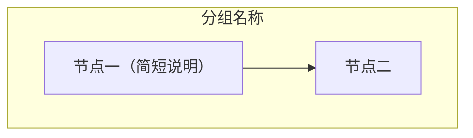

# 图表选型与制作工作流（infra-note）

新增或修改全站图表前先读本文。全站统一采用 **Pele（Mermaid）+ 单源 `.drawio` / `.excalidraw` + 交互 `<Explainer>`**，不维护任何 Python 绘图生成框架；每张新增或修改的静态图必须导出真实 PNG 目视确认无重叠。

---

## 1. 四选一路由决策标准

先选工具再动笔，**严禁把简单流程图硬塞进手动坐标 XML**：

| 图表类型                                                              | 首选工具               | 产物形式                          | 说明                                                                                                                                                                         |
| :-------------------------------------------------------------------- | :--------------------- | :-------------------------------- | :--------------------------------------------------------------------------------------------------------------------------------------------------------------------------- |
| 流程、分层栈、双端对照、状态转换、模块调用、排障决策树                | **Pele（Mermaid）**    | `.mdx` 内联 ` ```mermaid ` 代码块 | 自动布局、零坐标心算；构建期转主题化 SVG                                                                                                                                     |
| LLM 论文级结构图、硬件泳道、矩阵/掩码网格、等比时间线、频谱图、坐标系 | **单源 `.drawio`**     | `.drawio` + `.wisp.svg`           | 直接写未压缩 XML 或在 Draw.io 桌面端配合 `wisp-drawio-library.xml` 拖拽编辑，再跑 `pnpm diagram lint --fix` 吸附配色与网格；重复格子可用一次性临时脚本算坐标，用完即删不入库 |
| 局部直觉对照、`<= 3` 跳指针映射、比特位宽对照                         | **单源 `.excalidraw`** | `.excalidraw` + `.wisp.svg`       | 通过 `wisp_diagram.py new` 由骨架生成一次后以 `.excalidraw` 为准                                                                                                             |
| 矩阵演化、注意力掩码步进、多步离散寻址、`> 3` 拍时序推演              | **交互 `<Explainer>`** | 文章私有 `explainers/*.tsx`       | 用 `BeatExplainer` 因果节拍驱动                                                                                                                                              |

---

## 2. Pele（Mermaid）写作规范

在 `.mdx` 中直接嵌入代码块，构建期由 `remark-pele` 转为内联主题化 SVG：

````mdx

````

约束：

- 节点数 `<= 12`，优先纵向（`TB`）或双列并排，保证正文栏内字号清晰；
- 节点与子图标签一律使用双引号包裹 `N1["..."]`；
- **公式划界**：数学符号与公式在节点/边标签内统一使用 `$$...$$`（如 `A["闪电索引器 $$I_{t,s}$$"]`），禁止裸写带花括号的 TeX 下上标（如 `I_{t,s}`、`H_{L/2}`）；纯代码/API 标识符保持普通文本；
- **禁止**手写 `style`、`classDef`、`%%{init}%%` 颜色覆盖；
- 遵守全站文风（无感叹号 `!`/`！`、无直角引号 `「」『』`、不将算子统称为“内核”）。

---

## 3. Draw.io 论文配图美学规范

所有静态 `.drawio` 遵循以下 6 条准则（参考 `src/content/posts/deepseek/07-engram/` 标杆图与 `wisp-drawio-library.xml` 元件库）：

1. **画布上下限与纵向扩容**：画布自然宽度严格控制 `<= 704px`（`lint` 上限 `720px`，带目录/系列栏文章 `.wisp-wide` 也会贴齐 ~710px 栏宽），严格对齐 `8px` 网格；**高度没有上限**（推荐 `320–760px`），禁止为了迁就单屏高度而压扁节点或硬塞“二合一”大图，复杂流程拆成两张独立小图。跨区连线走干净外侧走廊，不穿过第三个节点或分组标题栏；正交折线默认使用 `edgeStyle=orthogonalEdgeStyle;rounded=1;orthogonalLoop=1;jettySize=auto;`。
2. **字号层级、内边距与 MathJax 缩放**：核心节点与分组标题用 `12px`，辅助信息（边标签、坐标刻度、字节条标注、微缩网格字、底部说明）用 `11px`（合法范围 `12 ± 1`）；常规节点使用 `spacing=6`（分组标题 `spacingTop=8`），单行节点最低 `32px`（推荐 `36–40px`），双行卡片 `56–64px`，禁用 `16px`/`24px` 扁框放文字。站点通过 `src/styles/custom.css` 与 `wisp-diagram` 导出器对 `.wisp-diagram-body mjx-container` 设 `font-size: 0.85em`，抵消 Inter 超高 x-height（`0.545em`）相对于 MathJax SVG `ex` 基准（`0.442em`）造成的 `+23%` 视觉放大。
3. **中性底框 + 最多 3 种语义色**：外层分组容器优先中性灰淡底（`#f4f4f2` / `#e2e2dd`）或单一主色淡底，每图非 slate 色调 `<= 3` 种；重点输出靠加粗描边（`strokeWidth=2`）或虚线区分。
4. **几何编码信息，拒绝大段文字框**：善用梯形投影（`shape=trapezoid`）、算子圆（`orEllipse` ⊕ / `sumEllipse` ⊗ / `ellipse` ·）、圆柱存储（`shape=datastore`）、菱形路由（`shape=rhombus`）、叠卡（`opacity=50` 偏移 `+8,-8`）、紧凑 `16×16` 微缩矩阵块、MoE 竖向专家条带等论文级图形直接表达张量切分、维度变化与算子作用。
5. **公式与模块名划界**：含 `\(...\)` MathJax 公式的页面设置 `math="1"`；公式不自动换行，框宽预留余量。
6. **避让连线标签**：节点间距 `< 64px` 或长直角边标签优先拆成独立 `text` 标签摆在留白侧边，禁止把标签压在水平/垂直线中间或与箭头头部重合。
7. **禁止横向花括号**：`shape=curlyBracket` 仅用于左右竖向标注；上下横向分组改用虚线横条或分组标题。

---

## 4. 新增或修改静态图的标准 4 步流程

1. **直接创建/编辑单源 `.drawio`**
   - 在 Draw.io 桌面端导入 `node_modules/astro-wisp/skills/wisp-diagram/assets/wisp-drawio-library.xml` 作画（保存前在 File → Properties 取消勾选 Compressed），或直接编辑未压缩 `.drawio` XML；
   - 运行修复命令自动吸附调色板、去阴影渐变与格式规范：
     ```bash
     pnpm diagram lint path/to/diagram.drawio --fix
     ```
2. **构建 SVG 并同步清单**
   ```bash
   pnpm diagram build
   pnpm diagram lint --strict
   ```
   确认 `0 error(s), 0 warning(s)` 且 `diagrams.manifest.json` 无孤儿记录。
3. **导出明暗 PNG 实图目视验收（必做）**
   `lint --strict` 只检查颜色、字号、网格与总宽，**不检测文字重叠或箭头穿盒**。每次改图必须导出明暗双主题 PNG 到系统临时目录逐张确认：
   ```bash
   W="node_modules/astro-wisp/skills/wisp-diagram/scripts/wisp_diagram.py"
   uv run $W export src/content/posts/<path>/diagrams/<name>.wisp.svg --theme light -o "$TEMP/<name>.light.png"
   uv run $W export src/content/posts/<path>/diagrams/<name>.wisp.svg --theme dark  -o "$TEMP/<name>.dark.png"
   ```
   检查组标题不被压住、文字不折行溢出、箭头不穿盒、暗色模式对比清晰。临时 PNG 不提交进仓库。
4. **文章引用与全仓门禁**
   - `.mdx` 中引用源文件：``；
   - 运行最终门禁：
     ```bash
     pnpm format
     pnpm check
     uv run node_modules/astro-wisp/skills/wisp-writer/scripts/check_post.py --all --strict
     pnpm build
     ```
