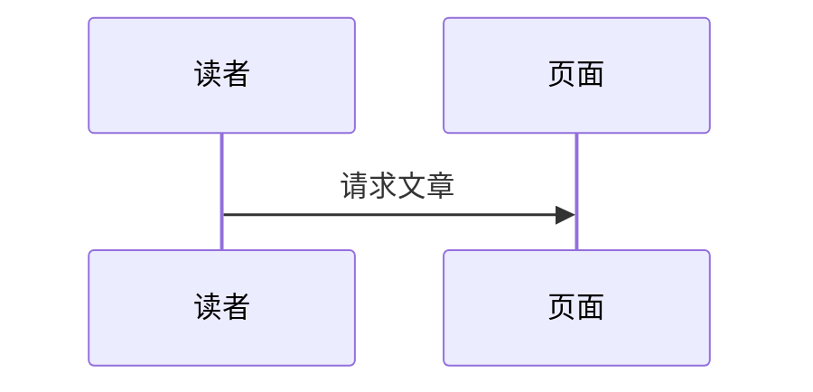

# 写作指南

本文介绍如何在 Wisp 中写文章：frontmatter 字段、Markdown 与 MDX 的区别、公式、代码块、脚注和中文写作建议。

## 文章结构

每篇文章是 `src/content/posts/` 下的一个目录：

```text
src/content/posts/my-post/
├─ index.mdx        # 正文（也可以是 index.md）
├─ diagrams/        # 图表源文件和生成的 .wisp.svg
└─ images/          # 图片
```

目录名就是文章的 id，URL 为 `/posts/my-post/`。也可以只放一个单文件 `src/content/posts/my-post.md`，它的 id 同样是 `my-post`。

## frontmatter

文件开头用 `---` 包裹的 YAML 是 frontmatter。字段定义在 `src/content.config.ts` 中：

```yaml
---
title: "自注意力机制讲解"
description: "从直觉到公式，逐步讲清楚自注意力的计算过程。"
pubDate: 2026-03-18
updatedDate: 2026-04-01    # 可选
tags: [LLM, Transformer]   # 可选，默认 []
category: 机器学习          # 可选
featured: true             # 可选，出现在首页精选
draft: false               # 可选，草稿不会出现在生产构建中
toc: true                  # 可选，是否显示目录
---
```

| 字段 | 必填 | 约束与说明 |
|---|---|---|
| `title` | 是 | 最多 80 个字符 |
| `description` | 是 | 最多 200 个字符，显示在列表页和 RSS 中 |
| `pubDate` | 是 | 日期，如 `2026-03-18` |
| `updatedDate` | 否 | 显示在文章页的更新时间 |
| `tags` | 否 | 字符串数组，默认 `[]` |
| `category` | 否 | 字符串 |
| `draft` | 否 | 默认 `false`；`true` 时生产构建不包含该文章 |
| `featured` | 否 | 默认 `false`；`true` 时出现在首页精选区 |
| `cover` | 否 | 封面图片 |
| `lang` | 否 | 文章语言，覆盖站点的 `site.lang` |
| `toc` | 否 | 默认 `true`；设为 `false` 时不显示目录 |

标签和分类的 URL 段由名字生成：小写、空格转 `-`，中文保留。需要改写时使用 `taxonomy.slugMap`，见 [配置参考](./configuration.md)。

## Markdown 与 MDX

- **`.md`**：标准 Markdown，不能写组件。
- **`.mdx`**：Markdown 加上 JSX。可以 `import` 组件并在正文中使用。

两者的 Markdown 语法完全相同。如果文章不需要组件，使用 `.md` 即可。

## 常用语法

### 标题与目录

使用 `##` 和 `###` 生成目录项。`#` 留给文章标题（由 frontmatter 的 `title` 生成），正文中不要再写一级标题。

### 代码块

````markdown
```typescript
export const answer = 42;
```
````

- 代码块默认带行号和复制按钮，可以在 `wisp.config.ts` 中关闭（`features.lineNumbers`、`features.codeCopy`）。
- 语言名使用 Shiki 支持的标识，如 `python`、`typescript`、`bash`、`json`、`diff`。
- `diff` 代码块中，以 `+` 和 `-` 开头的行会被标记为增删行。
- 行内代码用反引号包裹。

### 公式

使用 KaTeX 语法：

```markdown
行内公式：$E = mc^2$。

$$
\operatorname{Attention}(Q, K, V) = \operatorname{softmax}\left(\frac{QK^\top}{\sqrt{d_k}}\right)V
$$
```

- 行内用 `$...$`，块级用独立成行的 `$$...$$`。
- 只有文章中包含公式时才会加载 KaTeX 样式，没有公式的页面不增加字体和样式负担。
- 关闭公式功能：`features.math: false`。

### 脚注

```markdown
这是一个需要补充说明的论断。[^1]

[^1]: 脚注内容显示在文章底部。
```

### 任务列表

```markdown
- [x] 已完成
- [ ] 待办
```

### 表格、引用与分隔线

标准 GFM 语法即可。引用块使用 muted 颜色的左边框，不使用斜体。

### Mermaid 图表

````markdown

````

Mermaid 代码块在构建期由 Pele 渲染为内联 SVG，没有运行时代码。Mermaid 渲染失败时，开发环境会退化为普通代码块并打印警告；`mermaid.strict: true` 时构建会失败。布局与 Mermaid.js 略有不同。

### 图片与图表

普通图片使用标准语法：

```markdown

```

`.excalidraw` 和 `.drawio` 源文件的引用方式不同，会被渲染为内联 SVG。见 [图表指南](./diagrams.md)。

### 交互组件（MDX）

在 `.mdx` 中导入并使用，见 [交互组件](./explainers.md)。

## 中文写作建议

- **不需要手动加空格**：中英文之间、数字与中文之间的间距由 CSS 的 `text-autospace` 属性自动处理（支持该属性的浏览器生效）。直接写 `使用 Astro 构建` 即可。
- **强调用粗体**：`**关键词**` 在中文中很清楚。中文不要用斜体，主题也不会为中文渲染斜体。西文强调如 *emphasis* 会保持斜体。
- **标点使用全角**：中文段落用全角标点，代码和英文用半角。
- **段落不做缩进**：段间距由样式控制，不要用全角空格缩进。
- **摘要要具体**：`description` 会出现在列表和 RSS 中，写清楚文章解决什么问题。
- **链接写完整文字**：避免“点击这里”，使用能说明目标内容的链接文字。

## 预览

```bash
pnpm dev
```

开发服务器会热更新文章。图表源文件修改后，需要运行 `pnpm diagram build` 才会更新 `.wisp.svg`。
