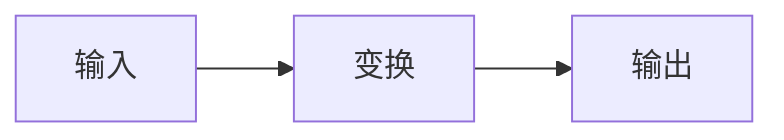

---
title: {{title}}
description: {{description}}
pubDate: {{pubDate}}
{{tags_line}}{{category_line}}{{draft_line}}---

TODO：开头一段。先给出结论或要回答的问题，再说为什么值得弄清楚。

## 直觉

TODO：不用公式，用一个具体例子说明核心想法。

## 形式化定义

TODO：给出符号约定，行内公式如 $x \in \mathbb{R}^{n}$，然后给出核心公式：

$$
y = f(x; \theta) = \sigma\left(Wx + b\right)
$$

其中 TODO：逐个解释符号。

## 计算流程

TODO：用 Mermaid 画简单流程，复杂的概念图调用 wisp-diagram skill。



{/* 概念图示例，源文件放在 ./diagrams/ 并构建后再取消注释：

*/}

## 实现

TODO：给出最小实现，并说明关键行。

```python
import math


def scaled(x: float, d: int) -> float:
    """TODO：与上文公式对应的实现。"""
    return x / math.sqrt(d)
```

## 为什么这样设计

TODO：讨论取舍、边界条件和失败的情形。用表格对比几种方案时，列数不超过 4。

| 方案 | 优点 | 代价 |
|---|---|---|
| TODO | TODO | TODO |

## 小结

TODO：三句话以内的回顾，必要时指向延伸阅读。
