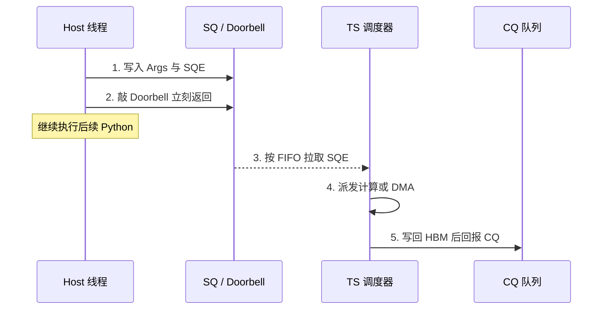
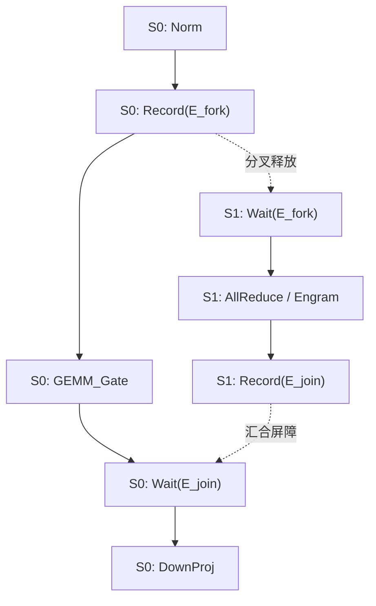

import StreamEventPipelineExplainer from '../../../../explainers/aclgraph/StreamEventPipelineExplainer';

在现代 GPU（Graphics Processing Unit，图形处理器）或昇腾 NPU（Neural Processing Unit，神经网络处理器）计算卡上，执行张量计算的算力核心与运行 PyTorch 解释器的主机 CPU 分处总线的物理两侧，单次跨 PCIe 或高速内部总线的控制开销以微秒计。**Asynchronous Execution Model（异步执行模型）**通过主机与设备的指令队列解耦，避免了 CPU 每发一个算子都要原地休眠等待完成，使主机侧发射逻辑与设备侧流水计算得以同时推进。

## 主机与设备解耦后的队列通道架构

异构运行时软件栈（CUDA Runtime 与 CANN Runtime）在主从两侧维护一对环形队列通道，以“提交描述符—硬件消费—回写回执”的方式运作[^cann-model]：

- **CANN 侧入队链路**：主机通过 `aclnnMatMul` 等接口经宿主缓冲 **TaskQueue** 组装定长 **SQE（Submission Queue Entry，提交队列条目）**写入物理 **SQ（Submission Queue，硬件提交队列）**，随后写 **Doorbell（门铃寄存器）**立即返回，由设备端 **TS（Task Scheduler，任务调度器）**固件异步拉取并在执行完成后回写 **CQ（Completion Queue，完成队列）**。
- **CUDA 侧入队链路**：主线程将 Launch Packet 顺序写入锁页内存映射的 **Pushbuffer**，推前写指针后即把控制权交回 Python，由显卡前端调度引擎在后端按序消费并回报完成事件。
- **异步发射红利**：只要硬件队列积压着足够多的待执行 SQE，单次 `T_launch`（约十微秒）即可支撑计算核心持续满载运行，消除算子间的串行等待。




### 硬件物理队列容量与隐式默认流陷阱

芯片内部的物理队列槽位是稀缺硬件资源，在 CANN 源码与官方管理规范中有明确上限约束[^sqcq-cap][^stream-doc]：

| 硬件平台与层级           | 容量上限与约束                       | 对图捕获与并发调度的影响     |
| ------------------------ | ------------------------------------ | ---------------------------- |
| CANN Runtime 池级常量    | `RT_DEVICE_SQCQ_RES_MAX_NUM = 1024U` | 超限触发 `207008` 资源报错   |
| Atlas A2 / A3 / 950PR/DT | 单卡上限 `1984` 条逻辑 Stream        | 需控制计算/通信流总数        |
| Atlas 推理 / 200I/500 A2 | `1024` / `512` 条 Stream             | 边缘节点须稀疏分桶并及时释放 |

除物理数量上限外，工程师在多流开发初期还必须规避 **Default Stream（隐式默认流）**的三项风险：

- **缺乏优先级与线程隔离**：多线程共用默认流时，执行次序直接受制于宿主线程抢占调度，极易引发难以复现的任务交织。
- **Stream Capture 校验拦截**：后续静态图录制机制默认禁止把全局默认流直接纳入捕获取样视野。
- **推荐工程规范**：启动阶段通过 `aclrtCreateStream`（或 `torch.npu.Stream()`）显式划分计算流、通信流与预取流并传递句柄。

## 单流顺序保证与多流并发竞态机理

**同一条 Stream 内部严格奉行 FIFO（First-In First-Out，先进先出）语义**：只要先后写入 SQ0，设备调度器必然在 $K_1$ 完全写回 **HBM（High Bandwidth Memory，高带宽显存）**后才启动 $K_2$，单流内连续算子无需额外插入同步屏障。

而在分布式推理与异构卸载场景（如 **DeepSeek-V4.1-Flash** 在第 1、14 层使用后台流异步搬运 **Engram** 条件记忆表并重叠 HCCL/NCCL AllReduce[^v41-stream]）中，计算与通信任务分散在不同独立 SQ 中。**两条独立硬件队列允许按各自空闲状态并发执行**——若缺失显式因果依赖边，后入队的消费者流极可能抢先读走尚未写完的脏显存。

<StreamEventPipelineExplainer
  client:visible
  title="图 3：主机异步入队、单流顺序执行、双流竞态与 Event 跨流协同时序推演"
/>

### Event、Notify、ExternalEvent 与 Fork-Join 多流模型

跨流编排因果顺序应避免退化为阻塞整条 CPU 线程的 `aclrtSynchronizeStream`，而是选用运行在设备控制面的轻量信号原语[^event-doc][^notify-doc][^torch-streams]：

| 原语类型      | 核心 API（CANN / PyTorch）                  | 单卡上限（A2 / 950） | 作用与同步阻断行为        |
| ------------- | ------------------------------------------- | -------------------- | ------------------------- |
| Stream Sync   | `aclrtSynchronizeStream` / `.synchronize()` | 依附 Stream          | 阻塞 CPU 线程等 CQ 返回   |
| Event         | `aclrtRecordEvent` / `aclrtStreamWaitEvent` | 65536                | 跨流边，仅阻断设备目标流  |
| Notify        | `aclrtRecordNotify` / `WaitAndResetNotify`  | 8192 / 65535         | 纯设备级轻量任务握手信号  |
| ExternalEvent | `torch_npu.npu.ExternalEvent`               | 捕获绑定后复用       | 跨静态图/外部更新流异步等 |

多流协作在生产中几乎统一收拢为封闭有向无环的 **Fork-Join 模型**，这也是唯一能被 CUDA Graph 与 ACL Graph 完整吸收的多流结构：主分支产生前置结果后发射 `Record(E_fork)` 放行旁路通信/预取流，并在旁路算子收尾前通过 `Record(E_join)` 与主分支 `Wait(E_join)` 重新汇合。



## Host-bound 气泡公式与定量仿真验证

Prefill 阶段算子耗时达毫秒级，通常处于 Compute-bound 或 Memory-bound；进入小批量 Decode 后，单个微算子执行时长降至 3–5 微秒，而主机单次派发耗时达 10–15 微秒，系统落入 **Host-bound** 区间。对包含 $K$ 个算子的顺序单流，稳态步骤耗时与硬件有效占空比满足：

$$
T_{\text{step}} \approx T_{\text{launch}} + (K - 1)\max(T_{\text{launch}},\, T_{\text{kernel}}) + T_{\text{kernel}}
$$

$$
\begin{aligned}
\eta_{\text{active}} &= \frac{K \cdot T_{\text{kernel}}}{T_{\text{step}}} \\
\text{BubbleRatio} &= 1 - \eta_{\text{active}}
\end{aligned}
$$

只要出现 $T_{\text{launch}} > T_{\text{kernel}}$，硬件队列就会在上一个 Kernel 收尾后暴露出空闲气泡。下面的纯 CPU 仿真脚本按事件时钟核算出单流气泡与双流 Fork-Join 重叠收益：

```python
from dataclasses import dataclass


@dataclass
class Task:
    name: str
    stream: str
    dur_us: float
    enqueue_us: float = 0.0
    wait_event: str | None = None
    record_event: str | None = None


def simulate_streams(
    tasks: list[Task], launch_us: float = 12.0, sync_at_end: bool = True
) -> dict:
    host_clk = 0.0
    stream_avail: dict[str, float] = {}
    event_ready: dict[str, float] = {}
    timeline = []
    race_detected = False

    for t in tasks:
        host_start = host_clk
        host_end = host_start + launch_us
        host_clk = host_end
        t.enqueue_us = host_end

        dep_ready = event_ready.get(t.wait_event, 0.0) if t.wait_event else 0.0
        if t.wait_event and t.wait_event not in event_ready:
            race_detected = True

        prev_stream_end = stream_avail.get(t.stream, 0.0)
        dev_start = max(host_end, prev_stream_end, dep_ready)
        dev_end = dev_start + t.dur_us
        stream_avail[t.stream] = dev_end

        if t.record_event:
            event_ready[t.record_event] = dev_end

        timeline.append((t.name, t.stream, host_end, dev_start, dev_end))

    total_dev_end = max(stream_avail.values())
    active_compute = sum(t.dur_us for t in tasks if t.dur_us > 0)
    sync_stall = max(0.0, total_dev_end - host_clk) if sync_at_end else 0.0
    return {
        "host_launch_total_us": host_clk,
        "dev_makespan_us": total_dev_end,
        "sync_stall_us": sync_stall,
        "overlap_efficiency": active_compute / total_dev_end,
        "race_detected": race_detected,
        "timeline": timeline,
    }


eager_single = [
    Task("Norm", "S0", 4.0),
    Task("QKV", "S0", 6.0),
    Task("RoPE", "S0", 3.0),
    Task("Attn", "S0", 8.0),
    Task("OutProj", "S0", 5.0),
]

fork_join_dual = [
    Task("Norm", "S0", 4.0, record_event="E_fork"),
    Task("GEMM_Gate", "S0", 22.0),
    Task("AllReduce_Side", "S1", 26.0, wait_event="E_fork", record_event="E_join"),
    Task("DownProj", "S0", 12.0, wait_event="E_join"),
]

res_single = simulate_streams(eager_single, launch_us=12.0)
res_dual = simulate_streams(fork_join_dual, launch_us=10.0)

print(
    f"[Single Eager] HostLaunch={res_single['host_launch_total_us']:.1f}us, "
    f"Makespan={res_single['dev_makespan_us']:.1f}us, "
    f"ActiveRatio={res_single['overlap_efficiency']:.2%}"
)
print(
    f"[Fork-Join Dual] HostLaunch={res_dual['host_launch_total_us']:.1f}us, "
    f"Makespan={res_dual['dev_makespan_us']:.1f}us, "
    f"EffectiveLoadRatio={res_dual['overlap_efficiency']:.2%}, "
    f"SyncStall={res_dual['sync_stall_us']:.1f}us"
)
for name, s, enq, st, ed in res_dual["timeline"]:
    print(f"  {name:16s} stream={s} enq={enq:5.1f}us start={st:5.1f}us end={ed:5.1f}us")
```

实测输出清晰给出两组定量对照：单流总有效算力仅 26.0 微秒却被每次 12.0 微秒发射耗时拉长至 65.0 微秒（有效占空比跌至 40.00%）；双流 Fork-Join 成功将有效载荷提升至 94.12%，且 `DownProj` 在 `E_join` 约束下精确推迟至 56.0 微秒才启动。

```text
[Single Eager] HostLaunch=60.0us, Makespan=65.0us, ActiveRatio=40.00%
[Fork-Join Dual] HostLaunch=40.0us, Makespan=68.0us, EffectiveLoadRatio=94.12%, SyncStall=28.0us
  Norm             stream=S0 enq= 10.0us start= 10.0us end= 14.0us
  GEMM_Gate        stream=S0 enq= 20.0us start= 20.0us end= 42.0us
  AllReduce_Side   stream=S1 enq= 30.0us start= 30.0us end= 56.0us
  DownProj         stream=S0 enq= 40.0us start= 56.0us end= 68.0us
```

双流并发虽能掩盖部分通信与访存耗时，仍受制于高频 Python/C++ 派发与细粒度 HBM 往返读写。[第 2 章：PyTorch 编译栈与分段融合](../02-torch-compile-fundamentals/)将分析编译器如何压缩算子数量并说明为何单靠编译优化依旧无法击穿发射墙。

[^cann-model]: 参阅 `cann/runtime`（提交 `1954820a`）官方文档 `docs/zh/quick_start/Runtime_programming_model.md`，描述主机异步入队、Stream 队列 FIFO 保证及 Event/Notify 同步。

[^sqcq-cap]: 参阅 `cann/runtime`（提交 `1954820a`）源码 `src/runtime/core/src/device/device_sq_cq_pool.hpp` 第 23 行常量 `RT_DEVICE_SQCQ_RES_MAX_NUM = 1024U`。

[^stream-doc]: 参阅 `cann/runtime`（提交 `1954820a`）API 手册 `docs/zh/api_ref/06_stream_management.md`，列出各代昇腾产品的 Stream 创建上限。

[^event-doc]: 参阅 `cann/runtime`（提交 `1954820a`）API 手册 `docs/zh/api_ref/07_event_management.md`，涵盖 `aclrtCreateEvent` 与单卡 65536 上限约束。

[^notify-doc]: 参阅 `cann/runtime`（提交 `1954820a`）API 手册 `docs/zh/api_ref/08_notify_management.md`，定义 `ACL_NOTIFY_DEVICE_USE_ONLY` 标志及单卡 8192（A2/A3）/ 65535（950）上限。

[^torch-streams]: 参阅 `Ascend/pytorch`（提交 `d09e29e4`）源码 `torch_npu/npu/streams.py` 第 180–365 行对 `Event(external=True)` 及 `ExternalEvent.reset()` 复用的说明。

[^v41-stream]: 关于 DeepSeek-V4.1-Flash 在第 1、14 层利用后台预取流与跨流事件（`cuda.Event` / `ExternalEvent`）注入 Engram 静态记忆的具体时序，见本站[10 串珠成链：从 DeepSeek-V2 到 V4.1 的单步全链路与双硬件全景](../../deepseek/10-architecture-synthesis/)。
