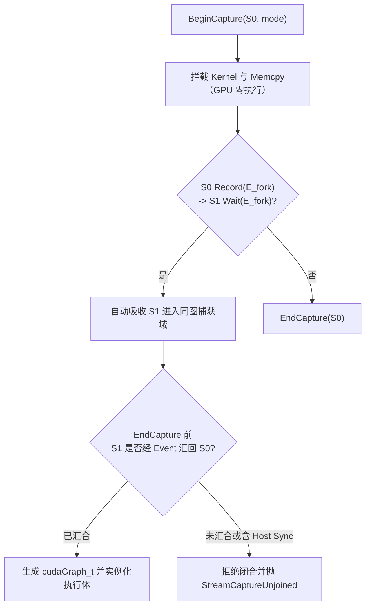

[第 2 章](../02-torch-compile-fundamentals/)证实了编译融合无法独自消灭主机发射成本。为了彻底抹平逐算子跨 PCIe 敲门的开销，**CUDA Graph（设备静态执行图）**将数百个算子及其 **DAG（Directed Acyclic Graph，有向无环图）**依赖关系预先录制为拓扑实体 `cudaGraph_t` 并实例化为 `cudaGraphExec_t`，运行时由 CPU 只发射一条 `cudaGraphLaunch` 即由设备硬件连续跑完全图。

## 为何在大模型推理中仅在 Decode 阶段启用静态图

在线大模型推理呈现鲜明的负载分化，决定静态图精准作用于自回归解码阶段：

| 对比维度     | Prefill（预填充，Eager/分块） | Decode（自回归解码，启用静态图） |
| ------------ | ----------------------------- | -------------------------------- |
| 输入形状稳定 | 随提示词波动，难以提前收敛    | 每步固定增 1 token，可离散分桶   |
| 单算子耗时   | 百微秒至毫秒级，大型矩阵饱和  | 往往数微秒，受限于访存与发射     |
| 主导系统瓶颈 | Compute-bound（算力主导）     | Host-bound（主机发射主导）       |
| 静态图收益   | 分桶 Padding 开销反超微弱收益 | 抹平数百次发射气泡，拉高解码吞吐 |

- **DeepSeek-V4.1-Flash 算力账本**：该模型采用 40 层非对称 CED 架构（552B 主干在 Decode 步仅激活 16B 参数并通过 CSA2 压缩把单 token KV 压到 890 B NVFP4[^v41-cg]）；虽然访存极轻，但单层仍包含 `Mega-mHC` 四流混合、CSA2、384 选 6 MoE 与第 1/14 层异步 Engram 等约 28 个算子（另加 3 层 DSpark 草稿头），整网单步需发射超过 1120 次 Kernel。
- **端到端收益**：按单次发射 10 微秒估算，Eager 发射墙高达 11200 微秒，远远压过 4704 微秒的设备理想算力耗时；切入一次 `cudaGraphLaunch`（约 25 微秒激发门槛）后直接消除发射气泡。

## Explicit API 与 Stream Capture 两条建图路径

CUDA 提供两种建图方式：面向底层 C++ 库的 **Explicit API** 要求调用 `cudaGraphCreate`、`cudaGraphAddKernelNode` 与 `cudaGraphAddDependencies` 手工拼装节点，难以兼容 PyTorch 上层生态；工业界（包括 PyTorch `torch.cuda.CUDAGraph`）普遍采用无侵入的 **Stream Capture（异步流录制）**[^vllm-cg-doc]。

调用 `cudaStreamBeginCapture(stream, mode)` 后，所有落入受控流的算子均**不真正在 GPU 上执行**，而是被驱动劫持转化为图节点，直到 `cudaStreamEndCapture(stream, &graph)` 校验并发依赖并输出拓扑图。多线程与多流环境下的捕获模式与跨流扩散规律如下：

| 捕获安全模式枚举                   | 同线程跨流约束     | 跨线程容忍度               | 典型适用场景                 |
| ---------------------------------- | ------------------ | -------------------------- | ---------------------------- |
| `cudaStreamCaptureModeGlobal`      | 严禁隐式不安全并发 | 禁同进程任意线程非安全分配 | 单主控推理、`CUDAGraph` 默认 |
| `cudaStreamCaptureModeThreadLocal` | 仅拦截发起捕获线程 | 允许后台工作线程独立运行   | 多线程并发调度与日志并行     |
| `cudaStreamCaptureModeRelaxed`     | 放开隐式依赖截断   | 开发者自行保证多线程隔离   | 底层沙箱或特殊内存池集成     |

在多流并行场景下，当捕获中的主流 `S0` 通过 `cudaEventRecord(E_fork, S0)` 与非捕获副流 `S1` 的 `cudaStreamWaitEvent(S1, E_fork)` 发生耦合时，副流 `S1` 会被自动拉入捕获域；但在 `cudaStreamEndCapture(S0)` 时驱动会核查 `S1` 是否反向 `Join` 回原点流 `S0`，否则抛出致命错误 **`cudaErrorStreamCaptureUnjoined`**[^vllm-cg-doc]。



## 静态执行图的四大不变量边界

静态图用“冻结部分运行期灵活度”换取“零 CPU 调度开销”，生产模型接入必须严守以下四项硬边界（如图 2）：


- **边界一（虚拟地址固化与原地拷贝）**：录制期间算子直接固化输入/输出张量的显存指针 `data_ptr`。重放前禁止重绑新张量对象，必须预先保留静态缓冲并通过 `static_x.copy_(real_x)` 原位更新内容；多桶场景尾图通过 **`weak_ref_outputs()`** 释放冗余输出引用，避免百桶锁死整卡显存。
- **边界二（离散批分桶与全局显存池）**：必须提前规划离散分桶（如 `1, 2, 4, 8, ...`）并用 `Padding` 补齐真实批大小，同时将无效填充槽位的 `slot_mapping` 设为 `-1` 防止脏写 KV Cache[^vllm-cg-doc]。图内严禁动态 `cudaMalloc`，中间缓冲统一托管给可跨图复用的 **`global_graph_pool`**。
- **边界三（零 Host-Device 同步与条件节点）**：由于捕获期设备并未真正运算，模型中禁止出现 `.item()`、`.cpu()` 或 `torch.nonzero()` 等同步读回或不确定尺寸操作；变长控制应通过设备张量 `seq_lens` 在 Kernel 内向读取。当遇到必须按中间激活值触发的 `IF` / `WHILE` / `SWITCH` 分支时，早期 `cudaGraphExecUpdate` 无法改写拓扑，需依赖 **CUDA 12.4 原生 Conditional Nodes**（由 `cudaGraphConditionalHandleCreate` 与 `cudaGraphSetConditional` 在设备侧独立跳转，华为 ACL Graph 亦在第 5 章给出了同源硬件实现）。
- **边界四（多流汇合与对称通信内存隔离）**：副流分叉必须在结束捕获前经 `Event` 汇回主流；使用对称通信窗口地址的多卡算子须短暂切出常规图形显存池上下文（例如 `nccl_symm_mem_context`），保障跨进程通信地址映射与图内指针完全一致。

## vLLM 的双模切图与 Double Wrapper 生产调度流

在 **Chunked Prefill（分块预填充）**与 Decode 混排的混合批处理场景中，动态变长 Attention 难以直接塞入全图。vLLM 通过前端 `torch.compile` 分段切图配合双层 **`CUDAGraphWrapper`** 兼顾覆盖率与极限发射性能[^vllm-cg-doc]：

- **纯解码帧走 `FULL` 模式**：全批为单步 Decode token 时，最外层 `CUDAGraphWrapper(mode=FULL)` 一次打包全网整条拓扑直接重放。
- **混合批无缝回落 `PIECEWISE`**：当批内混入长提示词切片时，外层微秒级旁路，转由嵌在两两注意力算子之间的 **`CUDAGraphWrapper(mode=PIECEWISE)`** 对线性投影与 MLP 子图做静态图发射，仅将中间变长 Attention 留给 Eager 动态调度。


下面的独立 Python 验证器同时校准 `cudaErrorStreamCaptureUnjoined` 防误用拦截、原位 `copy_()` 地址复用契约，以及 DeepSeek-V4.1-Flash 40 层主干在三种执行模式下的提速账本：

```python
class StreamCaptureUnjoinedError(RuntimeError):
    pass


class CudaGraphValidator:
    def __init__(self, buckets: tuple[int, ...]) -> None:
        self.buckets = sorted(buckets)
        self.graphs: dict[int, dict] = {}
        self.static_ptr_map: dict[int, int] = {}

    def select_bucket(self, num_tokens: int) -> int:
        for b in self.buckets:
            if num_tokens <= b:
                return b
        raise ValueError(
            f"num_tokens={num_tokens} exceeds max bucket {self.buckets[-1]}"
        )

    def capture(
        self,
        bucket: int,
        kernel_ptrs: dict[str, int],
        forked_streams: set[str],
        joined_streams: set[str],
        has_host_sync: bool,
    ) -> None:
        if has_host_sync:
            raise RuntimeError(
                "cudaErrorStreamCaptureUnsupported: host sync "
                "(.item()/.cpu()) during capture"
            )
        unjoined = forked_streams - joined_streams
        if unjoined:
            raise StreamCaptureUnjoinedError(
                f"cudaErrorStreamCaptureUnjoined: {sorted(unjoined)} "
                "never joined origin stream"
            )
        self.graphs[bucket] = {"nodes": 40 * 24, "ptrs": dict(kernel_ptrs)}
        self.static_ptr_map[bucket] = kernel_ptrs["x"]

    def replay(
        self, num_tokens: int, caller_ptr: int, used_in_place_copy: bool
    ) -> str:
        bucket = self.select_bucket(num_tokens)
        expected_ptr = self.static_ptr_map[bucket]
        effective_ptr = expected_ptr if used_in_place_copy else caller_ptr
        if effective_ptr != expected_ptr:
            return (
                f"STALE_PTR_BUG(graph reads {hex(expected_ptr)}, "
                f"caller wrote {hex(caller_ptr)})"
            )
        pad = bucket - num_tokens
        return f"REPLAY_OK(bucket={bucket}, pad={pad}, single_launch=15.0us)"


validator = CudaGraphValidator((1, 2, 4, 8, 16, 32))
ptrs = {"x": 0x7F00_1000, "out": 0x7F00_8000}

try:
    validator.capture(
        8, ptrs, forked_streams={"comm_s1"}, joined_streams=set(), has_host_sync=False
    )
except StreamCaptureUnjoinedError as exc:
    print(f"[Unjoined Check] caught expected error: {exc}")

validator.capture(
    8, ptrs, forked_streams={"comm_s1"}, joined_streams={"comm_s1"}, has_host_sync=False
)
stale_msg = validator.replay(
    6, caller_ptr=0x7F00_9999, used_in_place_copy=False
)
ok_msg = validator.replay(6, caller_ptr=0x7F00_9999, used_in_place_copy=True)
print(f"[Reassign Bug] {stale_msg}")
print(f"[InPlace Copy] {ok_msg}")

# DeepSeek-V4.1-Flash 40-layer CED Decode launch vs replay cost comparison
layers, ops = 40, 28
eager_host_us = layers * ops * 10.0  # 11200 us
dev_ideal_us = layers * ops * 4.2    # 4704 us (bubbles eliminated under graph)
piecewise_launches = layers * 2 + 1  # ~81 piecewise graph + eager attn launches
speedup = eager_host_us / (dev_ideal_us + 25.0)
print(
    f"[DS-V4.1-Flash 40L Decode] Eager={eager_host_us:.0f}us, "
    f"FULL_Graph={dev_ideal_us + 25.0:.0f}us ({speedup:.2f}x speedup), "
    f"PiecewiseLaunches={piecewise_launches} vs FullLaunches=1"
)
```

实测结果如下：

```text
[Unjoined Check] caught expected error: cudaErrorStreamCaptureUnjoined: ['comm_s1'] never joined origin stream
[Reassign Bug] STALE_PTR_BUG(graph reads 0x7f001000, caller wrote 0x7f009999)
[InPlace Copy] REPLAY_OK(bucket=8, pad=2, single_launch=15.0us)
[DS-V4.1-Flash 40L Decode] Eager=11200us, FULL_Graph=4729us (2.37x speedup), PiecewiseLaunches=81 vs FullLaunches=1
```

明确了 CUDA Graph 的静态契约后，当硬件底座切换至具有物理 TS 固件、Notify 信号池以及主机 Tiling 机制的华为昇腾 NPU 时，CANN Runtime 演进出了围绕**影子模型流与逻辑任务队列**构建的 **ACL Graph** 体系。[第 4 章：ACL Graph 架构与 Stream Capture 机理](../04-acl-graph-architecture-and-capture/)将逐行源码剖析其内部实现。

[^vllm-cg-doc]: 参阅 `vllm`（提交 `bb23c0a8`）官方架构文档 `docs/design/cuda_graphs.md`，详细定义了 `NONE` / `PIECEWISE` / `FULL` / `FULL_DECODE_ONLY` / `FULL_AND_PIECEWISE` 模式及静态缓冲、Fork-Join 和弱引用处理契约。

[^v41-cg]: DeepSeek-V4.1-Flash 40 层非对称 CED、8B/16B 激活参数与 CSA2 890 B/token KV 规格，见本站[10 串珠成链：从 DeepSeek-V2 到 V4.1 的单步全链路与双硬件全景](../../deepseek/10-architecture-synthesis/)。
