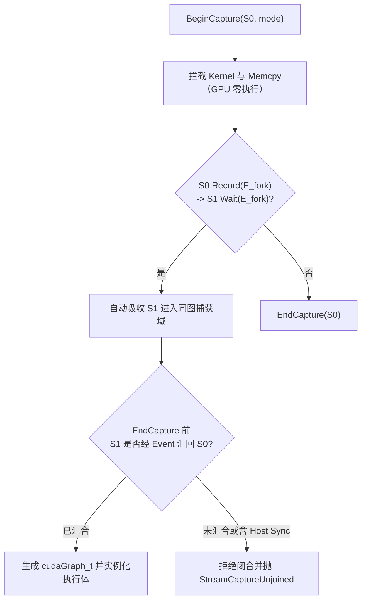

import Figure from 'astro-wisp/components/Figure.astro';
import ptCgLaunch from './images/pytorch-cudagraph-launch.png';
import ptCgDlrm from './images/pytorch-cudagraph-dlrm-speedup.png';

[第 2 章](../02-torch-compile-fundamentals/)的计算表明，`torch.compile` 就算把算子融到极致，40 层模型单步解码依然需要 CPU 跑完数百次发射循环。想真正把主机发射墙削平，就得请出 **CUDA Graph（设备静态执行图）**[^nv-cg-start][^pytorch-cg-blog]。

它的思路很直接：预热阶段暂不急着算，让驱动把整串算子的函数指针、网格维度与显存地址录成静态 **DAG（Directed Acyclic Graph，有向无环图）** `cudaGraph_t`。如图 1 所示，驱动随后编译出可执行体 `cudaGraphExec_t`。正式推理时，CPU 只需发一条 `cudaGraphLaunch` 命令，命令处理器就会把整串算子一口气跑完。

在 CUDA 12.6 等新工具链中，NVIDIA 还为线性直通图实现了常数时间 $O(1)$ 主机发射优化，避免启动开销随图内节点数线性增长[^nv-cg-const]。

<Figure
  src={ptCgLaunch}
  alt="PyTorch 官方博客对比图：常规模式下 CPU 依次发射 A 至 E 造成 GPU 空转，使用 CUDA Graphs 后 Build Graph 一次、CPU 单次 Launch Graph 紧凑跑完 A 至 E"
  caption="图 1：逐算子发射的 CPU 等待空档（上）与 CUDA Graph 单次发射省下的总耗时（下）（来源 PyTorch 官方博客）"
/>

## 为什么静态图只用在 Decode 阶段

刚接触推理引擎的读者常会问：既然静态图省发射开销，为什么线上服务不连 **Prefill（预填充）** 一起录成静态图？对比两个阶段的负载特征就能看明白：

| 对比维度     | Prefill（预填充，Eager 或分段） | Decode（自回归解码，启用静态图） |
| :----------- | :------------------------------ | :------------------------------- |
| 输入形状稳定 | 随提示词长度剧烈波动            | 每步固定增 1 token，易离散分桶   |
| 单算子耗时   | 百微秒至毫秒级，矩阵计算饱和    | 常只有几微秒，受限于显存与发射   |
| 主导系统瓶颈 | Compute-bound（算力主导）       | Host-bound（主机发射主导）       |
| 静态图收益   | 分桶 Padding 浪费反超微弱收益   | 抹平上千次发射气泡，拉高解码吞吐 |

PyTorch 官方 CUDA Graphs 实测数据清楚地刻画了这种批大小规律[^pytorch-cg-blog]。在 8×A100 上训练 DLRM 时（图 2），小批量下的加速比高达 2.5 倍以上，随着全局批量增大至计算饱和，收益自然回落至约 1.0 倍。在同文测试的 Mask R-CNN 中，图捕获将 ResNet 主干片段从 31 毫秒压至 6 毫秒（5 倍提速），在 4000 余卡规模的 BERT 上也带来 1.12 倍端到端增益。

<Figure
  src={ptCgDlrm}
  alt="PyTorch 官方博客实测图：8xA100 上 DLRM 随 Global batch size 从 512 增至 131072，CUDA Graphs 加速比从约 2.6 倍逐步收敛到 1.0 倍附近"
  caption="图 2：8×A100 DLRM 随全局批量增大时 CUDA Graphs 加速比由小批显著提速向 1.0× 收敛（来源 PyTorch 官方博客）"
/>

把数字落到 40 层 **DeepSeek-V4.1-Flash** 单步解码上，全貌立刻清楚[^v41-cg]。主干单步只激活 16B 参数且 KV 压至轻量 NVFP4，每层仍含约 28 个算子，加上 3 层 DSpark 草稿头，整网单步需发射超过 1120 次算子。按单次发射 $10\,\mu\text{s}$ 算，Eager 主机发射耗时高达 $11200\,\mu\text{s}$，远远超过 $4704\,\mu\text{s}$ 的设备算力耗时；换成单次 `cudaGraphLaunch`（仅约 $25\,\mu\text{s}$ 触发耗时）后，整段发射气泡直接消失。

## 驱动怎么把算子录成静态图

CUDA 提供两条建图路径。第一条是 C++ **Explicit API**，需要程序员手工逐个节点拼接图结构。这种写法调用 `cudaGraphCreate` 和 `cudaGraphAddKernelNode` 等底层函数，很难接进动态的 PyTorch 框架。

因此包括 `torch.cuda.CUDAGraph` 在内的主流上层生态普遍采用无侵入的 **Stream Capture（异步流录制）**[^vllm-cg-doc]。开启捕获后，代码照常调算子接口，只是设备暂时不真正计算，驱动在后台悄悄把经过的算子登记为图节点。

### 捕获零执行与三种安全模式

调用 `cudaStreamBeginCapture(stream, mode)` 后，目标流切入录制态。如果此时别的线程或库偷偷在后台发起非安全异步调用或显存分配，就会污染正在录制的图拓扑。因此 CUDA 定义了三种捕获安全模式：

| 捕获安全模式枚举                   | 同线程跨流约束     | 跨线程容忍度               | 典型适用场景                 |
| :--------------------------------- | :----------------- | :------------------------- | :--------------------------- |
| `cudaStreamCaptureModeGlobal`      | 严禁隐式不安全并发 | 禁同进程任意线程非安全分配 | 单主控推理、`CUDAGraph` 默认 |
| `cudaStreamCaptureModeThreadLocal` | 仅拦截发起捕获线程 | 允许后台工作线程独立运行   | 多线程并发调度与指标并行     |
| `cudaStreamCaptureModeRelaxed`     | 放开隐式依赖截断   | 调用方自行保证多线程隔离   | 底层沙箱或特殊内存池集成     |

### 多流自动吸收与闭合校验

很多模型会用多条流重叠计算与通信。如果在录制中的主流 `S0` 记录 `E_fork`，再让旁路流 `S1` 等待它，驱动就会把 `S1` 自动拉进同一张图的捕获域，如图 3 所示[^vllm-cg-doc]。

到了调用 `cudaStreamEndCapture(S0, &graph)` 收尾时，驱动会检查所有被吸收进来的旁路流是否都已经通过反向事件汇回原点流 `S0`。只要有一条支路忘了汇合，驱动当场拒绝成图并报错 **`cudaErrorStreamCaptureUnjoined`**。



## 静态执行图的四道硬边界

静态图用“冻结运行期灵活度”换取“零 CPU 调度开销”，生产模型接入必须守住图 4 总结的四项硬件边界。踩中不同的红线，代价也不一样——有的当场报错中止，有的则会一声不响地算出乱码。


### 显存地址固化与原地覆写

捕获瞬间，图节点会把输入和输出张量的设备虚拟内存地址 `data_ptr` 写死在参数表里。假设我们按容量桶 $B_{\text{cap}} = 8$ 捕获了一张图，输入缓冲 `static_x` 固定在 `0x7f00_1000`，后续重放时来了一个真实批量 $B_{\text{real}} = 6$ 的请求。

如果直接写 `x = new_tensor`（假设新张量落在 `0x7f00_9999`），重放并不会报错，但图节点只会死盯着 `0x7f00_1000` 里的陈旧数据来算，导致整批输出错位（图 5 右栏）。正确的做法是预分配固定缓冲，每步用 `static_x[:6].copy_(real_x)` 把新数据原位写进 `0x7f00_1000`。

图 5 上半区还展示了 PyTorch 1.10 引入的图专属分配池策略[^pytorch-cg-blog]。所有图中间激活从跨桶共享的 **`global_graph_pool`** 分配以复用物理显存页，避免与图外常规缓存分配器互相争抢释放，每张图结尾再调用 `weak_ref_outputs()` 释放输出强引用。


### 离散分桶、-1 槽位与零主机同步

静态图无法在执行时临时扩容，必须提前按离散批量桶（如 `1, 2, 4, 8, 16, 32`）预捕多张图，将请求用 `Padding` 填齐。由于第 `6..7` 槽可能残留上一步块号，调度层必须在重放前把无效尾部槽位的 `slot_mapping` 刷为 `-1`，防止写入其他请求的 KV 缓存[^vllm-cg-doc]。

同时，捕获期间设备并未真正算出结果，代码里绝不能出现 `.item()`、`.cpu()` 或 `torch.nonzero()` 等让主机读取张量值的语句。一旦触发主机同步，驱动立即抛出 `cudaErrorStreamCaptureUnsupported` 中止录制。

如果控制流分支确实依赖中间激活值，则需借助 **CUDA 12.4–12.8 原生 Conditional Nodes** 把判断下沉到设备侧[^nv-cond-blog]。它通过 `cudaGraphConditionalHandleCreate` 与 `cudaGraphSetConditional` 在图内完成 `IF`/`WHILE`/`SWITCH` 跳转。第 5 章会看到昇腾 ACL Graph 也提供了同类 `CondHandle` 原语。

### 多流封闭汇合与对称通信隔离

凡是在捕获期内分叉出去的通信或预取流，收尾前必须经过事件汇回主流。涉及多卡对称通信内存指针的算子，还必须切换进 `nccl_symm_mem_context` 等专用隔离上下文分配内存，保证跨卡映射指针在重放期间恒定不变。

## vLLM 运行时落地：双模切图与可中断捕获

线上混合批处理常常既包含需要静态图的 Decode 请求，又混入变长的 Chunked Prefill 切片。结合 vLLM V1 设计与 `torch.compile` 架构文档[^vllm-v1-blog][^vllm-cg-src]，引擎同时组合了双层 **`CUDAGraphWrapper`** 与可中断包装器 **`BreakableCUDAGraphWrapper`**[^vllm-brk]。

当整批全是纯解码词元时，最外层的 `CUDAGraphWrapper(mode=FULL)` 一次打包整网直接重放（如图 6 与图 7 所示）。如果混入了预填充切片，外层自动透传让道，改由嵌在注意力算子夹缝间的 `CUDAGraphWrapper(mode=PIECEWISE)` 分别重放各段纯张量投影图，注意力自己保持 Eager 动态调度。


遇到局部算子含主机副作用或不支持捕获时（如 PD 分离的 `wait_for_layer_load`），如何避免整图退化？`vllm`（提交 `99b0b0b0`）为此引入了 `BreakableCUDAGraphWrapper` 与 `@eager_break_during_capture`[^vllm-brk]。它会在捕获到受装饰算子时自动截断当前段、切回 Eager 跑完并记下回调，再无缝开启下一段静态图，核心类协作如图 8 所示。

```mermaid caption="图 8：vllm@99b0b0b0 中 CUDAGraphWrapper 与 BreakableCUDAGraphWrapper 核心类关系"
classDiagram
    class CUDAGraphWrapper {
        +runtime_mode
        +graph_pool
        +concrete_cudagraph_entries
        +__call__()
    }
    class CUDAGraphEntry {
        +BatchDescriptor batch_descriptor
        +cudagraph
        +input_addresses
    }
    class CUDAGraphOptions {
        +bool debug_log_enable
        +bool gc_disable
        +bool weak_ref_output
    }
    class BreakableCUDAGraphWrapper {
        +BreakableCUDAGraphCapture
        +eager_break_during_capture()
    }
    CUDAGraphWrapper *-- CUDAGraphEntry : caches per descriptor
    CUDAGraphWrapper o-- CUDAGraphOptions : configured by
    BreakableCUDAGraphWrapper ..> CUDAGraphWrapper : splits non-capturable ops
```

下面的纯 CPU Python 脚本验证了未汇合流报错、原位 `copy_()` 地址复用契约，并核算了 40 层 DeepSeek-V4.1-Flash 在三种模式下的发射耗时：

```python
class StreamCaptureUnjoinedError(RuntimeError):
    pass

class CudaGraphValidator:
    def __init__(self, buckets: tuple[int, ...]) -> None:
        self.buckets = sorted(buckets)
        self.static_ptr_map: dict[int, int] = {}

    def select_bucket(self, num_tokens: int) -> int:
        for b in self.buckets:
            if num_tokens <= b:
                return b
        raise ValueError(f"num_tokens={num_tokens} exceeds max bucket {self.buckets[-1]}")

    def capture(self, bucket: int, ptr: int, forked: set[str], joined: set[str], host_sync: bool) -> None:
        if host_sync:
            raise RuntimeError("cudaErrorStreamCaptureUnsupported: host sync during capture")
        unjoined = forked - joined
        if unjoined:
            raise StreamCaptureUnjoinedError(f"cudaErrorStreamCaptureUnjoined: {sorted(unjoined)} never joined")
        self.static_ptr_map[bucket] = ptr

    def replay(self, num_tokens: int, caller_ptr: int, in_place_copy: bool) -> str:
        bucket = self.select_bucket(num_tokens)
        expected = self.static_ptr_map[bucket]
        effective = expected if in_place_copy else caller_ptr
        if effective != expected:
            return f"STALE_PTR_BUG(reads {hex(expected)}, caller wrote {hex(caller_ptr)})"
        return f"REPLAY_OK(bucket={bucket}, pad={bucket - num_tokens}, slot_pad=-1)"

v = CudaGraphValidator((1, 2, 4, 8, 16, 32))
try:
    v.capture(8, 0x7F00_1000, forked={"comm_s1"}, joined=set(), host_sync=False)
except StreamCaptureUnjoinedError as exc:
    print(f"[Unjoined Check] {exc}")

v.capture(8, 0x7F00_1000, forked={"comm_s1"}, joined={"comm_s1"}, host_sync=False)
print(f"[Reassign Bug] {v.replay(6, caller_ptr=0x7F00_9999, in_place_copy=False)}")
print(f"[InPlace Copy] {v.replay(6, caller_ptr=0x7F00_9999, in_place_copy=True)}")

layers, ops = 40, 28
eager_host_us = layers * ops * 10.0
dev_ideal_us = layers * ops * 4.2
full_us = dev_ideal_us + 25.0
print(f"[40L Decode] Eager={eager_host_us:.0f}us, FULL_Graph={full_us:.0f}us ({eager_host_us/full_us:.2f}x), PiecewiseLaunches={layers * 2 + 1} vs Full=1")
```

运行输出验证了全部三条结论：未汇合流在录制收尾即被拦截，跳过原位拷贝会导致静态图继续读取旧指针 `0x7f001000`。切换到 `FULL_Graph` 后，单步耗时从 $11200\,\mu\text{s}$ 降到 $4729\,\mu\text{s}$（2.37 倍提速）：

```text
[Unjoined Check] cudaErrorStreamCaptureUnjoined: ['comm_s1'] never joined
[Reassign Bug] STALE_PTR_BUG(reads 0x7f001000, caller wrote 0x7f009999)
[InPlace Copy] REPLAY_OK(bucket=8, pad=2, slot_pad=-1)
[40L Decode] Eager=11200us, FULL_Graph=4729us (2.37x), PiecewiseLaunches=81 vs Full=1
```

理顺 CUDA Graph 的静态契约后，我们再看华为昇腾 NPU。GPU 算子通常在设备端直接读取变长序列参数，而昇腾拥有物理 TS 固件、易变的临时主机参数区以及由主机算好的 Tiling 参数。围绕这些硬件差异，CANN Runtime 演化出了以影子模型流为核心的 **ACL Graph**，[第 4 章：ACL Graph 录制架构：影子流与参数备份](../04-acl-graph-architecture-and-capture/)将结合源码展开剖析。

[^vllm-cg-doc]: 参阅 `vllm`（提交 `99b0b0b0`）官方架构文档 `docs/design/cuda_graphs.md`，详细定义 `NONE`、`PIECEWISE`、`FULL`、`FULL_DECODE_ONLY` 与 `FULL_AND_PIECEWISE` 模式及静态缓冲、Fork-Join 契约。

[^vllm-cg-src]: 参阅 `vllm`（提交 `99b0b0b0`）源码 `vllm/compilation/cuda_graph.py`（L127–290 `CUDAGraphEntry`、`CUDAGraphOptions` 与 `CUDAGraphWrapper`）。

[^vllm-brk]: 参阅 `vllm`（提交 `99b0b0b0`）源码 `vllm/compilation/breakable_cudagraph.py`（L53–260 `eager_break_during_capture` 与 `BreakableCUDAGraphWrapper`）。

[^nv-cg-start]: NVIDIA Technical Blog, [Getting Started with CUDA Graphs](https://developer.nvidia.com/blog/cuda-graphs/)，系统说明 CUDA Graphs 任务图捕获、实例化与重放原理。

[^nv-cg-const]: Houston Hoffman & Fred Oh, [Constant-Time Launch for Straight-Line CUDA Graphs and Other Performance Enhancements](https://developer.nvidia.com/blog/constant-time-launch-for-straight-line-cuda-graphs-and-other-performance-enhancements/)（NVIDIA Technical Blog，CUDA 12.6），说明线性直通图的常数级 CPU 发射开销优化。

[^pytorch-cg-blog]: Vinh Nguyen et al., [Accelerating PyTorch with CUDA Graphs](https://pytorch.org/blog/accelerating-pytorch-with-cuda-graphs/)（PyTorch 官方博客，2021-10），给出 PyTorch 图专属内存池、8×A100 DLRM 曲线、Mask R-CNN 5 倍提速与 BERT 1.12 倍评测结果。

[^nv-cond-blog]: NVIDIA Technical Blog, [Dynamic Control Flow in CUDA Graphs with Conditional Nodes](https://developer.nvidia.com/blog/dynamic-control-flow-in-cuda-graphs-with-conditional-nodes/)，介绍 CUDA 12.4 至 12.8 图内 `IF`/`WHILE`/`SWITCH` 设备侧控制流。

[^vllm-v1-blog]: vLLM Team, [vLLM V1: A Major Upgrade to vLLM's Core Architecture](https://blog.vllm.ai/2025/01/27/v1-alpha-release.html)（2025-01-27），介绍 V1 如何以 Piecewise CUDA Graphs 搭配 `torch.compile` 抹平小批调度瓶颈。

[^v41-cg]: DeepSeek-V4.1-Flash 40 层架构与 CSA2 890 B/token KV 规格，见本站[10 串珠成链：V4.1 单步全链路与双硬件协同](../../deepseek/10-architecture-synthesis/)。
