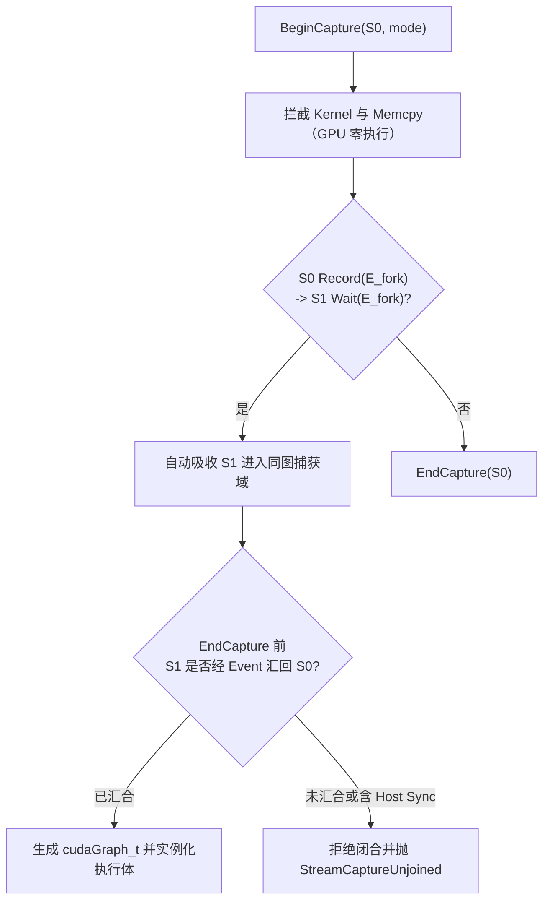

[第 2 章](../02-torch-compile-fundamentals/)的计算显示，编译融合无法独自消除主机发射开销。为此，**CUDA Graph（设备静态执行图）**会把数百个算子及其 **DAG（Directed Acyclic Graph，有向无环图）**依赖先录制为 `cudaGraph_t`。随后驱动将其编译为 `cudaGraphExec_t`，运行时 CPU 只需发射一条 `cudaGraphLaunch` 即可跑完全图。

## 为什么静态图只用在 Decode 阶段

在线大模型推理在两个阶段呈现截然不同的负载特征，因此静态图主要作用于自回归解码阶段：

| 对比维度     | Prefill（预填充，Eager/分块） | Decode（自回归解码，启用静态图） |
| ------------ | ----------------------------- | -------------------------------- |
| 输入形状稳定 | 随提示词波动，难以提前收敛    | 每步固定增 1 token，可离散分桶   |
| 单算子耗时   | 百微秒至毫秒级，大型矩阵饱和  | 往往数微秒，受限于访存与发射     |
| 主导系统瓶颈 | Compute-bound（算力主导）     | Host-bound（主机发射主导）       |
| 静态图收益   | 分桶 Padding 开销反超微弱收益 | 抹平数百次发射气泡，拉高解码吞吐 |

以 40 层 **DeepSeek-V4.1-Flash** 为例，其 552B 主干在解码步仅激活 16B 参数，并用 CSA2 将单 token KV 压至 890 B NVFP4[^v41-cg]。即便访存极轻，单层仍含 `Mega-mHC` 四流混合、CSA2、384 选 6 MoE 与异步 Engram 注入等约 28 个算子。加上 3 层 DSpark Draft 头，整网单步需发射超过 1120 次 Kernel。

按单次发射 10 微秒估算，Eager 模式的主机发射墙高达 11200 微秒，远远压过 4704 微秒的设备算力耗时。切换为单次 `cudaGraphLaunch`（约 25 微秒触发开销）后，整段发射气泡直接被抹平。

## 显式建图与 Stream Capture

CUDA 提供两条建图路径。面向底层 C++ 库的 **Explicit API** 需要逐个拼接图节点。开发者须手工调用 `cudaGraphCreate`、`cudaGraphAddKernelNode` 与 `cudaGraphAddDependencies`，很难直接适配动态的 PyTorch 框架。

因此包括 `torch.cuda.CUDAGraph` 在内的主流上层生态普遍采用无侵入的 **Stream Capture（异步流录制）**[^vllm-cg-doc]。

调用 `cudaStreamBeginCapture(stream, mode)` 后，落入受控流的算子**不会在 GPU 上实际执行**，而是被驱动拦截并记为图节点。调用 `cudaStreamEndCapture(stream, &graph)` 时，驱动会校验并发依赖并输出完整拓扑图。多线程与多流环境下的三种捕获模式约束如下：

| 捕获安全模式枚举                   | 同线程跨流约束     | 跨线程容忍度               | 典型适用场景                 |
| ---------------------------------- | ------------------ | -------------------------- | ---------------------------- |
| `cudaStreamCaptureModeGlobal`      | 严禁隐式不安全并发 | 禁同进程任意线程非安全分配 | 单主控推理、`CUDAGraph` 默认 |
| `cudaStreamCaptureModeThreadLocal` | 仅拦截发起捕获线程 | 允许后台工作线程独立运行   | 多线程并发调度与日志并行     |
| `cudaStreamCaptureModeRelaxed`     | 放开隐式依赖截断   | 开发者自行保证多线程隔离   | 底层沙箱或特殊内存池集成     |

在多流并行时，如果捕获中的主流 `S0` 经 `cudaEventRecord` 触发副流 `S1` 的 `cudaStreamWaitEvent`，`S1` 会被自动拉入捕获域（如图 1 所示）。

调用 `cudaStreamEndCapture` 闭合时，驱动会检查所有被吸收的副流是否都经事件汇回原点流 `S0`。只要存在未汇合的分支，驱动就会抛出 **`cudaErrorStreamCaptureUnjoined`** 错误[^vllm-cg-doc]。



## 静态执行图的四大不变量边界

静态图以“冻结部分运行期灵活度”换取“零 CPU 调度开销”，生产模型接入必须守住四项硬件边界（如图 2 所示）：


### 虚拟地址固化与原地拷贝

录制期间，算子会直接把输入与输出张量的设备虚拟地址 `data_ptr` 写死在图节点里。重放前不能通过变量赋值重新绑定新张量，而要预先分配静态缓冲，每步用 `static_x.copy_(real_x)` 原地覆写内容。

在多桶并存的场景下，尾图还需调用 `weak_ref_outputs()` 释放多余的输出强引用，防止几十个分桶把整卡显存长期锁死。

### 离散分桶与全局图显存池

静态图无法在执行时动态扩容，因此必须提前规划离散批量分桶（如 `1, 2, 4, 8` 等），并用 `Padding` 补齐当前真实批量。同时要把无效填充槽位的 `slot_mapping` 设为 `-1`，防止写入算子污染其他请求的 KV Cache[^vllm-cg-doc]。

图内严禁触发动态 `cudaMalloc`，所有中间激活缓冲统一交由可跨图复用的 **`global_graph_pool`** 管理，利用不同分桶在时间线上的互斥性复用物理显存页。

### 零主机同步与设备条件节点

捕获阶段设备并未真实运算，因此模型中禁止出现 `.item()`、`.cpu()` 或 `torch.nonzero()` 等同步读回或依赖数据形状的操作。变长序列信息应直接放在设备张量 `seq_lens` 中，由 Kernel 在设备侧自行读取。

当分支依赖中间激活值而走 `IF`、`WHILE` 或 `SWITCH` 时，早期 `cudaGraphExecUpdate` 无法改写拓扑。此时需借助 **CUDA 12.4 原生 Conditional Nodes**。它通过 `cudaGraphConditionalHandleCreate` 与 `cudaGraphSetConditional` 在设备侧跳转。华为 ACL Graph 在第 5 章也提供了同类实现。

### 多流汇合与对称通信隔离

凡在捕获期内通过 `Event` 分叉出去的旁路流，必须在结束捕获前经 `Event` 汇回主流。涉及多卡对称通信窗口地址的算子，还须切入 `nccl_symm_mem_context` 等隔离上下文分配内存，确保跨卡地址映射与图内指针保持一致。

## vLLM 双模切图与双层包装调度

在 **Chunked Prefill（分块预填充）**与 Decode 混排的混合批处理场景中，动态变长 Attention 难以直接塞入全图。vLLM 通过前端 `torch.compile` 分段切图配合双层 **`CUDAGraphWrapper`** 兼顾覆盖率与极限发射性能[^vllm-cg-doc]。

当整批全是单步 Decode token 时，最外层的 `CUDAGraphWrapper(mode=FULL)` 一次打包全网算子直接重放。若批内混入长提示词切片，外层旁路让道，转由嵌在相邻注意力算子之间的 `CUDAGraphWrapper(mode=PIECEWISE)` 接管线性投影与 MLP 子图。中间变长 Attention 则留给 Eager 动态调度（见图 3 与图 4）。


下面的独立 Python 脚本用来验证两项静态图约束：未汇合流报错 `cudaErrorStreamCaptureUnjoined` 与原位 `copy_()` 地址复用契约。脚本同时对比了 DeepSeek-V4.1-Flash 40 层主干在三种执行模式下的发射开销：

```python
class StreamCaptureUnjoinedError(RuntimeError):
    pass


class CudaGraphValidator:
    def __init__(self, buckets: tuple[int, ...]) -> None:
        self.buckets = sorted(buckets)
        self.graphs: dict[int, dict] = {}
        self.static_ptr_map: dict[int, int] = {}

    def select_bucket(self, num_tokens: int) -> int:
        for b in self.buckets:
            if num_tokens <= b:
                return b
        raise ValueError(
            f"num_tokens={num_tokens} exceeds max bucket {self.buckets[-1]}"
        )

    def capture(
        self,
        bucket: int,
        kernel_ptrs: dict[str, int],
        forked_streams: set[str],
        joined_streams: set[str],
        has_host_sync: bool,
    ) -> None:
        if has_host_sync:
            raise RuntimeError(
                "cudaErrorStreamCaptureUnsupported: host sync "
                "(.item()/.cpu()) during capture"
            )
        unjoined = forked_streams - joined_streams
        if unjoined:
            raise StreamCaptureUnjoinedError(
                f"cudaErrorStreamCaptureUnjoined: {sorted(unjoined)} "
                "never joined origin stream"
            )
        self.graphs[bucket] = {"nodes": 40 * 24, "ptrs": dict(kernel_ptrs)}
        self.static_ptr_map[bucket] = kernel_ptrs["x"]

    def replay(
        self, num_tokens: int, caller_ptr: int, used_in_place_copy: bool
    ) -> str:
        bucket = self.select_bucket(num_tokens)
        expected_ptr = self.static_ptr_map[bucket]
        effective_ptr = expected_ptr if used_in_place_copy else caller_ptr
        if effective_ptr != expected_ptr:
            return (
                f"STALE_PTR_BUG(graph reads {hex(expected_ptr)}, "
                f"caller wrote {hex(caller_ptr)})"
            )
        pad = bucket - num_tokens
        return f"REPLAY_OK(bucket={bucket}, pad={pad}, single_launch=15.0us)"


validator = CudaGraphValidator((1, 2, 4, 8, 16, 32))
ptrs = {"x": 0x7F00_1000, "out": 0x7F00_8000}

try:
    validator.capture(
        8, ptrs, forked_streams={"comm_s1"}, joined_streams=set(), has_host_sync=False
    )
except StreamCaptureUnjoinedError as exc:
    print(f"[Unjoined Check] caught expected error: {exc}")

validator.capture(
    8, ptrs, forked_streams={"comm_s1"}, joined_streams={"comm_s1"}, has_host_sync=False
)
stale_msg = validator.replay(
    6, caller_ptr=0x7F00_9999, used_in_place_copy=False
)
ok_msg = validator.replay(6, caller_ptr=0x7F00_9999, used_in_place_copy=True)
print(f"[Reassign Bug] {stale_msg}")
print(f"[InPlace Copy] {ok_msg}")

# DeepSeek-V4.1-Flash 40-layer CED Decode launch vs replay cost comparison
layers, ops = 40, 28
eager_host_us = layers * ops * 10.0  # 11200 us
dev_ideal_us = layers * ops * 4.2    # 4704 us (bubbles eliminated under graph)
piecewise_launches = layers * 2 + 1  # ~81 piecewise graph + eager attn launches
speedup = eager_host_us / (dev_ideal_us + 25.0)
print(
    f"[DS-V4.1-Flash 40L Decode] Eager={eager_host_us:.0f}us, "
    f"FULL_Graph={dev_ideal_us + 25.0:.0f}us ({speedup:.2f}x speedup), "
    f"PiecewiseLaunches={piecewise_launches} vs FullLaunches=1"
)
```

验证输出如下：

```text
[Unjoined Check] caught expected error: cudaErrorStreamCaptureUnjoined: ['comm_s1'] never joined origin stream
[Reassign Bug] STALE_PTR_BUG(graph reads 0x7f001000, caller wrote 0x7f009999)
[InPlace Copy] REPLAY_OK(bucket=8, pad=2, single_launch=15.0us)
[DS-V4.1-Flash 40L Decode] Eager=11200us, FULL_Graph=4729us (2.37x speedup), PiecewiseLaunches=81 vs FullLaunches=1
```

明确 CUDA Graph 的静态契约后，我们再把视线切到具备物理 TS 固件、Notify 信号池与主机 Tiling 的华为昇腾 NPU。围绕影子模型流与逻辑任务队列，CANN Runtime 演化出了 **ACL Graph** 体系，[第 4 章：ACL Graph 架构与影子模型流录制](../04-acl-graph-architecture-and-capture/)将结合源码展开剖析。

[^vllm-cg-doc]: 参阅 `vllm`（提交 `bb23c0a8`）官方架构文档 `docs/design/cuda_graphs.md`，详细定义了 `NONE` / `PIECEWISE` / `FULL` / `FULL_DECODE_ONLY` / `FULL_AND_PIECEWISE` 模式及静态缓冲、Fork-Join 和弱引用处理契约。

[^v41-cg]: DeepSeek-V4.1-Flash 40 层非对称 CED、8B/16B 激活参数与 CSA2 890 B/token KV 规格，见本站[10 串珠成链：V4.1 单步全链路与双硬件协同](../../deepseek/10-architecture-synthesis/)。
