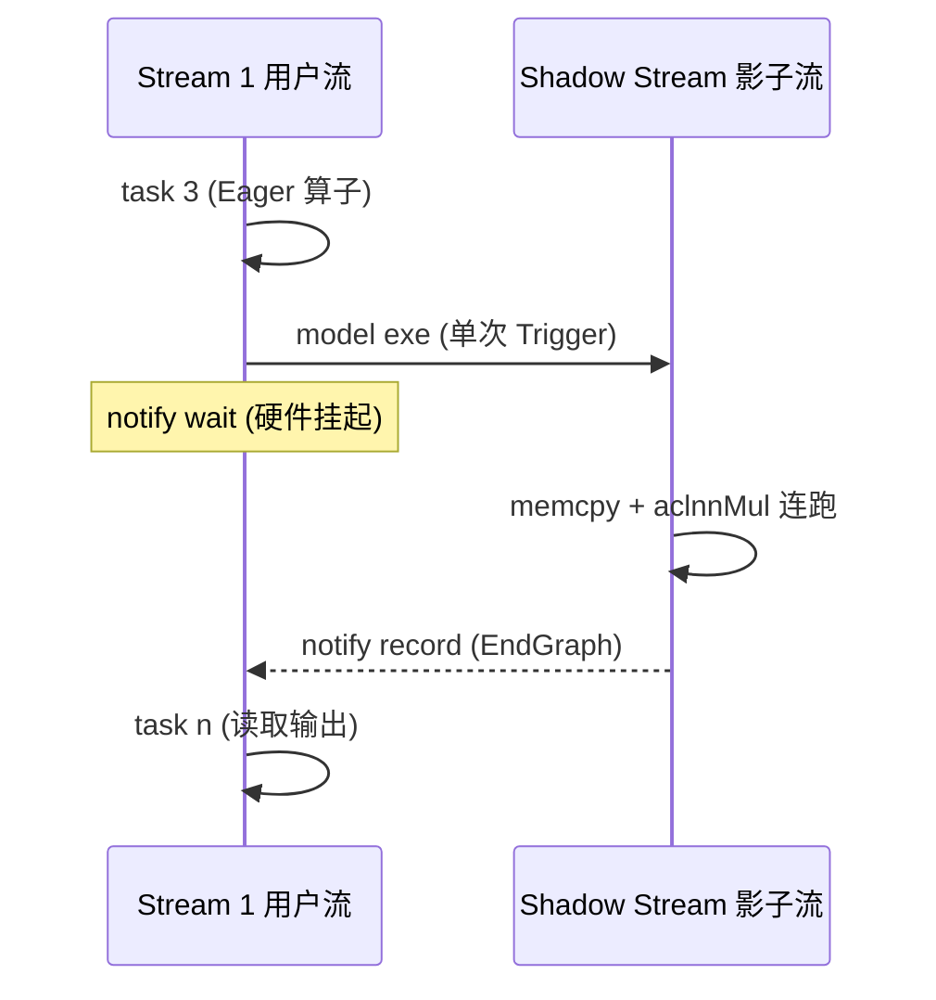

import AclGraphShadowStreamExplainer from '../../../../explainers/aclgraph/AclGraphShadowStreamExplainer';

进入华为昇腾 NPU 体系后，对应静态执行图的核心实现是以 `aclmdlRI`（Model Running Instance，模型运行实例）管理接口为代表的 **ACL Graph**[^cann-acl-api]。在上层 `torch_npu.npu.NPUGraph` 中它与 CUDA Graph 保持一致 API 体验，而在 CANN Runtime（`cann/runtime`）底层内部，为了匹配昇腾硬件 **TS（Task Scheduler，任务调度器）**、`Notify` 信号池与主机参数快照生命周期，ACL Graph 构建了以 **Shadow Model Stream（影子模型流）与逻辑任务队列预建**为核心的独特架构。

## Host-bound 场景与 DeepSeek-V4.1-Flash 生产取舍

- **核心矛盾定位**：小批量 Decode 与细粒度算子在单卡 AICore 上仅运行数微秒，CPU 下发与参数构建速度追不上硬件消费速度，引发密集调度空泡。以 40 层 **DeepSeek-V4.1-Flash**[^v41-cap] 为例，即便 CSA2 将 KV 压至轻量 NVFP4 格式，单层仍包含 `npu_hc_pre_v3`、`AscendDSAV41Impl`、细粒度路由 MoE、第 1/14 层异步 Engram 注入及 `npu_hc_post` 等约 28 个算子（整网超 1100 次提交），主机微隙被逐层累积放大。
- **生产双态调度准则**：在线服务在 **Prefill 阶段保持常规 Eager 发射**（长提示词矩阵计算耗时高、形状变化大，无须引入垫零与捕图成本）；请求转入 **Decode 阶段**后，模型运行器依据 `exe_mode` 切换至提前录制的 **ACL Graph 静态图模式**，实现“一次捕获、多次触发”[^cann-acl-api]。

## 两阶段机制全解：Capture 六步与 Replay 两步

ACL Graph 把执行生命周期切分为彻底隔离的 **Capture（图捕获）** 与 **Replay（图重放）** 两阶段，端到端流转见图 1。


在 **Capture 阶段**，CANN Runtime 的 `src/acl/aclrt_impl/model_ri.cpp` 与会话类 `CaptureSession` 执行六项核心动作[^model-ri-impl][^cap-session]：

| 阶段动作 | 底层核心职责               | CANN Runtime 关键函数 / 结构                           |
| -------- | -------------------------- | ------------------------------------------------------ |
| 动作 1   | 劫持用户流原任务参数体     | `CaptureSession::StreamBeginCapture`                   |
| 动作 2   | 申请持久设备缓冲 D2D 备份  | `CaptureModel::CopyTaskArgsDeviceBuffer`[^args-backup] |
| 动作 3   | 内存态生成逻辑任务描述符   | 构造 `LogicSQ` 链表条目                                |
| 动作 4   | 闭合校验流依赖与 DAG 合法  | `CheckCaptureModelValidity`（`0x0703001F`）            |
| 动作 5   | 严守用户调用序列与跨流依赖 | 原序追加进逻辑流任务表                                 |
| 动作 6   | 捕获期不实际驱动算力核执行 | `IsSoftwareSqEnable` 录完即返不落硬件                  |

- **Args 参数保护机制（动作 2）**：昇腾算子发射结构体 `comm.args` 常驻留于易变临时参数区。`capture_model_args_backup.cc` 中的 `CopyTaskArgsDeviceBuffer` 通过 `DevMemAllocWithBackupFlag` 申请持久设备缓冲并以 **D2D（Device-to-Device，设备内显存拷贝）**留底，防止图外运算污染静态图内的算子参数指针[^args-backup]。
- **Replay 阶段两动作（`PreModelExecute` + `ExecuteAsync`）**[^cap-model]：首次调用 `aclmdlRIExecuteAsync` 时由 `CaptureModel::BuildSqCq` 懒分配物理 `SQ/CQ` 并刷新关联 `Notify ID`；此后每次重放主线程仅向执行流发射一条 **Trigger（总触发信号）**，设备调度器即按预建描述符全速吞吐全图。

<AclGraphShadowStreamExplainer
  client:visible
  title="图 2：ACL Graph 单流影子流重定向、EndGraph Notify 收尾、多流 Fork-Join 扩展与 Replay 运行交互推演"
/>

## 单流 Stream Capture 原理解剖：Shadow Stream 与 EndGraph Notify 机制

理解单流双射的关键在于区分**用户调用流**与 **Shadow Model Stream** 的两阶段职责[^cap-session][^cap-model]：

- **捕获期重定向**：对 `Stream 1` 调用 `aclmdlRICaptureBegin(stream, mode)` 时，`StreamAddToCaptureModelProc` 新建 `RT_MODEL_CAPTURE_MODEL` 对象，并替用户流配对创建专用于挂载离线任务的 **Shadow Stream（影子流）**。捕获态期间投入 `Stream 1` 的 `memcpyAsync` 与 `aclnnMul` 全被转发至该影子流的 `LogicSQ` 中（前序普通 `task 1/2` 留在用户流正常执行）。
- **收尾信号焊接**：调用 `aclmdlRICaptureEnd(stream, &modelRI)` 时，Runtime 在影子流最末端调用 `CaptureModel::ModelEndGraph()`，追加一枚 **`TS_TASK_TYPE_NOTIFY_RECORD`**（EndGraph 通知记录），随后冻结图拓扑产出 `modelRI`。
- **重放期轻量握手**：向自由运行的用户流注入 `task 3 -> aclmdlRIExecuteAsync -> task n` 时，Runtime 只向用户流写入 **`model exe`（触发影子流全速连跑）** 与 **`notify wait`（设备硬件挂起用户流直到 EndGraph Notify 返回）** 两条轻量控制任务。整段等待完全在芯片内部完成，**CPU 全程无需阻塞**，仅在主机明确需要取回结果时再补 `aclrtSynchronizeStream`。



## 多流 Stream Capture、Mode 隔离与 `RT_ERROR_STREAM_UNJOINED` 拦截

开启计算流与通信/拷贝流重叠的多流模型依赖流间 **Event Record / Wait** 把副流拉入同一个静态图管辖区（与 `cann/runtime` 官方多流 Stream Capture 测试契约等价）[^model-ri-doc]：

```cpp
// 1. 从 stream1 开启全局捕获
CHECK_ERROR(aclmdlRICaptureBegin(stream1, ACL_MODEL_RI_CAPTURE_MODE_GLOBAL));
// 2. 分叉点 (Fork)：在处于捕获态的 stream1 记录 event1，再让未捕获的 stream2 等待它
CHECK_ERROR(aclrtRecordEvent(event1, stream1));
CHECK_ERROR(aclrtStreamWaitEvent(stream2, event1));

// 3. 此刻 stream2 已被 Runtime 自动吸收并归属进同一 ACL Graph 捕获域，双流并发下发各自算子
aclnnMul(mulWorkspaceAddr, mulWorkspaceSize, mulExecutor, stream1);
aclnnMul(mulWorkspaceAddr2, mulWorkspaceSize2, mulExecutor2, stream2);
aclnnAdd(mulWorkspaceAddr2, mulWorkspaceSize2, mulExecutor2, stream2);

// 4. 汇合点 (Join)：由 stream2 记录结束锚点 event2，并由捕获原点流 stream1 明确等待收尾
CHECK_ERROR(aclrtRecordEvent(event2, stream2));
CHECK_ERROR(aclrtStreamWaitEvent(stream1, event2));

// 5. 捕获收尾：Runtime 验明两条流已完整汇合形成有效有向图拓扑后输出 modelRI
CHECK_ERROR(aclmdlRICaptureEnd(stream1, &modelRI));
```

在 `aclmdlRICaptureEnd` 阶段，`CaptureSession::CheckCaptureModelValidity` 会执行两项严格校验[^cap-session]：凡未通过反向 `Event` 汇回原点流 `origCaptureStream` 的副流分支，或者误将专用于外部更新的 `RT_EVENT_EXTERNAL` 充当普通内部流依赖，都会立刻触发 **`RT_ERROR_STREAM_UNJOINED`（内部码 `0x0703001F` / 日志 `EE1017`）** 拒绝建图。此外，`aclmdlRICaptureBegin` 通过三种捕获安全模式控制并发隔离（可经 `aclmdlRICaptureThreadExchangeMode` 动态切换）：

| 捕获安全模式（`aclmdlRICaptureMode`）    | 跨线程与并发隔离规则           | 典型适用场景             |
| ---------------------------------------- | ------------------------------ | ------------------------ |
| `ACL_MODEL_RI_CAPTURE_MODE_GLOBAL`       | 拦截同进程他线程不安全异步调用 | 单进程单主控、默认保护   |
| `ACL_MODEL_RI_CAPTURE_MODE_THREAD_LOCAL` | 仅拦截发起捕获线程，余流正常   | 多线程调度与指标热更并行 |
| `ACL_MODEL_RI_CAPTURE_MODE_RELAXED`      | 放开隐式截断，调用方自保隔离   | 底层沙箱与特殊内存池集成 |

## Runtime 捕获状态机与 Args 隔离仿真验证

下面的纯 CPU Python 状态机还原了 `CaptureSession`、`Shadow Model Stream`、`CopyTaskArgsDeviceBuffer` 参数快照、多流 `RT_ERROR_STREAM_UNJOINED` 拦截与首次 `BuildSqCq` 懒分配机制：

```python
from dataclasses import dataclass


@dataclass
class LogicSqTask:
    name: str
    args_backup: tuple
    is_notify_record: bool = False


class MockCaptureSession:
    def __init__(self) -> None:
        self.capturing = False
        self.mode = None
        self.origin_stream = None
        self.shadow_stream = "shadow_model_s0"
        self.capture_streams: set[str] = set()
        self.recorded_events: dict[str, str] = {}
        self.joined_events: set[str] = set()
        self.tasks: list[LogicSqTask] = []
        self.sq_bound = False

    def capture_begin(
        self, stream: str, mode: str = "ACL_MODEL_RI_CAPTURE_MODE_GLOBAL"
    ) -> None:
        self.capturing = True
        self.mode = mode
        self.origin_stream = stream
        self.capture_streams = {stream}
        self.tasks.clear()

    def record_task(self, stream: str, name: str, host_args: list[int]) -> None:
        if stream not in self.capture_streams:
            raise RuntimeError(f"Stream {stream} is not in capture topology")
        # 对应 CopyTaskArgsDeviceBuffer：将参数快照持久化至设备缓冲
        backup = tuple(host_args)
        self.tasks.append(LogicSqTask(name=name, args_backup=backup))

    def record_event(self, event: str, stream: str) -> None:
        if stream in self.capture_streams:
            self.recorded_events[event] = stream

    def stream_wait_event(self, stream: str, event: str) -> None:
        if event not in self.recorded_events:
            return
        src_stream = self.recorded_events[event]
        if src_stream in self.capture_streams and stream not in self.capture_streams:
            self.capture_streams.add(stream)
        elif stream == self.origin_stream and src_stream in self.capture_streams:
            self.joined_events.add(src_stream)

    def capture_end(self) -> list[LogicSqTask]:
        unjoined = [
            s
            for s in self.capture_streams
            if s != self.origin_stream and s not in self.joined_events
        ]
        if unjoined:
            raise RuntimeError(
                f"RT_ERROR_STREAM_UNJOINED (0x0703001F): unjoined streams={unjoined}"
            )
        # 在影子模型流末端追加 EndGraph notify_record
        self.tasks.append(
            LogicSqTask(
                name="TS_TASK_TYPE_NOTIFY_RECORD(EndGraph)",
                args_backup=("root_notify",),
                is_notify_record=True,
            )
        )
        self.capturing = False
        return list(self.tasks)

    def execute_async(self, user_stream: str) -> list[str]:
        ops = []
        if not self.sq_bound:
            n_st = len(self.capture_streams)
            ops.append(f"PreModelExecute:BuildSqCq(streams={n_st})")
            self.sq_bound = True
        ops.append(f"{user_stream}<-model_exe(trigger {self.shadow_stream})")
        ops.append(f"{user_stream}<-notify_wait(EndGraph)")
        return ops


sess = MockCaptureSession()
sess.capture_begin("stream_1")
host_dims = [8, 128]
sess.record_task("stream_1", "memcpyAsync", host_dims)
sess.record_event("ev_fork", "stream_1")
sess.stream_wait_event("stream_2", "ev_fork")
sess.record_task("stream_2", "aclnnMul_branch", [8, 128])
# 捕获后修改主机缓冲，备份副本仍保持 (8, 128)
host_dims[0] = 999
sess.record_event("ev_join", "stream_2")
sess.stream_wait_event("stream_1", "ev_join")
model_tasks = sess.capture_end()

print(
    f"[Captured LogicSQ] count={len(model_tasks)}, "
    f"args_backup_of_task0={model_tasks[0].args_backup}, tail={model_tasks[-1].name}"
)
print(f"[Replay #1] {sess.execute_async('stream_1')}")
print(f"[Replay #2] {sess.execute_async('stream_1')}")
```

运行输出清晰印证了两项关键不变量：即使在捕获过程中原地修改 `host_dims[0] = 999`，逻辑队列内的参数副本依然牢牢锁定为 `(8, 128)`；且仅初次重放时触发 `BuildSqCq` 绑定 `streams=2` 物理通道，后续执行只发射两条轻量控制命令：

```text
[Captured LogicSQ] count=3, args_backup_of_task0=(8, 128), tail=TS_TASK_TYPE_NOTIFY_RECORD(EndGraph)
[Replay #1] ['PreModelExecute:BuildSqCq(streams=2)', 'stream_1<-model_exe(trigger shadow_model_s0)', 'stream_1<-notify_wait(EndGraph)']
[Replay #2] ['stream_1<-model_exe(trigger shadow_model_s0)', 'stream_1<-notify_wait(EndGraph)']
```

基础静态图固化了全部参数与控制分支。而面对变长 KV Cache 触发的 Attention Tiling 更新，以及投机解码中的设备端动态条件分支，[第 5 章：ACL Graph 动态扩展与条件子图](../05-acl-graph-task-update-and-conditional-subgraph/)将揭示如何在不重建整图、不退回 CPU 的前提下就地消化这两类运行期变化。

[^cann-acl-api]: 参阅 `cann/runtime`（提交 `1954820a`）文档 `docs/zh/api_ref/15_model_running_instance_management.md`，全面列示 `aclmdlRICaptureBegin`、`aclmdlRICaptureEnd`、`aclmdlRIExecuteAsync` 等生命周期管理接口与约束。

[^model-ri-impl]: 参阅 `cann/runtime`（提交 `1954820a`）源码 `src/acl/aclrt_impl/model_ri.cpp` 第 1–466 行公开接口实现层。

[^cap-session]: 参阅 `cann/runtime`（提交 `1954820a`）源码 `src/runtime/feature/aclgraph/capture_session.cc` 第 1–1167 行对 `StreamBeginCapture`、`StreamEndCapture`、`CheckCaptureModelValidity` 及 `RT_ERROR_STREAM_UNJOINED` 拦截逻辑的定义。

[^args-backup]: 参阅 `cann/runtime`（提交 `1954820a`）源码 `src/runtime/feature/aclgraph/capture_model_args_backup.cc` 第 16–55 行 `CaptureModel::CopyTaskArgsDeviceBuffer` 的 Device 参数保护拷贝实现。

[^cap-model]: 参阅 `cann/runtime`（提交 `1954820a`）源码 `src/runtime/feature/aclgraph/capture_model.cc` 第 497–615、1556–1605 及 2346–2413 行对 `PreModelExecute`、`BuildSqCq` 和 `ModelEndGraph` 的底层管控逻辑。

[^model-ri-doc]: 参阅 `cann/runtime`（提交 `1954820a`）官方示例 `example/2_advanced_features/model_ri/0_simple_model/main.cpp` 与 API 手册多流 Stream Capture 例程。

[^v41-cap]: DeepSeek-V4.1-Flash 40 层 CED、`npu_hc_pre_v3`/`npu_hc_post` 及 `AscendDSAV41Impl` 在昇腾生产栈的算子分布见本站[10 串珠成链：从 DeepSeek-V2 到 V4.1 的单步全链路与双硬件全景](../../deepseek/10-architecture-synthesis/)。
