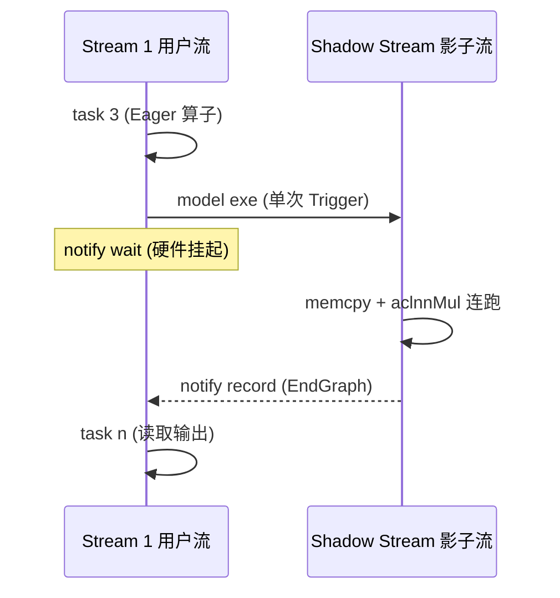

import AclGraphShadowStreamExplainer from './explainers/AclGraphShadowStreamExplainer';

在华为昇腾 NPU 上，静态执行图的核心实现是以 `aclmdlRI`（Model Running Instance，模型运行实例）接口为代表的 **ACL Graph**[^cann-acl-api]。上层 `torch_npu.npu.NPUGraph` 提供了与 CUDA Graph 一致的 Python API，降低框架接入成本。

在 CANN Runtime 底层，ACL Graph 需要匹配 **TS（Task Scheduler，任务调度器）**、`Notify` 信号池与主机参数区生命周期。为此它设计了一套以 **Shadow Model Stream（影子模型流）**与逻辑任务队列为核心的双流架构。

## 昇腾发射瓶颈与生产双态取舍

小批量 Decode 期间，细粒度算子在单卡 AICore 上往往只运行数微秒，CPU 构造参数与提交队列的速度赶不上硬件消费，导致密集空泡。

以 40 层 **DeepSeek-V4.1-Flash**[^v41-cap] 为例，即便 CSA2 把 KV 压至轻量 NVFP4，单层仍含约 28 个算子。它们涵盖四流混合、细粒度 MoE 与 `AscendDSAV41Impl`。加上第 1、14 层的异步 Engram 注入，整网单步需提交超过 1100 次。

因此线上服务在 **Prefill 阶段保持常规 Eager 发射**：长提示词矩阵计算耗时高且形状变化大，跳过静态图能省去 Padding 与捕图成本。请求进入 **Decode 阶段**后，模型运行器依据 `exe_mode` 切换至预录制的 **ACL Graph**，实现一次捕获、多次触发[^cann-acl-api]。

## Capture 六步与 Replay 两步

ACL Graph 把执行生命周期拆分为彼此隔离的 **Capture（图捕获）**与 **Replay（图重放）**两阶段，端到端流转见图 1。


在 **Capture 阶段**，CANN Runtime 的 `src/acl/aclrt_impl/model_ri.cpp` 与会话类 `CaptureSession` 执行六项核心动作[^model-ri-impl][^cap-session]：

| 阶段动作 | 底层核心职责               | CANN Runtime 关键函数 / 结构                           |
| -------- | -------------------------- | ------------------------------------------------------ |
| 动作 1   | 劫持用户流原任务参数体     | `CaptureSession::StreamBeginCapture`                   |
| 动作 2   | 申请持久设备缓冲 D2D 备份  | `CaptureModel::CopyTaskArgsDeviceBuffer`[^args-backup] |
| 动作 3   | 内存态生成逻辑任务描述符   | 构造 `LogicSQ` 链表条目                                |
| 动作 4   | 闭合校验流依赖与 DAG 合法  | `CheckCaptureModelValidity`（`0x0703001F`）            |
| 动作 5   | 严守用户调用序列与跨流依赖 | 原序追加进逻辑流任务表                                 |
| 动作 6   | 捕获期不实际驱动算力核执行 | `IsSoftwareSqEnable` 录完即返不落硬件                  |

针对表格中的动作 2，昇腾算子发射结构体 `comm.args` 常驻留于易变的临时参数区。为此 `CopyTaskArgsDeviceBuffer` 调用 `DevMemAllocWithBackupFlag` 申请持久缓冲。它用 **D2D（Device-to-Device，设备内显存拷贝）**备份参数[^args-backup]，防止图外运算覆盖静态图里的算子指针。

到了 **Replay 阶段**，核心动作收敛为 `PreModelExecute` 与 `ExecuteAsync` 两步[^cap-model]。首次调用 `aclmdlRIExecuteAsync` 时，`CaptureModel::BuildSqCq` 会懒分配物理 `SQ/CQ` 并刷新关联 `Notify ID`。此后每次重放，主线程只需向执行流写入一条 **Trigger（总触发信号）**，调度器就会按预建描述符连续跑完全图。

<AclGraphShadowStreamExplainer
  client:visible
  title="图 2：ACL Graph 单流影子流重定向、EndGraph Notify 收尾、多流 Fork-Join 扩展与 Replay 运行交互推演"
/>

## 单流录制与影子模型流握手

理解单流录制的关键，在于区分**用户调用流**与 **Shadow Model Stream** 的两阶段职责（如图 2 所示）[^cap-session][^cap-model]。

对 `Stream 1` 调用 `aclmdlRICaptureBegin(stream, mode)` 后，Runtime 会新建捕获对象并配对创建 **Shadow Stream（影子流）**。

捕获期间投入 `Stream 1` 的 `memcpyAsync` 与 `aclnnMul` 都会转发进影子流的 `LogicSQ`，而前序普通任务仍留在用户流正常执行。

调用 `aclmdlRICaptureEnd` 结束捕获时，Runtime 会在影子流末端追加一条 EndGraph 通知记录（`TS_TASK_TYPE_NOTIFY_RECORD`）。随后它冻结图拓扑并产出 `modelRI`。

重放时，用户流只需在 `task 3` 与 `task n` 之间插入 `aclmdlRIExecuteAsync`（如图 3 所示）。Runtime 会向用户流写入 `model exe` 与 `notify wait` 两条控制任务。前者触发影子流全速执行，后者让硬件挂起用户流直到 EndGraph Notify 返回，整段等待都在芯片内部完成且不阻塞 CPU。



## 多流汇合校验与安全隔离模式

需要重叠计算与通信的多流模型，依赖流间 **Event Record / Wait** 将副流吸收进同一静态图捕获域，其标准写法与 `cann/runtime` 多流测试例程一致[^model-ri-doc]：

```cpp
// 1. 从 stream1 开启全局捕获
CHECK_ERROR(aclmdlRICaptureBegin(stream1, ACL_MODEL_RI_CAPTURE_MODE_GLOBAL));
// 2. 分叉点 (Fork)：在处于捕获态的 stream1 记录 event1，再让未捕获的 stream2 等待它
CHECK_ERROR(aclrtRecordEvent(event1, stream1));
CHECK_ERROR(aclrtStreamWaitEvent(stream2, event1));

// 3. 此刻 stream2 已被 Runtime 自动吸收并归属进同一 ACL Graph 捕获域，双流并发下发各自算子
aclnnMul(mulWorkspaceAddr, mulWorkspaceSize, mulExecutor, stream1);
aclnnMul(mulWorkspaceAddr2, mulWorkspaceSize2, mulExecutor2, stream2);
aclnnAdd(mulWorkspaceAddr2, mulWorkspaceSize2, mulExecutor2, stream2);

// 4. 汇合点 (Join)：由 stream2 记录结束锚点 event2，并由捕获原点流 stream1 明确等待收尾
CHECK_ERROR(aclrtRecordEvent(event2, stream2));
CHECK_ERROR(aclrtStreamWaitEvent(stream1, event2));

// 5. 捕获收尾：Runtime 验明两条流已完整汇合形成有效有向图拓扑后输出 modelRI
CHECK_ERROR(aclmdlRICaptureEnd(stream1, &modelRI));
```

在 `aclmdlRICaptureEnd` 阶段，`CaptureSession::CheckCaptureModelValidity` 会核查两项闭合规则[^cap-session]。只要副流未通过反向 Event 汇回原点流 `origCaptureStream`，或者误将 `RT_EVENT_EXTERNAL` 充当内部依赖，Runtime 就会拒绝建图。此时系统抛出 **`RT_ERROR_STREAM_UNJOINED`**（错误码 `0x0703001F`，日志 EE1017）。

此外，`aclmdlRICaptureBegin` 还提供三种安全模式控制多线程并发隔离，并支持在捕获期间通过 `aclmdlRICaptureThreadExchangeMode` 动态切换：

| 捕获安全模式（`aclmdlRICaptureMode`）    | 跨线程与并发隔离规则           | 典型适用场景             |
| ---------------------------------------- | ------------------------------ | ------------------------ |
| `ACL_MODEL_RI_CAPTURE_MODE_GLOBAL`       | 拦截同进程他线程不安全异步调用 | 单进程单主控、默认保护   |
| `ACL_MODEL_RI_CAPTURE_MODE_THREAD_LOCAL` | 仅拦截发起捕获线程，余流正常   | 多线程调度与指标热更并行 |
| `ACL_MODEL_RI_CAPTURE_MODE_RELAXED`      | 放开隐式截断，调用方自保隔离   | 底层沙箱与特殊内存池集成 |

## 捕获状态机与参数隔离仿真

下面的纯 CPU Python 状态机模拟了 `CaptureSession` 的核心状态流转。脚本重点验证参数快照备份、未汇合流拦截以及首次重放懒分配物理队列三项行为：

```python
from dataclasses import dataclass


@dataclass
class LogicSqTask:
    name: str
    args_backup: tuple
    is_notify_record: bool = False


class MockCaptureSession:
    def __init__(self) -> None:
        self.capturing = False
        self.mode: str | None = None
        self.origin_stream: str | None = None
        self.shadow_stream = "shadow_model_s0"
        self.capture_streams: set[str] = set()
        self.recorded_events: dict[str, str] = {}
        self.joined_streams: set[str] = set()
        self.tasks: list[LogicSqTask] = []
        self.sq_bound = False

    def capture_begin(self, stream: str, mode: str = "ACL_MODEL_RI_CAPTURE_MODE_GLOBAL") -> None:
        self.capturing, self.mode, self.origin_stream = True, mode, stream
        self.capture_streams = {stream}
        self.tasks.clear()

    def record_task(self, stream: str, name: str, host_args: list[int]) -> None:
        if stream not in self.capture_streams:
            raise RuntimeError(f"Stream {stream} is not in capture topology")
        self.tasks.append(LogicSqTask(name=name, args_backup=tuple(host_args)))

    def record_event(self, event: str, stream: str) -> None:
        if stream in self.capture_streams:
            self.recorded_events[event] = stream

    def stream_wait_event(self, stream: str, event: str) -> None:
        src = self.recorded_events.get(event)
        if not src:
            return
        if src in self.capture_streams and stream not in self.capture_streams:
            self.capture_streams.add(stream)
        elif stream == self.origin_stream and src in self.capture_streams:
            self.joined_streams.add(src)

    def capture_end(self) -> list[LogicSqTask]:
        unjoined = [s for s in self.capture_streams if s != self.origin_stream and s not in self.joined_streams]
        if unjoined:
            raise RuntimeError(f"RT_ERROR_STREAM_UNJOINED (0x0703001F): unjoined streams={unjoined}")
        self.tasks.append(LogicSqTask("TS_TASK_TYPE_NOTIFY_RECORD(EndGraph)", ("root_notify",), True))
        self.capturing = False
        return list(self.tasks)

    def execute_async(self, user_stream: str) -> list[str]:
        ops = []
        if not self.sq_bound:
            ops.append(f"PreModelExecute:BuildSqCq(streams={len(self.capture_streams)})")
            self.sq_bound = True
        ops.append(f"{user_stream}<-model_exe(trigger {self.shadow_stream})")
        ops.append(f"{user_stream}<-notify_wait(EndGraph)")
        return ops


sess = MockCaptureSession()
sess.capture_begin("stream_1")
host_dims = [8, 128]
sess.record_task("stream_1", "memcpyAsync", host_dims)
sess.record_event("ev_fork", "stream_1")
sess.stream_wait_event("stream_2", "ev_fork")
sess.record_task("stream_2", "aclnnMul_branch", [8, 128])
host_dims[0] = 999  # 模拟捕获后修改主机临时缓冲，备份副本应保持 (8, 128)
sess.record_event("ev_join", "stream_2")
sess.stream_wait_event("stream_1", "ev_join")
model_tasks = sess.capture_end()

print(f"[Captured LogicSQ] count={len(model_tasks)}, args_backup_of_task0={model_tasks[0].args_backup}, tail={model_tasks[-1].name}")
print(f"[Replay #1] {sess.execute_async('stream_1')}")
print(f"[Replay #2] {sess.execute_async('stream_1')}")
```

脚本输出印证了两项不变量：捕获后把 `host_dims[0]` 原地改为 999，逻辑队列内的参数副本依然保持 `(8, 128)`。此外，`BuildSqCq` 只在初次重放时分配 `streams=2` 物理通道，后续执行仅向用户流写入两条控制命令：

```text
[Captured LogicSQ] count=3, args_backup_of_task0=(8, 128), tail=TS_TASK_TYPE_NOTIFY_RECORD(EndGraph)
[Replay #1] ['PreModelExecute:BuildSqCq(streams=2)', 'stream_1<-model_exe(trigger shadow_model_s0)', 'stream_1<-notify_wait(EndGraph)']
[Replay #2] ['stream_1<-model_exe(trigger shadow_model_s0)', 'stream_1<-notify_wait(EndGraph)']
```

基础静态图把所有参数与控制流都冻结在录制瞬间。但线上推理还会遇到变长 KV Cache 触发的 Attention Tiling 更新，以及投机解码里的条件分支。[第 5 章：ACL Graph 热更新与条件子图流控](../05-acl-graph-task-update-and-conditional-subgraph/)将说明如何在不重建整图的前提下消化这两类动态变化。

[^cann-acl-api]: 参阅 `cann/runtime`（提交 `1954820a`）文档 `docs/zh/api_ref/15_model_running_instance_management.md`，全面列示 `aclmdlRICaptureBegin`、`aclmdlRICaptureEnd`、`aclmdlRIExecuteAsync` 等生命周期管理接口与约束。

[^model-ri-impl]: 参阅 `cann/runtime`（提交 `1954820a`）源码 `src/acl/aclrt_impl/model_ri.cpp` 第 1–466 行公开接口实现层。

[^cap-session]: 参阅 `cann/runtime`（提交 `1954820a`）源码 `src/runtime/feature/aclgraph/capture_session.cc` 第 1–1167 行对 `StreamBeginCapture`、`StreamEndCapture`、`CheckCaptureModelValidity` 及 `RT_ERROR_STREAM_UNJOINED` 拦截逻辑的定义。

[^args-backup]: 参阅 `cann/runtime`（提交 `1954820a`）源码 `src/runtime/feature/aclgraph/capture_model_args_backup.cc` 第 16–55 行 `CaptureModel::CopyTaskArgsDeviceBuffer` 的 Device 参数保护拷贝实现。

[^cap-model]: 参阅 `cann/runtime`（提交 `1954820a`）源码 `src/runtime/feature/aclgraph/capture_model.cc` 第 497–615、1556–1605 及 2346–2413 行对 `PreModelExecute`、`BuildSqCq` 和 `ModelEndGraph` 的底层管控逻辑。

[^model-ri-doc]: 参阅 `cann/runtime`（提交 `1954820a`）官方示例 `example/2_advanced_features/model_ri/0_simple_model/main.cpp` 与 API 手册多流 Stream Capture 例程。

[^v41-cap]: DeepSeek-V4.1-Flash 40 层 CED、`npu_hc_pre_v3`/`npu_hc_post` 及 `AscendDSAV41Impl` 在昇腾生产栈的算子分布见本站[10 串珠成链：V4.1 单步全链路与双硬件协同](../../deepseek/10-architecture-synthesis/)。
