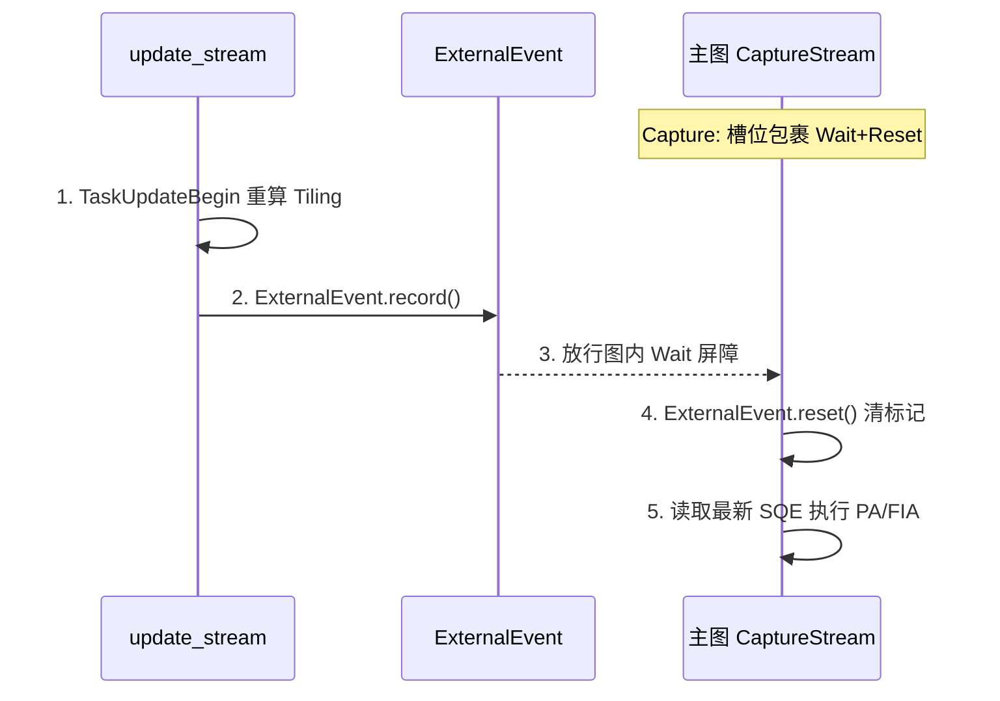
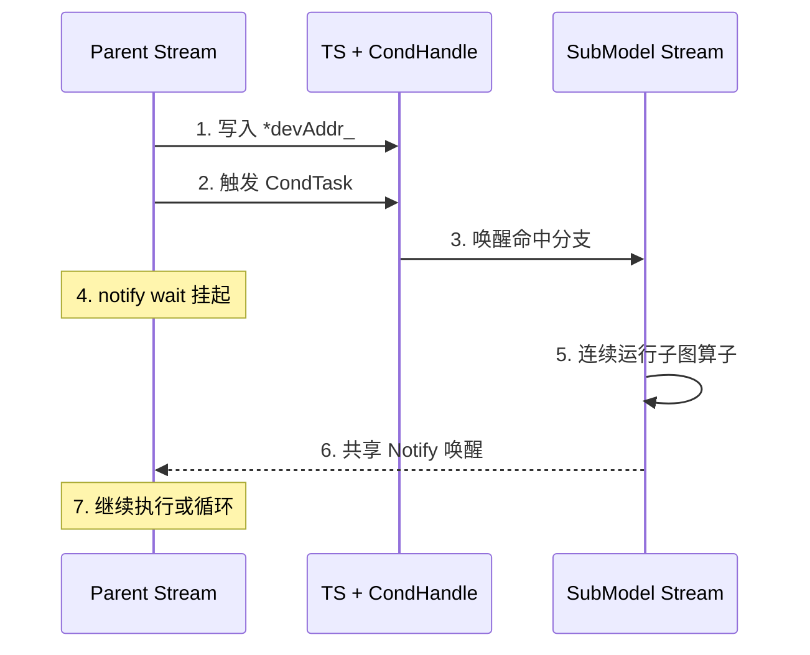

import AclGraphDynamicControlExplainer from '../../../../explainers/aclgraph/AclGraphDynamicControlExplainer';

基础 ACL Graph 能高速重放固定拓扑，但在生产服务（如 40 层 **DeepSeek-V4.1-Flash** 长上下文解码与 **DSpark** 3 层 SWA 动态推测解码验证[^dspark-sub]）下会遭遇两类运行期动态变化：

| 动态变化维度 | 静态图局限与生产瓶颈                    | ACL Graph 原地化解方案                |
| ------------ | --------------------------------------- | ------------------------------------- |
| 算子参数层面 | `seq_kv` 增长使 Host 预计算 Tiling 失效 | `TaskGrp` + `TaskUpdate` 划槽原地刷新 |
| 控制流层面   | 条件跳出与循环依赖 CPU `Synchronize`    | `CondHandle` + 条件子图无往返分支循环 |


## 变长注意力困境：TaskGrp 划槽与 TaskUpdate 原位热刷新

与 NVIDIA Kernel 在设备侧直接读取常驻 `seq_lens` 不同，昇腾高阶 `aclnn` 注意力算子将切片分块边界（Tiling 与 Workspace 偏移）前移至 CPU 计算后随 Kernel Args 写入任务描述符。既然模型其余投影与 MoE 算子在同一批尺寸桶内完全不变，CANN Runtime 通过 **`aclrtTaskGrp`** 对少量变长算子实施“局部打孔、定点替换”[^cann-model-ri][^cap-session-up]：

| 操作时机         | 核心 CANN / torch_npu 接口        | 底层逻辑队列操作机理                       |
| ---------------- | --------------------------------- | ------------------------------------------ |
| 捕获期标注起止   | `aclmdlRICaptureTaskGrpBegin/End` | 插入预取 Nop，登记可改 `(stream, task)` 槽 |
| 重放前切换更新态 | `CaptureTaskUpdateBegin`          | 传入非捕获 `update_stream` 切换至 `UPDATE` |
| 发射新参数描述符 | 重算新 `seq_kv` 下的 FIA/PA 算子  | `isUpdateSinkSqe=1` 一对一覆写原 Tiling    |
| 更新完毕封闭生效 | `CaptureTaskUpdateEnd`            | 结束切片更新作用域，其余图节点不动         |

<AclGraphDynamicControlExplainer
  client:visible
  title="图 2：TaskGrp 局部热覆写（配 ExternalEvent 护栏）与 CondHandle 原生条件子图控制流交互推演"
/>

### ExternalEvent 防并发踩踏与 `torch_npu._GraphDispatchMode`

热刷新需要解决跨步读写竞态：若第 $t+1$ 步的 `TaskUpdateBegin` 在第 $t$ 步物理任务还没读完原参数槽位前就原地覆写描述符，或主图在更新尚未落定前就先触发回放，便会导致踩踏错误。为此，CANN Runtime 与 `torch_npu` 源码 `torch_npu/npu/graphs.py` 中的 **`_GraphDispatchMode`** 通过 **`ExternalEvent`** 构建了三段自动互锁协议[^torch-graphs][^torch-streams-up]：



- **Capture 期自动布防**：`_GraphDispatchMode` 截获注册的动态算子，在其前自动插入 `ExternalEvent.wait(capture_stream)` 与 `ExternalEvent.reset(capture_stream)`（防止下轮重放直接读到上一轮残留信号），并用 `graph_task_group_begin/end` 框出 `taskGrp`。
- **Replay 前热更同步**：业务将最新元数据传入 `update_capture_record` 后，框架在非捕获更新流 `update_stream` 上打开 `TaskUpdateBegin/End` 重写 Tiling 并于尾部发射 `ExternalEvent.record(update_stream)`，保证更新与前序图回放无阻塞重叠且顺序严密。

## Conditional Subgraph：把条件判断彻底放进 NPU 控制面

面对由中间张量即时决定的 `if / else / while / switch` 分支与自循环，**Conditional Subgraph（条件子图）体系**在 `cann/runtime` 中依托 `CondHandle` 与 `CaptureToModelRI` 将整套控制跳转下沉进 NPU 设备与 TS 固件[^cond-hpp][^cond-cc]：

### `CondHandle`、`defaultValue_` 复位与 `aclmdlRICondTaskParams`

- **`devAddr_` 与默认值复位**：`aclmdlRICondHandleCreate` 调用 `CondHandle::Setup` 在设备侧分配 **8 字节 `devAddr_`**（物理地址由 `aclmdlRICondHandleGetCondPtr` 提取，供前序算子直接在设备侧写条件值）并在主机保存不可变 `defaultValue_`[^cond-hpp]。附带 **`ACL_MODEL_RI_COND_HANDLE_ASSIGN_DEFAULT`** 标志时，`PreModelExecute` 会在每次图重启前通过 `CondHandle::InitCondTaskByDefValue` 把默认值经 **H2D（Host-to-Device，主机到设备拷贝）**刷新至 `devAddr_`，确保多次重放幂等。
- **三类分支控制原语**：在父图控制位置装配结构体 `aclmdlRICondTaskParams`（`acl_rt.h` 第 448–454 行[^acl-rt-h]）并调用 `aclmdlRIAddCondTask`，覆盖 `IF`（`size` 1 或 2）、`WHILE`（固定 `size = 1` 直到 `*devAddr_ == 0` 退出）及多路整型索引跳转 `SWITCH`（`size > 0`）：

```cpp
typedef struct tagAclmdlRICondTaskParams {
    aclmdlRICondHandle handle;     // 绑定指向设备 8 B 条件值的硬件句柄
    aclmdlRICondTaskType type;     // ACL_MODEL_RI_COND_TYPE_IF(0) / WHILE(1) / SWITCH(2)
    uint32_t size;                 // 产出子图数组元素个数：IF 允许 1 或 2，WHILE 固定为 1，SWITCH 须大于 0
    aclmdlRI* modelRIArray;        // 输出数组，接收 Runtime 预先分配好的各支路子 aclmdlRI 句柄
} aclmdlRICondTaskParams;
```

### 子图捕获 `CaptureToModelRIBegin` 与共享 `subModelNotify_` 收尾

针对 `modelRIArray[i]`，在各自子分支流上调用 **`aclmdlRICaptureToModelRIBegin(subStream, modelRIArray[i], mode)`** 录制分支算子并以 `aclmdlRICaptureEnd` 闭合。无论 `SWITCH`/`IF` 存在多少条分支，所属同一 `CondHandle` 的所有子模型在硬件侧**共用唯一一枚通知字 `subModelNotify_`**[^cond-hpp][^cond-cc]：

- **父流侧焊接**：`aclmdlRIAddCondTask` 插入条件跳转描述符 **`TS_TASK_TYPE_CAPTURE_CONDITION`**（`SQE 0`），同时由 `UpdateCondTaskNotifyWaitSqe` 在紧邻槽位（`SQE + 1`）追加 **`notify wait`** 挂起父流。
- **TS 固件执行与共享唤醒**：TS 直接读取 HBM 中 8 字节 `*devAddr_` 激活对应子流；命中分支末尾统一发射 `subModelNotify_` 的 `notify record` 唤醒父流（见图 4）。在 Python 层，`torch_npu` 通过 `_npugraph_conditional_nodes.py` 的 **`NPUGraphCaptureControlFlowOpDispatchMode`** 自动把 `torch.ops.higher_order.cond` / `while_loop` 映射到该硬件链路[^torch-cond]。



## TaskUpdate 与硬件 WHILE 循环协同仿真验证

下面的纯 CPU Python 模型联合仿真了变长 KV Cache 下的 `TaskGrp + ExternalEvent` 局部更新以及 `CondHandle + WHILE` 设备端自循环推测校验过程：

```python
class CondHandleSim:
    def __init__(self, default_val: int, assign_default: bool = True) -> None:
        self.default_val = default_val
        self.assign_default = assign_default
        self.dev_addr_val = 0

    def pre_model_reset(self) -> None:
        if self.assign_default:
            self.dev_addr_val = self.default_val


class TaskGrpAndCondModel:
    def __init__(self) -> None:
        self.pa_sqe = {"seq_kv": 0, "tiling_ver": 0, "isUpdateSinkSqe": 1}
        self.ext_ev_reset_done = True
        self.cond_handle = CondHandleSim(default_val=1, assign_default=True)

    def task_update_and_replay(
        self, seq_kv: int, draft_probs: list[float], threshold: float = 0.65
    ) -> dict:
        if not self.ext_ev_reset_done:
            raise RuntimeError("ExternalEvent must be waited & reset before update")
        # Step A: 非捕获更新流原地覆写 TaskGrp 槽位并记录 ExternalEvent
        self.pa_sqe["seq_kv"] = seq_kv
        self.pa_sqe["tiling_ver"] += 1
        # Step B: PreModelExecute 将 CondHandle defaultValue_ H2D 复位至 devAddr_
        self.cond_handle.pre_model_reset()
        # Step C: 设备侧硬件 WHILE 循环直接执行条件子图（零 CPU 往返）
        iters = 0
        cpu_roundtrips = 0
        while self.cond_handle.dev_addr_val != 0 and iters < len(draft_probs):
            p = draft_probs[iters]
            iters += 1
            if p < threshold:
                self.cond_handle.dev_addr_val = 0  # 子图算子向 *devAddr_ 写入 0
        # Step D: 父图内等待并重置 ExternalEvent，恢复下步防护护栏
        self.ext_ev_reset_done = True
        return {
            "seq_kv": self.pa_sqe["seq_kv"],
            "tiling_ver": self.pa_sqe["tiling_ver"],
            "while_iters": iters,
            "cpu_roundtrips": cpu_roundtrips,
        }


sim = TaskGrpAndCondModel()
cases = [
    (128, [0.91, 0.88, 0.52, 0.80]),
    (512, [0.95, 0.92, 0.90, 0.87]),
    (2048, [0.40, 0.85, 0.90, 0.88]),
]
for step_idx, (skv, probs) in enumerate(cases, start=1):
    out = sim.task_update_and_replay(skv, probs)
    print(
        f"[Step {step_idx}] PA.seq_kv={out['seq_kv']:4d} (ver={out['tiling_ver']}), "
        f"WHILE_iters={out['while_iters']}, CPU_roundtrips={out['cpu_roundtrips']}"
    )
```

运行日志如下：`seq_kv` 从 128 跃迁至 2048 期间仅局部递增刷新 3 次，同时设备侧分别执行 3、4、1 轮子图内部迭代即动态退出，CPU 往返干预次数始终为 0：

```text
[Step 1] PA.seq_kv= 128 (ver=1), WHILE_iters=3, CPU_roundtrips=0
[Step 2] PA.seq_kv= 512 (ver=2), WHILE_iters=4, CPU_roundtrips=0
[Step 3] PA.seq_kv=2048 (ver=3), WHILE_iters=1, CPU_roundtrips=0
```

[第 6 章：昇腾推理全栈集成与故障定位](../06-acl-graph-fullstack-and-vllm-ascend/)将把前述全部底层原语接入 `vllm-ascend` 生产全栈，系统性给出选型矩阵与高频错误码排障路径。

[^cann-model-ri]: 参阅 `cann/runtime`（提交 `1954820a`）头文件 `include/external/acl/acl_rt.h`（第 830、5230、5240 行等）及 API 手册 `15_model_running_instance_management.md`。

[^cap-session-up]: 参阅 `cann/runtime`（提交 `1954820a`）源码 `src/runtime/feature/aclgraph/capture_session.cc` 与 `capture_model.cc` 对 `StreamBeginTaskGrp`、`StreamBeginTaskUpdate`、`UpdateStreamTask` 和 `isUpdateSinkSqe` 标志位的实现。

[^torch-graphs]: 参阅 `Ascend/pytorch`（提交 `d09e29e4`）源码 `torch_npu/npu/graphs.py` 第 420–588 行 `_GraphDispatchMode` 与 `update_capture_record` 实现。

[^torch-streams-up]: 参阅 `Ascend/pytorch`（提交 `d09e29e4`）源码 `torch_npu/npu/streams.py` 第 180–365 行关于 `ExternalEvent` 与 `Event(external=True)` 行为规范的注释。

[^cond-hpp]: 参阅 `cann/runtime`（提交 `1954820a`）源码 `src/runtime/core/inc/cond_handle/cond_handle.hpp` 第 24–77 行与 `src/runtime/feature/aclgraph/cond_handle.cc` 第 1–188 行对 `CondHandle`、`InitCondTaskByDefValue` 及 `UpdateCondTaskNotifyWaitSqe` 的实现。

[^cond-cc]: 参阅 `cann/runtime`（提交 `1954820a`）官方例子 `example/2_advanced_features/model_ri/3_cond_model/main.cpp` 及 `4_model_sync_external/main.cpp`。

[^acl-rt-h]: 参阅 `cann/runtime`（提交 `1954820a`）头文件 `include/external/acl/acl_rt.h` 第 436–454 及 5938–5975 行。

[^torch-cond]: 参阅 `Ascend/pytorch`（提交 `d09e29e4`）源码 `torch_npu/npu/_npugraph_conditional_nodes.py` 第 1–159 行对 `NPUGraphCaptureControlFlowOpDispatchMode` 与高阶控制流的适配实现。

[^dspark-sub]: 关于 DeepSeek-V4.1-Flash DSpark（3 层 SWA Draft 头与无损多词元校验）细节，参阅本站[09 MTP 与 DSpark 动态推测解码](../../deepseek/09-mtp-and-dspark/)。
