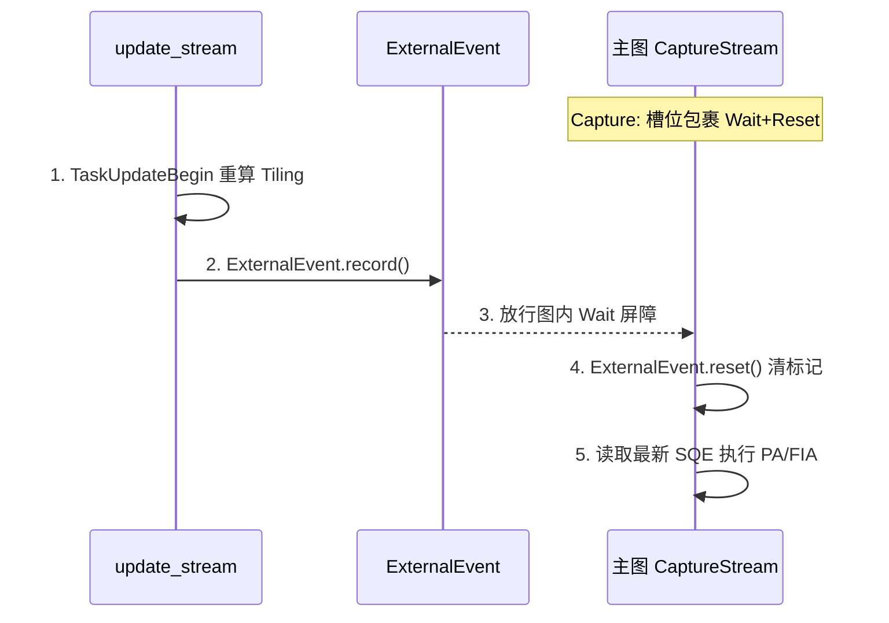
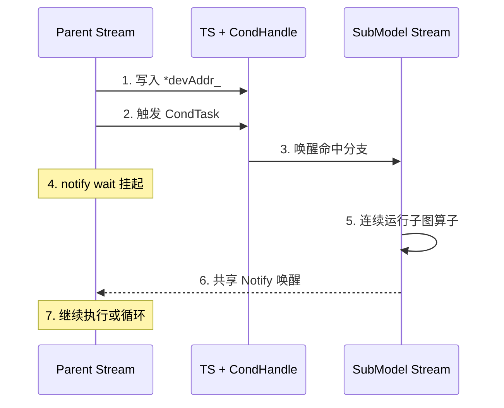

import AclGraphDynamicControlExplainer from './explainers/AclGraphDynamicControlExplainer';

基础 ACL Graph 只能重放固定拓扑，但生产服务常在两处打破静态假设。在 **DeepSeek-V4.1-Flash** 长上下文解码与 **DSpark** 3 层 SWA 动态推测解码中[^dspark-sub]，系统必须应对以下两类运行期变化：

| 动态变化维度 | 静态图局限与生产瓶颈                    | ACL Graph 原地化解方案                |
| ------------ | --------------------------------------- | ------------------------------------- |
| 算子参数层面 | `seq_kv` 增长使 Host 预计算 Tiling 失效 | `TaskGrp` + `TaskUpdate` 划槽原地刷新 |
| 控制流层面   | 条件跳出与循环依赖 CPU `Synchronize`    | `CondHandle` + 条件子图无往返分支循环 |

```mermaid caption="图 1：父图内嵌可原地覆写的 TaskGrp 槽位、ExternalEvent 保序同步边界以及 CondHandle 条件分支子图协同结构"
flowchart TB
  subgraph P["父 ACL Graph 主逻辑流 (Parent CaptureModel)"]
    direction LR
    P0["前驱 Task<br/>Norm / QKV"] --> P1["TaskGrp<br/>SinkSqe=1 可原地覆写"]
    P1 --> P2["notify wait<br/>SQE+1"]
    P2 --> P3["后续 Task<br/>Notify 唤醒"]
    P2 --> P4{"CondTask<br/>*devAddr"}
  end
  subgraph U["Replay 前热刷新 (TaskUpdate)"]
    direction TB
    U0["update_stream TaskUpdateBegin<br/>原地重写 PA/FIA Tiling 描述符"] --> U1["ExternalEvent<br/>更新流 record → 主图 wait + reset"]
  end
  subgraph S["CondHandle 与条件子图"]
    direction TB
    S0["CondHandle (8B devAddr_)<br/>PreExecute H2D 条件字"] --> S1["Sub Graph 0 (IF / WHILE)<br/>结尾共享 subModelNotify_"]
    S0 -.-> S2["Sub Graph 1 (Else)<br/>同发 Notify Record 返回"]
  end
  U1 --> P1
  S0 --> P4
```

## TaskGrp 划槽与热刷新

NVIDIA Kernel 通常在设备侧直接读取常驻的 `seq_lens`。而昇腾 `aclnn` 注意力算子把 Tiling 与 Workspace 偏移计算前移到了主机侧，并随 Kernel Args 写入任务描述符。

由于同分桶内其余投影与 MoE 算子完全不变，CANN Runtime 通过 **`aclrtTaskGrp`** 对变长算子槽位实施“局部打孔、定点替换”[^cann-model-ri][^cap-session-up]：

| 操作时机         | 核心 CANN / torch_npu 接口        | 底层逻辑队列动作                           |
| ---------------- | --------------------------------- | ------------------------------------------ |
| 捕获期标注起止   | `aclmdlRICaptureTaskGrpBegin/End` | 插入预取 Nop，登记可改 `(stream, task)` 槽 |
| 重放前切换更新态 | `CaptureTaskUpdateBegin`          | 传入非捕获 `update_stream` 切换至 `UPDATE` |
| 发射新参数描述符 | 重算新 `seq_kv` 下的 FIA/PA 算子  | `isUpdateSinkSqe=1` 一对一覆写原 Tiling    |
| 更新完毕封闭生效 | `CaptureTaskUpdateEnd`            | 结束切片更新作用域，其余图节点不动         |

<AclGraphDynamicControlExplainer
  client:visible
  title="图 2：TaskGrp 局部热覆写（配 ExternalEvent 护栏）与 CondHandle 原生条件子图控制流交互推演"
/>

### 外部事件护栏与热更防踩踏

原地热刷新必须挡住跨步读写竞态。如果第 $t+1$ 步的 `TaskUpdateBegin` 在第 $t$ 步物理任务读完参数槽位前就覆写描述符，或者主图在更新落定前提前回放，都会引发数据踩踏。

为此，CANN Runtime 与 `torch_npu` 图分发模块通过 **`ExternalEvent`** 构建了防踩踏协议（如图 3 所示）[^torch-graphs][^torch-streams-up]。

捕获期，图分发代理先用 `graph_task_group_begin/end` 框出动态算子的 `taskGrp` 槽位。随后它会在算子前方插入 `ExternalEvent.wait` 与 `ExternalEvent.reset`，清掉上一轮残留信号。

到重放前热更时，框架在非捕获流 `update_stream` 上打开 `TaskUpdateBegin/End` 重写 Tiling，并在尾部发射 `ExternalEvent.record`。这保证了参数更新与前序图回放无阻塞重叠，同时按因果顺序放行新参数。



## NPU 设备端条件子图流控

当 `if`、`while` 或 `switch` 分支取决于中间张量值时，常规静态图必须退回主机判断。为此 `cann/runtime` 提供了 **Conditional Subgraph（条件子图）**体系。它依托 `CondHandle` 与 `CaptureToModelRI` 把控制跳转下沉进 NPU 与 TS 固件[^cond-hpp][^cond-cc]。

### 条件句柄复位与分支参数结构

调用 `aclmdlRICondHandleCreate` 时，`CondHandle::Setup` 会在设备侧分配 8 字节 `devAddr_`，并在主机保存不可变的默认值 `defaultValue_`[^cond-hpp]。前序算子可通过 `aclmdlRICondHandleGetCondPtr` 拿到设备指针并直接在算子内写条件值。

若创建句柄时传入 **`ACL_MODEL_RI_COND_HANDLE_ASSIGN_DEFAULT`** 标志，`PreModelExecute` 会在每次重放前刷新条件值。它会用 **H2D（Host-to-Device，主机到设备拷贝）**把默认值写回 `devAddr_`，确保多次重放幂等。

随后我们在父图控制点装配 `aclmdlRICondTaskParams`[^acl-rt-h] 并调用 `aclmdlRIAddCondTask`。参数中的 type 与 size 分别指定分支类型与子图数量：`IF` 支持 1 或 2 路，`WHILE` 固定为 1 路直到条件值为零退出，`SWITCH` 则按整型索引跳转多路：

```cpp
typedef struct tagAclmdlRICondTaskParams {
    aclmdlRICondHandle handle;     // 绑定指向设备 8 B 条件值的硬件句柄
    aclmdlRICondTaskType type;     // ACL_MODEL_RI_COND_TYPE_IF(0) / WHILE(1) / SWITCH(2)
    uint32_t size;                 // 产出子图数组元素个数：IF 允许 1 或 2，WHILE 固定为 1，SWITCH 须大于 0
    aclmdlRI* modelRIArray;        // 输出数组，接收 Runtime 预先分配好的各支路子 aclmdlRI 句柄
} aclmdlRICondTaskParams;
```

### 子图录制与共享通知唤醒

拿到预分配的子句柄数组 `modelRIArray` 后，我们在各支路流上调用 **`aclmdlRICaptureToModelRIBegin`** 录制分支算子。各支路最终以 `aclmdlRICaptureEnd` 闭合[^cond-hpp][^cond-cc]。同一 `CondHandle` 名下的所有分支子图，在硬件侧共同绑定唯一一枚通知字 `subModelNotify_`。

在父流侧，`aclmdlRIAddCondTask` 先插入条件跳转描述符 `TS_TASK_TYPE_CAPTURE_CONDITION`，紧接着在下一槽位追加 `notify wait` 挂起父流。执行时，TS 固件直接读取 HBM 中的 8 字节 `*devAddr_` 激活对应支路流（如图 4 所示）。

命中分支跑完子图算子后，在末尾发射 `subModelNotify_` 的 `notify record` 唤醒父流继续执行或进入下一轮循环。在 Python 层，`torch_npu` 的控制流分发模块会自动把 `torch.ops.higher_order.cond` 与 `while_loop` 映射到这条硬件链路[^torch-cond]。



## 热刷新与设备循环协同仿真

下面的纯 CPU Python 脚本同时模拟了变长 KV Cache 的局部更新与设备侧自循环推测校验过程：

```python
class CondHandleSim:
    def __init__(self, default_val: int, assign_default: bool = True) -> None:
        self.default_val = default_val
        self.assign_default = assign_default
        self.dev_addr_val = 0

    def pre_model_reset(self) -> None:
        if self.assign_default:
            self.dev_addr_val = self.default_val


class TaskGrpAndCondModel:
    def __init__(self) -> None:
        self.pa_sqe = {"seq_kv": 0, "tiling_ver": 0, "isUpdateSinkSqe": 1}
        self.ext_ev_reset_done = True
        self.cond_handle = CondHandleSim(default_val=1, assign_default=True)

    def task_update_and_replay(
        self, seq_kv: int, draft_probs: list[float], threshold: float = 0.65
    ) -> dict:
        if not self.ext_ev_reset_done:
            raise RuntimeError("ExternalEvent must be waited & reset before update")
        # Step A: 非捕获更新流原地覆写 TaskGrp 槽位并记录 ExternalEvent
        self.pa_sqe["seq_kv"] = seq_kv
        self.pa_sqe["tiling_ver"] += 1
        # Step B: PreModelExecute 将 CondHandle defaultValue_ H2D 复位至 devAddr_
        self.cond_handle.pre_model_reset()
        # Step C: 设备侧硬件 WHILE 循环直接执行条件子图（零 CPU 往返）
        iters = 0
        cpu_roundtrips = 0
        while self.cond_handle.dev_addr_val != 0 and iters < len(draft_probs):
            p = draft_probs[iters]
            iters += 1
            if p < threshold:
                self.cond_handle.dev_addr_val = 0  # 子图算子向 *devAddr_ 写入 0
        # Step D: 父图内等待并重置 ExternalEvent，恢复下步防护护栏
        self.ext_ev_reset_done = True
        return {
            "seq_kv": self.pa_sqe["seq_kv"],
            "tiling_ver": self.pa_sqe["tiling_ver"],
            "while_iters": iters,
            "cpu_roundtrips": cpu_roundtrips,
        }


sim = TaskGrpAndCondModel()
cases = [
    (128, [0.91, 0.88, 0.52, 0.80]),
    (512, [0.95, 0.92, 0.90, 0.87]),
    (2048, [0.40, 0.85, 0.90, 0.88]),
]
for step_idx, (skv, probs) in enumerate(cases, start=1):
    out = sim.task_update_and_replay(skv, probs)
    print(
        f"[Step {step_idx}] PA.seq_kv={out['seq_kv']:4d} (ver={out['tiling_ver']}), "
        f"WHILE_iters={out['while_iters']}, CPU_roundtrips={out['cpu_roundtrips']}"
    )
```

运行日志如下：`seq_kv` 从 128 跃迁至 2048 期间仅局部递增刷新 3 次，同时设备侧分别执行 3、4、1 轮子图内部迭代即动态退出，CPU 往返干预次数始终为 0：

```text
[Step 1] PA.seq_kv= 128 (ver=1), WHILE_iters=3, CPU_roundtrips=0
[Step 2] PA.seq_kv= 512 (ver=2), WHILE_iters=4, CPU_roundtrips=0
[Step 3] PA.seq_kv=2048 (ver=3), WHILE_iters=1, CPU_roundtrips=0
```

[第 6 章：ACL Graph 生产全栈与故障定位](../06-acl-graph-fullstack-and-vllm-ascend/)将把前述全部底层原语接入 `vllm-ascend` 生产全栈，给出模式选型矩阵与高频错误码排障路径。

[^cann-model-ri]: 参阅 `cann/runtime`（提交 `1954820a`）头文件 `include/external/acl/acl_rt.h`（第 830、5230、5240 行等）及 API 手册 `15_model_running_instance_management.md`。

[^cap-session-up]: 参阅 `cann/runtime`（提交 `1954820a`）源码 `src/runtime/feature/aclgraph/capture_session.cc` 与 `capture_model.cc` 对 `StreamBeginTaskGrp`、`StreamBeginTaskUpdate`、`UpdateStreamTask` 和 `isUpdateSinkSqe` 标志位的实现。

[^torch-graphs]: 参阅 `Ascend/pytorch`（提交 `d09e29e4`）源码 `torch_npu/npu/graphs.py` 第 420–588 行 `_GraphDispatchMode` 与 `update_capture_record` 实现。

[^torch-streams-up]: 参阅 `Ascend/pytorch`（提交 `d09e29e4`）源码 `torch_npu/npu/streams.py` 第 180–365 行关于 `ExternalEvent` 与 `Event(external=True)` 行为规范的注释。

[^cond-hpp]: 参阅 `cann/runtime`（提交 `1954820a`）源码 `src/runtime/core/inc/cond_handle/cond_handle.hpp` 第 24–77 行与 `src/runtime/feature/aclgraph/cond_handle.cc` 第 1–188 行对 `CondHandle`、`InitCondTaskByDefValue` 及 `UpdateCondTaskNotifyWaitSqe` 的实现。

[^cond-cc]: 参阅 `cann/runtime`（提交 `1954820a`）官方例子 `example/2_advanced_features/model_ri/3_cond_model/main.cpp` 及 `4_model_sync_external/main.cpp`。

[^acl-rt-h]: 参阅 `cann/runtime`（提交 `1954820a`）头文件 `include/external/acl/acl_rt.h` 第 436–454 及 5938–5975 行。

[^torch-cond]: 参阅 `Ascend/pytorch`（提交 `d09e29e4`）源码 `torch_npu/npu/_npugraph_conditional_nodes.py` 第 1–159 行对 `NPUGraphCaptureControlFlowOpDispatchMode` 与高阶控制流的适配实现。

[^dspark-sub]: 关于 DeepSeek-V4.1-Flash DSpark（3 层 SWA Draft 头与无损多 token 校验）细节，参阅本站[09 多 token 预测与 DSpark 动态推测解码](../../deepseek/09-mtp-and-dspark/)。
