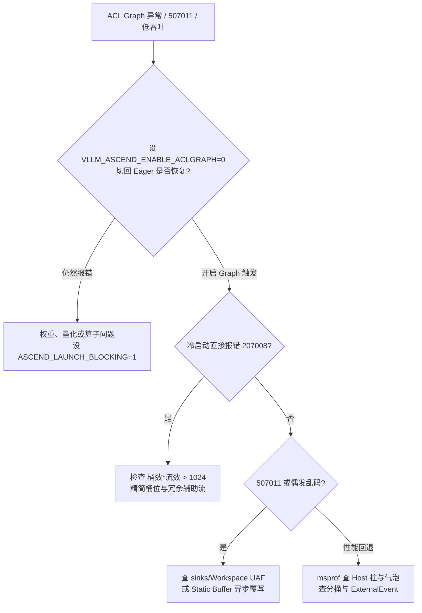

把 ACL Graph 拉进 `vllm-ascend` 高并发生产栈后，收益与风险往往同时放大。若图模式选型失当或物理队列配额超限，服务会在预热阶段直接报错退出，或在线上并发期间触发隐蔽的异步显存崩溃与性能回退。

## 生产四层软硬件调用栈映射


从上层框架到底层芯片固件，生产全栈划分为边界明确的四层架构（见图 1 与图 2）：

在最上层的 **L1 `vllm-ascend` 调度层**[^vllm-ascend-acl][^vllm-ascend-npug]，引擎负责批大小稀疏分桶、按请求态分派全图或分段模式，并用 `ACLGraphWrapper` 与 `weak_ref_outputs` 回收输出强引用。往下衔接 **L2 `torch_npu` 桥接层**，它提供对齐 CUDA 语义的 `NPUGraph`、全局图池映射，并经分发代理自动接入 TaskGrp 热刷新与条件控制流。

到底层的 **L3 `cann/runtime` 原生底座**，`CaptureSession` 负责拓扑闭合鉴权，`CaptureModel` 则构造持久 `LogicSQ` 并备份设备参数。`CondHandle` 与 `DeviceSqCqPool` 分别管控条件唤醒和队列分配。

最下方的 **L4 Ascend HDK 与硬件层**持有 1024U 上限的物理 SQ/CQ，并配备 8192 个 Notify 与 65536 个 Event 槽位。设备侧由 TS 固件直接驱动 AICore、AICPU 与 HCCL 执行。


## 图模式选型与分桶配额计算

上线部署的核心开关围绕 **`cudagraph_mode`** 与 **`npugraph_ex` 编译优化套件**组合配置[^vllm-ascend-graph][^vllm-ascend-acl]：

| 模式 / 开关          | 核心机制           | 适用场景           | 关键边界              |
| -------------------- | ------------------ | ------------------ | --------------------- |
| `NONE`（Eager）      | 关静态图，逐算子发 | 纯 Prefill 或调试  | 解码受 Host 气泡拖累  |
| `PIECEWISE`          | 隔离 Attention 编  | Chunked Prefill    | 留少量 CPU 调度       |
| `FULL_DECODE_ONLY`   | 纯解码全图，混批跳 | 稳健生产默认配置   | 按桶预捕占显存        |
| `FULL_AND_PIECEWISE` | 解码全图+混批分段  | 高吞吐混排与微延迟 | 配 `weak_ref_outputs` |
| `npugraph_ex`        | 图替换、可退旧栈   | 小算子密集自定义图 | 含 Triton 跳缓存      |
| `SuperKernel`        | 多算子超融合直通   | A3 / 950 极低延迟  | 需静态输入与白名单    |

启用 **`npugraph_ex`** 编译优化套件时，还需留意自定义 Triton Ascend Kernel 的持久化约束[^vllm-ascend-npug]。这类算子会在参数表内产生 **`kernel_side_table`** 动态外部地址跳转表，编译器为防止跨进程加载失配会跳过磁盘缓存，导致每次冷启动重新编译该子图。遇到此类情况可通过 `force_eager` 把疑难算子切出静态下沉通道。

稀疏分桶的物理池总消费必须满足以下约束公式：

$$
N_{\text{SQ/CQ}} = |\text{aligned\_buckets}| \times N_{\text{streams}} \le 1024
$$

若盲目配置 1 到 256 的全密集桶且每图挂接 4 条逻辑流（计算、HCCL、拷贝与辅助同步流），通道需求立刻突破 1024 上限。生产环境应采用前密后疏的稀疏桶表。开启 **DSpark / MTP 多 token 推测**时，还须将每档桶容量对齐为 `num_spec_tokens + 1` 的整数倍。例如单步验证 2 token 就要对齐到偶数倍，减少无效 Padding 计算。

## 三大高频故障与二分排障路径

线上启用 ACL Graph 后的常见故障主要分为三类。结合图 3 的决策路径，借助 `VLLM_ASCEND_ENABLE_ACLGRAPH=0`、`ASCEND_LAUNCH_BLOCKING=1` 与 `msprof` 即可完成二分定位：

### 错误码 207008 资源耗尽

冷启动预热多档分桶时，进程可能报错 `ACL_ERROR_RT_NO_STREAM_RESOURCE`（错误码 207008，日志 EE1023）。日志通常还会打印 `driver error:no stream resource`[^err-codes][^sqcq-6][^cap-6]。

这是因为 `CaptureModel::BuildSqCq` 按流数量分配通道时撞穿了 `RT_DEVICE_SQCQ_RES_MAX_NUM = 1024U` 硬限。并且这些通道必须到 `aclmdlRIDestroy` 才释放归还。排障时先按 $\text{桶数} \times \text{每图流数} \le 1024$ 核对预算，精简细碎分桶并收拢冗余副流即可根治。

### 错误码 507011 设备内存异常

暖机阶段运行正常，进入并发抢占与显存块回收后，设备流突然挂死并报 `ACL_ERROR_RT_MODEL_EXECUTE`（错误码 507011）[^err-codes]。这类故障的典型根因是设备侧内存 **UAF（Use-After-Free，释放后重用）**。

捕获期固化在 SQE 与参数区的虚拟地址（如 `sinks` 汇总缓冲、局部 `Workspace` 或被 `weak_ref_outputs` 释回的内存块）在重放前可能被分配器回收。一旦再次访存就会触发硬件异常。定位时先设置 `ASCEND_LAUNCH_BLOCKING=1` 同步捕获报错位置，再将图内引用张量改用全局持久缓冲保活。

### 异步重放踩踏与性能回退

有时系统不报错却偶发输出乱码 token，或者推理吞吐掉回 Eager 水平。前者的常见原因在于 `aclmdlRIExecuteAsync` 会非阻塞返回 CPU，外循环在第 $t$ 步影子流读完旧数据前就提前覆写了第 $t+1$ 步的静态输入缓冲。后者则往往源于隐藏动态维触发静默回退，或 `ExternalEvent` 漏重置引起阻塞等待。

排查时先设置 `VLLM_ASCEND_ENABLE_ACLGRAPH=0` 排除权重与量化自身问题，再用 `msprof` 观察计算轨与 `ACL` 轨时间线。如果发现密集的 Host Launch 柱说明已退回分段 Eager，算子前出现长段空白带则多半是错置同步或未重置事件。



## 队列配额与内存越界仿真

下面的纯 CPU Python 脚本依据 `RT_DEVICE_SQCQ_RES_MAX_NUM = 1024U` 核算密集与稀疏分桶的通道余量。脚本同时复现了 `sinks` 指针提前释放触发的 507011 UAF 报错：

```python
RT_DEVICE_SQCQ_RES_MAX_NUM = 1024  # cann/runtime device_sq_cq_pool.hpp


def check_sqcq_budget(
    buckets: list[int], streams_per_graph: int, mtp_tokens: int = 1
) -> dict:
    # 开启 MTP 时将分桶规格按 (num_mtp_tokens + 1) 向上对齐
    step_unit = mtp_tokens + 1
    aligned = sorted(
        {((b + step_unit - 1) // step_unit) * step_unit for b in buckets}
    )
    total_sqcq = len(aligned) * streams_per_graph
    oom_207008 = total_sqcq > RT_DEVICE_SQCQ_RES_MAX_NUM
    return {
        "num_graphs": len(aligned),
        "streams_per_graph": streams_per_graph,
        "total_sqcq": total_sqcq,
        "oom_207008": oom_207008,
        "headroom": RT_DEVICE_SQCQ_RES_MAX_NUM - total_sqcq,
    }


dense_buckets = list(range(1, 258))  # 257 档密集桶 -> 257 * 4 = 1028 > 1024
sparse_buckets = [8, 16, 24, 32, 48, 64, 96, 128, 192, 256, 384, 512]

dense_res = check_sqcq_budget(dense_buckets, streams_per_graph=4, mtp_tokens=0)
# MTP k=1 -> 对齐到 2 的整数倍
sparse_res = check_sqcq_budget(sparse_buckets, streams_per_graph=4, mtp_tokens=1)

print(
    f"[Dense Bucketing] graphs={dense_res['num_graphs']}, "
    f"total_SQCQ={dense_res['total_sqcq']}/1024, "
    f"trigger_207008={dense_res['oom_207008']}"
)
print(
    f"[Sparse + MTP(k=1)] graphs={sparse_res['num_graphs']}, "
    f"total_SQCQ={sparse_res['total_sqcq']}/1024, headroom={sparse_res['headroom']}"
)

# 复现 507011 异步 UAF：图引用指针在重放结束前被提前释放
class DeviceBufferTracker:
    def __init__(self) -> None:
        self.freed: set[int] = set()

    def free(self, ptr: int) -> None:
        self.freed.add(ptr)

    def check_replay(self, captured_ptrs: list[int]) -> str:
        dangling = [hex(p) for p in captured_ptrs if p in self.freed]
        if dangling:
            return f"507011 ACL_ERROR_RT_MODEL_EXECUTE (UAF on {dangling})"
        return "EXEC_OK"


trk = DeviceBufferTracker()
sinks_ptr, work_ptr = 0x1200_4000, 0x1200_8000
print(f"[Normal Lifetime] {trk.check_replay([sinks_ptr, work_ptr])}")
trk.free(sinks_ptr)
print(f"[UAF Bug] {trk.check_replay([sinks_ptr, work_ptr])}")
```

仿真输出显示，257 档密集桶消耗 1028 组通道并直接触发 `trigger_207008=True`，对齐 MTP 的 12 档稀疏桶仅用 48 组、留下 976 组余量。在生命周期追踪器中，未保活指针也在重放检查阶段触发了 507011 UAF 告警：

```text
[Dense Bucketing] graphs=257, total_SQCQ=1028/1024, trigger_207008=True
[Sparse + MTP(k=1)] graphs=12, total_SQCQ=48/1024, headroom=976
[Normal Lifetime] EXEC_OK
[UAF Bug] 507011 ACL_ERROR_RT_MODEL_EXECUTE (UAF on ['0x12004000'])
```

至此，本专题完成了从异步队列、编译期融合、CUDA/ACL 静态捕图、局部热刷新与条件子图直到四层生产集成的全链路贯通。如需继续回查上层 Continuous Batching 调度与通用全链路 profiling 方法论，可继续阅读姊妹系列[vLLM 与昇腾推理引擎](../../vllm/)及终章[性能观测与线上故障定位](../../vllm/06-profiling-and-debugging/)。

[^vllm-ascend-acl]: 参阅 `vllm-ascend`（提交 `3649b8ff`）设计文档 `docs/source/developer_guide/Design_Documents/ACL_Graph.md`，介绍模型全图捕获与分段运行接入详情。

[^vllm-ascend-npug]: 参阅 `vllm-ascend`（提交 `3649b8ff`）设计文档 `docs/source/developer_guide/Design_Documents/npugraph_ex.md`，详述 `force_eager`、`inplace_pass`、`register_replacement` 与 Triton `kernel_side_table` 导致图缓存跳过磁盘持久化的约束。

[^vllm-ascend-graph]: 参阅 `vllm-ascend`（提交 `3649b8ff`）用户指南 `docs/source/user_guide/feature_guide/graph_mode.md`，完整说明 `cudagraph_mode` 各选项、`enable_static_kernel`、`SuperKernel` 及 `XliteGraph` 配合准则。

[^err-codes]: 参阅 `cann/runtime`（提交 `1954820a`）错误码声明 `include/external/acl/error_codes/rt_error_codes.h` 第 76、102 行及映射表 `src/runtime/core/src/common/errcode_manage.cc` 第 94–96、184、190、470 行。

[^sqcq-6]: 参阅 `cann/runtime`（提交 `1954820a`）源码 `src/runtime/core/src/device/device_sq_cq_pool.hpp` 第 23 行常量 `RT_DEVICE_SQCQ_RES_MAX_NUM = 1024U` 及 `device_sq_cq_pool.cc` 第 116–145 行 `BatchAllocSqCq` 池校验。

[^cap-6]: 参阅 `cann/runtime`（提交 `1954820a`）源码 `src/runtime/feature/aclgraph/capture_model.cc` 第 1556–1605 行 `CaptureModel::BuildSqCq` 校验物理流容量超限并抛出 `EE1023`。
