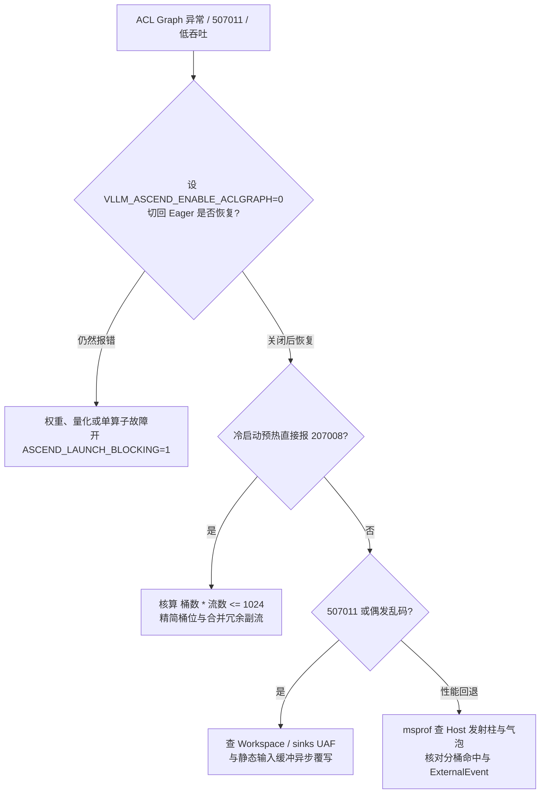

把 ACL Graph 真正推进高并发生产服务后，收益与隐患常常成对出现。模式选型过激可能撑爆图数与显存，分桶太密会在预热阶段当场报 **207008** 退出，工作区或输出张量过早释放又会在运行时炸出神秘的 **507011** 异步异常。

解决这类线上疑难杂症不能靠盲猜环境变量，而需要先把 `vllm-ascend` 到物理 NPU 的四层调用链摸清，再把预算数字与生命周期边界算实。

## 四层生产调用栈与源码映射

从顶层引擎调度到底层硬件固件，ACL Graph 生产全栈由职责分明的四层软件栈串联（图 1 与图 2）[^vllm-ascend-acl][^vllm-ascend-npug]：


```mermaid caption="图 2：ACL Graph 贯穿 vllm-ascend、torch_npu、cann/runtime 与 Ascend HDK 四层调用栈映射"
flowchart TD
    subgraph L1["L1 · vllm-ascend 调度与包装层"]
        L1A["cudagraph_mode 分桶<br/>FULL / PIECEWISE + MTP"] --> L1B["ACLGraphWrapper & UpdatableGraph<br/>npugraph_ex + weak_ref"]
    end
    subgraph L2["L2 · PyTorch + torch_npu 桥接层"]
        L2A["NPUGraph 与 Pool 管理<br/>capture_begin / replay"] --> L2B["GraphDispatch & CondDispatch<br/>自动包裹 TaskGrp 与条件流"]
    end
    subgraph L3["L3 · CANN Runtime 模型运行时"]
        L3A["CaptureSession + CaptureModel<br/>拓扑校验与 CopyTaskArgs"] --> L3B["DeviceSqCqPool & Notify<br/>物理 SQ/CQ 上限 1024"]
    end
    subgraph L4["L4 · Ascend HDK 与 NPU 硬件层"]
        L4A["物理 SQ/CQ 队列<br/>超限报 207008"] --> L4B["TS 固件与 AICore<br/>异常报 507011 / UAF"]
    end
    L1B -->|"封装捕获与重放"| L2A
    L2B -->|"下沉逻辑队列"| L3A
    L3B -->|"分配物理队列并提交"| L4A
```

- **L1（`vllm-ascend` 调度层）**：按批量桶分派 `FULL` 或 `PIECEWISE`，并弱引用回收临时空间。
- **L2（`torch_npu` 桥接层）**：对齐 CUDA `NPUGraph` 接口，借调度代理接入 `TaskGrp` 热刷新。
- **L3（`cann/runtime` 原生层）**：`CaptureSession` 检拓扑，`CaptureModel` 建影子 `LogicSQ` 并做参数备份。
- **L4（Ascend HDK 硬件层）**：持有 1024 组物理 SQ/CQ，由 TS 固件直接驱动算力核执行。

### 包装器类关系与关键片段

在 `vllm-ascend`（提交 `b776261e`）中，包装器家族继承了第 3 章的 `CUDAGraphWrapper` 体系。它新增了 `UpdatableGraph` 替换、Workspace 弱引用与可中断抓图包装器，类协作见图 3[^vllm-acl-src][^vllm-brk-src]。

```mermaid caption="图 3：vllm-ascend@b776261e ACLGraphWrapper、UpdatableGraph 与 BreakableACLGraphWrapper 类关系"
classDiagram
    class ACLGraphWrapper {
        +runtime_mode
        +graph_pool
        +concrete_aclgraph_entries
        +__call__()
        -_updatable_graph_replay()
    }
    class ACLGraphEntry {
        +BatchDescriptor batch_descriptor
        +NPUGraph aclgraph
        +output
        +input_addresses
    }
    class GraphParams {
        +events
        +workspaces
        +handles
        +attn_params
    }
    class BreakableACLGraphWrapper {
        +use_eagle
        +enable_enpu
        -_capture()
        -_replay()
    }
    ACLGraphWrapper *-- ACLGraphEntry : caches per batch
    ACLGraphWrapper ..> GraphParams : weak_ref_workspaces()
    BreakableACLGraphWrapper --|> BreakableCUDAGraphWrapper : inherits split logic
    BreakableACLGraphWrapper ..> GraphParams : shares workspace contract
```

下面这段代码提炼自 `acl_graph.py` 的核心生命周期：捕获完成后，`weak_ref_workspaces` 与 `weak_ref_tensors` 会释放多余的临时强引用。重放阶段，`FULL` 模式在非草稿路径下还须同步当前流，防止乱序[^vllm-acl-src]：

```python
with torch.npu.graph(aclgraph, pool=self.graph_pool):
    with super_kernel_scope("full_model", self.enable_super_kernel):
        output = self.runnable(*args, **kwargs)
    get_offloader().join_after_forward()  # 多流预取必须汇合后再 CaptureEnd

weak_ref_workspaces(_graph_params)
entry.output = weak_ref_tensors(output)
entry.aclgraph = aclgraph

# 重放前若未启用 enpu 统一编排且处于 FULL 主图模式，先同步防止与上轮 update_attn_params 乱序
if not self.enable_enpu and self.runtime_mode == CUDAGraphMode.FULL and not is_draft_eagle:
    torch.npu.current_stream().synchronize()
```

## 图模式选型与 SQ/CQ 配额

上线前要围绕 **`cudagraph_mode`** 与 **`npugraph_ex` 编译优化套件**做组合选型[^vllm-ascend-graph][^vllm-ascend-npug]：

| 模式或优化开关       | 核心机制与路由     | 适用负载场景       | 关键边界与注意事项     |
| :------------------- | :----------------- | :----------------- | :--------------------- |
| `NONE`（Eager）      | 关静态图，逐算子发 | 纯 Prefill 或调试  | 解码受发射气泡严重拖累 |
| `PIECEWISE`          | 隔离 Attention 编  | Chunked Prefill 混 | 保留部分 CPU 调度开销  |
| `FULL_DECODE_ONLY`   | 纯解码全图，混批跳 | 稳健生产默认推荐   | 按批量桶预捕占显存     |
| `FULL_AND_PIECEWISE` | 解码全图+混批分段  | 高吞吐混排与微延迟 | 须开输出弱引用省显存   |
| `npugraph_ex`        | 图替换、可退旧栈   | 小算子密集自定义图 | 含 Triton 跳磁盘缓存   |
| `SuperKernel`        | 多算子超融合直通   | A3 / 950 极低延迟  | 需静态输入与白名单     |

启用 **`npugraph_ex`** 编译套件时，还要盯住一条隐藏成本：自定义 Triton Ascend 算子往往会在参数区生成 **`kernel_side_table`** 动态外部地址表。编译器为避免跨进程重启地址失配，会主动跳过这类子图的磁盘缓存，导致每次冷启动重新编译；若触发过慢，可用 `force_eager` 把疑难算子摘回常规通道[^vllm-ascend-npug]。

选定模式之后，必须核算**物理 SQ/CQ 队列预算**。由于单卡硬件池硬限为 `RT_DEVICE_SQCQ_RES_MAX_NUM = 1024U`[^sqcq-6]，多档分桶的总通道消耗绝不能踩线：

$$
N_{\text{SQ/CQ}} = |\text{aligned\_buckets}| \times N_{\text{streams}} \le 1024
$$

一旦盲目配上 1 到 256 的密集桶、且每图挂接 4 条逻辑流（计算、HCCL 通信、卸载拷贝与辅助更新流），总消耗立刻突破 1024 上限。生产配置应当“前密后疏”；如果开了 **DSpark / MTP 多 token 推测**，还须把各档桶容量向上对齐到 `num_spec_tokens + 1` 的整数倍，减少无效对齐浪费。


## 三大高频故障与二分排障

生产打开 ACL Graph 后遇到异常，记住先看三类经典症状（图 4 下半区与图 5）[^err-codes][^cap-6]：

### 错误码 207008 资源耗尽

冷启动预捕各档分桶时进程突然退出，常见报错为 `ACL_ERROR_RT_NO_STREAM_RESOURCE`。它对应错误码 **207008**（日志 `EE1023`），提示 `driver error:no stream resource`[^err-codes]。这是因为 `CaptureModel::BuildSqCq` 绑通道时撞穿了 `1024U` 池容量。由于分配出的物理通道要等 `aclmdlRIDestroy` 才归还，排障只需按预算公式削减细碎分桶或合并冗余副流[^sqcq-6][^cap-6]。

### 错误码 507011 设备内存异常

单请求跑得通，一进高并发抢占或回收内存就突然卡死，设备流抛出 `ACL_ERROR_RT_MODEL_EXECUTE`（错误码 **507011**）[^err-codes]。这类问题多半源于异步 **UAF（释放后重用）**：图内固化的虚拟地址（例如 `sinks` 汇总缓冲、局部 `Workspace` 或被误设弱引用的输出）在图真正算完前就被内存池收走并覆写了。

排查时先设 `ASCEND_LAUNCH_BLOCKING=1` 同步定位报错算子。随后检查图内张量是否已用长生命周期缓冲保活，避免 `weak_ref_outputs` 误伤仍在下游引用的输出。

### 异步重放踩踏与性能回退

有时进程不崩，却偶尔吐出乱码 token，或吞吐掉回 Eager 水平。前一种常见于主机连发太快：第 $t$ 步影子流还没读完静态输入，第 $t+1$ 步就覆盖了输入缓冲；后一种往往是隐含动态分支触发静默回退，或 `ExternalEvent` 漏了 `reset` 造成死等。

这时设 `VLLM_ASCEND_ENABLE_ACLGRAPH=0` 一刀切下二分（图 5）。关掉后仍报错说明故障在权重或算子；立刻恢复则用 `msprof` 看 `ACL` 轨，密密麻麻的 Host 柱表明回退分段，空白则指向事件误堵。



## 配额核算与内存越界仿真

下面这段纯 CPU 脚本按硬件上限 `RT_DEVICE_SQCQ_RES_MAX_NUM = 1024` 核算通道余量。它同时模拟了 `sinks` 指针提前释放触发 **507011** UAF 告警的过程：

```python
RT_DEVICE_SQCQ_RES_MAX_NUM = 1024

def check_sqcq_budget(buckets: list[int], streams_per_graph: int, mtp_tokens: int = 1) -> dict:
    unit = mtp_tokens + 1
    aligned = sorted({((b + unit - 1) // unit) * unit for b in buckets})
    total_sqcq = len(aligned) * streams_per_graph
    return {
        "num_graphs": len(aligned),
        "total_sqcq": total_sqcq,
        "oom_207008": total_sqcq > RT_DEVICE_SQCQ_RES_MAX_NUM,
        "headroom": RT_DEVICE_SQCQ_RES_MAX_NUM - total_sqcq,
    }

dense_res = check_sqcq_budget(list(range(1, 258)), streams_per_graph=4, mtp_tokens=0)
sparse_res = check_sqcq_budget([8, 16, 24, 32, 48, 64, 96, 128, 192, 256, 384, 512], streams_per_graph=4, mtp_tokens=1)
print(f"[Dense Bucketing] graphs={dense_res['num_graphs']}, total_SQCQ={dense_res['total_sqcq']}/1024, trigger_207008={dense_res['oom_207008']}")
print(f"[Sparse + MTP(k=1)] graphs={sparse_res['num_graphs']}, total_SQCQ={sparse_res['total_sqcq']}/1024, headroom={sparse_res['headroom']}")

class DeviceBufferTracker:
    def __init__(self) -> None:
        self.freed: set[int] = set()
    def free(self, ptr: int) -> None:
        self.freed.add(ptr)
    def check_replay(self, captured_ptrs: list[int]) -> str:
        dangling = [hex(p) for p in captured_ptrs if p in self.freed]
        return f"507011 ACL_ERROR_RT_MODEL_EXECUTE (UAF on {dangling})" if dangling else "EXEC_OK"

trk = DeviceBufferTracker()
sinks_ptr, work_ptr = 0x1200_4000, 0x1200_8000
print(f"[Normal Lifetime] {trk.check_replay([sinks_ptr, work_ptr])}")
trk.free(sinks_ptr)
print(f"[UAF Bug] {trk.check_replay([sinks_ptr, work_ptr])}")
```

输出划出两条红线：257 档密集桶共耗 1028 组通道，直接触发 `trigger_207008=True`。对齐 `MTP(k=1)` 的 12 档稀疏桶仅耗 48 组；而一旦 `sinks_ptr` 提前释放，重放即报 **507011 UAF**：

```text
[Dense Bucketing] graphs=257, total_SQCQ=1028/1024, trigger_207008=True
[Sparse + MTP(k=1)] graphs=12, total_SQCQ=48/1024, headroom=976
[Normal Lifetime] EXEC_OK
[UAF Bug] 507011 ACL_ERROR_RT_MODEL_EXECUTE (UAF on ['0x12004000'])
```

至此，本系列贯通了异步队列、`torch.compile`、CUDA Graph、影子流与 `vllm-ascend` 全栈排障。想了解上层调度与 Profiling 实战，可读[vLLM 与昇腾推理引擎](../../vllm/)及[性能观测与线上故障定位](../../vllm/06-profiling-and-debugging/)。

[^vllm-ascend-acl]: 参阅 `vllm-ascend`（提交 `b776261e`）设计文档 `docs/source/developer_guide/Design_Documents/ACL_Graph.md`。

[^vllm-ascend-npug]: 参阅 `vllm-ascend`（提交 `b776261e`）设计文档 `docs/source/developer_guide/Design_Documents/npugraph_ex.md`，详述 `force_eager` 与 Triton 磁盘缓存约束。

[^vllm-ascend-graph]: 参阅 `vllm-ascend`（提交 `b776261e`）用户指南 `docs/source/user_guide/feature_guide/graph_mode.md`，说明 `cudagraph_mode` 与 `SuperKernel` 配置。

[^vllm-acl-src]: 参阅 `vllm-ascend`（提交 `b776261e`）源码 `vllm_ascend/compilation/acl_graph.py` 第 60–400 行对 `ACLGraphWrapper`、`ACLGraphEntry` 与工作区弱引用的实现。

[^vllm-brk-src]: 参阅 `vllm-ascend`（提交 `b776261e`）源码 `vllm_ascend/compilation/breakable_aclgraph.py` 第 38–91 行 `BreakableACLGraphWrapper`。

[^err-codes]: 参阅 `cann/runtime`（提交 `1954820a`）头文件 `include/external/acl/error_codes/rt_error_codes.h` 第 76、102 行及 `errcode_manage.cc` 错误码映射。

[^sqcq-6]: 参阅 `cann/runtime`（提交 `1954820a`）源码 `src/runtime/core/src/device/device_sq_cq_pool.hpp` 第 23 行常量 `RT_DEVICE_SQCQ_RES_MAX_NUM = 1024U`。

[^cap-6]: 参阅 `cann/runtime`（提交 `1954820a`）源码 `src/runtime/feature/aclgraph/capture_model.cc` 第 1556–1605 行 `BuildSqCq` 校验逻辑。
