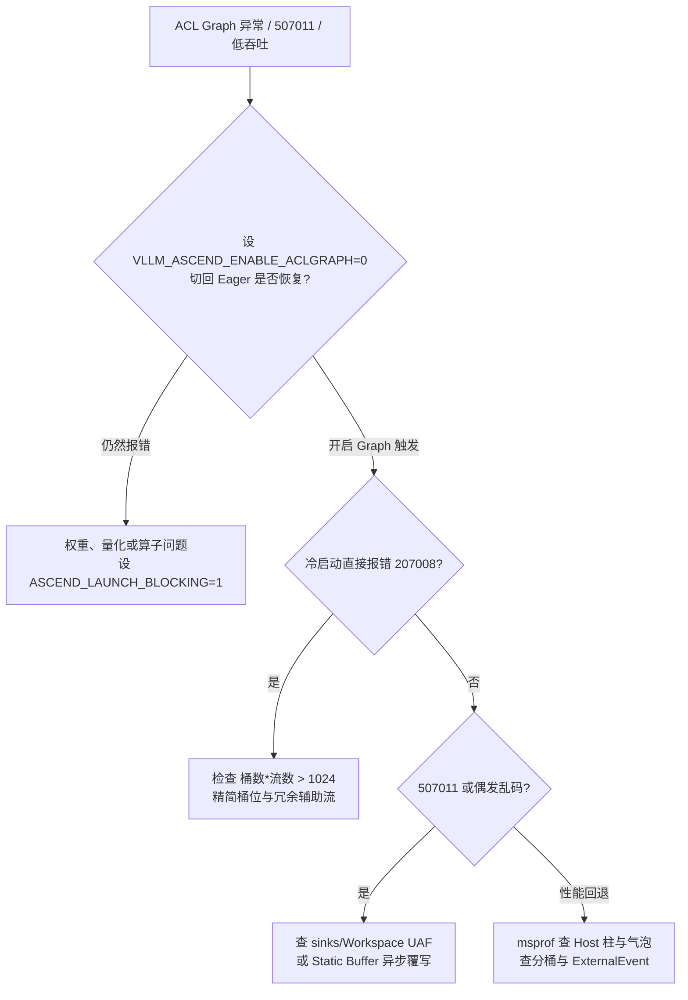

在跨越底层队列（第 1 章）、编译融合（第 2 章）、静态边界（第 3 章）以及影子流与动态扩展（第 4 至第 5 章）后，本章将所有机制汇总到高并发 `vllm-ascend` 四层生产调用栈中，梳理模式选型、稀疏分桶与三大高频线上故障排查路径。

## 生产四层软件硬件调用栈全景映射


从上层框架到底层芯片固件，四层各自承担明确边界（对应图 1 与官方协同视图图 2）：

- **L1 · `vllm-ascend` 调度与编译层**（提交 `3649b8ff`[^vllm-ascend-acl][^vllm-ascend-npug]）：负责批大小稀疏分桶、按请求态分派 `FULL`/`PIECEWISE` 模式、`ACLGraphWrapper` 包装以及 `weak_ref_outputs` 输出缓存回收。
- **L2 · `torch_npu` 框架桥接层**（提交 `d09e29e4`）：提供对齐 CUDA 语义的 `NPUGraph` 与全局内存池映射，经 `_GraphDispatchMode` 与控制流代理自动衔接 TaskGrp 热刷新与条件流。
- **L3 · `cann/runtime` 原生底座**（提交 `1954820a`）：`CaptureSession` 执行拓扑闭合鉴权，`CaptureModel` 构造持久 `LogicSQ` 并做 Device Args 备份，`CondHandle` 管控共享 Notify，`DeviceSqCqPool` 分配物理队列。
- **L4 · Ascend HDK 与 NPU 硬件层**：持有 `1024U` 上限的物理 `SQ/CQ`、8192 个 Notify 槽位与 65536 个 Event 状态字，由 TS 固件驱动 AICore、AICPU 与 HCCL 执行引擎。


## `cudagraph_mode` 选择矩阵、优化工具与分桶计算

上线部署的核心开关围绕 **`cudagraph_mode`** 与 **`npugraph_ex` 编译优化套件**组合配置[^vllm-ascend-graph][^vllm-ascend-acl]：

| 模式 / 开关          | 核心机理           | 适用场景           | 关键边界              |
| -------------------- | ------------------ | ------------------ | --------------------- |
| `NONE`（Eager）      | 关静态图，逐算子发 | 纯 Prefill 或调试  | 解码受 Host 气泡拖累  |
| `PIECEWISE`          | 隔离 Attention 编  | Chunked Prefill    | 留少量 CPU 调度       |
| `FULL_DECODE_ONLY`   | 纯解码全图，混批跳 | 稳健生产默认配置   | 按桶预捕占显存        |
| `FULL_AND_PIECEWISE` | 解码全图+混批分段  | 高吞吐混排与微延迟 | 配 `weak_ref_outputs` |
| `npugraph_ex`        | 图替换、可退旧栈   | 小算子密集自定义图 | 含 Triton 跳缓存      |
| `SuperKernel`        | 多算子超融合直通   | A3 / 950 极低延迟  | 需静态输入与白名单    |

- **`npugraph_ex` 与 Triton 持久化约束**[^vllm-ascend-npug]：自定义 Triton Ascend Kernel 会在参数表内产生 **`kernel_side_table`** 动态外部地址跳转表，图编译器为防止跨进程加载失配会主动跳过磁盘缓存持久化，使每次冷启动重新触发该段子图的在线编译；必要时可通过 `force_eager` 将疑难自定义算子切出静态下沉通道。
- **稀疏分桶预算与 MTP 对齐约束**：物理池总消费满足约束公式：

$$
N_{\text{SQ/CQ}} = |\text{aligned\_buckets}| \times N_{\text{streams}} \le 1024
$$

若盲目使用 1..256 全密集桶且每图挂接 4 条逻辑流（计算、HCCL、拷贝与同步辅助流），需求立刻突破 1024 硬限；生产应采用前密后疏的稀疏捕获桶表，并在启用 DeepSeek-V4.1-Flash **DSpark / MTP 多词元推测**时，将每档捕获桶容量对齐为 **`num_spec_tokens + 1` 的整数倍**（如单步验证 2 token 对齐为偶数倍），避免向上跳档造成大量无效 Padding 计算与脏写隐患。

## 生产三大高频故障机理与二分排障工具箱

线上启用 ACL Graph 后的疑难故障主要收敛为以下三类，按图 3 路径借助 `VLLM_ASCEND_ENABLE_ACLGRAPH=0`、`ASCEND_LAUNCH_BLOCKING=1` 与 `msprof` 可实现二分定位：

- **错误码 `207008`（`ACL_ERROR_RT_NO_STREAM_RESOURCE` / `EE1023`）**[^err-codes][^sqcq-6][^cap-6]
  - **现象**：冷启动暖机预回放多档捕获桶时抛错退出，日志打印 `driver error:no stream resource`。
  - **根因**：`CaptureModel::BuildSqCq`（`capture_model.cc` 第 1583 行）按 `StreamList_().size()` 划走通道时撞穿 `RT_DEVICE_SQCQ_RES_MAX_NUM = 1024U` 硬限，且仅调用 `aclmdlRIDestroy` 才释放归还。
  - **定位与根治**：核算 $\text{桶数} \times \text{每图内部流数} \le 1024$，精简细碎桶位并收拢冗余副流。
- **错误码 `507011`（`ACL_ERROR_RT_MODEL_EXECUTE`）**[^err-codes]
  - **现象**：暖机样本正常运行，进入并发抢占与显存块回收后设备流突然挂死或报 `model execute failed`。
  - **根因**：**设备侧内存 UAF（Use-After-Free，释放后重用）**。捕获期固化在 SQE 与 Args 中的虚拟地址（如 `sinks` 汇总缓冲、局部 `Workspace` 或被 `weak_ref_outputs` 过早释回的内存块）在重放前被分配器收回复用甚至 `empty_cache()` 解映射，再次访存即引发硬件异常。
  - **定位与根治**：设置 `ASCEND_LAUNCH_BLOCKING=1` 同步报错行定位，为被图引用张量改用全局静态持久缓冲保活。
- **Async Replay Race（异步重放踩踏）与 Profiler 回退识别**
  - **现象**：无报错但偶尔生成乱码词元，或推理吞吐骤降退回 Eager 水平。
  - **根因**：`aclmdlRIExecuteAsync` 非阻塞返回 CPU，外循环在第 $t$ 步模型影流读入旧数据前就原地覆盖第 $t+1$ 步静态输入缓冲；或因隐藏动态维/Triton 断点触发静默回退与未重置 `ExternalEvent` 阻塞等待。
  - **定位与根治**：先切 `VLLM_ASCEND_ENABLE_ACLGRAPH=0` 排除权重与量化自身问题，再用 **`msprof`** 观察 `Task Scheduler` / `AICore` 轨与 `ACL` 轨——密集 Host Launch 柱说明回退分段 Eager，算子前长期空白带则锁定错置同步或未重置事件。



## `SQ/CQ` 池配额求解与 UAF / 异步竞态诊断验证

下面这则运行在纯 CPU 环境的 Python 验证器对标 `RT_DEVICE_SQCQ_RES_MAX_NUM = 1024U` 核算密集分桶与 MTP 对齐稀疏分桶的通道消耗边界，并复现 `sinks` 指针提前释放触发的 `507011` UAF 状态告警：

```python
RT_DEVICE_SQCQ_RES_MAX_NUM = 1024  # cann/runtime device_sq_cq_pool.hpp


def check_sqcq_budget(
    buckets: list[int], streams_per_graph: int, mtp_tokens: int = 1
) -> dict:
    # 开启 MTP 时将分桶规格按 (num_mtp_tokens + 1) 向上对齐
    step_unit = mtp_tokens + 1
    aligned = sorted(
        {((b + step_unit - 1) // step_unit) * step_unit for b in buckets}
    )
    total_sqcq = len(aligned) * streams_per_graph
    oom_207008 = total_sqcq > RT_DEVICE_SQCQ_RES_MAX_NUM
    return {
        "num_graphs": len(aligned),
        "streams_per_graph": streams_per_graph,
        "total_sqcq": total_sqcq,
        "oom_207008": oom_207008,
        "headroom": RT_DEVICE_SQCQ_RES_MAX_NUM - total_sqcq,
    }


dense_buckets = list(range(1, 258))  # 257 档密集桶 -> 257 * 4 = 1028 > 1024
sparse_buckets = [8, 16, 24, 32, 48, 64, 96, 128, 192, 256, 384, 512]

dense_res = check_sqcq_budget(dense_buckets, streams_per_graph=4, mtp_tokens=0)
# MTP k=1 -> 对齐到 2 的整数倍
sparse_res = check_sqcq_budget(sparse_buckets, streams_per_graph=4, mtp_tokens=1)

print(
    f"[Dense Bucketing] graphs={dense_res['num_graphs']}, "
    f"total_SQCQ={dense_res['total_sqcq']}/1024, "
    f"trigger_207008={dense_res['oom_207008']}"
)
print(
    f"[Sparse + MTP(k=1)] graphs={sparse_res['num_graphs']}, "
    f"total_SQCQ={sparse_res['total_sqcq']}/1024, headroom={sparse_res['headroom']}"
)

# 复现 507011 异步 UAF：图引用指针在重放结束前被提前释放
class DeviceBufferTracker:
    def __init__(self) -> None:
        self.freed: set[int] = set()

    def free(self, ptr: int) -> None:
        self.freed.add(ptr)

    def check_replay(self, captured_ptrs: list[int]) -> str:
        dangling = [hex(p) for p in captured_ptrs if p in self.freed]
        if dangling:
            return f"507011 ACL_ERROR_RT_MODEL_EXECUTE (UAF on {dangling})"
        return "EXEC_OK"


trk = DeviceBufferTracker()
sinks_ptr, work_ptr = 0x1200_4000, 0x1200_8000
print(f"[Normal Lifetime] {trk.check_replay([sinks_ptr, work_ptr])}")
trk.free(sinks_ptr)
print(f"[UAF Bug] {trk.check_replay([sinks_ptr, work_ptr])}")
```

实测结果如下：257 档密集桶以 1028/1024 直接越界触发 `trigger_207008=True`，对齐 MTP 的 12 档稀疏桶仅用 48 组留出 976 组通道冗余，而未保活指针则在重放检查中精确捕获 `507011` UAF 错误：

```text
[Dense Bucketing] graphs=257, total_SQCQ=1028/1024, trigger_207008=True
[Sparse + MTP(k=1)] graphs=12, total_SQCQ=48/1024, headroom=976
[Normal Lifetime] EXEC_OK
[UAF Bug] 507011 ACL_ERROR_RT_MODEL_EXECUTE (UAF on ['0x12004000'])
```

至此，本专题完成了从异步队列、编译期融合、CUDA/ACL 静态捕图、局部热刷新与条件子图直到四层生产集成的全链路贯通。如需继续回查上层 Continuous Batching 调度与通用全链路 profiling 方法论，可继续阅读姊妹系列[vLLM 与昇腾推理引擎](../../vllm/)及终章[性能观测与线上故障定位](../../vllm/06-profiling-and-debugging/)。

[^vllm-ascend-acl]: 参阅 `vllm-ascend`（提交 `3649b8ff`）设计文档 `docs/source/developer_guide/Design_Documents/ACL_Graph.md`，介绍模型全图捕获与分段运行接入详情。

[^vllm-ascend-npug]: 参阅 `vllm-ascend`（提交 `3649b8ff`）设计文档 `docs/source/developer_guide/Design_Documents/npugraph_ex.md`，详述 `force_eager`、`inplace_pass`、`register_replacement` 与 Triton `kernel_side_table` 导致图缓存跳过磁盘持久化的约束。

[^vllm-ascend-graph]: 参阅 `vllm-ascend`（提交 `3649b8ff`）用户指南 `docs/source/user_guide/feature_guide/graph_mode.md`，完整说明 `cudagraph_mode` 各选项、`enable_static_kernel`、`SuperKernel` 及 `XliteGraph` 配合准则。

[^err-codes]: 参阅 `cann/runtime`（提交 `1954820a`）错误码声明 `include/external/acl/error_codes/rt_error_codes.h` 第 76、102 行及映射表 `src/runtime/core/src/common/errcode_manage.cc` 第 94–96、184、190、470 行。

[^sqcq-6]: 参阅 `cann/runtime`（提交 `1954820a`）源码 `src/runtime/core/src/device/device_sq_cq_pool.hpp` 第 23 行常量 `RT_DEVICE_SQCQ_RES_MAX_NUM = 1024U` 及 `device_sq_cq_pool.cc` 第 116–145 行 `BatchAllocSqCq` 池校验。

[^cap-6]: 参阅 `cann/runtime`（提交 `1954820a`）源码 `src/runtime/feature/aclgraph/capture_model.cc` 第 1556–1605 行 `CaptureModel::BuildSqCq` 校验物理流容量超限并抛出 `EE1023`。
