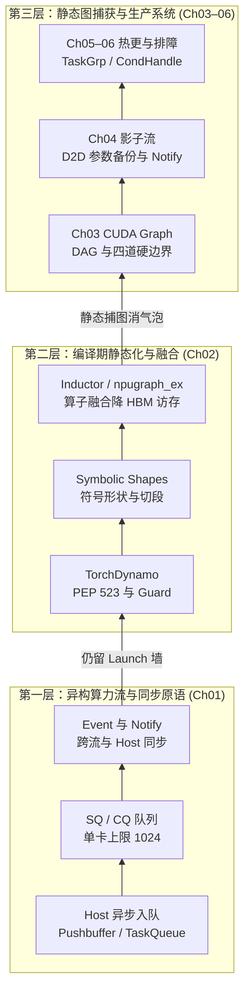

以 40 层 **DeepSeek-V4.1-Flash** 为例，小批量 **Decode（自回归解码）** 单步仅需 4.7 毫秒设备算力时间。此时 **HBM（High Bandwidth Memory，高带宽显存）** 带宽也仍有余量。但 CPU 逐个下发约 1120 次启动指令需耗时 11.2 毫秒，超过一半端到端延迟耗在了主机发射回路上。

要抹掉这堵 **Host-bound Launch Wall（主机发射墙）**，推理系统必须自底向上打通三层软硬件抽象，如图 1 所示：

- **第一层（异步队列）**：理解 CPU 如何借 **Stream（流）** 与 **Event（事件）** 把指令异步塞进设备硬件队列。
- **第二层（编译静态化）**：借助 `torch.compile` 融合碎片算子、降低显存往返，但仍受限于动态注意力切段。
- **第三层（静态执行图）**：通过 **CUDA Graph** 与昇腾 **ACL Graph** 固化拓扑，把上千次发射压缩为单次触发。

## 为什么先学编译与 CUDA Graph

很多初学者直接翻看昇腾 ACL Graph 接口时，容易被“影子流”“外部事件”“可更新槽位”等术语绕晕。其实这些机制都在解决前两层留下的具体问题。没有第 1 层的异步队列，就没有可录制的指令流。没有第 2 层的分段融合和第 3 层的静态图契约，也看不出昇腾为什么需要单设一套影子模型流。

本系列与姊妹系列[vLLM 与昇腾推理引擎](../vllm/)明确分工。`vLLM` 系列立足请求调度与显存分页，本系列聚焦底层执行栈。前 3 章面向零基础开发者讲透异构流、`torch.compile` 与 CUDA Graph 原理，后 3 章深入 `cann/runtime` 与 `vllm-ascend` 源码实操。

全系列围绕两把标尺串联。宏观上追踪 40 层 DeepSeek-V4.1-Flash 解码发射耗时如何从 11.2 毫秒降到 4.73 毫秒。微观上用同一个 4 算子微型层推演队列、切图、地址固化与热刷新：

| 章节                                                                                              | 核心问题                   | 底层核心对象                             |
| :------------------------------------------------------------------------------------------------ | :------------------------- | :--------------------------------------- |
| [01 异构算力流：硬件队列、跨流同步与发射墙](./01-heterogeneous-streams-and-events/)               | 异步并发与发射气泡公式     | `Pushbuffer`、`SQ/CQ`、`Event`/`Notify`  |
| [02 PyTorch 编译栈：分段融合与发射上限](./02-torch-compile-fundamentals/)                         | 降 HBM 访存与切段局限      | `TorchDynamo`、`SymInt`、`npugraph_ex`   |
| [03 CUDA Graph 原理：流捕获、四边界与双模](./03-cuda-graph-fundamentals/)                         | 静态图契约与双模切图       | `Stream Capture`、`CUDAGraphWrapper`     |
| [04 ACL Graph 录制架构：影子流与参数备份](./04-acl-graph-architecture-and-capture/)               | 影子流隔离与参数持久备份   | `Shadow Stream`、`LogicSQ`、`Notify`     |
| [05 ACL Graph 动态破壁：槽位热更与条件子图](./05-acl-graph-task-update-and-conditional-subgraph/) | 变长 Tiling 与设备分支循环 | `TaskGrp`、`ExternalEvent`、`CondHandle` |
| [06 ACL Graph 生产全栈：选型配额与故障定位](./06-acl-graph-fullstack-and-vllm-ascend/)            | 分桶配额与线上故障定位     | `ACLGraphWrapper`、错误码 207008/507011  |

## 源码快照与单机验证基准

本系列全部源码路径、类名与行号均核对自 `cann/runtime`[^cann-rt]、`Ascend/pytorch`[^torch-npu]、`vllm`[^vllm-repo] 与 `vllm-ascend`[^vllm-ascend-repo] 的锁定提交。文中机制同时对照了 PyTorch 2 论文[^pytorch2-paper]及 PyTorch、vLLM 与 NVIDIA 官方技术博客的一手实测结论。第 1 至第 6 章均附带纯 CPU 可运行的 Python 仿真脚本，没有硬件机器也能亲手核算延迟气泡、分桶余量与状态迁移。

建议从[第 1 章：异构算力流](./01-heterogeneous-streams-and-events/)开始顺序阅读。若需补充芯片计算与访存基础、跨卡通信或 DeepSeek 算子结构，可对照[推理与异构硬件基础](../foundations/)、[分布式并行与跨卡通信](../distributed/)与[DeepSeek 架构演进](../deepseek/)。

[^cann-rt]: CANN Runtime 开源仓库（`cann/runtime`，提交 `1954820a`），采用 CANN Open Software License Agreement Version 2.0 授权，涵盖 `aclmdlRI*` 接口、Stream Capture 模型录制实现与物理 `SQ/CQ` 资源池逻辑。

[^torch-npu]: 华为昇腾 PyTorch 插件仓库（`Ascend/pytorch`，提交 `d09e29e4`），提供 `NPUGraph` C++ 与 Python 封装、自动更新调度模式及条件控制流模式。

[^vllm-repo]: 上游推理引擎仓库（`vllm-project/vllm`，提交 `99b0b0b0`），采用 Apache-2.0 开源协议，包含 `torch.compile` 分段策略、`CUDAGraphWrapper` 与 `BreakableCUDAGraphWrapper` 设计。

[^vllm-ascend-repo]: 昇腾推理后端插件仓库（`vllm-project/vllm-ascend`，提交 `b776261e`），采用 Apache-2.0 开源协议，实现面向 NPU 硬件栈的 `ACLGraphWrapper`、`UpdatableGraph` 与 `npugraph_ex` 编译通道。

[^pytorch2-paper]: Jason Ansel et al., _PyTorch 2: Faster Machine Learning Through Dynamic Python Bytecode Transformation and Graph Compilation_, [ASPLOS 2024](https://doi.org/10.1145/3620665.3640366)。
