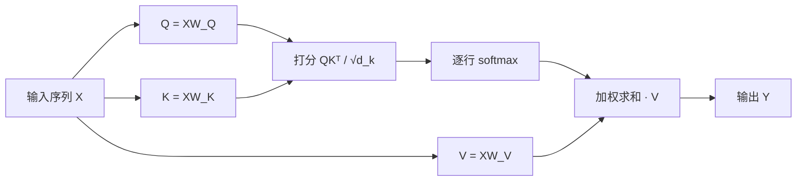

自注意力（self-attention）是 Transformer 的核心。它让序列中的每个位置都能直接读取其他位置的信息，而不需要像循环网络那样一步一步传递。理解它，基本就理解了大多数现代语言模型的主干。

## 直觉

假设句子是「猫坐在垫子上，因为它很软」。要理解「它」指的是什么，模型需要回看前面的词。自注意力的做法是：让「它」这个位置发出一个**查询**（query），去和每个位置的**键**（key）比较相似度；相似度高的位置，它的**值**（value）就多贡献一些。

可以把它想成一次软性的检索：查询是问题，键是索引，值是内容。检索的结果不是单个答案，而是所有值的加权平均，权重由相似度决定。

## 计算步骤

设输入是一个序列矩阵 $X \in \mathbb{R}^{n \times d_{\text{model}}}$，其中 $n$ 是序列长度。计算分四步：

1. **线性投影**：用三组可学习的权重得到 $Q = XW_Q$、$K = XW_K$、$V = XW_V$。
2. **相似度打分**：计算 $S = QK^\top / \sqrt{d_k}$，其中 $d_k$ 是键向量的维度，本文示例中 $d_k = 64$。
3. **归一化**：对 $S$ 的每一行做 softmax，把分数变成和为 1 的权重。
4. **加权求和**：用权重乘以 $V$，得到每个位置的输出。

把这四步合成一个式子，就是块级公式：

$$
\operatorname{Attention}(Q, K, V) = \operatorname{softmax}\left(\frac{QK^\top}{\sqrt{d_k}}\right)V
$$

这里 softmax 作用在每一行上，所以输出的第 $i$ 行是第 $i$ 个位置对所有值的加权平均。


上面的流程用 Mermaid 也可以直接画出来：



## 为什么要除以 √d

假设 $q$ 和 $k$ 的每个分量都是方差为 1 的独立随机变量。那么点积 $q \cdot k$ 是 $d_k$ 个乘积之和，方差为 $d_k$，标准差为 $\sqrt{d_k}$。维度越大，点积的数值越大，softmax 就越接近 one-hot，梯度会变得很小。除以 $\sqrt{d_k}$ 之后，点积的方差回到 1 左右，softmax 的输出保持在一个比较温和的范围内。

这个细节看起来很小，但是没有它，深层网络训练起来会明显困难。

## 一段 PyTorch 实现

下面的代码实现了带可选掩码的缩放点积注意力。掩码用于语言模型中的因果约束，让位置 $i$ 只能看到不晚于 $i$ 的位置。

```python
import math

import torch
import torch.nn.functional as F


def scaled_dot_product_attention(q, k, v, mask=None):
    """q, k, v 的形状都是 (batch, n, d_k) 或 (batch, heads, n, d_k)。"""
    d_k = q.size(-1)
    scores = q @ k.transpose(-2, -1) / math.sqrt(d_k)
    if mask is not None:
        scores = scores.masked_fill(mask == 0, float("-inf"))
    weights = F.softmax(scores, dim=-1)
    return weights @ v, weights


# 一个小例子：序列长 4，每个位置 8 维
torch.manual_seed(0)
x = torch.randn(1, 4, 8)
causal = torch.tril(torch.ones(4, 4))  # 下三角为 1，表示可见
out, w = scaled_dot_product_attention(x, x, x, mask=causal)

print(out.shape)        # torch.Size([1, 4, 8])
print(w[0].sum(dim=-1)) # 每一行的权重和都是 1
```

实际模型里通常会用 `torch.nn.MultiheadAttention` 或 `F.scaled_dot_product_attention`，后者会自动选择更快的内核。手写一遍的好处是可以清楚地看到每一步的形状变化。

## 多头注意力

单个注意力头只能学到一种「相似」的定义。多头注意力把 $d_{\text{model}}$ 切成 $h$ 份，每个头独立做一次注意力，最后把结果拼接起来，再乘以一个输出矩阵 $W_O$。不同的头往往会关注不同的关系，比如有的头关注语法上的主谓关系，有的头关注指代。

## 复杂度

注意力的计算量与序列长度的平方成正比，即 $O(n^2 d)$。这是长上下文模型的主要瓶颈。相关的优化包括分块计算（如 FlashAttention）、稀疏注意力，以及用 KV 缓存减少推理时的重复计算。这些话题会在之后的文章中展开。
