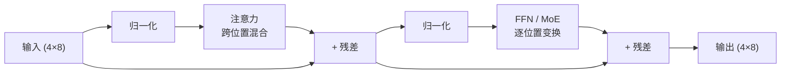

import MatMul from '../../../../explainers/react/MatMul';

这是整个系列的起点，不假设你学过深度学习。本篇要解决一个具体问题：当你在对话框里输入「我在读注意力」，模型拿到这串字之后，**到底按什么顺序做了哪些算术**。

读完你能回答：一个 token 在模型里是什么形状的数据、矩阵乘到底在算什么、一层 Transformer 的输入和输出为什么形状相同。后面所有篇（MLA、稀疏注意力、MoE）改的都是这一层里的某一步，所以这里的形状必须先对上。

## 先看一个例子

把输入切成 4 个 token：

| 位置 $s$ | 0   | 1   | 2   | 3      |
| -------- | --- | --- | --- | ------ |
| token    | 我  | 在  | 读  | 注意力 |

模型不认识汉字，它先把每个 token 查成一个固定长度的数字向量。本系列统一用 $d=8$（真实模型里是几千）：

```
"我"     → [ 0.2, -1.1,  0.4,  0.9, -0.3,  0.7,  0.1, -0.5]
"在"     → [-0.6,  0.3,  1.2, -0.2,  0.8, -0.4,  0.5,  0.1]
"读"     → [ 0.9,  0.5, -0.7,  0.3, -1.0,  0.2, -0.1,  0.6]
"注意力" → [-0.1,  0.8,  0.6, -0.9,  0.4,  1.1, -0.3,  0.2]
```

把这 4 行摞起来，就是一个形状为 $4\times 8$ 的**张量**（tensor）。张量就是多维数组：一个数是 0 维，一行数是 1 维（向量），一张表是 2 维（矩阵），再加上 batch 维就是 3 维。「形状」是每个维度的长度，写成 $(L, d) = (4, 8)$。

整个前向过程就是这张表被一层层改写，**每一层出来的形状还是 $4\times 8$**。这一点很重要：正因为形状不变，几十层才能串起来。

## 矩阵乘在算什么

模型里绝大部分算术是矩阵乘。它的规则只有一句：**结果的第 $i$ 行第 $j$ 列，等于左边第 $i$ 行与右边第 $j$ 列逐个相乘再相加**。

下面这个动画把每一次乘加都单独走一步，建议手上拿张纸跟着算第一格：

<MatMul
  client:visible
  a={[
    [1, 2],
    [3, 4],
  ]}
  b={[
    [5, 6],
    [7, 8],
  ]}
  title="图 00-1：C = A × B，逐元素累加"
/>

形状上的规则：$(m\times K)$ 乘 $(K\times n)$ 得到 $(m\times n)$，中间那个 $K$ 必须对上，并且在相乘过程中被「消掉」。记住这条，后面所有维度推导都是机械的。

一次矩阵乘的乘加次数是 $m\cdot K\cdot n$。这就是为什么模型的计算量能用参数量和 token 数估出来，也是为什么后面每一篇都在想办法让某个维度变小。

## 一层里有什么

一层 Transformer（本系列只关心推理）做四件事，顺序固定：



四件事的分工值得单独记住，因为它决定了后面每一篇在改哪里：

| 组件       | 做什么                                 | 位置之间             | 本系列哪篇改它 |
| ---------- | -------------------------------------- | -------------------- | -------------- |
| 归一化     | 把每行缩放到稳定的数值范围             | 不交换信息           | —              |
| **注意力** | 让每个位置去读其他位置的信息           | **唯一跨位置的一步** | 01–12、18      |
| 残差       | 把输入直接加到输出上，保证深层仍能训练 | 不交换信息           | 16（mHC）      |
| **FFN**    | 每个位置各自过一个两层小网络           | 完全独立             | 13（MoE）      |

注意力是**唯一**让位置之间交换信息的地方。所以「模型能不能用到很远的上下文」这个问题，只能在注意力里回答——这就是为什么这个系列有十几篇都在讲注意力。

而 FFN 逐位置独立，参数却占大头，所以省参数的办法（MoE）长在 FFN 上。两条优化路线从一开始就分在两个组件里，不要混。

## 代码实现

一层前向的最小可运行版本。只用 NumPy，没有 GPU 也能跑：

> 本篇的完整可运行脚本在文章目录下的 `toy.py`，其中的结论都写成了 `assert`。跑 `uv run --with numpy python toy.py` 即可自己验证一遍。

```python
import numpy as np

rng = np.random.default_rng(0)
L, d, d_ff = 4, 8, 16          # 序列长 4，隐藏维 8，FFN 中间维 16

x = rng.normal(size=(L, d))     # 输入：4 个 token，每个 8 维

def rms_norm(z, eps=1e-6):
    """RMSNorm：按行缩放到单位均方值。真实实现还会乘一个可学习的 gain。"""
    return z / np.sqrt((z ** 2).mean(axis=-1, keepdims=True) + eps)

def attention(z, w_q, w_k, w_v, w_o):
    q, k, v = z @ w_q, z @ w_k, z @ w_v      # (L, d) 各自线性投影
    scores = q @ k.T / np.sqrt(d)            # (L, L) 每个位置对每个位置打分
    mask = np.tril(np.ones((L, L)))          # 因果：只能看自己和左边
    scores = np.where(mask == 1, scores, -np.inf)
    w = np.exp(scores - scores.max(-1, keepdims=True))
    w /= w.sum(-1, keepdims=True)            # softmax：每行和为 1
    return (w @ v) @ w_o                     # 加权求和后再投影回 d

def ffn(z, w1, w2):
    return np.maximum(z @ w1, 0) @ w2        # 逐位置：升维 → 非线性 → 降维

p = {n: rng.normal(size=s) * 0.1 for n, s in {
    'w_q': (d, d), 'w_k': (d, d), 'w_v': (d, d), 'w_o': (d, d),
    'w1': (d, d_ff), 'w2': (d_ff, d),
}.items()}

h = x + attention(rms_norm(x), p['w_q'], p['w_k'], p['w_v'], p['w_o'])   # 子层 1 + 残差
y = h + ffn(rms_norm(h), p['w1'], p['w2'])                               # 子层 2 + 残差

print(x.shape, '->', y.shape)        # (4, 8) -> (4, 8)
print('注意力权重每行之和：', end=' ')
q, k = rms_norm(x) @ p['w_q'], rms_norm(x) @ p['w_k']
sc = np.where(np.tril(np.ones((L, L))) == 1, q @ k.T / np.sqrt(d), -np.inf)
w = np.exp(sc - sc.max(-1, keepdims=True)); w /= w.sum(-1, keepdims=True)
print(w.sum(axis=-1))                # [1. 1. 1. 1.]
```

这验证了两件事：**层的输入输出形状相同**，以及**注意力每行权重之和为 1**（它是一个加权平均，不会把数值放大）。第 01 篇会把 `attention` 这几行拆开逐步讲。

真实实现把同样的步骤写成了带并行切分和量化的版本。对照 DeepSeek-V3 的参考实现（commit `9b4e9788`）：

| 这里的函数  | 源码位置                                           | 差别                                                              |
| ----------- | -------------------------------------------------- | ----------------------------------------------------------------- |
| `rms_norm`  | `model.py:270-293`（`RMSNorm`）                    | 多一个可学习的 `weight`，调用 `F.rms_norm`                        |
| `attention` | `model.py:396-497`（`MLA`）                        | 不是朴素注意力，而是本系列第 04–05 篇的 MLA                       |
| `ffn`       | `model.py:500-534`（`MLP`）、`601-633`（`Expert`） | SwiGLU：`w2(silu(w1 x) * w3 x)`，不是 ReLU，且有三个权重          |
| 层的拼装    | `model.py:720-735`（`Block.forward`）              | 顺序完全一致：`x + attn(attn_norm(x))`，再 `x + ffn(ffn_norm(x))` |

超参的默认值在 `inference/model.py:20-94` 的 `ModelArgs` 里：`dim=2048`、`n_heads=16`、`n_layers=27`、`inter_dim=10944`。注意这是**参考脚本的 dataclass 默认值**，不是已发布权重的配置；真实模型的尺寸要读对应权重目录里的配置文件。

## 代价与边界

- 本篇的 `attention` 是朴素实现：它一次算出完整的 $L\times L$ 分数矩阵。$L$ 翻倍，这个矩阵的元素数翻 4 倍。这是长上下文一切麻烦的起点。
- 代码里每一层都重新算全部位置。生成文本时这会大量重复——第 02 篇处理这件事。
- NumPy 版本没有 batch 维、没有多 head、没有量化、没有并行切分。它只能验证形状和算术，不能说明任何性能结论。
- 这里的归一化、激活函数和残差写法都做了简化，不要用它去对比真实模型的输出数值。

## 自测

1. 输入形状是 $(4, 8)$，若把 FFN 中间维从 16 改成 32，输出形状变成什么？为什么？
2. 一层里哪些步骤让位置之间交换了信息？如果去掉注意力，模型还能利用上文吗？
3. $(4\times 8)$ 乘 $(8\times 8)$ 需要多少次乘加？序列长度翻倍时，这个数字怎么变；$L\times L$ 的分数矩阵又怎么变？
4. 动手：把上面代码的 `mask` 一行删掉，打印 `w` 的第 0 行。它会变成什么？这说明因果掩码在防止什么？

## 来源

- [Attention Is All You Need](https://arxiv.org/abs/1706.03762)（Transformer 层结构）
- [RMSNorm](https://arxiv.org/abs/1910.07467)
- [DeepSeek-V3 参考实现](https://github.com/deepseek-ai/DeepSeek-V3/blob/9b4e9788e4a3a731f7567338ed15d3ec549ce03b/inference/model.py)（本篇引用的行号按此 commit）
- 下一篇：[01 · 注意力从零推一遍](../01-attention/)——把 `attention` 的 5 行拆成 5 步，并解释为什么要加权求和。
