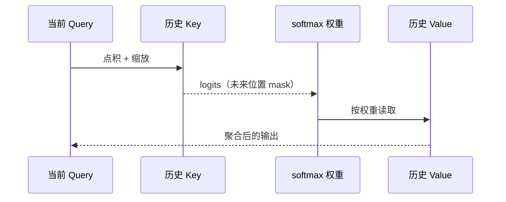

大模型 decode 的每一步只新增一个 Query，却要读取已经生成的历史。理解这条读路径，比先背某个模型的参数表更重要。

## 一次读出发生了什么

固定位置 $t$ 的 Query，先和可见 Key 做缩放点积，再把 softmax 权重乘到 Value 上：

$$o_t=\sum_{s\le t}\operatorname{softmax}\left(\frac{q_tk_s^\top}{\sqrt{d_k}}\right)_s v_s.$$

Query 和 Key 决定“读多少”，Value 决定“读出的内容”。例如 $q=1$、$k_0=0$、$k_1=\ln3$ 时，权重是 $(1/4,3/4)$；若 $v_0=[2,0]^\top,v_1=[0,4]^\top$，输出为 $[0.5,3]^\top$。

## Cache 保存什么

prefill 处理一段输入时，每层会计算并保存这段输入的 K/V。decode 到来时只计算新 token 的 Query、Key、Value，把新 K/V 追加到 cache；旧的 K/V 不需要重新投影。矩阵形状可以写成：

$$Q[S,d_k]K^\top[d_k,T]\to E[S,T]\to P[S,T],\quad PV[S,d_v].$$

这里的 $T$ 是绝对可见长度，$S$ 是本轮 Query 数。批处理的局部索引不能替代绝对位置：第 $r$ 个新 token 的绝对位置是 $P+r$，因果 mask 必须据此屏蔽未来。

## MHA、GQA 与 MQA

MHA 为每个 Query head 保存独立的 K/V；GQA 让一组 Query heads 共享 K/V；MQA 让所有 Query heads 共享一组 K/V。共享发生在被读取的 K/V 轴上，Query 仍可保留多个 head。缓存元素数因此和 Query head 数、KV head 数、每 head 宽度分别相关。

这也是后面三个术语容易混淆的地方：MLA 缩小每个位置的表示，稀疏注意力减少一次读取的候选，SWA 直接限制可读窗口。它们都可能减少带宽，却不是同一件事。

## 读代码时看四个轴

检查实现时先找 batch、query position、head 和 cache position 四个轴，再看 RMSNorm 和 RoPE 是否改变了投影顺序。RMSNorm 依赖当前向量的统计量，不能随意吸收到固定矩阵；RoPE 依赖绝对位置，不能把缓存槽号当作位置。

## 来源与边界

标准 MHA、GQA、RoPE 和 KV cache 语义见 [DeepSeek-V2 §2.1](https://arxiv.org/html/2405.04434v5#S2.SS1)。本页只建立坐标，不描述某个 checkpoint 的完整 kernel，也没有在本机测量吞吐或显存。
