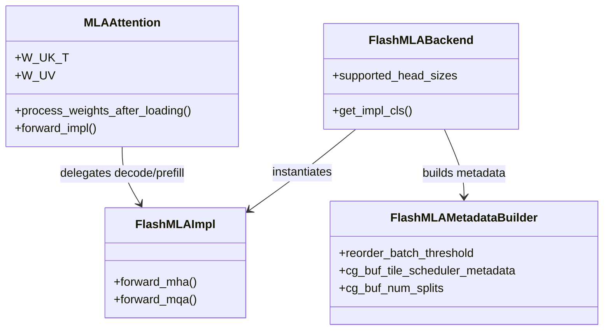

import Figure from 'astro-wisp/components/Figure.astro';
import MlaAbsorbExplainer from './explainers/mla-absorb';
import paperFig2V3 from './images/paper-fig2-v3-arch.png';
import paperFig3 from './images/paper-fig3-dsattn.png';
import paperFig4 from './images/paper-fig4-niah.png';

在[04 KV Cache 与 MQA / GQA](../../foundations/04-kv-cache-and-gqa/)中，**GQA（Grouped-Query Attention，分组查询注意力）**通过多个查询头共用少量键值头压低显存。但直接削减独立 KV 头，会在预训练多学科推理任务上损伤模型表征[^dsv2-paper]。

**MLA（Multi-Head Latent Attention，多头潜在注意力）**改走线性代数降秩路线[^dsv2-paper]。它在写入显存前把所有头的键与值联合压成低维潜在向量，解码时再借矩阵结合律合并固定权重，不砍头数也能将缓存压至单头规模。

设当前正在计算第 $t$ 个 token，历史 token 索引为 $j \in \{1, \dots, t\}$，注意力头索引为 $i \in \{1, \dots, n_h\}$。上标 $C$ 表示不含位置编码的内容部分，上标 $R$ 表示解耦的位置编码部分。全篇符号与 DeepSeek-V3 维度约定如下：

| 符号                                           | 含义                                | 张量形状 / V3 生产取值                       |
| :--------------------------------------------- | :---------------------------------- | :------------------------------------------- |
| $d,\; n_h$                                     | 模型隐藏层维度、注意力头数          | $d=7168,\; n_h=128$                          |
| $d_c,\; d_c'$                                  | KV 压缩潜在维度、Query 压缩潜在维度 | $d_c=512,\; d_c'=1536$                       |
| $d_h,\; d_h^R$                                 | 单头内容维度、解耦 RoPE 维度        | $d_h=128,\; d_h^R=64$                        |
| $h_t,\; u_t$                                   | 输入隐状态、注意力层最终输出        | 均属于 $\mathbb{R}^d$                        |
| $c_t^Q,\; c_j^{KV}$                            | Query 潜向量、历史 KV 潜向量        | $\mathbb{R}^{d_c'}$、$\mathbb{R}^{d_c}$      |
| $W^{DQ},\; W^{DKV},\; W^{KR}$                  | Q/KV 下投影与共享位置键投影         | $W^{DKV}h_t$ 与 $k_j^R$ 存入缓存             |
| $W_i^{UQ},\; W_i^{QR},\; W_i^{UK},\; W_i^{UV}$ | 第 $i$ 头内容与位置上投影矩阵       | 从 $c_t^Q$ 与 $c_j^{KV}$ 解压多头            |
| $W^O,\; W_i^O$                                 | 输出投影矩阵及其第 $i$ 头列分块     | $W^O \in \mathbb{R}^{d\times n_h d_h}$       |
| $W_i^{QK},\; W_i^{VO}$                         | K 路径与 V 路径吸收合并矩阵         | $(W_i^{UQ})^\top W_i^{UK}$、$W_i^O W_i^{UV}$ |
| $\tilde{q}_{t,i}^C,\; \tilde{o}_{t,i}$         | 吸收态内容查询、潜空间加权求和向量  | 均留在 $\mathbb{R}^{d_c}$ 空间内             |

## MLA 原始公式与解耦 RoPE

DeepSeek-V3 完整沿用了 DeepSeek-V2 的 MLA 模块作为注意力底座（图 1）[^dsv3-paper]。以下先从训练与完整展开视角写清原始前向计算流程。

<Figure
  src={paperFig2V3}
  alt="论文图 2：DeepSeek-V3 基础架构图，左侧为 Transformer 堆叠，右下展示 MLA 低秩压缩与解耦 RoPE，右上展示 DeepSeekMoE"
  caption="图 1：DeepSeek-V3 基础架构中的 MLA 低秩压缩、解耦 RoPE 与 DeepSeekMoE（DeepSeek-V3 论文图 2）"
/>

### 低秩下投影与解压公式

首先对当前输入 $h_t \in \mathbb{R}^d$ 做低秩下投影，分别生成 Query 与 KV 的低维潜向量。其中只有 $c_t^{KV}$ 会写进 KV Cache，而 $c_t^Q$ 仅用于压缩训练期激活显存并随算完释放[^dsv2-paper]：

$$
c_t^Q = W^{DQ} h_t \in \mathbb{R}^{d_c'}, \qquad c_t^{KV} = W^{DKV} h_t \in \mathbb{R}^{d_c}
$$

随后针对第 $i \in \{1, \dots, n_h\}$ 个头执行上投影解压，并分别在位置分支施加 **RoPE（Rotary Position Embedding，旋转位置编码）**。对于历史位置 $j$ 的键向量，RoPE 分支 $k_j^R$ 由全头共享并同样存入 KV Cache：

$$
\begin{aligned}
q_{t,i}^C &= W_i^{UQ} c_t^Q \in \mathbb{R}^{d_h}, & q_{t,i}^R &= \mathrm{RoPE}(W_i^{QR} c_t^Q) \in \mathbb{R}^{d_h^R}, & q_{t,i} &= \mathrm{Concat}(q_{t,i}^C, q_{t,i}^R) \\
k_{j,i}^C &= W_i^{UK} c_j^{KV} \in \mathbb{R}^{d_h}, & k_j^R &= \mathrm{RoPE}(W^{KR} h_j) \in \mathbb{R}^{d_h^R}, & k_{j,i} &= \mathrm{Concat}(k_{j,i}^C, k_j^R) \\
v_{j,i}^C &= W_i^{UV} c_j^{KV} \in \mathbb{R}^{d_h}
\end{aligned}
$$

### 注意力打分与输出投影

由于拼接向量的内积等于内容段与位置段各自内积之和，第 $i$ 个头对历史位置 $j$ 的注意力打分 $s_{t,j,i}$ 与归一化权重 $\alpha_{t,j,i}$ 写为：

$$
s_{t,j,i} = \frac{q_{t,i}^\top k_{j,i}}{\sqrt{d_h + d_h^R}} = \frac{(q_{t,i}^C)^\top k_{j,i}^C + (q_{t,i}^R)^\top k_j^R}{\sqrt{d_h + d_h^R}}, \qquad \alpha_{t,j,i} = \mathrm{Softmax}_j(s_{t,j,i})
$$

按权重对值向量求和得单头输出 $o_{t,i} = \sum_{j=1}^t \alpha_{t,j,i} v_{j,i}^C \in \mathbb{R}^{d_h}$。将总输出矩阵 $W^O \in \mathbb{R}^{d\times (n_h d_h)}$ 按列切分为 $n_h$ 块（每块 $W_i^O \in \mathbb{R}^{d\times d_h}$），总输出等价于逐头投影求和：

$$
u_t = W^O \cdot \mathrm{Concat}(o_{t,1}, o_{t,2}, \dots, o_{t,n_h}) = \sum_{i=1}^{n_h} W_i^O \cdot o_{t,i} \in \mathbb{R}^d
$$

如果在解码期按上述原始公式每步解压 $k_{j,i}^C$ 与 $v_{j,i}^C$，1 条 512 维的 $c_j^{KV}$ 会立即膨胀为 $128\times 128\times 2 = 32{,}768$ 个临时元素（放大 32 倍），直接抵消低秩压缩的带宽收益。

## 矩阵吸收推导与推理流程

为什么必须把 RoPE 解耦成独立分支，才能在推理期免去历史键值解压？若直接给内容向量 $q_{t,i}^C$ 与 $k_{j,i}^C$ 施加旋转位置编码，内积表达式中间就会夹入随相对距离变化的旋转矩阵 $R_{t-j}$：

$$
(c_t^Q)^\top (W_i^{UQ})^\top R_{t-j} W_i^{UK} c_j^{KV}
$$

因为中间被随历史位置 $j$ 变化的 $R_{t-j}$ 隔开，矩阵 $(W_i^{UQ})^\top$ 与 $W_i^{UK}$ 无法提前相乘合并。将 RoPE 拆出后，内容分支 $C$ 彻底不含旋转矩阵，K 与 V 两条路径即可利用结合律完成吸收。

### K 路径吸收推导

先把 $q_{t,i}^C = W_i^{UQ} c_t^Q$ 与 $k_{j,i}^C = W_i^{UK} c_j^{KV}$ 代入内容打分，再用转置性质 $(AB)^\top = B^\top A^\top$ 展开并合并中间两个固定权重：

$$
\begin{aligned}
(q_{t,i}^C)^\top k_{j,i}^C &= (W_i^{UQ} c_t^Q)^\top (W_i^{UK} c_j^{KV}) \\
&= (c_t^Q)^\top \bigl((W_i^{UQ})^\top W_i^{UK}\bigr) c_j^{KV} = (c_t^Q)^\top W_i^{QK} c_j^{KV}
\end{aligned}
$$

这里固定合并矩阵记作 $W_i^{QK} = (W_i^{UQ})^\top W_i^{UK} \in \mathbb{R}^{d_c' \times d_c}$。代入总打分公式，所有计算只需直接面对 Cache 里的 $c_j^{KV}$ 与 $k_j^R$：

$$
s_{t,j,i} = \frac{(c_t^Q)^\top W_i^{QK} c_j^{KV} + (q_{t,i}^R)^\top k_j^R}{\sqrt{d_h + d_h^R}}
$$

### V 路径吸收推导

V 路径同样把与历史位置无关的权重提到求和外。从输出投影的分块加法出发，依次代入 $o_{t,i}$ 与 $v_{j,i}^C = W_i^{UV} c_j^{KV}$ 并令 $W_i^{VO} = W_i^O W_i^{UV} \in \mathbb{R}^{d\times d_c}$：

$$
\begin{aligned}
u_t &= \sum_{i=1}^{n_h} W_i^O \cdot o_{t,i} = \sum_{i=1}^{n_h} W_i^O \left(\sum_{j=1}^t \alpha_{t,j,i} \cdot W_i^{UV} c_j^{KV}\right) \\
&= \sum_{i=1}^{n_h} \sum_{j=1}^t \alpha_{t,j,i} \cdot \bigl(W_i^O W_i^{UV}\bigr) c_j^{KV} = \sum_{i=1}^{n_h} W_i^{VO} \left(\sum_{j=1}^t \alpha_{t,j,i} \cdot c_j^{KV}\right)
\end{aligned}
$$

### 推理五步流程与工程等价写法

解码生成第 $t$ 个 token 时，KV Cache 中每个历史位置 $j$ 只存 $c_j^{KV}$ 与 $k_j^R$（共 $512+64=576$ 维）。完整推理执行下列 5 步，全程不对任何历史 token 解压 $K$ 或 $V$：

1. **压缩当前输入并追加缓存**：算出 $c_t^Q = W^{DQ}h_t$，同时计算 $c_t^{KV} = W^{DKV}h_t$ 与 $k_t^R = \mathrm{RoPE}(W^{KR}h_t)$ 并写入 Cache 末尾。
2. **生成吸收态 Query 与 RoPE Query**：按 $\tilde{q}_{t,i}^C = (W_i^{QK})^\top c_t^Q \in \mathbb{R}^{d_c}$ 与 $q_{t,i}^R = \mathrm{RoPE}(W_i^{QR} c_t^Q) \in \mathbb{R}^{d_h^R}$ 准备当前查询。
3. **直接拿 Cache 算注意力权重**：

$$
\alpha_{t,j,i} = \mathrm{Softmax}_j\!\left(\frac{(\tilde{q}_{t,i}^C)^\top c_j^{KV} + (q_{t,i}^R)^\top k_j^R}{\sqrt{d_h + d_h^R}}\right)
$$

4. **在低秩空间做加权求和**：算出 $\tilde{o}_{t,i} = \sum_{j=1}^t \alpha_{t,j,i} c_j^{KV} \in \mathbb{R}^{d_c}$。
5. **乘吸收后输出矩阵并求和**：算出 $u_t = \sum_{i=1}^{n_h} W_i^{VO} \tilde{o}_{t,i} \in \mathbb{R}^d$。

工程实现中为了避免额外存大尺寸矩阵 $W_i^{QK}$ 与 $W_i^{VO}$，第 2 步常拆成先算 $q_{t,i}^C = W_i^{UQ}c_t^Q$ 再左乘 $(W_i^{UK})^\top$ 得 $\tilde{q}_{t,i}^C$；第 5 步先给 $\tilde{o}_{t,i}$ 左乘 $W_i^{UV}$ 还原到 $d_h$ 维，再拼接乘 $W^O$。两种写法数学完全等价，且每步都只对当前 1 个 token 计算一次，彻底省去历史解压开销。

取 $d_c=2,\; d_h=2,\; j\in\{1,2\}$ 的微型算例核验：令 $c_1^{KV}=[1,2]^\top,\; c_2^{KV}=[2,1]^\top$，第 1 头 $q_{t,1}^C=[1,1]^\top$、$W_1^{UK}=[\begin{smallmatrix}1&0\\1&1\end{smallmatrix}]$。吸收查询 $\tilde{q}_{t,1}^C = (W_1^{UK})^\top q_{t,1}^C = [2,1]^\top$ 直接点积 $c_j^{KV}$ 算得 $[4, 5]$，与解压后再点积结果分毫不差。图 2 从隐状态 $h_t$ 出发，分 4 步演示低秩压缩、RoPE 阻塞与双向吸收。图 3 对照了直接展开与矩阵吸收的数据路径。

<MlaAbsorbExplainer client:visible title="图 2：MLA 从隐状态 $h_t$ 到 RoPE 解耦与矩阵吸收" />


## 论文实证对比与显存开销

DeepSeek-V2 在附录 D 中对 MHA 与 MLA 做了受控消融[^dsv2-paper]。在 16B 与 250B 两组 MoE 模型上，MLA 将 KV 缓存分别压至 MHA 的 14% 与 4%，多项核心基准反超基线（见下表及图 4、图 5）：

| 模型规模与注意力（DeepSeek-V2 附录 D 表 9） | 激活 / 总参数  | 每 token KV 元素（占比） |   BBH    |   MMLU   |  C-Eval  |  CMMLU   |
| :------------------------------------------ | :------------: | :----------------------: | :------: | :------: | :------: | :------: |
| 小型 MoE w/ MHA（1.33T token）              |  2.5B / 15.8B  |      110.6K（100%）      |   37.9   |   48.7   | **51.6** |   52.3   |
| 小型 MoE w/ MLA（1.33T token）              |  2.4B / 15.7B  |     **15.6K（14%）**     | **39.0** | **50.0** |   50.9   | **53.4** |
| 大型 MoE w/ MHA（420B token）               | 25.0B / 250.8B |      860.2K（100%）      |   46.6   |   57.5   |   57.9   |   60.7   |
| 大型 MoE w/ MLA（420B token）               | 21.5B / 247.4B |     **34.6K（4%）**      | **50.7** | **59.0** | **59.2** | **62.5** |

<Figure
  src={paperFig3}
  alt="论文图 3：MHA、GQA、MQA 与 MLA 的键值缓存结构对比"
  caption="图 4：MHA、GQA、MQA 与 MLA 键值缓存结构对比（DeepSeek-V2 论文图 3）"
/>

<Figure
  src={paperFig4}
  alt="论文图 4：DeepSeek-V2 Base 128K 上下文大海捞针评测热力图"
  caption="图 5：DeepSeek-V2 128K 上下文大海捞针检索实测（DeepSeek-V2 论文图 4）"
/>

按 61 层 DeepSeek-V3（$n_h=128,\; d_h=128$，BF16）换算，MLA 把单 token 缓存从标准 MHA 的 65,536 B/层压至 1,152 B/层（压缩 56.89 倍）。V3.2 进一步量化为 656 B 混合精度格式，字节比例尺见图 6：

| 方案配置                  | 每层每 token 元素数 | 每层字节 | 61 层单 token 总开销 | 相对 MLA 倍数 |
| :------------------------ | :-----------------: | :------: | :------------------: | :-----------: |
| 标准 MHA（128 个 KV 头）  |       32,768        | 65,536 B |     3,904.00 KiB     |    56.89×     |
| GQA-8（8 个 KV 头）       |        2,048        | 4,096 B  |      244.00 KiB      |     3.56×     |
| MLA（576 维 BF16 缓存）   |         576         | 1,152 B  |      68.63 KiB       |     1.00×     |
| DeepSeek-V3.2（FP8 混精） |  576（含 4 缩放）   |  656 B   |      39.08 KiB       |   **0.57×**   |


## Prefill 与 Decode 分流及硬件协同

既然矩阵吸收能把 HBM 搬运量砍掉近 57 倍，为什么引擎在长输入 Prefill（预填充）阶段反而切回原始展开公式？答案在算术强度与内积宽度之比[^flashmla-dive]。

在 Prefill 阶段，查询长度 $s_q$ 较大，核心注意力的平方项乘加占主导。若强行用矩阵吸收，注意力内积宽度从展开路径的 $128+64=192$ 涨到 $576$，Value 加权宽度从 $128$ 涨到 $512$，合计宽度从 $320$ 膨胀到 $1088$（计算量多出 **3.4 倍**）。

到了单步 Decode（$s_q = 1$），瓶颈转移到搬运历史缓存的 **HBM（High Bandwidth Memory，高带宽显存）**带宽。矩阵吸收把 128 头化归为 1 头 MQA，单 token 读写降至 1,152 B。以 H800 SXM5（降频约 865 TFLOPS、带宽 3.35 TB/s）为例，当 $h_q s_q \ge 128$ 时算术强度达 256 FLOPs/B，跨越计算受限拐点[^flashmla-dive]。

不过，生产落地在 GPU 与昇腾 NPU 上各自遇到了寄存器与分形排布约束（图 7）。H800 每个 **SM（Streaming Multiprocessor，流式多处理器）**仅有 65,536 个 32 位寄存器。单份 $64\times 512$ 的 FP32 输出矩阵就会占去 32,768 个，装不下经典双输出缓冲。`FlashMLA` 改将单份输出拆为各 $64\times 256$ 的左半 $O_L$ 与右半 $O_R$。配合 9 块 **TMA（Tensor Memory Accelerator，张量内存加速器）**异步 Prefetch，实测跑出 660 TFLOPS[^flashmla-dive]。

对应到华为昇腾 NPU，达芬奇 Cube 矩阵核按 $16\times 16$ 分形运算。因此 `vllm-ascend` 将吸收权重转为 `FRACTAL_NZ` 格式，并在 PD 分离解码节点将缓存排为 5 维 `PA_NZ` 视图以对齐连续块读取[^ascend-mla]。


## PyTorch 参考实现与数值等价核验

下面的独立 PyTorch 代码使用全篇统一的符号与矩阵命名，在双精度下对比**原始未吸收公式**、**理论合并矩阵**（$W_i^{QK}, W_i^{VO}$）与**工程分步吸收**（$W_i^{UK}, W_i^{UV}, W^O$）三条路径，确认三者输出精确一致：

```python
import math, torch
import torch.nn as nn
import torch.nn.functional as F

def apply_rope(x: torch.Tensor, pos: torch.Tensor, base: float = 10000.0) -> torch.Tensor:
    half = x.shape[-1] // 2
    idx = torch.arange(0, half, dtype=x.dtype, device=x.device)
    ang = pos.to(x.dtype).unsqueeze(-1) * (1.0 / (base ** (idx / half)))
    c, s = ang.cos(), ang.sin()
    if x.ndim == 3:
        c, s = c.unsqueeze(1), s.unsqueeze(1)
    x1, x2 = x[..., :half], x[..., half:]
    return torch.cat([x1 * c - x2 * s, x2 * c + x1 * s], dim=-1)

class MiniMLA(nn.Module):
    def __init__(self, d=16, n_h=4, d_h=8, d_hr=4, d_c=6, d_cq=10):
        super().__init__()
        self.d, self.n_h, self.d_h, self.d_hr, self.d_c = d, n_h, d_h, d_hr, d_c
        self.scale = 1.0 / math.sqrt(d_h + d_hr)
        self.w_dq, self.w_dkv = nn.Linear(d, d_cq, bias=False), nn.Linear(d, d_c, bias=False)
        self.w_uq, self.w_qr = nn.Linear(d_cq, n_h * d_h, bias=False), nn.Linear(d_cq, n_h * d_hr, bias=False)
        self.w_uk, self.w_uv = nn.Linear(d_c, n_h * d_h, bias=False), nn.Linear(d_c, n_h * d_h, bias=False)
        self.w_kr, self.w_o = nn.Linear(d, d_hr, bias=False), nn.Linear(n_h * d_h, d, bias=False)

    def head_weights(self):
        w_uq = self.w_uq.weight.view(self.n_h, self.d_h, -1)
        w_uk = self.w_uk.weight.view(self.n_h, self.d_h, self.d_c)
        w_uv = self.w_uv.weight.view(self.n_h, self.d_h, self.d_c)
        w_o = self.w_o.weight.view(self.d, self.n_h, self.d_h).permute(1, 0, 2)
        return w_uq, w_uk, w_uv, w_o

    def encode_kv(self, h_kv: torch.Tensor):
        pos = torch.arange(h_kv.shape[0], device=h_kv.device)
        return self.w_dkv(h_kv), apply_rope(self.w_kr(h_kv), pos)

    def forward_unabsorbed(self, h_t, pos_t, c_kv, k_r):
        c_q = self.w_dq(h_t)
        q_c = self.w_uq(c_q).view(self.n_h, self.d_h)
        q_r = apply_rope(self.w_qr(c_q).view(1, self.n_h, self.d_hr), pos_t)[0]
        k_c = self.w_uk(c_kv).view(-1, self.n_h, self.d_h)
        v_c = self.w_uv(c_kv).view(-1, self.n_h, self.d_h)
        s = (torch.einsum("ih,jih->ij", q_c, k_c) + torch.einsum("ir,jr->ij", q_r, k_r)) * self.scale
        o = torch.einsum("ij,jih->ih", F.softmax(s, dim=-1), v_c)
        return s, self.w_o(o.reshape(-1))

    def forward_absorbed_merged(self, h_t, pos_t, c_kv, k_r):
        c_q = self.w_dq(h_t)
        q_r = apply_rope(self.w_qr(c_q).view(1, self.n_h, self.d_hr), pos_t)[0]
        w_uq, w_uk, w_uv, w_o = self.head_weights()
        w_qk = torch.einsum("ihq,ihc->iqc", w_uq, w_uk)
        w_vo = torch.einsum("idh,ihc->idc", w_o, w_uv)
        q_tilde = torch.einsum("iqc,q->ic", w_qk, c_q)
        s = (q_tilde @ c_kv.T + q_r @ k_r.T) * self.scale
        o_tilde = F.softmax(s, dim=-1) @ c_kv
        return s, torch.einsum("idc,ic->d", w_vo, o_tilde)

    def forward_absorbed_factorized(self, h_t, pos_t, c_kv, k_r):
        c_q = self.w_dq(h_t)
        q_c = self.w_uq(c_q).view(self.n_h, self.d_h)
        q_r = apply_rope(self.w_qr(c_q).view(1, self.n_h, self.d_hr), pos_t)[0]
        _, w_uk, w_uv, _ = self.head_weights()
        q_tilde = torch.einsum("ih,ihc->ic", q_c, w_uk)
        s = (q_tilde @ c_kv.T + q_r @ k_r.T) * self.scale
        o_tilde = F.softmax(s, dim=-1) @ c_kv
        o = torch.einsum("ihc,ic->ih", w_uv, o_tilde)
        return s, self.w_o(o.reshape(-1))

if __name__ == "__main__":
    torch.manual_seed(42)
    mla = MiniMLA().to(torch.float64)
    with torch.no_grad():
        c_kv, k_r = mla.encode_kv(torch.randn(16, 16, dtype=torch.float64))
        h_t, pos_t = torch.randn(16, dtype=torch.float64), torch.tensor([15])
        _, u0 = mla.forward_unabsorbed(h_t, pos_t, c_kv, k_r)
        _, u1 = mla.forward_absorbed_merged(h_t, pos_t, c_kv, k_r)
        _, u2 = mla.forward_absorbed_factorized(h_t, pos_t, c_kv, k_r)
        print(f"ex_scores=[4.0, 5.0] merged_diff={(u0-u1).abs().max():.2e} factorized_diff={(u0-u2).abs().max():.2e}")
```

在双精度下运行输出：

```text
ex_scores=[4.0, 5.0] merged_diff=3.12e-17 factorized_diff=3.12e-17
```

## GPU 与昇腾 NPU 的生产引擎实现

把矩阵吸收写进在线推理引擎时，NVIDIA GPU 栈与华为昇腾 NPU 栈在静态分形权重、批阈值调度与计算图参数更新上分出两条成熟工程线。

### vLLM GPU 与 FlashMLA 调度

在 `vllm@99b0b0b0`[^vllm-mla][^vllm-flashmla] 中，通用层 `MLAAttention` 在加载权重后拆出吸收权重 `W_UK_T` 与上投影 `W_UV`。同时它向内存管理器申请单头 576 维联合缓存。如图 8 所示，`FlashMLABackend` 在解码时通过预分配缓冲保持 CUDA Graph 地址固定。



`MLAAttention.forward_impl` 与 `FlashMLAMetadataBuilder` 围绕三道工程边界做分流与防护[^vllm-mla][^vllm-flashmla]：

1. **短预填充并入解码**：设 `reorder_batch_threshold = 128`，稀疏或短请求直接合并走矩阵吸收路径 `forward_mqa`。
2. **Tile 调度静态缓冲**：初始化时预分配定长张量拷贝变长元数据，保证 CUDA Graph 重放指针恒定。
3. **黑盒字节视图兼容**：遇到 `fp8_ds_mla` 与 `nvfp4_ds_mla` 格式时保留原始 `uint8` 视图，由底层核解包。

下面是 `vllm@99b0b0b0` 加载期拆解权重与前向分流的真实控制流节选[^vllm-mla]：

```python
# vllm/model_executor/layers/attention/mla_attention.py:429-445 (vllm@99b0b0b0)
def split_kv_b_proj(kv_b_proj, out_dtype, kv_lora_rank, num_heads, qk_nope_head_dim, v_head_dim):
    weight = get_and_maybe_dequant_weights(kv_b_proj, out_dtype=out_dtype).T
    weight = weight.view(kv_lora_rank, num_heads, qk_nope_head_dim + v_head_dim)
    return weight.split([qk_nope_head_dim, v_head_dim], dim=-1)
```

### 昇腾 NPU 实现与图参数更新

转向华为昇腾 NPU，`vllm-ascend@b776261e`[^ascend-mla] 中的 `AscendMLAImpl` 根据算力核分形约束与 ACLGraph 静态图机制组织管线，核心流转如图 9 所示：

```mermaid caption="图 9：vllm-ascend@b776261e 昇腾 MLA 分形重排、双路融合与 ACLGraph 参数热更新"
flowchart TD
    W["process_weights_after_loading<br/>W_UK_T / W_UV / MLAPO 转 FRACTAL_NZ"] --> P{"Prefill 或 Decode ?"}
    P -->|"Prefill"| PF["npu_kv_rmsnorm_rope_cache<br/>写 PA 或 PA_NZ · FIA TND"]
    P -->|"Decode"| ML["mla_preprocess_prolog_v3<br/>融合 Q/KV 投影、RoPE 与双路写"]
    ML --> FIA["npu_fused_infer_attention_score_v2<br/>512 维潜空间归约 (TND_NTD)"]
    FIA --> VUP["npu_transpose_batchmatmul<br/>W_UV 上投影恢复多头"]
    UPD["update_stream + graph_task_update<br/>原位刷新可变 seq_lens 列表"] -.->|"ACLGraph 同步"| FIA
```

昇腾生产栈在落地上有两处关键保护机制[^ascend-mla]：

- **`PA_NZ` 分形限定**：5 维 `PA_NZ` 仅对非稀疏 PD 解码节点开启，且与 `PROLOG_V3` 互斥。
- **补齐与静态图更新**：非 2 次幂头数先补零，捕获后靠更新流调用 `graph_task_update_begin/end`。

`AscendMLAImpl` 在解码阶段按量化与分形开关塑造缓存视图的真实逻辑如下[^ascend-mla]：

```python
# vllm_ascend/attention/mla_v1.py:2886-2907 (vllm-ascend@b776261e)
if self.fa_quant_layer and not self.support_fp8_attention:
    nz_fmt_last_dim = 16
    k_nope = k_nope.view(-1, self.num_kv_heads, self.kv_lora_rank // (nz_fmt_last_dim * 2), block_size, nz_fmt_last_dim * 2)
    k_pe = k_pe.view(-1, self.num_kv_heads, self.qk_rope_head_dim // nz_fmt_last_dim, block_size, nz_fmt_last_dim)
elif self.enable_kv_nz:
    nz_fmt_last_dim = 16
    k_nope = k_nope.view(-1, self.num_kv_heads, self.kv_lora_rank // nz_fmt_last_dim, block_size, nz_fmt_last_dim)
    k_pe = k_pe.view(-1, self.num_kv_heads, self.qk_rope_head_dim // nz_fmt_last_dim, block_size, nz_fmt_last_dim)
```

两套生态围绕单头低秩 KV 缓存的工程对照汇总如下表：

| 机制维度     | `vLLM` GPU（`99b0b0b0`）                  | `vllm-ascend` NPU（`b776261e`）              |
| :----------- | :---------------------------------------- | :------------------------------------------- |
| 吸收权重拆解 | `split_kv_b_proj` 生成 `W_UK_T` / `W_UV`  | 拆解并重排为 `FRACTAL_NZ` 分形               |
| 前级算子融合 | `_prepare_mqa_query` 批矩阵乘             | `mla_preprocess_prolog_v3` 融合投影+RoPE     |
| 物理缓存视图 | 4D 单张 `[num_blocks, bs, 1, 576]`        | 分离 `kv_c + k_pe`（PD 解码可用 5D `PA_NZ`） |
| 静态图适配   | `cg_buf_tile_scheduler_metadata` 固定地址 | `update_stream` 原位更新宿主机序列长         |

工程部署还必须正视两项约束。首先，576 维非 2 次幂内积与 512 维输出不对称宽度无法套用通用 128 维核。其次，跨卡若按头切分张量并行，每张卡仍须存全套低秩 KV 缓存，生产部署通常压缩 TP 度、把并发留给数据并行与后端 MoE 专家并行[^dsv3-paper]。

当单 token 的缓存字节已被压到极限，长上下文推理的下一堵墙转向全序列扫描的二次复杂度：即使低秩向量再小，64K 序列上注意力仍占单步 Decode 延迟的 70%–80%。下一篇 [02 NSA：Attention Sink 与块稀疏](../02-swa-and-nsa/) 将拆解如何安全剪掉无关历史而不破坏 Softmax 分布。

[^dsv2-paper]: DeepSeek-AI，“DeepSeek-V2: A Strong, Economical, and Efficient Mixture-of-Experts Language Model”，2024。[arXiv:2405.04434](https://arxiv.org/abs/2405.04434)，§2.1（Fig. 3、Fig. 4）与 Appendix D Table 9（MHA/GQA/MQA/MLA 消融）。

[^dsv3-paper]: DeepSeek-AI，“DeepSeek-V3 Technical Report”，2024。[arXiv:2412.19437](https://arxiv.org/abs/2412.19437)，§2.1（Fig. 2）与 §3.4。

[^flashmla-dive]: DeepSeek-AI，`FlashMLA` 技术笔记 `docs/20250422-new-kernel-deep-dive.md`（L1–77，H800 Roofline $h_q s_q \ge 128$ 拐点、双 Warpgroup Seesaw `64x256` 切分与 9 块 TMA 64×64 流水），commit `395cb3af`。

[^vllm-mla]: `vLLM` 仓库（commit `99b0b0b0`）：`vllm/model_executor/layers/attention/mla_attention.py`（`L429-445` `split_kv_b_proj`、`L1067-1275` `forward_impl`、`L1440-1515` `_prepare_mqa_query`、`L1574-1645` `process_weights_after_loading`、`L1763-1795` `_v_up_proj`）。

[^vllm-flashmla]: `vLLM` 仓库（commit `99b0b0b0`）：`vllm/v1/attention/backends/mla/flashmla.py`（`L46-96` `FlashMLABackend`、`L109-200` `FlashMLAMetadataBuilder`、`L259-340` `FlashMLAImpl.forward_mqa`）。

[^ascend-mla]: `vllm-ascend` 仓库（commit `b776261e`）：`vllm_ascend/attention/mla_v1.py`（`L1181-1223` `_supports_flashmla`、`L1495-1525` `FRACTAL_NZ`、`L1925-1955` `PA_NZ`、`L2554-2615` `mla_preprocess_prolog_v3`、`L2864-2945` `_forward_decode` 及 `update_graph_params` `graph_task_update_begin/end`）。
