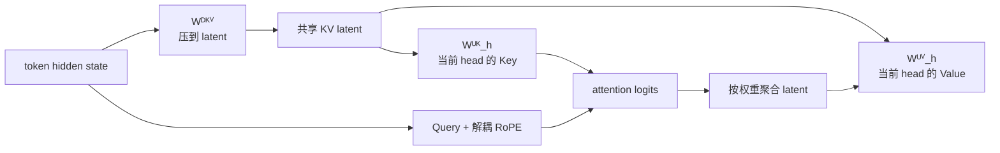

标准 MHA 为每个历史 token 保存很多组 K/V。MLA 的问题更具体：能否让这些 head 共享一份低维历史表示，同时保留每个 Query head 的注意力差异？

## 数据流先于公式

对列向量，一条可读的写法是 $c_s^{KV}=W^{DKV}x_s$、$k_s^{C,h}=W_h^{UK}c_s^{KV}$、$v_s^{C,h}=W_h^{UV}c_s^{KV}$。历史 cache 保存 latent 和位置分支，而不是每个 head 的完整内容 K/V。

## 为什么要解耦 RoPE

如果内容分支也直接做旋转，内积里会出现随 $t,s$ 变化的 $R_t^\top R_s$，当前 Query 很难把固定上投影吸收掉。MLA 把 Query/Key 拆成内容分支和位置分支：

$$q_t^h=[q_t^{C,h};q_t^{R,h}],\qquad k_s^h=[k_s^{C,h};k_s^R].$$

只有位置分支承担 RoPE；内容分支共享 latent。这样缓存宽度变成 $d_c+d_r$，而不是每个 head 的完整 $d_k+d_v$。这减少的是“每个 token 的表示宽度”，不是把历史长度截断。

## 两次矩阵吸收

Key 吸收把 $q_t^{C,h\top}W_h^{UK}c_s^{KV}$ 重排为 $\widetilde q_t^{h\top}c_s^{KV}$，Value 吸收则先得到 latent 聚合 $z_t^h=\sum_s\alpha_{t,s}^hc_s^{KV}$，再乘 $W_h^{UV}$。softmax 仍在 logits 上执行，不能把归一化一起吸收到线性层。

浮点求和顺序会带来末位差异；如果路径含 RMSNorm，仍要按代码顺序执行。阅读 V3 实现时，`wq_a → q_norm → wq_b`、`wkv_a`、`kv_norm`、`wkv_b` 以及 `kv_cache/pe_cache` 是最短的对照路径。

## 来源与边界

- [DeepSeek-V2 §2.1.1–§2.1.4、Table 1](https://arxiv.org/html/2405.04434v5#S2.SS1)
- [DeepSeek-V2 附录 C](https://arxiv.org/html/2405.04434v5#A3)
- [DeepSeek-V3 固定实现](https://github.com/deepseek-ai/DeepSeek-V3/blob/9b4e9788e4a3a731f7567338ed15d3ec549ce03b/inference/model.py#L396-L497)

论文给出的缓存和速度收益属于其模型配置与硬件条件；本页只解释表示和计算重排。
