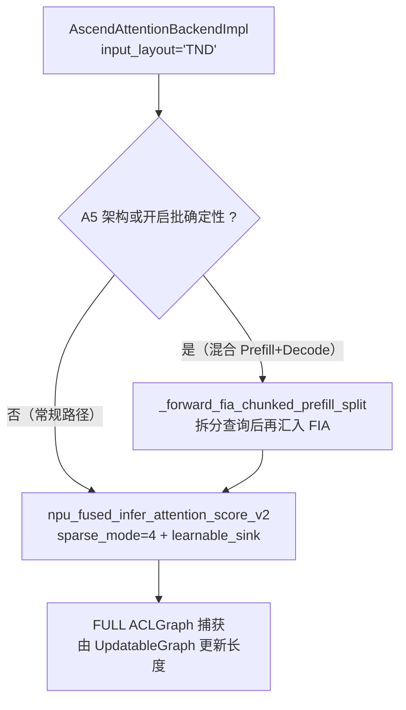

import Figure from 'astro-wisp/components/Figure.astro';
import SinkNsaRouteExplainer from './explainers/sink-nsa-route';
import paperFig1Sink from './images/paper-fig1-sink-scheme.png';
import paperFig2 from './images/paper-fig2-sink-logits.png';
import paperFig3 from './images/paper-fig3-sink-ppl.png';
import paperFig2NsaArch from './images/paper-fig2-nsa-arch.png';
import paperFig3NsaKernel from './images/paper-fig3-nsa-kernel.png';
import paperFig5 from './images/paper-fig5-nsa-niah.png';
import paperFig8 from './images/paper-fig8-nsa-visual.png';

在[01 MLA 多头潜在注意力](../01-mla/)中，每层每个 token 的 KV 缓存已压至 576 维潜向量。但进入 64K 甚至 128K 长上下文后，注意力算子仍须扫描全部历史位置；NSA 论文实测 Softmax 注意力在 64K 解码下占总延迟的 70%–80%[^nsa]。

长文本中超过 95% 的历史位置分到的权重接近零，但直接切出固定 **SWA（Sliding Window Attention，滑动窗口注意力）**或训练后再做剪枝，均会在精度或硬件效率上受限。先统一核心符号与张量形状：

| 符号                                                           | 含义                                     | 张量形状 / 取值域                             |
| :------------------------------------------------------------- | :--------------------------------------- | :-------------------------------------------- |
| $L,\; W,\; G$                                                  | 上下文总长、滑窗宽度、GQA 查询头分组     | NSA 默认 $G = 16$，$w = 512$                  |
| $l,\; d,\; l'$                                                 | `cmp` 压缩窗长、压缩步长、`slc` 块宽     | $l=32,\; d=16,\; l'=64$                       |
| $\mathbf{q}_t,\; Q_g$                                          | 单查询向量、GQA 同组查询矩阵             | $\mathbb{R}^{d_k}$、$[G, d_k]$                |
| $\tilde{K}_t^c,\; \tilde{V}_t^c$                               | 分支 $c\in\{\text{cmp, slc, win}\}$ 键值 | 按分支压缩、精筛或滑窗切片                    |
| $\mathbf{p}_t^{\text{cmp}},\; \bar{\mathbf{p}}_t^{\text{slc}}$ | 压缩注意力概率、GQA 组聚合的块选择分数   | 沿 $G$ 个头求和后挑 Top-$n$                   |
| $\mathcal{I}_t,\; g_t^c,\; s_{\text{aux}}$                     | 组共享选块下标集、分支门控、Sink 偏置    | $g_t^c \in (0, 1)$；$s_{\text{aux}}$ 每头标量 |

## 滑动窗口注意力与 KV 缓存压缩

标准因果注意力中，第 $t$ 个 token 须关注前面全部历史位置 $0 \dots t$。随着序列长度 $L$ 增长，单步解码需要读取的 KV Cache 线性膨胀，总计算量呈 $O(L^2)$ 上升。**SWA（Sliding Window Attention，滑动窗口注意力）**让每个查询只关注最近 $W$ 个位置 $[t - W + 1,\, t]$，超出窗口的早期历史在当前层直接屏蔽。

由于每层只依赖最近 $W$ 个键值向量，推理引擎只需维护定长为 $W$ 的滚动 KV Cache，把每步显存占用和带宽开销从 $O(L)$ 压成常数 $O(W)$。堆叠 $N$ 层 Transformer 后，第 $N$ 层的理论感受野仍可扩展至 $N \times W$。但若把按全量注意力预训练的模型直接切换为固定滑窗推理，早期 token 一旦离开窗口就会破坏输出分布。

## 纯滑窗失效与 Attention Sink

当序列长度超过窗口宽度 $W$ 时，如果直接把最早的 token 移出缓存，即使只丢掉开头几个 token，语言模型的 **PPL（Perplexity，困惑度）**也会急剧飙升，输出很快崩溃[^sink]。PPL 衡量模型预测下一个 token 时的不确定性，数值越低说明预测越准。

StreamingLLM（图 1）对比了四种缓存策略，指出背后有两个叠加原因。第一，Softmax 要求可见位置权重之和为 1（$\sum_{j\le t} p_{t,j}=1$），当前词找不到强相关对象时，多余权重仍须分配出去。第二，因果掩码使起始几个 token 对后续所有位置始终可见，模型顺势将其固定成吸收多余概率的锚点，即 **Attention Sink**（图 2）。

<Figure
  src={paperFig1Sink}
  alt="论文图 1：全量注意力、固定窗口注意力、重计算滑窗与 StreamingLLM L 型掩码对比"
  caption="图 1：全量扫描、纯滑动窗口失效与 StreamingLLM Attention Sink 掩码对比（StreamingLLM 论文图 1）"
/>

<Figure
  src={paperFig2}
  alt="论文图 2：Llama-2-7B 多层注意力 logits 可视化，深层第 0 列出现显著高激活竖条"
  caption="图 2：Llama-2-7B 注意力 logits 分布（StreamingLLM 论文图 2），起始 token 承担显著吸收效应"
/>

以一个 8 token 因果序列（$t=0\dots 7$）为例量化这一分布偏移。设末尾查询 $q_7$ 对各历史位置的原始打分为 $z = [6.0, 0.2, 0.1, 0.0, 1.0, 1.2, 1.5, 2.0]$，滑窗宽度 $W=3$（保留 $[5, 6, 7]$）：

1. **全量因果基线**：$e^{6.0} \approx 403.4$ 主导分母，$t_0$ 吸收 95.00% 权重，局部窗 $[5, 6, 7]$ 合计占 3.58%。
2. **纯滑窗丢弃 $t_0$**：分母骤缩至 $e^{1.2}+e^{1.5}+e^{2.0} \approx 15.2$，窗口 $[5, 6, 7]$ 总权重被放大 **27.9 倍**至 100.00%。
3. **L 型掩码恢复 $t_0$**：重新保留 $t_0$ 后，它吸收了 96.37% 权重，局部窗口占比回落至 3.63%。

StreamingLLM 在 Llama-2-13B、Pythia-12B、Falcon-7B 与 MPT-7B 的 20K 长文本实验（图 3）与 65K PG-19 评测上验证了这一机制[^sink]。在 65K PG-19 上，纯滑窗（$0+1024$）PPL 高达 5158.07，保留前 4 个初始 token（$4+1020$）后稳回 5.40；即使把这 4 个 token 替换为换行符，PPL 仍维持在 5.60。

<Figure
  src={paperFig3}
  alt="论文图 3：四类开源模型在 20K 序列上的 PPL 曲线，纯滑窗超出预训练长度后骤升而 StreamingLLM 保持平稳"
  caption="图 3：20K 序列语言建模 PPL 曲线（StreamingLLM 论文图 3）"
/>

工程实现 Sink 滑窗还须满足两项约束[^sink]。第一，**Pre-RoPE 缓存与重旋转**：KV 缓存中须保存未经 RoPE 旋转的原始键向量，检索时按缓存内连续下标 $[0, 1, \dots]$ 重新旋转，防止驱逐旧块后相邻 token 相对距离跳变。第二，**可学习 Sink 偏置**：相比在 Softmax 分母加常数 1（`Zero Sink`，160M 模型 PPL 19.90），预置可学习的 Sink 偏置参数能进一步将 PPL 降至 18.01。

然而，L 型静态掩码只保留开头锚点与最近滑窗，窗口之外的中段历史仍被完全遮蔽。要兼顾常数级的分布稳定与跨距离动态召回，稀疏机制需要从模型训练阶段内生地融入架构。

## 训练后稀疏的局限与硬件访存瓶颈

在 NSA 论文第 2 章中，作者分析了 **Post-hoc（训练后稀疏）**难以兼顾精度与加速的两重原因[^nsa]。

首先，阶段割裂与不可微筛选限制了实用性。H2O 仅压缩 Decode 阶段访存，MInference 仅优化 Prefill 阶段，难以协同加速全流程。基于 k-means 或局部敏感哈希的离散选块还会切断梯度反传；训练后仅留前 20% 权重通常只覆盖约 70% 注意力。

其次，**GQA（Grouped-Query Attention，分组查询注意力）**下的访存模式直接卡住硬件效率。长文本注意力热力图呈局部块聚集分布（图 4），同组 $G=16$ 个查询头共享同一份 KV。若像 Quest 那样分头独立挑选 $n=16$ 个历史块，算子被迫从 **HBM（High Bandwidth Memory，高带宽显存）**读取选中块的**并集**。最坏时需离散读取 $16 \times 16 = 256$ 块，同时单头矩阵高度退化为 $M=1$，无法填满 Tensor Core 或达芬奇 Cube 分块。

<Figure
  src={paperFig8}
  alt="论文图 8：全量注意力权重热力图呈现明显的块状聚集分布"
  caption="图 4：全量注意力分数热力图的块状聚集规律（NSA 论文图 8）"
/>

## NSA 三分支原生稀疏与组共享算子

**NSA（Native Sparse Attention，原生稀疏注意力）**直接在预训练阶段引入三条独立分支。分支输出再经可学习的 Sigmoid 门控 $g_t^c \in (0, 1)$ 加权汇聚（图 5）[^nsa]：

$$
\mathbf{o}_t^* = \sum_{c\in\{\text{cmp},\, \text{slc},\, \text{win}\}} g_t^c \cdot \operatorname{Attn}\!\bigl(\mathbf{q}_t,\, \tilde{K}_t^c,\, \tilde{V}_t^c\bigr)
$$

<Figure
  src={paperFig2NsaArch}
  alt="论文图 2：NSA 三分支并行稀疏注意力框架及压缩、选择、滑窗三类稀疏掩码模式"
  caption="图 5：NSA 三分支并行架构与稀疏掩码模式（NSA 论文图 2）"
/>

### 三分支并行架构

1. **块压缩（`cmp`）**：以块长 $l=32$、步长 $d=16$ 滑动并经 MLP 压缩，保留 50% 重叠并将序列压缩 16 倍。
2. **组共享块选择（`slc`）**：复用 $\mathbf{p}_t^{\text{cmp}}$，将 $l'=64$ 块内重叠分数沿 $G=16$ 个头求和，得出整组唯一的 Top-$n$ 下标 $\mathcal{I}_t$：

$$
\mathbf{p}_t^{\text{slc}}[j] = \sum_{m=0}^{\frac{l'}{d}-1} \sum_{n=0}^{\frac{l}{d}-1} \mathbf{p}_t^{\text{cmp}}\!\left[\frac{l'}{d}j - m - n\right], \qquad \bar{\mathbf{p}}_t^{\text{slc}} = \sum_{h=1}^{G} \mathbf{p}_t^{\text{slc},(h)}, \qquad \mathcal{I}_t = \operatorname{Top-}n\bigl(\bar{\mathbf{p}}_t^{\text{slc}}\bigr)
$$

3. **独立滑窗（`win`）**：单设投影矩阵 $W_K^{\text{win}}, W_V^{\text{win}}$（$w=512$），避免邻近梯度压制远距离稀疏块学习。

图 6 在同一组 8 token 序列上对比了全量注意力、纯滑窗 SWA、Attention Sink 与 NSA 三分支的可见通路与权重分配。切换上方模式或拖动 $z_0$ 滑块，可以直观看到 $t_0$ 丢失造成的 27.9 倍局部放大、Sink 对分母的稳定作用，以及 `slc` 如何动态召回中段关键位置 $t_2$。

<SinkNsaRouteExplainer
  client:visible
  title="图 6：从全量注意力、SWA 到 NSA 三分支的可见范围与权重对比"
/>

### 硬件对齐 Kernel 与长上下文实测

由于同组 $G=16$ 个查询头共享选中块下标集 $\mathcal{I}_t$，执行链路（图 7）得以彻底重构。算子一次性将整组查询头装入片上 SRAM 或 **UB（Unified Buffer，片上统一缓存）**，随后顺序搬运共享连续块，使矩阵乘高度 $M=16$ 跨越计算拐点。

<Figure
  src={paperFig3NsaKernel}
  alt="论文图 3：NSA 硬件对齐 Kernel 设计，按 GQA 查询组调度 Grid 循环并在片上 SRAM 连续搬运选中块"
  caption="图 7：NSA 硬件对齐 GQA 组共享 Kernel 调度流程（NSA 论文图 3）"
/>

在 27B、64K、$n=16$（含 1 个起始块与 2 个局部块）配置下，每步活跃读取长度降至 5,632、访存降低 11.6 倍。A100 上 Triton Kernel 取得 9.0 倍前向加速，LongBench HPQ 提升 8.7 分且 64K 大海捞针全命中（图 8）[^nsa]。

<Figure
  src={paperFig5}
  alt="论文图 5：27B NSA 在 64K 大海捞针全部深度与长度格子上取得 1.00 检索精度"
  caption="图 8：27B NSA 在 64K 上下文大海捞针全命中热力图（NSA 论文图 5）"
/>

| 稀疏方法（27B / 64K） |      活跃长度 / 访存       | LongBench HPQ |   2Wiki   |  平均分   |
| :-------------------- | :------------------------: | :-----------: | :-------: | :-------: |
| H2O（训练后 KV 驱逐） |     2,560（仅 Decode）     |     0.112     |   0.101   |   0.303   |
| Quest（分头独立选块） |     2,560（并集膨胀）      |     0.295     |   0.245   |   0.392   |
| Full Attention 基线   |       65,536（1.0×）       |     0.350     |   0.305   |   0.437   |
| **NSA（原生组共享）** | **等效 5,632（降 11.6×）** |   **0.437**   | **0.356** | **0.469** |

## PyTorch 参考实现与数值验证

下面的自包含 PyTorch 代码同时验证两项数值结论。第一部分复现 8 token 序列下纯 $W=3$ 滑窗的 27.9 倍权重放大与 $t_0$ 锚点恢复效果。第二部分核验 $G=16$ 组共享分块 Online Softmax 与原生 `scaled_dot_product_attention` 的数值等价性：

```python
import math
import torch
import torch.nn.functional as F

def nsa_group_shared_tile_attn(q_group, k_all, v_all, k_cmp, l_p=64, top_n=4, b_k=32):
    g_q, d_k = q_group.shape
    p_slc = F.softmax(q_group @ k_cmp.T, dim=-1)
    grp_idx = p_slc.sum(dim=0).topk(top_n).indices.sort().values
    k_slc = torch.cat([k_all[b * l_p : (b + 1) * l_p] for b in grp_idx.tolist()], dim=0)
    v_slc = torch.cat([v_all[b * l_p : (b + 1) * l_p] for b in grp_idx.tolist()], dim=0)
    m_s = torch.full((g_q, 1), -float("inf"), dtype=q_group.dtype)
    l_s = torch.zeros((g_q, 1), dtype=q_group.dtype)
    o_s = torch.zeros((g_q, v_all.shape[-1]), dtype=q_group.dtype)
    for b in grp_idx.tolist():
        for off in range(0, l_p, b_k):
            kb = k_all[b * l_p + off : b * l_p + off + b_k]
            vb = v_all[b * l_p + off : b * l_p + off + b_k]
            sb = (q_group @ kb.T) / math.sqrt(d_k)
            m_n = torch.maximum(m_s, sb.amax(dim=-1, keepdim=True))
            p_b = torch.exp(sb - m_n)
            alpha = torch.exp(m_s - m_n)
            l_s, o_s, m_s = l_s * alpha + p_b.sum(-1, keepdim=True), o_s * alpha + p_b @ vb, m_n
    return o_s / l_s, k_slc, v_slc

if __name__ == "__main__":
    torch.manual_seed(42)
    z = torch.tensor([6.0, 0.2, 0.1, 0.0, 1.0, 1.2, 1.5, 2.0], dtype=torch.float64)
    p_full = F.softmax(z, dim=-1)
    p_win, p_sink = torch.zeros(8, dtype=torch.float64), torch.zeros(8, dtype=torch.float64)
    p_win[5:], p_sink[[0, 5, 6, 7]] = F.softmax(z[5:], dim=-1), F.softmax(z[[0, 5, 6, 7]], dim=-1)
    print(f"full_w3={p_full[5:].sum():.4f} pure_w3={p_win[5:].sum():.4f} sink_w3={p_sink[5:].sum():.4f} t0={p_sink[0]:.4f}")

    T, G_q, d_k, d_v = 1024, 16, 24, 16
    q_g = torch.randn(G_q, d_k, dtype=torch.float64) / math.sqrt(d_k)
    k_all = torch.randn(T, d_k, dtype=torch.float64) / math.sqrt(d_k)
    v_all = torch.randn(T, d_v, dtype=torch.float64)
    k_cmp = torch.randn(T // 64, d_k, dtype=torch.float64)
    o_tile, k_slc, v_slc = nsa_group_shared_tile_attn(q_g, k_all, v_all, k_cmp)
    o_ref = F.scaled_dot_product_attention(q_g.unsqueeze(0), k_slc.unsqueeze(0), v_slc.unsqueeze(0)).squeeze(0)
    diff = (o_ref - o_tile).abs().max().item()
    assert diff < 1e-14
    print(f"K_slc={tuple(k_slc.shape)} O_tile_diff={diff:.2e}")
```

运行结果与上述计算完全一致：

```text
full_w3=0.0358 pure_w3=1.0000 sink_w3=0.0363 t0=0.9637
K_slc=(256, 24) O_tile_diff=1.94e-16
```

## GPU 与昇腾 NPU 的生产引擎实现

在在线推理服务中，如果像原始原型那样常驻锁定物理第 0 页，就会破坏分页内存池的前缀缓存哈希复用。`vLLM` 与 `vllm-ascend` 因此一致将 Attention Sink 实现为独立于物理 KV 槽位的每头可学习偏置参数。

### vLLM GPU 实现与滑窗语义约束

在 `vllm@99b0b0b0`[^vllm-fa] 中，`FlashAttentionBackend` 通过 `supports_sink()` 宣告算子支持。前向执行时，它将 `window_size` 与每头偏置 `s_aux` 送入 FlashAttention Kernel（图 9）。

```mermaid caption="图 9：vllm@99b0b0b0 中 FlashAttentionBackend 滑窗与 s_aux 偏置调度链路"
flowchart TD
    CFG["ModelConfig.sliding_window<br/>+ s_aux 权重加载"] --> BE["FlashAttentionBackend<br/>supports_sink() 检查"]
    BE --> CONV{"后端 Kernel 语义换算"}
    CONV -->|"FlashAttention"| FA["window_size=(W-1, 0)<br/>透传 s_aux 到 Softmax 分母"]
    CONV -->|"Triton 回退"| TR["左窗宽 1 + window_size[0]<br/>按前缀树偏移兼容分页"]
    FA --> OUT["无需锁定物理第 0 页<br/>完整复用 APC 前缀哈希"]
```

工程实现有两处细节[^vllm-fa]：其一，FlashAttention 与 Triton 的滑窗左边界定义相差 1，Triton 需要加 1 对齐语义。其二，由于 `s_aux` 只进入 Softmax 分母归约而不占用物理 KV 块，**APC（Automatic Prefix Caching，自动前缀缓存）**可无缝复用任意前缀分片。

```python
# vllm/v1/attention/backends/flash_attn.py:1508-1521 (vllm@99b0b0b0)
window_size=sliding_window_size,
block_table=block_table,
softcap=self.logits_soft_cap,
scheduler_metadata=scheduler_metadata,
fa_version=self.vllm_flash_attn_version,
s_aux=self.sinks,
mask_mod=rswa_mask_mod_fn or mm_mask_mod,
```

### 昇腾 NPU 的 FIA 调度与混批切分

转向华为昇腾 NPU，`vllm-ascend@b776261e`[^vllm-ascend] 由 `AscendAttentionBackendImpl` 统一调度 FIA（FusedInferAttentionScore）算子。该算子通过 `sparse_mode=4` 与 `pre_tokens` 配置滑窗，并透传 `learnable_sink`，流转如图 10 所示。



昇腾 FIA 滑窗同样有三项运行边界[^vllm-ascend]。第一，A5 架构或开启 `batch_invariant` 时，混批须拆分执行 Prefill 与 Decode。第二，GQA FIA 与 PagedAttention 已迁入 `UpdatableGraph` 托管变长参数。第三，DeepSeek 后续稀疏注意力在昇腾侧对应 `AscendSFAImpl` 与 `AscendDSAV41Impl`。

```python
# vllm_ascend/attention/attention_v1.py:981-987 (vllm-ascend@b776261e)
learnable_sink=self.sinks,
sparse_mode=sparse_mode,
actual_seq_lengths=actual_seq_lengths_q,
actual_seq_lengths_kv=actual_seq_lengths_kv,
input_layout="TND",
```

| 机制维度          | `vLLM` GPU（`99b0b0b0`）           | `vllm-ascend` NPU（`b776261e`）       |
| :---------------- | :--------------------------------- | :------------------------------------ |
| Sink 滑窗入口     | `FlashAttentionBackend`（`s_aux`） | `AscendAttentionBackendImpl` 调用 FIA |
| 掩码与偏置传参    | `window_size` 换算后传 `s_aux`     | `sparse_mode=4` 配 `learnable_sink`   |
| 混批与确定性限制  | `mask_mod` 支持常规混批            | A5 / 确定性模式拆分子批执行           |
| DeepSeek 稀疏主线 | 单头 MLA 叠 DSA（V3.2）/ CSA（V4） | `AscendSFAImpl`、`AscendDSAV41Impl`   |

从对照表可以看出，DeepSeek-V3.2 并未将 GQA-NSA 直接引入生产主干。NSA 强绑定多头分组共享 KV 的 GQA 架构，且需要从头联合预训练；而 DeepSeek-V3 已通过 MLA 将历史缓存压缩为单头共享潜向量。要在既有 128K 底座上低成本演进动态稀疏注意力，选块索引必须直接架在单头低秩潜空间之上——这正是下一篇 [03 DSA：Lightning Indexer 与稀疏筛选](../03-dsa/) 的主题。

[^sink]: Guangxuan Xiao 等，“Efficient Streaming Language Models with Attention Sinks”，ICLR 2024。[arXiv:2309.17453](https://arxiv.org/abs/2309.17453)（CC BY 4.0），§3.1–3.3（Fig. 1、Fig. 2、Fig. 3 与 Table 1/2）。

[^nsa]: Jingyang Yuan 等，“Native Sparse Attention: Hardware-Aligned and Natively Trainable Sparse Attention”，2025。[arXiv:2502.11089](https://arxiv.org/abs/2502.11089)，§2–5（式 (5)–(12)、Table 1/2、Fig. 2、Fig. 3、Fig. 5 与 Fig. 8）。

[^vllm-fa]: `vLLM` 仓库（commit `99b0b0b0`）：`vllm/v1/attention/backends/flash_attn.py`（`L545-548` `supports_sink`、`L1422-1522` `FlashAttentionImpl.forward` 中 `sliding_window_size` 与 `s_aux=self.sinks` 透传）。

[^vllm-ascend]: `vllm-ascend` 仓库（commit `b776261e`）：`vllm_ascend/attention/attention_v1.py`（`L785-830` `full_graph_fia_v2`、`L920-1045` `forward_fused_infer_attention` `sparse_mode=4` 与 `learnable_sink`、`L1095-1165` `_forward_fia_chunked_prefill_split`）。
