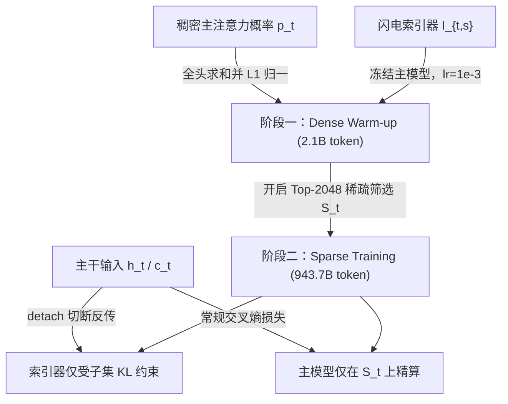

在[02 原生稀疏注意力（NSA）](../02-swa-and-nsa/)中，NSA 依靠 GQA 多组共享块选择把 64K 上下文的 KV 访存压缩了一个量级。但到了 DeepSeek-V3.2，团队并没有把 GQA-NSA 直接搬进生产主干：一方面，NSA 需要从头联合训练三路独立分支；另一方面，DeepSeek-V3.1-Terminus 底座的 128K 上下文已经建立在 MLA 之上，Decode 阶段通过矩阵吸收化归为单头 MQA 潜空间（128 个 Query 头共用 1 份 512 + 64 维潜向量）。

若拆回多组 KV 会推翻 MLA 的显存收益，而用 128 个高精度头逐 token 全量打分又会退回 $O(L^2)$ 瓶颈。为此，DeepSeek-V3.2 提出的 **DeepSeek 稀疏注意力（DSA）**把「粗筛谁重要」和「精算怎么聚合」拆给算力预算完全不对称的两个模块[^ds32]：先由一个极轻量的**闪电索引器（Lightning Indexer）**快速扫过历史序列挑出 Top-$k$（生产取 $k = 2048$）槽位，再让主模型 128 头 MLA 只按索引 Gather 这 2048 条潜向量，把主注意力的复杂度从 $O(L^2)$ 压至 $O(Lk)$。

## 闪电索引器定义与硬件对齐直觉

对于当前位置 $t$ 的查询隐状态 $\mathbf{h}_t \in \mathbb{R}^d$ 与历史位置 $s$ 的隐状态 $\mathbf{h}_s \in \mathbb{R}^d$，闪电索引器按如下公式计算两者的稀疏索引分数 $I_{t,s}$，主模型随后仅在分数最高的 Top-$k$ 集合上执行注意力计算[^ds32]：

$$
I_{t,s} = \sum_{j=1}^{H^I} w_{t,j}^I \cdot \operatorname{ReLU}\!\left(\mathbf{q}_{t,j}^I \cdot \mathbf{k}_s^I\right), \qquad
\mathbf{u}_t = \operatorname{Attn}\!\left(\mathbf{h}_t,\; \bigl\{\mathbf{c}_s \mid I_{t,s} \in \operatorname{Top-}k(I_{t,:})\bigr\}\right)
$$

其中 $H^I = 64$ 是索引查询头数，单头维度 $d^I = 128$（前 64 维带 RoPE 旋转），$\mathbf{q}_{t,j}^I \in \mathbb{R}^{128}$ 复用了主模型 Query 潜向量 $c_t^Q \in \mathbb{R}^{1536}$ 下投映射而来；$w_{t,j}^I \in \mathbb{R}$ 是由 $\mathbf{h}_t$ 投影出的每头动态加权标量；而全部 64 个索引头共用**同一份索引键** $\mathbf{k}_s^I \in \mathbb{R}^{128}$。

索引器选用 $\operatorname{ReLU}$ 激活以绕过 Softmax 的全序列指数和归约同步：$\operatorname{ReLU}$ 逐元素把负相关性截断为零，天然非负可加，可直接配合 FP8 低比特累加完成排序筛选。

把索引器设计成「$H^I = 64$ 个查询头共享 1 份 FP8 索引键 $\mathbf{k}_s^I$」，背后是存储与计算双侧严密咬合的硬件考量[^ds32]。

在历史存储侧，全头共享 1 份键且每 128 维（即整条键）共用 1 个 4 B 的 UE8M0 块缩放因子（写入前先经过 FP32 层归一化稳住量级），把每 token 的索引缓存增量严格控制在 132 B（128 B FP8 键 + 4 B 缩放因子）。

而在计算侧，如果单步 Decode（$T_q = 1$）只有 1 个索引头，查询矩阵高度退化为 $M = 1$ 的向量-矩阵乘，无法利用矩阵算力。配置 $H^I = 64$ 个头后，即使只解码 1 个 token，查询侧也天然排成 $64 \times 128$ 的矩阵块，使 $M = 64$ 恰好填满 GPU Tensor Core（如 Hopper `wgmma` 指令及底层核均偏好 32 或 64 个头）与昇腾达芬奇 Cube 16×16 矩阵乘分块（`Tile`，$64 = 4 \times 16$），同时从 HBM 读取的历史键仍然只有 1 份。

算一笔单 token 的算力对比账：面对 128K（$L = 131{,}072$）历史上下文，如果直接跑稠密 128 头吸收态 MLA，每对查询与历史潜槽都需要 $128 \times (576 + 512) = 139{,}264$ 次 BF16 乘加；而闪电索引器每个历史位置只需 $64 \times 128 = 8{,}192$ 次 FP8 乘加（算术次数缩减 17 倍，叠乘 FP8 两倍硬件峰值后理论计算开销压低超过 30 倍）。随后主模型只需在挑出的 $k = 2048$ 个槽位上做高精度归约，把全序列扫描卸载到极轻量目录层。

看一个 8 槽位微型算例：假设当前查询 $q_7$ 对历史槽位 $s_0 \dots s_7$ 算得非负索引分数 $[0.0, 3.8, 0.4, 5.1, 0.0, 2.6, 0.2, 4.3]$，若截取 $k = 3$，则只选中 $\{s_1, s_3, s_7\}$ 三条潜向量送入主注意力，其余 5 条（含已被 $\operatorname{ReLU}$ 归零的 $s_0, s_4$）全部跳过。

放大到生产尺寸（$L = 131{,}072$、$k = 2048$）时，主模型 128 个高精度头每步仅从 HBM 稀疏读取约 1.56% 的历史潜向量，在几乎不损长上下文精度的前提下大幅压缩主注意力算力（DeepSeek-V3.2-Exp 在 AA-LCR 与 Fiction.liveBench 上持平乃至略微反超稠密基线 DeepSeek-V3.1-Terminus）[^ds32]。

图 1 展示了这组 8 槽位算例的 ReLU 打分、Top-$k$ 筛选、按索引 Gather、生产字节账本与序列长度交叉点。


## 两阶段蒸馏预热与梯度隔离

为了让已经训练完的 128K 稠密 MLA 底座平滑切换到 $k = 2048$ 的稀疏模式，DeepSeek-V3.2 采用如图 2 所示的两阶段继续预训练方案[^ds32]。



在第一阶段（Dense Warm-up）中，主模型所有 671B 参数完全冻结，前向依然跑全量稠密 MLA。为了给单输出打分器 $I_{t,:}$ 构造唯一且平滑的监督信号，系统先把主注意力全部 128 个头的概率逐位置求和，再沿序列维做 L1 归一化，得到唯一的教师分布 $p_{t,:} \in \mathbb{R}^t$。

随后直接用 KL 散度 $\sum_t D_{\mathrm{KL}}(p_{t,:} \,\|\, \operatorname{Softmax}(I_{t,:}))$ 单独训练闪电索引器。由于 671B 主干权重保持冻结，这一阶段可用较大的学习率（$10^{-3}$）快速拟合，仅消耗 1,000 步（每步 16 条 128K 序列，共 2.1B token）便完成对齐热身。

进入第二阶段（Sparse Training）后，系统正式打开 Top-2048 稀疏筛选集合 $\mathcal{S}_t$，放开主干全部参数以 $7.3 \times 10^{-6}$ 的小学习率联合训练 15,000 步（480 条 128K 序列，共 943.7B token），同时将索引器的 KL 损失收窄到被选中集合 $\mathcal{S}_t$ 之上。

尤为关键的一步是对送入索引器的隐状态做 `detach` 梯度截断：索引器的参数更新仅由对齐主注意力的 KL 损失驱动，而 671B 主模型仅由语言建模交叉熵损失驱动。这样既让主干表示逐渐适应稀疏读取后的特征分布，又防止低比特粗糙排序引入的梯度噪声反向污染主网络表征。

## 656 B 混合精度布局与双端落地

把主注意力算力降至 $O(Lk)$ 后，随机下标的按索引 Gather 使每 token 缓存字节大小直接决定 HBM 搬运上限。在标准 BF16 下，每条 512 + 64 维 MLA 潜向量占 1,152 B，按 128K 上下文 × 62 层（61 主干层 + 1 MTP 层）计单请求高达 8.72 GiB。

为此 DeepSeek-V3.2 与 FlashMLA 设计了 `fp8_ds_mla` 混合精度格式[^flashmla]：将 512 维无位置内容潜向量 $c_s^{KV}$ 以 `fp8_e4m3` 存储（512 B），每 128 维配 1 个 FP32 分块缩放因子（共 4 × 4 B = 16 B），而对量化噪声高度敏感的 64 维 RoPE 位置键 $k_s^R$ 完整保留 BF16（128 B）。

三项合计恰好为 656 B/token，使 128K × 62 层主缓存从 8.72 GiB 降至 4.96 GiB；再叠加前文所述的 132 B/token 索引器缓存，单请求长上下文总缓存压至每层每 token 788 B。

两者连缩放因子的表示精度也各自贴合用途：索引器键只需做相对排序，因此 `DeepseekV32IndexerCache` 对整条 128 维键共用 1 个仅占 4 字节的纯指数 UE8M0 块缩放因子，换取更小的目录体积与更简单的整数移位对齐；主潜缓存则直接参与高精度加权求和，保留 4 个完整 FP32 缩放因子与 BF16 旋转键。

到了算子执行层，Hopper H800 上暴露出一个关键的指令吞吐错配[^flashmla]：单个 SM 上的 Tensor Core 执行 64 个查询头的 MMA 只需约 34 个时钟周期，但 H800 缺乏 `fp8_e4m3` 直转 `bf16` 的硬件指令，CUDA Core 必须依次完成 E4M3 转 FP16、转 FP32、转 BF16 再乘缩放因子，单 token 反量化耗时高达约 50 个周期，导致解码核卡在反量化上。

由于 128 个头共用同一份潜缓存（MQA），FlashMLA 把两个处理各 64 头的 CTA 编成大小为 2 的 CTA Cluster：每个 CTA 只从全局显存加载并反量化**一半**的潜向量（约 25 个周期，低于 34 周期的 MMA 耗时），再通过 Hopper 分布式共享内存（DSMEM）异步互换各自解好的一半，将反量化耗时藏进 Tensor Core 流水线之后。

在这一流水线调度下，`fp8_ds_mla` 解码 Kernel 在 `topk = 2048` 条件下跑出 410 TFLOPS，并在序列超过约 3,000 token 后反超稠密解码 Kernel。

图 3 对照了 NVIDIA GPU（`vLLM`[^vllm]）与华为昇腾 NPU（`vllm-ascend`[^ascend]）的运行时组件与分页对齐差异。在 NVIDIA GPU 上，`Indexer` 将键值映射与每头权重映射融合为一次 BF16 GEMM，并利用融合算子完成 Q 的 RoPE 旋转与量化，分页块统一按 64 token 粒度喂给 `SparseAttnIndexer` 与 `FlashMLASparseBackend`。

在华为昇腾 NPU 上，`AscendSFAImpl` 根据硬件代际与量化开关路由三类预处理路径（融合前端 prolog、组合量化投影或原生投影），并可用独立流并行发射索引查询与键量化。尽管昇腾物理分页对齐至达芬奇 Cube 友好的 128 token 大小，`npu_sparse_flash_attention` 在内部按索引 Gather 时仍能按逻辑粒度 1 逐 token 精确读取选中的潜向量。


| 对比维度     | `vLLM` GPU[^vllm]                             | `vllm-ascend` NPU[^ascend]                             |
| :----------- | :-------------------------------------------- | :----------------------------------------------------- |
| 入口与缓存类 | `Indexer` 与 `DeepseekV32IndexerCache`        | `AscendSFAImpl` 与 `AscendSFAIndexerBackend`           |
| 物理分页粒度 | 统一按 64 token 组织页块                      | 物理对齐 128 块，逻辑按 1 token 粒度稀疏读取           |
| 前置投影路径 | 键值/权重融合 GEMM + 量化 Q/RoPE 算子         | 三路预处理策略 + 独立流异步发射 Q                      |
| 打分与读取   | `SparseAttnIndexer` + `FlashMLASparseBackend` | `npu_lightning_indexer` + `npu_sparse_flash_attention` |

## PyTorch 参考实现与结构验证

下面的自包含 PyTorch 代码分别用 `LightningIndexer` 实现 $H^I$ 头共享单键的 $\operatorname{ReLU}$ 索引筛选，用 `sparse_mla_decode` 演示仅稀疏读取 `topk_ids` 槽位后的 1 头 MQA 计算，并校验前后张量形状：

```python
import math
import torch
import torch.nn as nn
import torch.nn.functional as F


class LightningIndexer(nn.Module):
    """DeepSeek-V3.2 闪电索引器（对应 vLLM `Indexer` / `SparseAttnIndexer`）。

    输入：
        h_q:  [T_q, d_model]（当前查询隐状态）
        h_kv: [L_ctx, d_model]（待检索历史隐状态）
    输出：
        topk_ids: [T_q, k_top]（仅保留得分最高的 k_top 个历史 token 槽位下标）
    """

    def __init__(self, d_model: int = 64, h_idx: int = 8, d_idx: int = 32, k_top: int = 16):
        super().__init__()
        self.h_idx, self.d_idx, self.k_top = h_idx, d_idx, k_top
        self.wq_b = nn.Linear(d_model, h_idx * d_idx, bias=False)  # 多头轻量索引查询
        self.wk = nn.Linear(d_model, d_idx, bias=False)            # 全部索引头共享 1 份键（132 B/tok）
        self.weights_proj = nn.Linear(d_model, h_idx, bias=False)  # 每头动态加权标量 w_{t,j}^I

    def forward(self, h_q: torch.Tensor, h_kv: torch.Tensor) -> torch.Tensor:
        q_idx = self.wq_b(h_q).view(-1, self.h_idx, self.d_idx)  # [T_q, H^I, d^I]
        k_idx = self.wk(h_kv)                                    # [L_ctx, d^I]（单头共享）
        w_idx = self.weights_proj(h_q)                           # [T_q, H^I]

        # ReLU 截断负相关性并免除全序列 Softmax 同步，天然支持 FP8 低比特累加后排序
        head_scores = F.relu(torch.einsum("thd,sd->ths", q_idx, k_idx))  # [T_q, H^I, L_ctx]
        scores = (head_scores * w_idx.unsqueeze(-1)).sum(dim=1)          # [T_q, L_ctx]
        return torch.topk(scores, k=self.k_top, dim=-1, sorted=False).indices


def sparse_mla_decode(
    q_abs: torch.Tensor,
    q_pe: torch.Tensor,
    c_kv_cache: torch.Tensor,
    k_pe_cache: torch.Tensor,
    topk_ids: torch.Tensor,
    w_uv: torch.Tensor,
) -> torch.Tensor:
    """只从 [L_ctx, ...] HBM 缓存中 Gather topk_ids 槽位并完成 1 头潜空间 MQA（复杂度 O(k_top)）。"""
    # 仅搬运选中的 k_top 行，避免扫描全长上下文
    c_sel = c_kv_cache[topk_ids]                            # [k_top, d_c]
    k_pe_sel = k_pe_cache[topk_ids]                         # [k_top, d_rope]
    q_mqa = torch.cat([q_abs, q_pe], dim=-1)                # [N, d_c + d_rope]
    kv_sel = torch.cat([c_sel, k_pe_sel], dim=-1)           # [k_top, d_c + d_rope]
    scale = 1.0 / math.sqrt(q_mqa.shape[-1])
    attn_latent = F.softmax((q_mqa @ kv_sel.T) * scale, dim=-1) @ c_sel  # [N, d_c]
    return torch.einsum("hc,hcv->hv", attn_latent, w_uv)    # [N, d_v]


if __name__ == "__main__":
    torch.manual_seed(42)
    L_ctx, d_model, k_top, n_h, d_c, d_rope, d_v = 128, 64, 16, 4, 16, 8, 12
    indexer = LightningIndexer(d_model=d_model, h_idx=8, d_idx=32, k_top=k_top)
    with torch.no_grad():
        topk_ids = indexer(torch.randn(1, d_model), torch.randn(L_ctx, d_model))
        assert topk_ids.shape == (1, k_top)
        out = sparse_mla_decode(
            torch.randn(n_h, d_c), torch.randn(n_h, d_rope),
            torch.randn(L_ctx, d_c), torch.randn(L_ctx, d_rope),
            topk_ids[0], torch.randn(n_h, d_c, d_v),
        )
        assert out.shape == (n_h, d_v)
```

DSA 的加速收益在序列长度跨过约 3,000 token 后才开始显现：索引打分 Kernel 启动与非连续按索引 Gather 存在固定开销，当序列短于约 3,000 token 时，DSA 的实际执行时间高于稠密 FlashMLA（因此 V3.2 对短文本 Prefill 提供了掩码 MHA 回退模式）[^ds32][^flashmla]。同时，闪电索引器每步仍要线性扫过所有历史 $\mathbf{k}_s^I$，本质上是一个常数因子极小的 $O(L^2)$ 目录检索。

更关键的是，DSA 只把主注意力的计算量压到了 $O(Lk)$，并没有从显存中削减哪怕一个历史 token——全部 $L$ 条 656 B 主潜向量与 132 B 索引键仍按 $O(L)$ 占满 HBM。

要支撑百万 token 并发推理，必须继续沿着**序列长度轴 $L$** 做压缩，这正是下一篇 [04 序列压缩注意力（上）：DeepSeek-V4 的 CSA 与 HCA 双重配方](../04-csa-and-hca/) 要解决的问题。

[^ds32]: DeepSeek-AI，“DeepSeek-V3.2: Pushing the Frontier of Open Large Language Models”，2025。[arXiv:2512.02556](https://arxiv.org/abs/2512.02556)，§2.1–2.3 式 (1)–(4)。

[^flashmla]: DeepSeek-AI，`FlashMLA` 技术文档 `docs/20250929-hopper-fp8-sparse-deep-dive.md`，commit `395cb3af`。[GitHub](https://github.com/deepseek-ai/FlashMLA/tree/395cb3afbb331fef7b1b21e9340861b9436b42d8)。

[^vllm]: `vLLM` 项目，`vllm/model_executor/models/deepseek_v2.py`（`Indexer`、`DeepseekV32IndexerCache`、`wk_weights_proj`）、`vllm/model_executor/layers/sparse_attn_indexer.py`（`SparseAttnIndexer`、`fp8_fp4_paged_mqa_logits`）与 `vllm/v1/attention/backends/mla/flashmla_sparse.py`（`FlashMLASparseBackend`、`flash_mla_sparse_fwd`），commit `bb23c0a8`。[GitHub](https://github.com/vllm-project/vllm/tree/bb23c0a81779ba733923a7dab9b840b4e533f6a5)。

[^ascend]: `vllm-ascend` 项目，`vllm_ascend/attention/sfa_v1.py`（`AscendSFAImpl`、`PreprocessType`、`npu_sparse_flash_attention`、`sparse_flash_mla`）与 `vllm_ascend/attention/indexer.py`（`AscendSFAIndexerBackend`、`_q_stream`、`npu_lightning_indexer`），commit `3649b8ff`。[GitHub](https://github.com/vllm-project/vllm-ascend/tree/3649b8ff7fd69e707db2c634073d2b4c40eadf15)。
