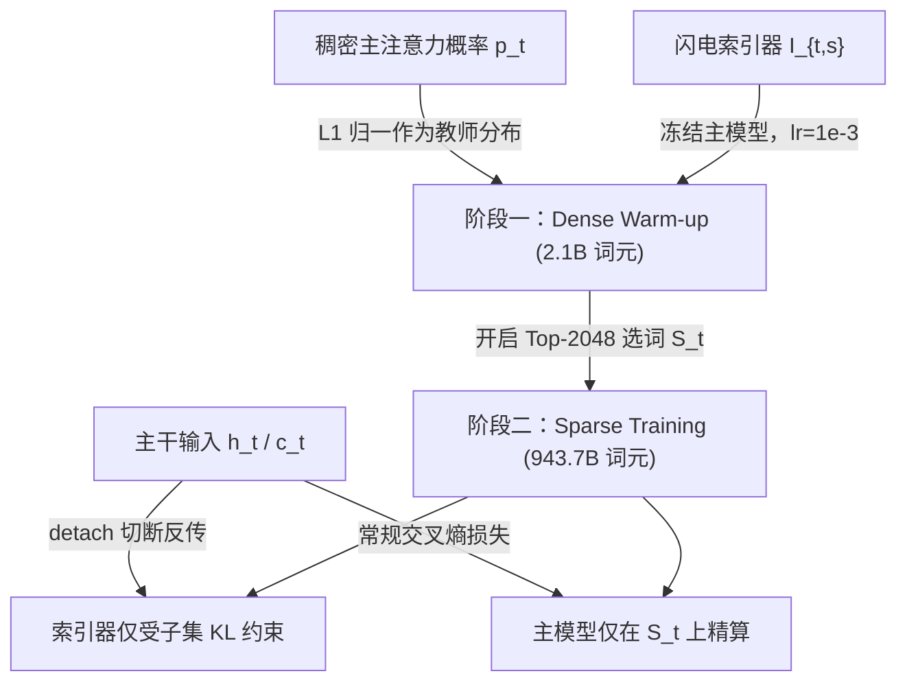

import DsaIndexerExplainer from '../../../../explainers/deepseek/DsaIndexerExplainer';

在 [01 MLA](../01-mla/) 中，DeepSeek-V3 把多头 KV 缓存压成了每词元仅存 `1` 份的潜向量 $c_s^{KV} \in \mathbb{R}^{512}$ 与解耦位置键 $k_s^R \in \mathbb{R}^{64}$；到了 [02 原生稀疏注意力（NSA）](../02-swa-and-nsa/)，NSA 靠 GQA 组共享连续块挑选加速长上下文推理。问题随之而来：**为什么不直接把 NSA 套进 MLA，反而要在 DeepSeek-V3.2 提出 DSA（DeepSeek Sparse Attention）**[^ds32]？

根源在于两者的 KV 头结构截然不同。GQA 天然由多组共享块分摊访存；而 Decode 矩阵吸收后的 MLA 已经退化成极端的 **`1` 头 MQA 潜在空间**（128 个 Query 头共享这 1 份潜向量）。若在单头潜空间强行保留多组统计会破坏省显存的根基；若拿 `128` 个高精度头逐词全量打分，打分器自身又会退化为 $O(L^2)$ 瓶颈。

DeepSeek-V3.2 的解法是把「粗筛谁重要」与「精算怎么聚合」拆给算力预算彻底不对称的两个模块。读完本章，你可以带走四件确定的事：

1. **极简闪电索引器（Lightning Indexer）**：采用 $H^I = 64$ 个轻量查询头配合 **`1` 头共享索引键** $k_s^I$，在 FP8 下用 **$\operatorname{ReLU}$** 替代 Softmax 打分，把全序列粗筛的常数因子压到极低。
2. **Top-$k$ 潜空间精确回捞**：每步只挑得分最高的 $k = 2048$ 个历史槽位，主模型 `128` 头 MLA 仅回捞这 `2048` 条潜向量，主注意力复杂度从 $O(L^2)$ 降至 $O(Lk)$。
3. **两阶段平滑蒸馏与梯度隔离**：先冻结主模型用稠密概率分布做 KL 预热（仅 `2.1B` 词元），再在 `943.7B` 词元稀疏联合训练阶段 `detach` 索引器输入切断互扰。
4. **656 B + 132 B 混合精度布局与双端落地**：对照 `vllm`（`block_size=64`，`FlashMLASparseBackend`）与 `vllm-ascend`（`block_size=128`，`AscendSFAImpl`）双栈实现。

## 先看一个例子：闪电索引器打分、Top-K 回捞与双缓存字节账本

直接打开**图 1**，沿 5 个步骤观察 $I_{t,s}$ 如何从 FP8 ReLU 打分一路推进到稀疏 MLA 回捞、`656 B + 132 B` 等比例存储构成以及长短序列算力交叉点：

<DsaIndexerExplainer
  client:visible
  title="图 1：DeepSeek-V3.2 DSA 闪电索引器、Top-K 回捞与 656 B + 132 B 账本"
/>

对应**图 1** 的真实模型尺寸（上下文 $L = 131072$、筛选预算 $k = 2048$）：闪电索引器就像廉价目录扫过全部 128K 历史键，而主模型 `128` 个高精度头只需从 HBM 回捞其中约 **`1.56%`** 的关键潜向量即可无损恢复上下文线索。

## 闪电索引器原理与两阶段 KL 蒸馏预热

在 DeepSeek-V3.2 论文[^ds32]中，第 $t$ 个查询词元对历史第 $s$ 个词元的索引打分定义为：

$$
I_{t,s} = \sum_{j=1}^{H^I} w_{t,j}^I \operatorname{ReLU}\bigl(q_{t,j}^I \cdot k_s^I\bigr)
$$

其中 $H^I = 64$、索引头维 $d^I = 128$（内含 `64` 维 RoPE）、查询权重 $w_{t,j}^I \in \mathbb{R}$ 由当前隐状态投影得出，而全部 $64$ 个头共享同一份键向量 $k_s^I \in \mathbb{R}^{128}$。选择 $\operatorname{ReLU}$ 替代 Softmax 的核心原因在于免去了跨全序列的 `exp-sum` 规约同步：负值自然截断为零且非负可加，能在 FP8 低比特累加后直接排序。

为了让已经预训练完成的稠密 MLA 底座平滑切换到 `Top-2048` 稀疏模式，DeepSeek-V3.2 采用如**图 2** 所示的两阶段训练流程：



顺着**图 2** 的数据流，阶段一冻结主干参数、全量执行稠密 MLA，以主注意力头总和 L1 归一化分布 $p_{t,:}$ 训练索引器 `1000` 步（`2.1B` 词元）；阶段二打开 $k = 2048$ 选词集合 $S_t$ 联合训练 `15000` 步（`943.7B` 词元），并通过 `detach` 阻止语言模型主损失反向干扰索引器排序目标。

## 656 B 混合精度布局与 GPU / Ascend NPU 源码对照

把主计算压至 $O(Lk)$ 后，随机下标回捞让 HBM 访存成为核心制约。标准 BF16 下 `512 + 64` 维 MLA 占用 `1152 B/token`（按 `128K × 62` 层计单请求达 `8.72 GiB`）。为此 FlashMLA 与 DeepSeek-V3.2 设计了 `fp8_ds_mla` 混合格式[^flashmla]：

- **FP8 NoPE 主体（`512 B`）**：`512` 维 $c_s^{KV}$ 以 `fp8_e4m3` 存储，占 `512 B`。
- **分块缩放因子（`16 B`）**：每 `128` 维配 `1` 个 `float32` 缩放因子（`4 × 4 B = 16 B`）。
- **BF16 RoPE 位置键（`128 B`）**：高频位置角度对量化敏感，`64` 维 $k_s^R$ 完整保留 `bfloat16`（`128 B`）。

三者相加恰好为 **`656 B/token`**（`128K × 62` 层从 `8.72 GiB` 降至 `4.96 GiB`），外加单头 `128` 维 FP8 索引键与 `4 B` `ue8m0` 指数缩放构成的 **`132 B/token`** `DeepseekV32IndexerCache`。在 Hopper H800 上，FlashMLA 借助 CTA Cluster size-2 的 DSMEM 异步传输掩盖 FP8 反量化周期（约 `50` 反量化周期 vs `34` MMA 周期），在 `topk=2048` 下跑出 `410 TFLOPS`，并在序列越过约 `3000` 词元后反超稠密内核[^flashmla]。**图 3** 对照了 GPU 与昇腾 NPU 源码栈的具体调度：


将**图 3** 中的核心工程符号逐一核对至 `vllm@bb23c0a8` 与 `vllm-ascend@3649b8ff`：

| 对比维度          | `vllm` GPU（`vllm@bb23c0a8`）[^vllm]                                                                 | `vllm-ascend` NPU（`vllm-ascend@3649b8ff`）[^ascend]                                    |
| :---------------- | :--------------------------------------------------------------------------------------------------- | :-------------------------------------------------------------------------------------- |
| **入口与封装类**  | `Indexer` 与 `DeepseekV32IndexerCache`（`deepseek_v2.py`）                                           | `AscendSFAImpl`（`sfa_v1.py`）与 `AscendSFAIndexerBackend`（`indexer.py`）              |
| **KV 分页块大小** | `block_size = 64`                                                                                    | `kernel_block_size = 128`（对齐达芬奇 Cube），`npu_sparse_flash_attention` 支持块粒 `1` |
| **前置融合核**    | `wk_weights_proj` BF16 融合 + `fused_indexer_q_rope_quant`                                           | `PreprocessType` 三路路由（`PROLOG_V3` / `MLAPO` / `NATIVE`）+ 可选 `_q_stream` 异步流  |
| **打分与回捞核**  | `SparseAttnIndexer`（`fp8_fp4_paged_mqa_logits`）+ `FlashMLASparseBackend`（`flash_mla_sparse_fwd`） | `npu_lightning_indexer` + `npu_sparse_flash_attention` / `sparse_flash_mla`             |

## PyTorch / NumPy 核心实现与等价性核验

下面这段自包含的 NumPy 核心实现验证 DSA 在 $L=128$ 序列中只挑 $k=16$（`12.5%`）历史槽位时，对显著关键位置（`salient`）的命中率、注意力质量保持率以及稀疏输出相对误差：

```python
import numpy as np

rng = np.random.default_rng(42)

def softmax(x: np.ndarray) -> np.ndarray:
    e = np.exp(x - np.max(x, axis=-1, keepdims=True))
    return e / np.sum(e, axis=-1, keepdims=True)

L_ctx, H_idx, d_idx, k_top = 128, 8, 32, 16
base_dir = rng.normal(size=(64,))
base_dir /= np.linalg.norm(base_dir)
q_main = base_dir[None, :] * 9.0 + rng.normal(size=(16, 64)) * 0.2
c_hist = rng.normal(size=(L_ctx, 64)) * 0.5
salient = np.arange(0, 100, 10)
c_hist[salient] = base_dir[None, :] * 5.5 + rng.normal(size=(10, 64)) * 0.1

# 稠密基线输出与目标分布
attn_ref = softmax((q_main @ c_hist.T) / np.sqrt(64))
p_target = attn_ref.sum(axis=0); p_target /= p_target.sum()
out_dense = attn_ref @ c_hist

# ReLU 闪电索引器打分与 Top-k 回捞
q_i = np.broadcast_to(base_dir[:d_idx], (H_idx, d_idx)) + rng.normal(size=(H_idx, d_idx)) * 0.05
k_i = c_hist[:, :d_idx] * 0.6
w_i = np.ones(H_idx) / H_idx
idx_scores = (np.maximum(0.0, q_i @ k_i.T) * w_i[:, None]).sum(axis=0)
topk_ids = np.argsort(idx_scores)[-k_top:]
assert idx_scores.shape == (L_ctx,) and topk_ids.shape == (k_top,)

out_sparse = softmax((q_main @ c_hist[topk_ids].T) / np.sqrt(64)) @ c_hist[topk_ids]
assert out_sparse.shape == out_dense.shape
rel_err = np.linalg.norm(out_dense - out_sparse) / np.linalg.norm(out_dense)
print(f"salient_hits={len(set(topk_ids)&set(salient))}/10 mass_kept={p_target[topk_ids].sum()*100:.2f}% rel_err={rel_err:.4f}")
```

运行脚本的实测输出结果如下，仅凭 `12.5%` 稀疏槽位即可命中全部 `10/10` 关键位置并守住 `97.50%` 注意力质量：

```text
salient_hits=10/10 mass_kept=97.50% rel_err=0.0252
```

## 代价与边界

- **计算降至 $O(Lk)$，显存容量依然是 $O(L)$**：只要下一句可能随机回捞任何早期词元，全部 $L$ 条 `656 B` 主潜向量与 `132 B` 索引键就必须完整驻留 HBM。
- **索引器本身仍是低常数 $O(L^2)$ 扫描**：在超长上下文（例如 `1M` 词元）预填充或解码中，索引器每步仍要扫过所有历史 $k_s^I$。
- **短序列调度开销反超风险**：由于非连续 Gather 与索引启动开销，实测在上下文约 `3000` 词元以内时性能不如稠密 FlashMLA[^flashmla]。

要真正打破随序列长度 $L$ 线性膨胀的 HBM 容量墙，就必须沿着**序列轴 $L$** 做门控折叠压缩——这正是下一章 [04 序列压缩注意力（上）：DeepSeek-V4 的 CSA 与 HCA 双重配方](../04-csa-and-hca/) 的主线。

## 自测

1. 为什么不能直接把 NSA 的 GQA 块打分套用到 MLA 上？

   <details>
     <summary>参考答案</summary>
     MLA 在推理吸收后退化成 `1` 头共享潜空间（MQA 模式），不再具备 GQA
     的多组独立键值来分摊块挑选；若强行用 `128` 个主 Query
     头做细粒度选词，打分自身会重新跌回高成本的 $O(L^2)$ 计算。
   </details>

2. 闪电索引器公式 $I_{t,s} = \sum_j w_{t,j}^I \operatorname{ReLU}(q_{t,j}^I \cdot k_s^I)$ 为什么选 $\operatorname{ReLU}$ 而不是 Softmax，且 $k_s^I$ 只用 1 个头？

   <details>
     <summary>参考答案</summary>
     $\operatorname{ReLU}$ 将负相关性直接截断为零且满足头间非负可加性，无需像 Softmax
     那样跨全序列做全局 `exp-sum` 同步，天然契合低精度 FP8 累加后直接排序；单头共享 $k_s^I$
     将索引缓存压到每词元仅 `132 B`（`128 B FP8 + 4 B ue8m0` 缩放）。
   </details>

3. 为什么 `fp8_ds_mla` 把 $c_s^{KV}$ 量化为 FP8，却把 $k_s^R$ 留在 BF16？
   <details>
     <summary>参考答案</summary>
     `512` 维潜向量 $c_s^{KV}$ 属于语义特征空间，按每 128 维一组配 `float32` 缩放量化成 FP8
     后误差可控制在 `2%–3%` 以内；而 `64` 维 $k_s^R$
     承载高频旋转位置角度（RoPE），微小数值扰动就会破坏相对位置相位，因此保留 `128 B` BF16
     精确表示，两者与 `16 B` 缩放合并恰好构成 `656 B`。
   </details>

[^ds32]: DeepSeek-AI, _DeepSeek-V3.2: Pushing the Frontier of Open Large Language Models_ (`arXiv:2512.02556`, 2025), Section 2.1–2.3.

[^flashmla]: FlashMLA 技术文档 `docs/20250929-hopper-fp8-sparse-deep-dive.md`（`FlashMLA@395cb3af`），记录了 `656 B/token` 稀疏 KV 格式、`8.72 GiB` 基线估算、H800 反量化周期边界与 `410 TFLOPS` 实测性能。

[^vllm]: `vllm@bb23c0a8`: `vllm/model_executor/models/deepseek_v2.py`（`Indexer`、`DeepseekV32IndexerCache`）、`vllm/model_executor/layers/sparse_attn_indexer.py`（`SparseAttnIndexer`、`fp8_fp4_paged_mqa_logits`）与 `vllm/v1/attention/backends/mla/flashmla_sparse.py`（`FlashMLASparseBackend`、`flash_mla_sparse_fwd`）。

[^ascend]: `vllm-ascend@3649b8ff`: `vllm_ascend/attention/sfa_v1.py`（`AscendSFAImpl`、`npu_sparse_flash_attention`、`sparse_flash_mla`）与 `vllm_ascend/attention/indexer.py`（`AscendSFAIndexerBackend`、`npu_lightning_indexer`）。
