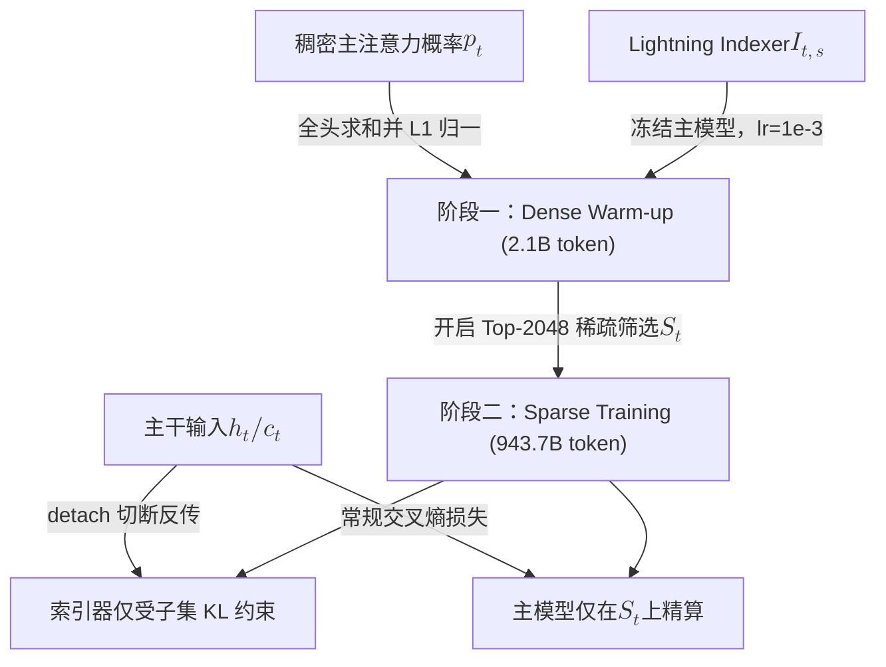
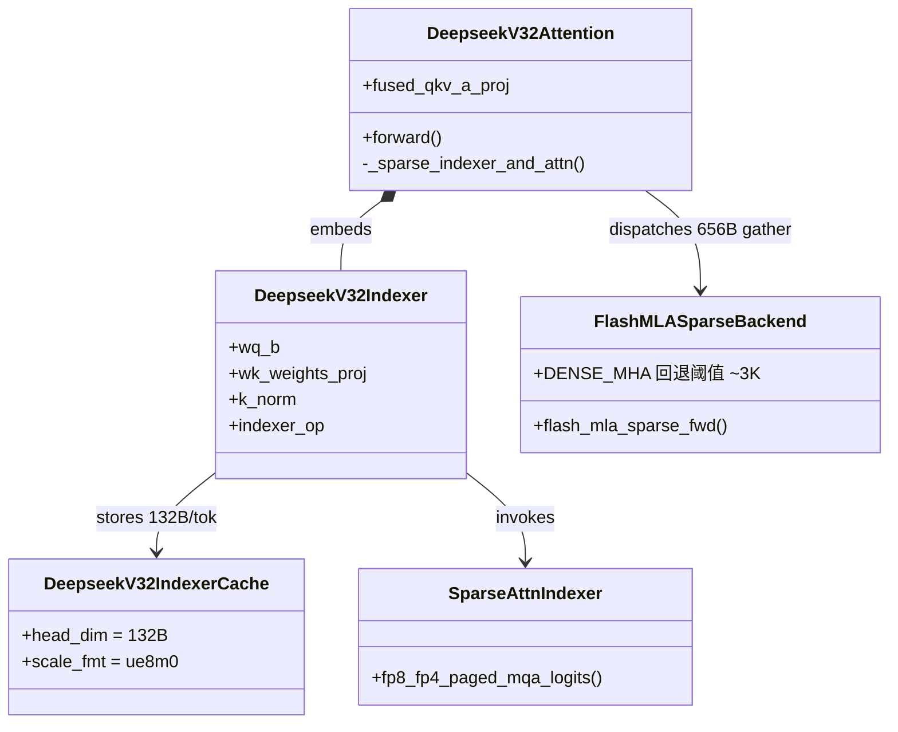
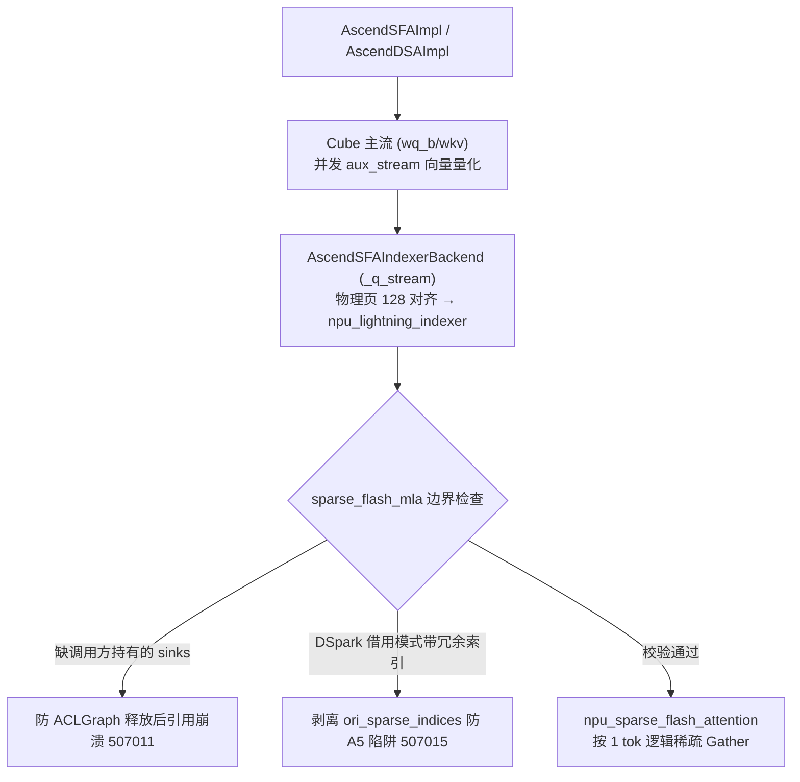

import Figure from 'astro-wisp/components/Figure.astro';
import DsaLightningIndexExplainer from './explainers/dsa-lightning-index';
import paperFig2 from './images/paper-fig2-v32-arch.svg';
import paperFig3a from './images/paper-fig3a-cost-prefill.svg';
import paperFig3b from './images/paper-fig3b-cost-decode.svg';

在[02 NSA 原生稀疏注意力](../02-swa-and-nsa/)中，NSA 依托 GQA 多组共享把 64K 访存压低一个量级。但 DeepSeek-V3.1-Terminus 底座已通过 MLA 将 128K 上下文写进单头共享的 576 维潜空间，拆回多组 KV 会直接毁掉 MLA 的显存压缩收益。

要在单头 MLA 上把主注意力复杂度从 $O(L^2)$ 压到 $O(Lk)$，DeepSeek-V3.2 提出 **DSA（DeepSeek Sparse Attention，DeepSeek 稀疏注意力）**[^ds32]。如图 1 所示，它将“粗筛谁重要”与“精算怎么聚合”拆给预算悬殊的两个模块。**Lightning Indexer（轻量级索引器）**先挑出 Top-$k$ 历史位置（$k=2048$），主干 128 头矩阵吸收模式 MLA 随后仅稀疏 Gather 这些条目。进入推导前，先统一核心符号与张量形状：

| 符号                                   | 含义                                      | 张量形状 / V3.2 生产取值                                      |
| :------------------------------------- | :---------------------------------------- | :------------------------------------------------------------ |
| $L,\; k$                               | 历史上下文长度、稀疏选取位置数            | $L \le 131{,}072$，生产 $k = 2048$                            |
| $H^I,\; d^I$                           | Lightning Indexer 查询头数、索引键维度    | $H^I = 64,\; d^I = 128$（前 64 维带 RoPE）                    |
| $\mathbf{q}_{t,j}^I,\; \mathbf{k}_s^I$ | 索引查询头（复用 $c_t^Q$）、共享索引键    | $[H^I, d^I]$、$[128]$（132 B/tok）                            |
| $w_{t,j}^I,\; I_{t,s}$                 | 第 $j$ 索引头动态标量、总索引分           | $\mathbb{R}$、$\mathcal{S}_t = \operatorname{Top-}k(I_{t,:})$ |
| $\mathbf{c}_s^{KV},\; \mathbf{u}_t$    | `fp8_ds_mla` 压缩 KV 缓存、稀疏注意力输出 | 656 B/tok、$\mathbb{R}^d$                                     |

（符号说明：为与 DeepSeek-V3.2 原论文公式 (1) 对齐，本章以 $s$ 索引历史 token、以 $j \in \{1,\dots,H^I\}$ 索引索引器查询头；其 $\mathbf{c}_s^{KV}$ 与 $\mathbf{u}_t$ 与[第 01 篇](../01-mla/)定义一致。）

<Figure
  src={paperFig2}
  alt="论文图 2：DeepSeek-V3.2 将 Lightning Indexer 接入单头 MQA 矩阵吸收模式 MLA 的架构图"
  caption="图 1：DeepSeek-V3.2 在单头 MLA 底座上实例化 DSA 的结构（DeepSeek-V3.2 论文图 2）"
/>

## 索引器原理与打分机制

给定当前位置 $t$ 的隐状态 $\mathbf{h}_t \in \mathbb{R}^d$ 与历史位置 $s$ 的隐状态 $\mathbf{h}_s \in \mathbb{R}^d$，Lightning Indexer 先计算非负索引分 $I_{t,s}$，主模型随后只在 Top-$k$ 索引集合 $\mathcal{S}_t$ 上执行高精度注意力[^ds32]：

$$
I_{t,s} = \sum_{j=1}^{H^I} w_{t,j}^I \cdot \operatorname{ReLU}\!\bigl(\mathbf{q}_{t,j}^I \cdot \mathbf{k}_s^I\bigr), \qquad
\mathbf{u}_t = \operatorname{Attn}\!\bigl(\mathbf{h}_t,\; \{\mathbf{c}_s^{KV} \mid I_{t,s} \in \operatorname{Top-}k(I_{t,:})\}\bigr)
$$

为什么要把索引器设计成“$H^I = 64$ 个头共享 1 份 FP8 索引键 $\mathbf{k}_s^I$ 且用 $\operatorname{ReLU}$ 激活”？这背后有存储、算术与矩阵核三侧的精确耦合[^ds32]：

- **免同步与 FP8 累加**：$\operatorname{ReLU}$ 将负分归零，省去全序列指数和归约，非负可加性直接对接 FP8 乘加。
- **132 B 极简目录键**：全头共享 1 份 128 维 FP8 键与 4 B `UE8M0` 块缩放，每 token 仅增 132 B 目录缓存。
- **凑足 $M = 64$ 矩阵高度**：单步解码哪怕 1 个 token，64 头也能排成 $64\times 128$ 块填满 Hopper `wgmma` 与昇腾 Cube。

在 128K 长度下，稠密 128 头矩阵吸收模式 MLA 每对缓存向量需 $128\times(576+512) = 139{,}264$ 次 BF16 乘加，而索引器仅需 $64\times 128 = 8{,}192$ 次 FP8 乘加（算术次数降 17 倍，叠乘 FP8 算力峰值降超 30 倍）[^ds32]。

以 8 个历史位置为例拆解一次打分计算：设 $H^I = 2$ 个索引头、头权重 $w = [1.0, 0.5]$，两头对 $s_0\dots s_7$ 的原始点积分别为 $[-1.2, 3.2, 0.4, 4.1, -0.8, 2.0, -0.5, 3.8]$ 与 $[-0.4, 1.2, -0.6, 2.0, -1.5, 1.2, 0.4, 1.0]$。经 $\operatorname{ReLU}$ 截断负值后按头加权求和，得到 8 个历史位置的总分：

$$
I_{7,:} = [0.0,\; 3.8,\; 0.4,\; 5.1,\; 0.0,\; 2.6,\; 0.2,\; 4.3]
$$

取 $k=3$ 时仅选中 $\{s_1, s_3, s_7\}$ 送入主注意力；放大到生产尺寸（$L=131{,}072,\; k=2048$），128 个主头每步只读 **1.56%** 的历史位置。图 2 分 4 步展示上述 8 个位置的索引打分与稀疏 Gather 流程。

<DsaLightningIndexExplainer
  client:visible
  title="图 2：DSA Lightning Indexer 打分与稀疏 Gather 流程"
/>

## 两阶段蒸馏预热与成本实证

让已经训好的 128K 稠密底座平滑切换到 $k=2048$ 稀疏模式，DeepSeek-V3.2 采用两阶段继续预训练（图 3）[^ds32]：



- **阶段一稠密预热**：冻结 671B 主干并求全头 L1 教师分布，以 $10^{-3}$ 学习率拟合 2.1B token。
- **阶段二稀疏联合训练**：开启 Top-2048 训练 943.7B token，并对索引输入做 `detach` 防低比特噪声污染主干。

如图 4 所示，H800 集群实测成本在 128K 处大幅拐弯[^ds32]。Prefilling 从每百万 token 约 \$0.67 降至约 \$0.19，Decoding 从约 \$2.15 降至约 \$0.25。同时 V3.2-Exp 在 AA-LCR 推理模式反超 V3.1-Terminus 4 分，ChatbotArena Elo 基本持平。

<Figure
  src={paperFig3a}
  alt="论文图 3a：H800 集群上 DeepSeek-V3.2 与 V3.1-Terminus 的 Prefilling 百万 token 成本随序列位置变化"
  caption="图 4a：H800 Prefilling 每百万 token 成本曲线（DeepSeek-V3.2 论文图 3a）"
/>

<Figure
  src={paperFig3b}
  alt="论文图 3b：H800 集群上 DeepSeek-V3.2 与 V3.1-Terminus 的 Decoding 百万 token 成本随序列位置变化"
  caption="图 4b：H800 Decoding 每百万 token 成本曲线（DeepSeek-V3.2 论文图 3b）"
/>

## 656 B 混合精度格式与双端协同

按索引离散 Gather 让每条缓存字节数直接决定 HBM 搬运天花板。DeepSeek-V3.2 推出 `fp8_ds_mla` 格式（图 5），将 128K × 62 层主缓存从 8.72 GiB 降至 4.96 GiB[^flashmla]。每条缓存条目由 512 B `fp8_e4m3` 内容向量、16 B 缩放因子和 128 B BF16 RoPE 构成（合计 656 B），叠加 132 B 索引键后共 788 B/token。


然而 Hopper H800 上暴露出一道精准的时钟周期瓶颈[^flashmla]。H800 单 SM 每周期的 Tensor Core 吞吐约为 $989\text{ TFLOPS} / 1830\text{ MHz} / 132\text{ SM} \approx 4096\text{ FLOPs/cycle}$。处理 64 个查询头的 **CTA（CUDA Thread Block，CUDA 线程块）**执行 MMA 只需约 **34 个周期**。

但由于硬件缺乏 `fp8_e4m3` 直转 `bf16` 指令，CUDA Core 须串行经 FP16 与 FP32 再乘缩放因子。单 token 反量化耗时高达 **50 个周期**，把算力卡死在 250 TFLOPS。

因为 128 个查询头在矩阵吸收模式下共用低秩缓存，FlashMLA 提出了跨线程块交叉互换的 **Crossover** 调度（图 6 上半区）[^flashmla]。系统把两个各管 64 头的 CTA 编成 Cluster，各加载并反量化一半潜向量，把耗时压至 25 周期（低于 34 周期 MMA）。

随后双方经 `st.async` 与 **DSMEM（Distributed Shared Memory，分布式共享内存）**互换半份缓存。在 `topk=2048` 下算子跑出 **410 TFLOPS**，长度超过约 3,000 token 即反超稠密核。

对应在华为昇腾 NPU 上（图 6 下半区）[^flashmla-ascend]，FlashMLA 昇腾稀疏前向算子将长序列切为大小 64 或 96 的分块执行 Online Softmax。它还引入 `skip scale` 优化，仅当行最大值跃升超过 `RESCALE_THRES = 6` 时才重缩放累加结果。在 DeepSeek-V4.1 工况下，该算子跑出 410 TFLOPS（Prefill）与 360 TFLOPS（Decode）。


## PyTorch 参考实现与数值核验

下面的独立 PyTorch 代码先核验前文的 8 位置计算示例，确认精确产出 `[0.0, 3.8, 0.4, 5.1, 0.0, 2.6, 0.2, 4.3]` 与选中历史位置 `{1, 3, 7}`。随后代码运行完整的 `LightningIndexer` 与 `sparse_mla_decode` 稀疏聚集流程：

```python
import math
import torch
import torch.nn as nn
import torch.nn.functional as F

class LightningIndexer(nn.Module):
    def __init__(self, d_model: int = 64, h_idx: int = 8, d_idx: int = 32, k_top: int = 16):
        super().__init__()
        self.h_idx, self.d_idx, self.k_top = h_idx, d_idx, k_top
        self.wq_b = nn.Linear(d_model, h_idx * d_idx, bias=False)
        self.wk = nn.Linear(d_model, d_idx, bias=False)
        self.weights_proj = nn.Linear(d_model, h_idx, bias=False)

    def forward(self, h_q: torch.Tensor, h_kv: torch.Tensor) -> torch.Tensor:
        q_idx = self.wq_b(h_q).view(-1, self.h_idx, self.d_idx)
        k_idx = self.wk(h_kv)
        w_idx = self.weights_proj(h_q)
        scores = (F.relu(torch.einsum("thd,sd->ths", q_idx, k_idx)) * w_idx.unsqueeze(-1)).sum(dim=1)
        return torch.topk(scores, k=self.k_top, dim=-1, sorted=False).indices

def sparse_mla_decode(q_abs, q_pe, c_kv_cache, k_pe_cache, topk_ids, w_uv):
    c_sel, k_pe_sel = c_kv_cache[topk_ids], k_pe_cache[topk_ids]
    q_mqa = torch.cat([q_abs, q_pe], dim=-1)
    kv_sel = torch.cat([c_sel, k_pe_sel], dim=-1)
    attn_w = F.softmax((q_mqa @ kv_sel.T) / math.sqrt(q_mqa.shape[-1]), dim=-1)
    return torch.einsum("hc,hcv->hv", attn_w @ c_sel, w_uv)

if __name__ == "__main__":
    torch.manual_seed(42)
    dot_h0 = torch.tensor([-1.2, 3.2, 0.4, 4.1, -0.8, 2.0, -0.5, 3.8])
    dot_h1 = torch.tensor([-0.4, 1.2, -0.6, 2.0, -1.5, 1.2, 0.4, 1.0])
    ex_scores = 1.0 * F.relu(dot_h0) + 0.5 * F.relu(dot_h1)
    ex_topk = torch.topk(ex_scores, k=3).indices.sort().values
    assert ex_topk.tolist() == [1, 3, 7]

    indexer = LightningIndexer(d_model=64, h_idx=8, d_idx=32, k_top=16)
    with torch.no_grad():
        topk_ids = indexer(torch.randn(1, 64), torch.randn(128, 64))
        out = sparse_mla_decode(
            torch.randn(4, 16), torch.randn(4, 8),
            torch.randn(128, 16), torch.randn(128, 8),
            topk_ids[0], torch.randn(4, 16, 12),
        )
        print(f"ex_scores={[round(x, 1) for x in ex_scores.tolist()]} ex_topk={ex_topk.tolist()} out={tuple(out.shape)}")
```

运行输出与正文计算示例完全一致：

```text
ex_scores=[0.0, 3.8, 0.4, 5.1, 0.0, 2.6, 0.2, 4.3] ex_topk=[1, 3, 7] out=(4, 12)
```

## GPU 与昇腾 NPU 的生产引擎实现

把 DSA 接进线上推理引擎时，`vllm@99b0b0b0`[^vllm-v32][^vllm-sparse] 与 `vllm-ascend@b776261e`[^ascend-sfa][^ascend-dsa][^ascend-idx] 分别围绕索引融合投影、多流掩蔽与静态图越界校验搭建了整套生产实现。

### vLLM GPU 实现与模块化稀疏管线

在 `vllm@99b0b0b0` 中，框架除保留通用 `Indexer` 与缓存类外，还在模型目录下拆出了专用稀疏注意力模块[^vllm-v32]。其中 `DeepseekV32Attention` 继承自 `MLAAttention`，并用融合算子 `fused_q` 一次产出量化索引查询与主查询，再经稀疏后端调度（图 7）。



真实前向切分如下：注意 `fused_q` 同步生成量化索引查询 `index_q_fp8`、头权重与吸收态主查询 `mqa_q`[^vllm-v32]：

```python
# vllm/models/deepseek_v32/attention.py:447-467 (vllm@99b0b0b0)
if self.indexer is not None and not self.skip_topk:
    index_q = self.indexer.wq_b(q_c)[0].view(-1, self.indexer.n_head, self.indexer.head_dim)
else:
    index_q = None
index_q_fp8, index_weights_out, mqa_q = fused_q(
    positions, q_pe, self.rotary_emb.cos_sin_cache, index_q,
    self.indexer_rope_emb.cos_sin_cache if has_indexer else None,
    ql_nope, self._q_scale, index_weights, indexer_softmax_scale, indexer_n_head_scale,
    has_indexer=has_indexer, index_rope_interleave=self._index_rope_interleave,
    quantize_mqa=self._fp8_query and prepare_mqa_query,
)
```

### 昇腾 NPU 的 CV 双流与边界约束

转向华为昇腾栈，`vllm-ascend@b776261e` 由 `AscendSFAImpl`、`AscendSFAIndexerBackend` 与 `AscendDSAImpl` 承接稀疏注意力[^ascend-sfa][^ascend-dsa][^ascend-idx]。

执行期间，主 Cube 流负责矩阵乘，辅助向量流趁矩阵等待时并行跑 RMSNorm 与动态量化（图 8）。索引侧也单独配备了辅助查询流并发计算索引特征，避免主向量流水线拥堵[^ascend-idx]。



昇腾封装层中还固化了两道 ACLGraph 保护机制[^ascend-sfa]。第一，强制由调用方长期持有 `sinks` 张量，防止静态图捕获临时地址引发异步 507011 崩溃。第二，DSpark 草稿在 A5 硬件上携带冗余物理索引会触发 507015 陷阱，须剥离后由窗口参数推导。此外，昇腾物理分页按 128 对齐达芬奇 Cube，但算子仍支持按 1 个 token 逻辑稀疏 Gather。

```python
# vllm_ascend/attention/dsa_v1.py:2630-2646 (vllm-ascend@b776261e)
with npu_stream_switch(aux_stream, enabled=True):
    torch.npu.current_stream().wait_event(e_part2_start)
    kv = self.cv_wkv.matmul(kv_quant, kv_pertoken_scale)
    e_kv_matmul_done = torch.npu.current_stream().record_event()
```

| 机制维度       | `vLLM` GPU（`99b0b0b0`）                                | `vllm-ascend` NPU（`b776261e`）                             |
| :------------- | :------------------------------------------------------ | :---------------------------------------------------------- |
| 入口与缓存类   | `DeepseekV32Attention`、`DeepseekV32IndexerCache`       | `AscendSFAImpl`、`AscendSFAIndexerBackend`、`AscendDSAImpl` |
| 物理分页粒度   | 统一 64 token（SM100 128）                              | 物理 128 块对齐，逻辑 1 token 稀疏读取                      |
| 流水掩蔽技术   | 2-CTA Cluster DSMEM Crossover + `fused_q`               | CV `aux_stream` 重叠 + `_q_stream` 并发                     |
| 静态图边界约束 | 短于 3K 回退 `DENSE_MHA`；`@eager_break_during_capture` | 调用方持有 `sinks` 防 507011；剥离 draft 索引防 507015      |

DSA 成功把主注意力的计算开销压至 $O(Lk)$，但在长度小于约 3,000 token 时索引启动开销反超收益，仍需切回稠密模式。更重要的是，DSA 并没有从 HBM 中减少哪怕一个历史 token——全长 $L$ 条 `656 B + 132 B` 缓存依然按 $O(L)$ 占满显存。要让百万 token 上下文真正放得进、跑得起，下一篇 [04 序列压缩注意力（上）：V4 CSA 与 HCA](../04-csa-and-hca/) 将转而直接压缩序列长度 $L$ 本身。

[^ds32]: DeepSeek-AI，“DeepSeek-V3.2: Pushing the Frontier of Open Large Language Models”，2025。[arXiv:2512.02556](https://arxiv.org/abs/2512.02556)，§2.1–2.3（式 (1)–(4)、Fig. 2 与 Fig. 3）。

[^flashmla]: DeepSeek-AI，`FlashMLA` 技术文档 `docs/20250929-hopper-fp8-sparse-deep-dive.md`（L1–52：656 B 格式、4096 FLOPs/cycle/SM 推导、34 vs 50 周期瓶颈与 2-CTA DSMEM Crossover），commit `395cb3af`。

[^flashmla-ascend]: DeepSeek-AI，`FlashMLA` 昇腾技术文档 `docs/20260930-ascend-prefill-deep-dive-zh.md`（L1–100：`B_TOPK=64/96`、`skip scale` `RESCALE_THRES=6` 与 410/360 TFLOPS 实测），commit `395cb3af`。

[^vllm-v32]: `vLLM` 仓库（commit `99b0b0b0`）：`vllm/models/deepseek_v32/attention.py`（`L56-122` `DeepseekV32Indexer`、`L124-485` `DeepseekV32Attention`、`fused_q` 与 `_sparse_indexer_and_attn`）及 `vllm/model_executor/models/deepseek_v2.py`（`L641-920` `DeepseekV32IndexerCache`、`Indexer`）。

[^vllm-sparse]: `vLLM` 仓库（commit `99b0b0b0`）：`vllm/model_executor/layers/sparse_attn_indexer.py`（`SparseAttnIndexer`、`fp8_fp4_paged_mqa_logits`）与 `vllm/v1/attention/backends/mla/flashmla_sparse.py`（`FlashMLASparseBackend`）。

[^ascend-sfa]: `vllm-ascend` 仓库（commit `b776261e`）：`vllm_ascend/attention/sfa_v1.py`（`L195-245, 362-860` `AscendSFAImpl`）与 `vllm_ascend/attention/sparse_flash_mla.py`（`L63-125` `sinks` UAF 507011 与 DSpark draft 陷阱 507015 保护机制）。

[^ascend-dsa]: `vllm-ascend` 仓库（commit `b776261e`）：`vllm_ascend/attention/dsa_v1.py`（`L2600-2715` `AscendDSAImpl` CV 双流 `aux_stream` 与 `npu_stream_switch`）。

[^ascend-idx]: `vllm-ascend` 仓库（commit `b776261e`）：`vllm_ascend/attention/indexer.py`（`L270-540, 895-955` `AscendSFAIndexerBackend` 与 `_q_stream`）。
