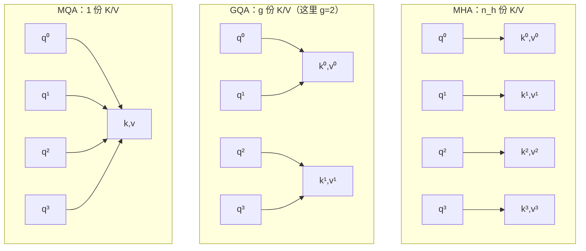

import CacheBars from '../../../../explainers/react/CacheBars';
import KVCacheView from '../../../../explainers/react/KVCacheView';

上一篇算出来的账是：$n_h(d_k+d_v)\times L\times n_{\text{layers}}\times \text{bytes}$，在 V3 量级的结构参数下，4096 个 token 就要 15 GiB。

这一篇动第一个因子。$L$ 是用户给的，$n_{\text{layers}}$ 和 $d_k$ 动了就是换模型，`bytes` 属于量化——剩下最容易下手的是 $n_h$：**真的需要每个 head 都存一份自己的 K/V 吗？**

读完你能回答：MQA 和 GQA 分别把 $n_h$ 变成了什么、为什么它们必然损失表达力、以及为什么这个损失正好是 MLA 想绕开的东西。

## 先看一个例子

第 01 篇说过，多头的意义是「同时问几个不同的问题」。但注意 Q、K、V 三者在这件事里的角色并不对称：

- $q^h_t$ 是**问题**：每个 head 问的必须不同，否则多头就没意义了。
- $k^h_s$ 是**索引**：用来回答「位置 $s$ 符不符合这个问题」。
- $v^h_s$ 是**内容**：位置 $s$ 交出的东西。

现在做个思想实验。假设 2 个 head，$d_k=4$，位置 $s$ 的两份 Key 是：

```
k⁰_s = [-2, 1, 3, 0]      ← head 0 的索引
k¹_s = [ 1, 0,-1, 2]      ← head 1 的索引
```

它们都是从**同一个** $x_s$ 线性投影出来的，只是用了不同的 $W^{K,h}$。也就是说，这两份数据的信息量上限相同，差别只在「从哪个角度看 $x_s$」。

于是一个很自然的问题：如果让两个 head 共用一份 Key、共用一份 Value，但各自保留自己的 Query，多头还剩多少意义？

## 三种共享方式



三者的区别只有一个参数：几个 Query head 共享一份 K/V。

| 方案 | K/V 份数 | 每 token 每层缓存 | 相对 MHA | 代价                               |
| ---- | -------- | ----------------- | -------- | ---------------------------------- |
| MHA  | $n_h$    | $n_h(d_k+d_v)$    | 1        | 基线                               |
| GQA  | $g$      | $g(d_k+d_v)$      | $g/n_h$  | 同组 head 被迫共用同一套索引和内容 |
| MQA  | 1        | $d_k+d_v$         | $1/n_h$  | 所有 head 共用，损失最大           |

把这三条和 MLA 放在同一配置下对照（$n_h=8$，$d_k=d_v=128$，GQA 取 $g=2$）：

<CacheBars
  client:visible
  nH={8}
  dK={128}
  dV={128}
  nGroups={2}
  dC={512}
  dR={64}
  tokens={4096}
  layers={61}
  title="图 03-1：缓存宽度对照——注意 MQA 已经把 n_h 这个因子完全消掉了"
/>

MQA 把 $n_h$ 消成 1，是这条路线的极限：**只要还按「存 K 和 V」的方式缓存，就不可能比它更省**。想再往下走，必须换一种缓存的东西——那就是 MLA。

缓存变窄在动画里的样子（把方案换成 MQA，注意每行变短了，右侧账本同步下降）：

<KVCacheView
  client:visible
  prefill={2}
  cfg={{ scheme: 'mqa', nH: 2, dK: 4, dV: 4 }}
  title="图 03-2：MQA 下的缓存——行数仍随长度增长，但每行窄了 n_h 倍"
/>

注意**行数并没有变少**。$L$ 这个因子还在，只是每行窄了。这是两条不同的轴：本篇压的是「每个 token 占多宽」，第 06–12 篇压的是「要读多少行」。

## 机制

### 形式化

MHA 里每个 head 有自己的投影矩阵：

$$
q_t^h = W^{Q,h}x_t,\quad k_s^h = W^{K,h}x_s,\quad v_s^h = W^{V,h}x_s,\qquad h=1,\dots,n_h
$$

GQA 把 head 分成 $g$ 组，令 $\gamma(h)$ 为 head $h$ 所属的组：

$$
q_t^h = W^{Q,h}x_t,\quad k_s^h = W^{K,\gamma(h)}x_s,\quad v_s^h = W^{V,\gamma(h)}x_s
$$

**只有 K/V 的投影按组共享，Q 的投影仍然每个 head 独立。** MQA 是 $g=1$ 的特例，MHA 是 $g=n_h$ 的特例。所以这三者是同一个参数的三个取值，不是三种不同算法。

### 损失在哪里

关键在于：同组的两个 head 看到的是**同一个 $k_s$**。注意力分数是

$$
e^h_{t,s} = \frac{(q^h_t)^\top k^{\gamma(h)}_s}{\sqrt{d_k}}
$$

两个同组 head 仍然可以给出不同的分数（因为 $q^h_t$ 不同），所以**注意力分布还是能不一样**。这是 GQA 仍然可用的原因。

但它们聚合的 Value 来自同一个 $v^{\gamma(h)}_s$。于是：

- 分数可以不同 → 权重可以不同 → 加权结果可以不同。
- 但「位置 $s$ 能提供什么内容」被压成了全组统一的一个版本。

换句话说，GQA/MQA 保留了「每个 head 关注不同位置」的能力，牺牲的是「每个 head 从同一位置提取不同侧面」的能力。head 数越多、组数越少，这个牺牲越大——这也解释了为什么 MQA 通常需要重新训练或微调才能恢复质量，而不是把训练好的 MHA 权重直接平均过去就行。

## 代码实现

把三种方案写成同一份代码，只改一个 `n_kv_heads` 参数：

> 完整可运行脚本见文章目录下的 `toy.py`（结论都写成了 `assert`）。

```python
import numpy as np

def attention(x, w_q, w_k, w_v, n_heads, n_kv_heads):
    """n_kv_heads = n_heads → MHA；= 1 → MQA；介于之间 → GQA。"""
    L, d = x.shape
    d_h = d // n_heads
    assert n_heads % n_kv_heads == 0, 'head 数必须能被 K/V 份数整除'
    rep = n_heads // n_kv_heads            # 每份 K/V 被几个 Query head 共用

    q = (x @ w_q).reshape(L, n_heads, d_h)          # (L, n_heads, d_h)
    k = (x @ w_k).reshape(L, n_kv_heads, d_h)       # (L, n_kv_heads, d_h)  ← 缓存的就是它
    v = (x @ w_v).reshape(L, n_kv_heads, d_h)

    k = np.repeat(k, rep, axis=1)          # 共享 = 把同一份复制给组内每个 head
    v = np.repeat(v, rep, axis=1)          # 注意：复制发生在计算时，不是缓存时

    scores = np.einsum('thd,shd->hts', q, k) / np.sqrt(d_h)
    mask = np.tril(np.ones((L, L), dtype=bool))
    scores = np.where(mask, scores, -np.inf)
    w = np.exp(scores - scores.max(-1, keepdims=True))
    w /= w.sum(-1, keepdims=True)
    out = np.einsum('hts,shd->thd', w, v)
    return out.reshape(L, d), k.shape, v.shape
```

最该注意的一行是 `np.repeat`：**共享的意思是缓存里只存一份，用的时候再广播给组内每个 head**。复制发生在计算时，不占缓存。如果实现时把 `repeat` 之后的结果缓存起来，就白省了——这是落地时最常见的错误。

缓存宽度的对照（$n_h=8$，$d_h=128$）：

```
方案      n_kv_heads      每 token 每层      相对 MHA
MHA              8          2048 个数     100.0%
GQA              2           512 个数      25.0%
MQA              1           256 个数      12.5%
```

`toy.py` 里还验证了上一节那个关键区分——即使 MQA 让所有 head 共用同一份 K，不同 head 的注意力分布依然不同：

```
MQA 下 head0 与 head1 在位置 5 的权重：
 head0 [0.171 0.117 0.166 0.203 0.19  0.151]
 head1 [0.069 0.094 0.129 0.419 0.109 0.18 ]
```

head1 把 41.9% 的权重压在位置 3 上，head0 则相当平均。**共享 K/V 没有让 head 退化成同一个**，这解释了 MQA 为什么还能用；它丢的是「从位置 3 提取不同侧面」的能力，不是「关注不同位置」的能力。

### 真实实现在哪

DeepSeek-V3 的参考实现里**没有 GQA/MQA 分支**——它直接用 MLA。想读 GQA 的实现，vLLM 的注意力后端里有现成的对照（本地快照 commit `cf5cea2d`）：GQA 在 kernel 里通常不真的做 `repeat`，而是让多个 Query head 直接索引同一份 K/V，省掉那次显存复制。

这正是「数学上等价、实现上不同」的典型例子：`np.repeat` 版本便于理解，但多了一次无谓的物化。读 kernel 时要习惯这种差别。

## 代价与边界

- 省下的是缓存宽度与随之而来的带宽，付出的是「同组 head 共用同一份内容」的表达力。这个损失无法通过推理阶段的技巧补回来，只能在训练时适配。
- 本篇的 toy 只验证形状与共享语义，不能说明质量影响。论文里的质量对比都绑定各自的训练配置，不能跨模型照搬。
- 把 $n_h$ 压到 1 之后，这条路线就到底了。继续省必须改变「缓存的对象」。
- 共享 K/V 对 batch 很友好（多个请求共用同一套 kernel 布局），但它不改变缓存随 $L$ 线性增长这件事。

## 自测

1. GQA 里两个同组的 head，注意力分布可以不同吗？它们提取的内容可以不同吗？分别说明原因。
2. 为什么 `np.repeat` 必须发生在「从缓存读出之后」，而不是「写入缓存之前」？
3. $n_h=128$、$d_k=d_v=128$、61 层、4096 token、BF16。GQA 取 $g=8$ 时缓存是多少？相比 MHA 省了几倍？
4. 动手：在 `toy.py` 里把 `n_kv_heads` 从 8 改到 1，观察输出向量的变化程度。再把 `n_heads` 调大，重复一次——共享的损失随 head 数怎么变？

## 来源

- [GQA: Training Generalized Multi-Query Transformer Models](https://arxiv.org/abs/2305.13245)（GQA 的提出与 uptraining 方法）
- [Fast Transformer Decoding: One Write-Head is All You Need](https://arxiv.org/abs/1911.02150)（MQA）
- [DeepSeek-V2 §2.1](https://arxiv.org/html/2405.04434v5#S2.SS1)（把 MHA/GQA/MQA 与 MLA 放在同一张表里对照）
- 下一篇：[04 · MLA：共享 latent](../04-mla/)——不再存 K 和 V，改存一个所有 head 共享的低维向量。
