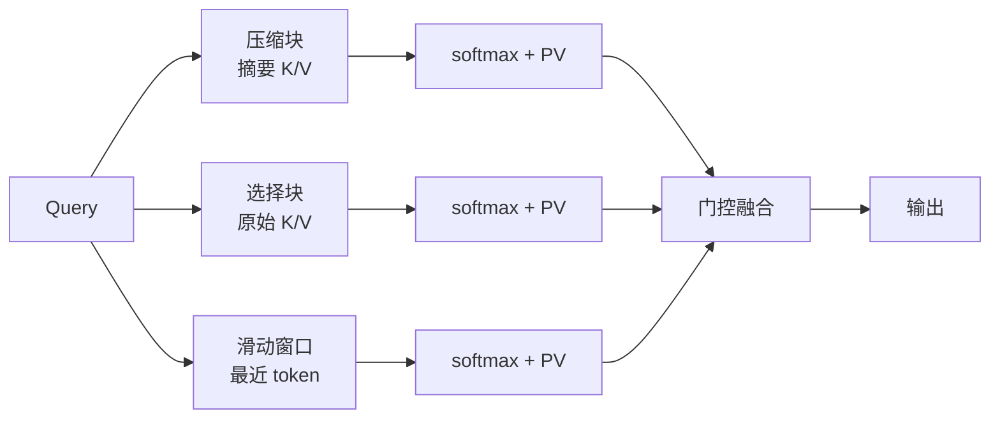

NSA（Native Sparse Attention）解决的是“历史太长，是否每次都要把所有 token 交给主 attention”。它把历史组织成三类读取路径，而不是简单地把候选拼成一张更小的 dense 矩阵。

## 一次 query 的三条路

压缩分支形成较便宜的全局概览，选择分支读取少量原始 token 块，窗口分支保留最近细节。三条分支各自计算 logits、softmax 和 $PV$，最后用 sigmoid 门值融合；把三类候选直接拼起来只做一次 softmax，模型就变了。

## 块边界和因果边界

压缩块 $C_i=[i\delta,i\delta+l)$ 可以重叠，选择块 $S_j=[jL,(j+1)L)$ 通常不重叠。压缩分支产生的分数用于排名；选中块只决定原始 token 的读取区域，选择分支仍用原始 K/V 重新打分和归一化。

一个块在内存中存在，不代表块内每个位置都已经对当前 query 可见。未完成尾部仍需 causal mask；窗口则读取最近 $w$ 个、包含当前位置的 token。实现里要分别检查“地址合法”和“位置可见”。

## 读论文与读 kernel

论文的分支、重叠评分、组内 top-k 和门控语义可以在 [NSA §3.1–§3.4](https://arxiv.org/html/2502.11089v2#S3.SS1) 对照。动态稀疏 kernel 还涉及块布局、gather 和归约；逐 token 的 Python toy 只能验证 mask 或分支归一化，不能推出生产吞吐。

NSA 减少的是主 attention 的读取集合和访存组织。压缩分支仍要随着序列更新，不能据此把它称作线性注意力。
