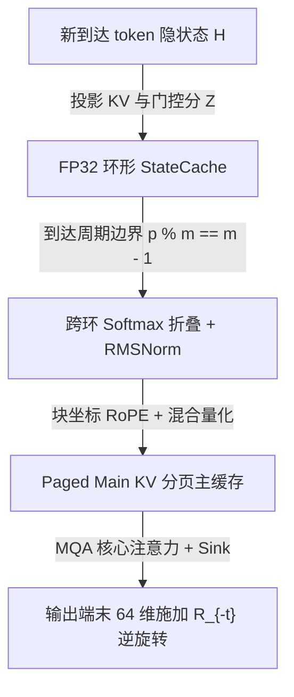

import CsaRingExplainer from '../../../../explainers/deepseek/CsaRingExplainer';

在[03 DeepSeek 稀疏注意力（DSA）](../03-dsa/)中，闪电索引器把主注意力的单步计算量压到了 $O(Lk)$，却没有从显存里删掉任何历史条目：按 `fp8_ds_mla` 格式计，每个 token 在每层仍占 656 B 主缓存与 132 B 索引键。放到百万 token 上下文（$L = 10^6$）与高并发批处理场景下，线性增长的 $O(L)$ 容量依然会迅速耗尽 HBM。

既然 MLA 已经把单条潜向量的宽度压缩到了极限，继续打破长文本显存墙的下一条轴线就是直接压缩**序列长度轴 $L$**。DeepSeek-V4 提出了一对互补的序列压缩注意力架构——交错部署门控序列压缩稀疏注意力（CSA）与重度压缩注意力（HCA），配合 584 B 混合精度缓存，使 DeepSeek-V4-Flash 在 1M 上下文下的 KV 占用降至 V3.2 的 7%、单 token 推理计算量降至 10%[^dsv4-paper]。

## 分组序列压缩与环形尾缓冲

沿序列轴压缩时，最朴素的做法是每隔 $m$ 个 token 做等权平均池化，但周围平淡上下文会把罕见却关键的符号特征（例如代码里的精确变量名）稀释成 $1/m$。DeepSeek-V4 改用**带位置偏置的逐通道 Softmax 门控折叠**：对输入隐状态 $H \in \mathbb{R}^{n \times d}$，不仅投影出待折叠内容特征，还投影出同维度的门控打分 $Z$，沿时间步维度逐通道做 Softmax 竞争，让高信息量 token 在关键通道上独占主导权重。

以 8 位置窗口为例：假设通道 $c$ 上重要符号 $t_1$ 获得 0.45 的门控权重，而其余 7 个平淡上下文仅分得 0.04–0.15 不等的剩余比重，关键信号就不会被均匀稀释。

同时，$[t_0 \dots t_3]$、$[t_4 \dots t_7]$ 这类非重叠窗口会在块边界处切断跨越边界的短语或逻辑依赖。

为了消除块边界割裂并保持净压缩率为 $1/m$（CSA 取 $m = 4$），CSA 设置两套独立的内容与打分投影 $(W^{aKV}, W^{bKV})$ 与 $(W^{aZ}, W^{bZ})$，并加上可学习的块内位置偏置 $B^a, B^b \in \mathbb{R}^{m \times c}$，把宽度为 $2m = 8$ 的重叠窗口折叠为单条压缩条目 $C_i^{\text{Comp}} \in \mathbb{R}^c$[^dsv4-paper]：

$$
[S_{mi:m(i+1)-1}^a;\, S_{m(i-1):mi-1}^b] = \operatorname{Softmax}_{\text{row}}\!\bigl([Z_{mi:m(i+1)-1}^a + B^a;\; Z_{m(i-1):mi-1}^b + B^b]\bigr)
$$

$$
C_i^{\text{Comp}} = \sum_{j=mi}^{m(i+1)-1} S_j^a \odot C_j^a + \sum_{j=m(i-1)}^{mi-1} S_j^b \odot C_j^b
$$

拿连续到达的 10 个 token 下标 $t_0 \dots t_9$ 走一遍：当 $t_0 \dots t_7$ 依次就位后，第 1 号压缩块 $C_1^{\text{Comp}}$ 会把当前段 $[t_4 \dots t_7]$（经 $a$ 分支投影）与紧邻前一段 $[t_0 \dots t_3]$（经 $b$ 分支投影）合在一起，对这总共 $2m = 8$ 个位置做逐通道 Softmax 加权（第 0 号块的负下标部分以 $-\infty$ 与零填充）。

等到 $[t_8 \dots t_{11}]$ 凑齐生成 $C_2^{\text{Comp}}$ 时，它的 $b$ 分支又会重新跨读 $[t_4 \dots t_7]$。相邻压缩块共享了 $m = 4$ 个边界 token，而每隔 $m = 4$ 步才写出一份条目，净序列长度严格缩减为 $1/4$。

然而在流式解码生成 $t_9$ 的瞬间，新到达的 $t_8$ 与 $t_9$ 所在的分组 $[t_8 \dots t_{11}]$ 尚未凑满 4 个位置（$t_{10}, t_{11}$ 尚未生成），不可提前折叠固化。同时出于因果性限制，查询只能关注严格早于自身所在压缩块的已完成条目（$s < \lfloor t/m \rfloor$），从而对未闭合尾块及块内近邻存在盲区。

为此，DeepSeek-V4 一方面在定长 FP32 环形状态槽位（`StateCache`）里暂存未闭合的尾部状态，另一方面为每层配对一条局部滑动窗口注意力（SWA，$n_{\text{win}} = 128$）保住逐 token 精细依赖[^dsv4-paper]。

图 1 演示了流水线到达时新 token 进入环形尾槽、凑满 $m=4$ 后双窗折叠写回、HCA 与 SWA 协同以及输出端逆旋转恢复的五个阶段，可逐帧切换查看。

<CsaRingExplainer
  client:visible
  title="图 1：DeepSeek-V4 CSA 重叠门控折叠、环形尾缓存与输出逆 RoPE 推演"
/>

## CSA 与 HCA 混合架构及输出逆旋转

在 DeepSeek-V4 技术报告中[^dsv4-paper]，CSA 与 HCA 共同构成同一全局压缩注意力族中的两类互补层，整体结构与堆叠方式如图 2 所示。


CSA 以 $m = 4$ 重叠折叠序列后，继续复用一层 FP4 闪电索引器（$n_h^I = 64$ 头、$c^I = 128$ 维）从历史压缩块中筛选 Top-$k$ 条目（V4-Flash 取 512，V4-Pro 取 1024）。

另一类层 **HCA（Heavily Compressed Attention）** 同样只在单层内沿序列轴折叠（跨层复用属于下一篇 V4.1 CSA2 的设计），它将步长拉大到 $m' = 128$ 并取消重叠窗口[^dsv4-paper]。百万上下文经 128 倍压缩后全序列仅剩约 7,812 条单头 KV，省去索引器直接做全块稠密注意力即可。

### 与 MLA 的结构对比：双轨 RoPE 与输出逆旋转

把 V4 与[01 多头潜在注意力（MLA）](../01-mla/)对照，就能看清为什么 MLA 的输出端不需要逆向旋转，而 V4 的压缩注意力必须补上这一步。在 V3 MLA 中，Key 与 Value 在位置通道上是解耦的：64 维 $k_s^R$ 携带绝对 RoPE 旋转 $R_s$，只参与 $Q \cdot K$ 点积算分；而充当 Value 的 512 维潜向量 $c_s^{KV}$ 完全不含位置编码，因此加权求和后的输出不含任何绝对旋转残余。

DeepSeek-V4 为了压低存储并统一压缩条目格式，让每条 512 维压缩潜向量 $C_j^{\text{Comp}}$（前 448 维 NoPE + 末 64 维携带绝对 RoPE 旋转 $R_{k_{\text{pos}}(j)}$）**同时充当 Key 与 Value**，在单头 MQA 模式下运行，并采用 584 B 混合存储格式（448 B FP8 NoPE + 8 B 缩放因子 + 128 B BF16 RoPE）[^dsv4-paper]。

由于兼任 Value 的条目末尾 64 维已经预先乘过了各自的历史绝对位置旋转 $R_{k_{\text{pos}}(j)}$，核心注意力输出 $\mathbf{o}_{t,h}^{[-64:]}$ 是不同历史绝对旋转态的线性叠加。借助旋转矩阵的正交可加性 $R_{-t} R_{k_{\text{pos}}(j)} = R_{k_{\text{pos}}(j) - t}$，V4 在核心注意力输出端紧接着对末 64 维乘上当前位置 $-t$ 的**逆向 RoPE**[^dsv4-paper]：

$$
R_{-t}\, \mathbf{o}_{t,h}^{[-64:]} = \sum_j a_{t,h,j}\, \bigl(R_{k_{\text{pos}}(j) - t}\, \mathbf{v}_j^{[-64:]}\bigr)
$$

这一步把输出向量末尾 64 维统一拉回以当前查询位置 $t$ 为原点的相对坐标偏移 $k_{\text{pos}}(j) - t$。除此之外，全局压缩支与局部 SWA 支拆开了两组 RoPE 频谱（`deepseek_yarn` 长文本外推与局部 `factor = 1.0` 对齐）；进入核心注意力前对 Query 与 KV 施加 `RMSNorm` 防止 `Attention Logits` 过大，分母加入可学习 `Sink` 偏置项 $\exp(z'_h)$，防止无效检索污染数值尺度。

输出端同样做了算子裁剪。在吸收态 MLA 里，完整输出投影矩阵 $W^{OA} \in \mathbb{R}^{n_h c \times d}$ 需要把全部 $n_h$ 个 512 维头直接升维到模型隐维度，参数与乘加都正比于 $n_h c d$。为此 V4 设计了分组输出投影 `GroupedWoA`：先将多头均分为 $g$ 组（V4-Flash 取 $g = 8$）分别投影到中间宽度 $d_g = 1024$ 并拼合，再汇总映射回主干宽度 $d$，兼顾跨头交互与参数预算。

在交错混合配置下，DeepSeek-V4-Flash（43 层，前 2 层纯 SWA 配后 41 层交错 CSA/HCA）将 1M 上下文推理 FLOPs 降至 V3.2 的 10%、KV 降至 7%；DeepSeek-V4-Pro（61 层）则分别降至 27% 与 10%（仅为 BF16 GQA-8 基线的约 2%）[^dsv4-paper]。

## 流式环形调度、上下文并行与双端实现

在流式生成和分布式训练中，序列压缩对上下游调度提出了两项额外要求。首先在长上下文训练的上下文并行（Context Parallelism，CP）下，每张卡分摊连续的 $s$ 个 token，而宽度为 $m$ 或 $m'$ 的压缩窗口经常横跨两张相邻显卡的边界，拼接样本末尾不足 $m$ 个 token 的残块还需按样本丢弃。

为此 DeepSeek-V4 设计了二阶段 CP 通信[^dsv4-paper]：第一阶段各卡把尾部最后的 $m$ 个未压缩条目发往下一张卡，让相邻卡无缝折叠跨界块；第二阶段再全网收集各卡压缩条目并做掩码重排，使整体序列严格规整为整倍压缩长度。

在流式推理阶段，压缩状态机需要跨步维护未闭合尾部 token 与周期边界触发，整体控制流如图 3 所示。



未闭合的尾部状态必须保留在独立的 FP32 环形缓冲区（`CompressorStateCache`）里：折块前的特征如果提前量化成低比特，跨步累加的数值误差会成倍放大；只有当序列新增位置跨过周期边界 $p \bmod m = m - 1$ 时，引擎才触发折叠、归一、部分 RoPE 并写回 HBM。

在 `vLLM` GPU 栈[^vllm-comp41][^vllm-fused]中，`DeepseekCompressor` 通过融合算子把折叠、归一化与写回 HBM 尽量合并成单遍显存访问（512 维路线调用 CuTe-DSL 核），并与双轨 RoPE 构建及融合逆 RoPE 量化核配套运行；后续 V4.1 取消了双倍重叠并聚焦压缩率 1 或 2，而 V4 的 4 与 128 兼容路径仍独立保留。

在 `vllm-ascend` 昇腾 NPU 栈[^ascend-comp4][^ascend-comp41][^ascend-triton]上，V4 原生逻辑直接调度 CANN `compressor` 算子；到了 `DeepseekV41Compressor` 演化路径，设备侧在 `AscendCircularBufferSpec` 中预先算出环形索引，并针对达芬奇向量与矩阵单元的分块习惯，把 Triton 压缩过程拆为三阶段顺序执行。

具体而言，第一段核函数以分块重排顺序完成 BF16 到 FP32 的投影矩阵乘；第二段在片上统一缓冲区（UB）约束内从环形缓存读回前导残差并完成两遍式分组 Softmax 折叠；第三段才将尾部仍未闭合的新状态写回环形缓存。第二段必须严格先于第三段完成，以免并发写回覆盖尚未被读出的前导残差。核心注意力计算完成后，再由 `AscendDSAV41Impl` 对末 64 维执行逆向旋转。

| 核心阶段           | `vLLM` GPU[^vllm-comp41][^vllm-fused]     | `vllm-ascend` NPU[^ascend-comp4][^ascend-comp41] |
| :----------------- | :---------------------------------------- | :----------------------------------------------- |
| 环形尾缓存与元数据 | `CompressorStateCache` 托管 FP32 尾部状态 | `AscendCircularBufferSpec` 设备侧构环索引        |
| 折叠与写回 Kernel  | 融合折叠归一写回（512 维 CuTe-DSL）       | V4 CANN 算子；V4.1 三段 Triton Kernel            |
| 双轨 RoPE 与逆旋转 | `build_deepseek_v4_rope` 配融合逆 RoPE    | 双频谱复指数 RoPE 与输出 `inverse=True` 旋转     |

## PyTorch 参考实现与数值核验

下面这段自包含的 PyTorch 实现对照前文的重叠双窗折叠公式与输出端逆旋转恒等式：用 `OverlapCSACompressor` 落地 $2m = 8$ 重叠双窗的逐通道 Softmax 门控折叠，同时用 `gptj_partial_rope` 验证前 48 维无位置部分严格零漂移，以及输出端位置 $-50$ 的逆旋转如何把绝对位置 17 精确还原为相对位移 $-33$：

```python
import torch
import torch.nn as nn
import torch.nn.functional as F


def gptj_partial_rope(
    x: torch.Tensor, pos: int, rope_dim: int = 16, theta: float = 10000.0, inverse: bool = False
) -> torch.Tensor:
    """仅对末尾 rope_dim 维施加 GPT-J 交错旋转；inverse=True 取 sin 负号实现 R_{-pos} 逆旋转。"""
    inv_freq = 1.0 / (theta ** (torch.arange(0, rope_dim, 2, dtype=x.dtype, device=x.device) / rope_dim))
    ang = pos * inv_freq
    # R_{-t} = R_t^T：仅需把正弦项取反即可在注意力输出端消去绝对位置偏置
    c, s = ang.cos(), (-ang.sin() if inverse else ang.sin())
    out = x.clone()
    seg = out[..., -rope_dim:]  # 对应 DeepseekV4ScalingRotaryEmbedding 的尾切片 rope_dim_offset
    ev, od = seg[..., 0::2].clone(), seg[..., 1::2].clone()
    seg[..., 0::2] = ev * c - od * s
    seg[..., 1::2] = od * c + ev * s
    return out


class OverlapCSACompressor(nn.Module):
    """DeepSeek-V4 重叠双窗序列压缩器（净步长 m=4，窗口宽 2m=8）。

    输入：
        h_prev_block: [m, d_model],  h_curr_block: [m, d_model]
    输出：
        compressed_kv: [1, d_c]（单条闭合块潜向量，兼作 Key 与 Value）
    """

    def __init__(self, m: int = 4, d_model: int = 32, d_c: int = 64):
        super().__init__()
        # 前后半窗采用两套独立的内容投影 (W^{aKV}, W^{bKV}) 与门控打分投影 (W^{aZ}, W^{bZ})
        self.w_kv_a = nn.Linear(d_model, d_c, bias=False)
        self.w_kv_b = nn.Linear(d_model, d_c, bias=False)
        self.w_z_a = nn.Linear(d_model, d_c, bias=False)
        self.w_z_b = nn.Linear(d_model, d_c, bias=False)
        # 可学习的块内相对位置偏置 B^a, B^b，形状均为 [m, d_c]
        self.b_a = nn.Parameter(torch.zeros(m, d_c))
        self.b_b = nn.Parameter(torch.zeros(m, d_c))

    def forward(self, h_prev_block: torch.Tensor, h_curr_block: torch.Tensor) -> torch.Tensor:
        c_win = torch.cat([self.w_kv_b(h_prev_block), self.w_kv_a(h_curr_block)], dim=0)  # [2m, d_c]
        z_win = torch.cat(
            [self.w_z_b(h_prev_block) + self.b_b, self.w_z_a(h_curr_block) + self.b_a], dim=0
        )  # [2m, d_c]
        # 沿时间行做逐通道 Softmax 竞争（dim=0），让关键信号独享高权重而免遭平均稀释
        scores = F.softmax(z_win, dim=0)
        return (scores * c_win).sum(dim=0, keepdim=True)  # [1, d_c]


if __name__ == "__main__":
    torch.manual_seed(42)
    m, d_model, d_c = 4, 32, 64
    comp = OverlapCSACompressor(m=m, d_model=d_model, d_c=d_c).to(torch.float64)
    with torch.no_grad():
        h_prev = torch.randn(m, d_model, dtype=torch.float64)
        h_curr = torch.randn(m, d_model, dtype=torch.float64)
        compressed_kv = comp(h_prev, h_curr)
        assert compressed_kv.shape == (1, d_c)

        # 验证输出逆 RoPE 恒等式：R_{-50}(R_{17} x) == R_{17 - 50} x == R_{-33} x，且前 48 维零漂移
        x_test = torch.randn(1, 64, dtype=torch.float64)
        k_rot = gptj_partial_rope(x_test, 17)
        inv_rel = gptj_partial_rope(k_rot, 50, inverse=True)
        direct_rel = gptj_partial_rope(x_test, -33)
        nope_drift = (k_rot[..., :-16] - x_test[..., :-16]).abs().max().item()
        rel_pos_err = (inv_rel - direct_rel).abs().max().item()
        assert nope_drift == 0.0 and rel_pos_err < 1e-12
        print(
            f"compressed_kv={tuple(compressed_kv.shape)} "
            f"nope_drift={nope_drift:.1e} rel_pos_err={rel_pos_err:.2e}"
        )
```

在双精度下运行上述验证脚本，前 48 维保持严格零漂移，输出端逆 RoPE 误差在双精度舍入极限内：

```text
compressed_kv=(1, 64) nope_drift=0.0e+00 rel_pos_err=4.44e-16
```

混合部署 CSA（$m = 4$）、HCA（$m' = 128$）与 SWA 时，页块管理器必须按最小公倍数 $\mathrm{lcm}(m, m')$ 对齐物理槽位粒度[^dsv4-paper]，流式环更新与折叠核也必须严格串行隔离读写边界[^ascend-triton]；同时 $m' = 128$ 的极重压缩层单独使用时难以保住细粒度事实细节，只能与 CSA 及 SWA 交错互补。

更重要的是，DeepSeek-V4 只压缩了「条目宽度 × 序列长度」两个维度；网络每一层依然各自独立写存与扫描索引。同时在 SSD 前缀缓存持久化上，单层不压缩 SWA 的体积约为压缩全局缓存的 8 倍，系统需要在全量持久化 SWA、按检查点周期落盘与完全不落盘 SWA 三种策略间权衡。

一旦为了节省 SSD 容量选择不持久化 SWA（Zero SWA Caching），每次命中仍需跨全部 $L$ 层重放末尾 $L \times n_{\text{win}}$（在 V4-Flash 中达 $43 \times 128 = 5{,}504$ 个 token）[^dsv4-paper]。怎样沿着**网络层数轴**继续复用缓存与索引，并把跨层 SWA 重放压低到有界常数，就是下一篇 [05 序列压缩注意力（下）：V4.1 三维压缩 CSA2 与智能体缓存 CED](../05-csa2-and-ced/) 的主线。

[^dsv4-paper]: DeepSeek-AI，“DeepSeek-V4 Technical Report”，2026。[arXiv:2606.19348](https://arxiv.org/abs/2606.19348)，§2.3（式 (9)–(27)）与 §3.5。

[^vllm-comp41]: `vLLM` 项目，`vllm/models/deepseek_v4/compressor.py`、`vllm/models/deepseek_v41/compressor.py`（`CompressorStateCache`、`CircularBufferManager`、`DeepseekCompressor`）与 `vllm/models/deepseek_v41/common/rope.py`（`build_deepseek_v4_rope`），commit `bb23c0a8`。[GitHub](https://github.com/vllm-project/vllm/tree/bb23c0a81779ba733923a7dab9b840b4e533f6a5)。

[^vllm-fused]: `vLLM` 项目，`vllm/models/deepseek_v41/common/ops/fused_compress_quant_cache.py`（`fused_save_compress_norm`、`rope_quant_insert`）、`vllm/models/deepseek_v4/common/ops/fused_inv_rope_fp8_quant.py` 与 `vllm/models/deepseek_v4/common/grouped_wo_a.py`（`DeepseekV4GroupedWoA`），commit `bb23c0a8`。

[^ascend-comp4]: `vllm-ascend` 项目，`vllm_ascend/models/deepseek_v4/compressor.py`（调用 `torch.ops._C_ascend.compressor`）与 `vllm_ascend/attention/dsa_v41.py`（`AscendDSAV41Impl._apply_rotary(..., inverse=True)`），commit `3649b8ff`。[GitHub](https://github.com/vllm-project/vllm-ascend/tree/3649b8ff7fd69e707db2c634073d2b4c40eadf15)。

[^ascend-comp41]: `vllm-ascend` 项目，`vllm_ascend/models/deepseek_v41/compressor.py`（`DeepseekV41Compressor`、`AscendCircularBufferSpec`）与 `vllm_ascend/ops/triton/c2_ring_metadata.py`，commit `3649b8ff`。

[^ascend-triton]: `vllm-ascend` 项目，`vllm_ascend/ops/triton/compressor/compressor_triton.py`（K1 `_proj_kernel`、K2 `_pool_kernel` 与 K3 `_cache_update_kernel` 三段核及读写顺序约束），commit `3649b8ff`。
