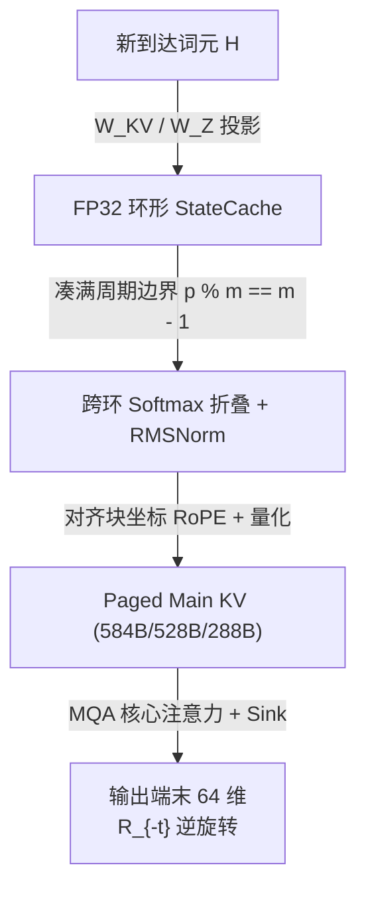

import CsaRingExplainer from '../../../../explainers/deepseek/CsaRingExplainer';

上一章的 DeepSeek-V3.2 稀疏注意力（DSA）用闪电索引器把单步计算从 $O(L^2)$ 压到 $O(Lk)$，却没有删掉哪怕一个历史词元的 KV 缓存：按 Hopper FP8 稀疏布局计算[^flashmla-doc]，每层每词元仍需 `656 B`（再加 `132 B` 索引键）。放到百万上下文（$L = 10^6$）与大并发批下，显存容量依然会直接爆表。

既然 [01 MLA](../01-mla/) 已经把单条潜向量的宽度压缩到了极限，继续打破长文本显存墙的唯一出路只剩下**压缩序列长度轴 $L$**。读完本章，你可以带走四件确定的事：

1. **门控折块与环形尾缓存**：DeepSeek-V4 通过带位置偏置的逐通道 Softmax 门控把连续多个词元折叠进压缩主缓存，并用定长 `FP32` 环形状态缓存兜住未闭合词元[^dsv4-paper]。
2. **CSA 与 HCA 的双重配方**：CSA（压缩稀疏注意力）以 $m=4$ 重叠双窗（`2m=8`）配 `FP4` 闪电索引器筛选 `Top-k`；HCA（重度压缩注意力）则用 $m'=128$ 非重叠极重压缩取消索引器全块稠密读取，两者交错把 V4-Flash 缓存压到 V3.2 的 `7%`[^dsv4-paper]。
3. **双轨 RoPE 与输出逆旋转**：由于同一压缩条目既当 Key 又当 Value 且末 `64` 维携带绝对旋转位置，注意力输出端必须在末尾 `64` 维施加位置 `-t` 的逆 RoPE 才能恢复相对距离[^dsv4-paper]。
4. **上下游源码扩展演进**：对照 `vllm@bb23c0a8` 与 `vllm-ascend@3649b8ff` 如何在 V3/V3.2 基础上扩展出 `DeepseekCompressor`、`CompressorStateCache`、环形元数据与逆 RoPE 算子。

## 先看一个例子：重叠门控折叠、环形尾槽与输出逆 RoPE

假设流式解码输入序列连续到达，每遇到关键信息词元 $t_1$（如精确代码符号），门控打分向量 $Z$ 会在通道上赋予它压倒性权重，避免被等权平均池化稀释成糊状特征。打开**图 1**，沿五个交互步骤追踪词元进入环形缓存、双窗折叠写回、`HCA/SWA` 补齐、输出逆旋转与字节账本的完整生命周期：

<CsaRingExplainer
  client:visible
  title="图 1：DeepSeek-V4 CSA 重叠门控折叠、环形尾缓存与输出逆 RoPE 推演"
/>

顺着**图 1** 的机制拆解：凡是尚未凑满步长 $m=4$ 的新词元（如 `t8, t9`）绝不直接污染主缓存，而是暂存在固定容量的 `FP32` 环形状态槽位中；同时为了弥补查询无法读取自身所在未闭合块的因果盲区，每层均配对局部滑动窗口（SWA，`n_win = 128`）保住逐词抄写精度。

## DeepSeek-V4 架构全景：CSA、HCA 与输出逆旋转

在 DeepSeek-V4 技术报告（`arXiv:2606.19348`）中[^dsv4-paper]，团队明确划分了同一全局稀疏家族下两种互补的压缩注意力层，如**图 2** 所示：


### 重叠门控双窗（CSA）与非重叠重度压缩（HCA）

对于输入隐状态 $H \in \mathbb{R}^{n \times d}$，**CSA** 取净压缩步长 $m = 4$，却用两套独立线性投影 $W^{aKV}, W^{bKV}$ 与 $W^{aZ}, W^{bZ}$ 从相邻位置切出宽度为 $2m = 8$ 的重叠窗口，加上可学习块内位置偏置 $B^a, B^b \in \mathbb{R}^{m \times c}$ 后沿时间行做逐通道 Softmax 加权折叠[^dsv4-paper]：

$$
[S_i^a;\, S_i^b] = \operatorname{Softmax}_{\text{row}}\!\bigl([Z_{mi:m(i+1)-1}^a + B^a;\; Z_{m(i-1):mi-1}^b + B^b]\bigr)
$$

$$
C_i^{\text{Comp}} = \sum_{j=0}^{m-1} S_{i,j}^a \odot C_{mi+j}^a + \sum_{j=0}^{m-1} S_{i,j}^b \odot C_{m(i-1)+j}^b
$$

相邻块之间共享了 $m$ 个词元的边界重叠上下文，消除了硬切块边界信息撕裂，再用 `FP4` 闪电索引器筛选出 `Top-k` 块（V4-Flash 取 `512`，V4-Pro 取 `1024`）。而 **HCA（Heavily Compressed Attention）** 并非跨层共享（跨层复用属于下一章 V4.1 CSA2），它同样在单层内压缩序列轴，只是将步长拉大到 $m' = 128$ 且取消双窗重叠——百万上下文下全序列只余约 `7,812` 条单头 KV，省去索引器直接做全块稠密读取即可。

### 双轨 RoPE、Attention Sink 与输出逆旋转

两条支路均采用单头共享 KV 的 MQA，并在进入核心注意力前对 $Q$ 与 KV 做 `RMSNorm` 防止对数几率爆炸、在分母加入可学习 Attention Sink 项 $\exp(z'_h)$（论文 Eq. 27），再配合分组输出投影 `GroupedWoA` 降低大矩阵乘成本[^dsv4-paper]。

关键的几何细节落在 RoPE 上：不仅 SWA 局部支与压缩全局支必须拆开两组频谱参数（`factor=1.0` vs `deepseek_yarn`），而且由于压缩缓存 $C^{\text{Comp}}$ **兼作 Key 和 Value**，其末 `64` 维已经携带了绝对位置旋转 $R_{k_{\text{pos}}}$。若不做处理，输出加权和 $\mathbf{o}_{t,h}^{[-64:]}$ 会残留历史绝对坐标。利用正交旋转可加性 $R_{-t} R_{k_{\text{pos}}} = R_{k_{\text{pos}} - t}$，DeepSeek-V4 在注意力输出端紧接着对末 `64` 维乘上当前位置 `-t` 的**逆向 RoPE（`inverse=True`）**：

$$
R_{-t}\, \mathbf{o}_{t,h}^{[-64:]} = \sum_j a_{t,h,j}\, \bigl(R_{k_{\text{pos}}(j) - t}\, \mathbf{v}_j^{[-64:]}\bigr)
$$

一举把加权求和恢复成严格的相对位置依赖[^dsv4-paper]。混合交错配置下，**DeepSeek-V4-Flash**（`43` 层，`L0–1` SWA + `L2–42` 交错 CSA/HCA）将 1M 上下文 FLOPs 降至 V3.2 的 **`10%`**、KV 降至 **`7%`**；**DeepSeek-V4-Pro**（`61` 层）则分别降至 **`27%`** 与 **`10%`**[^dsv4-paper]。

## GPU 与昇腾 NPU 上游源码扩展对照

相比 V3/V3.2 主干仅需 `MLAAttention` 与 `Indexer`[^vllm-comp41]，`vllm@bb23c0a8` 与 `vllm-ascend@3649b8ff` 为支撑序列折块在 `deepseek_v4/` 与 `deepseek_v41/` 目录扩展了一整套状态机与熔合核（其中 V4.1 取消了 $2m$ 重叠并聚焦 `ratio in (1, 2)`，将 `4/128` 保留在 `deepseek_v4/` 兼容路径）：



顺着**图 3** 的执行阶段对照双端仓库符号：

| 核心阶段               | `vllm` GPU（`vllm@bb23c0a8`）[^vllm-comp41][^vllm-fused]                                  | `vllm-ascend` NPU（`vllm-ascend@3649b8ff`）[^ascend-comp4][^ascend-comp41]                               |
| :--------------------- | :---------------------------------------------------------------------------------------- | :------------------------------------------------------------------------------------------------------- |
| **环形尾缓存与管理器** | `CompressorStateCache`（`FP32`：`SlidingWindowManager` 4/128 或 `CircularBufferManager`） | `AscendCircularBufferSpec` + `c2_ring_metadata.py` 在设备侧直接构造 5 行环索引                           |
| **折叠与写盘内核**     | `fused_save_compress_norm` + `rope_quant_insert`（head=512 CUDA 走 CuTe-DSL 核）          | V4 走原生 `torch.ops._C_ascend.compressor`；V4.1 走 `compressor_triton` 三段核 `K1/K2/K3`                |
| **双轨 RoPE 与逆旋转** | `build_deepseek_v4_rope` + `fused_inv_rope_fp8_quant` / FlashMLA 融合核                   | `ComplexExpRotaryEmbedding`（`default`/`c{ratio}`）+ `AscendDSAV41Impl._apply_rotary(..., inverse=True)` |

## PyTorch 参考实现：重叠门控折叠与输出逆 RoPE

下面这段自包含的 PyTorch 实现对照前文式 (44)–(61)：用 `OverlapCSACompressor` 落地 $2m=8$ 重叠双窗的逐通道 Softmax 门控折叠，同时用 `gptj_partial_rope` 验证前 `48` 维 NoPE 零漂移，以及输出端位置 `-50` 的逆旋转如何把绝对旋转还原回相对位置 `-33`：

```python
import torch
import torch.nn as nn
import torch.nn.functional as F


def gptj_partial_rope(
    x: torch.Tensor, pos: int, rope_dim: int = 16, theta: float = 10000.0, inverse: bool = False
) -> torch.Tensor:
    """仅对末尾 rope_dim 维施加 GPT-J 交错旋转；inverse=True 取 sin 负号实现 R_{-pos} 逆旋转。"""
    inv_freq = 1.0 / (theta ** (torch.arange(0, rope_dim, 2, dtype=x.dtype, device=x.device) / rope_dim))
    ang = pos * inv_freq
    # R_{-t} = R_t^T：仅需把正弦项取反即可在注意力输出端消去绝对位置偏置
    c, s = ang.cos(), (-ang.sin() if inverse else ang.sin())
    out = x.clone()
    seg = out[..., -rope_dim:]  # 对应 DeepseekV4ScalingRotaryEmbedding 的尾切片 rope_dim_offset
    ev, od = seg[..., 0::2].clone(), seg[..., 1::2].clone()
    seg[..., 0::2] = ev * c - od * s
    seg[..., 1::2] = od * c + ev * s
    return out


class OverlapCSACompressor(nn.Module):
    """DeepSeek-V4 重叠双窗序列压缩器（净步长 m=4，窗口宽 2m=8）。

    输入：
        h_prev_block: [m, d_model],  h_curr_block: [m, d_model]
    输出：
        compressed_kv: [1, d_c]（单条闭合块潜向量，兼作 Key 与 Value）
    """

    def __init__(self, m: int = 4, d_model: int = 32, d_c: int = 64):
        super().__init__()
        # 前后半窗采用两套独立的内容投影 (W^{aKV}, W^{bKV}) 与门控打分投影 (W^{aZ}, W^{bZ})
        self.w_kv_a = nn.Linear(d_model, d_c, bias=False)
        self.w_kv_b = nn.Linear(d_model, d_c, bias=False)
        self.w_z_a = nn.Linear(d_model, d_c, bias=False)
        self.w_z_b = nn.Linear(d_model, d_c, bias=False)
        # 可学习的块内相对位置偏置 B^a, B^b，形状均为 [m, d_c]
        self.b_a = nn.Parameter(torch.zeros(m, d_c))
        self.b_b = nn.Parameter(torch.zeros(m, d_c))

    def forward(self, h_prev_block: torch.Tensor, h_curr_block: torch.Tensor) -> torch.Tensor:
        c_win = torch.cat([self.w_kv_b(h_prev_block), self.w_kv_a(h_curr_block)], dim=0)  # [2m, d_c]
        z_win = torch.cat(
            [self.w_z_b(h_prev_block) + self.b_b, self.w_z_a(h_curr_block) + self.b_a], dim=0
        )  # [2m, d_c]
        # 沿时间行做逐通道 Softmax 竞争（dim=0），让关键信号独享高权重而免遭平均稀释
        scores = F.softmax(z_win, dim=0)
        return (scores * c_win).sum(dim=0, keepdim=True)  # [1, d_c]


if __name__ == "__main__":
    torch.manual_seed(42)
    m, d_model, d_c = 4, 32, 64
    comp = OverlapCSACompressor(m=m, d_model=d_model, d_c=d_c).to(torch.float64)
    with torch.no_grad():
        h_prev = torch.randn(m, d_model, dtype=torch.float64)
        h_curr = torch.randn(m, d_model, dtype=torch.float64)
        compressed_kv = comp(h_prev, h_curr)
        assert compressed_kv.shape == (1, d_c)

        # 验证输出逆 RoPE 恒等式：R_{-50}(R_{17} x) == R_{17 - 50} x == R_{-33} x，且前 48 维零漂移
        x_test = torch.randn(1, 64, dtype=torch.float64)
        k_rot = gptj_partial_rope(x_test, 17)
        inv_rel = gptj_partial_rope(k_rot, 50, inverse=True)
        direct_rel = gptj_partial_rope(x_test, -33)
        nope_drift = (k_rot[..., :-16] - x_test[..., :-16]).abs().max().item()
        rel_pos_err = (inv_rel - direct_rel).abs().max().item()
        assert nope_drift == 0.0 and rel_pos_err < 1e-12
        print(
            f"compressed_kv={tuple(compressed_kv.shape)} "
            f"nope_drift={nope_drift:.1e} rel_pos_err={rel_pos_err:.2e}"
        )
```

实测输出如下，前 `48` 维 NoPE 严格零漂移，输出端逆 RoPE 误差压在双精度极限以内：

```text
compressed_kv=(1, 64) nope_drift=0.0e+00 rel_pos_err=4.44e-16
```

## 代价与边界

- **异构页对齐与环形状态竞争**：混用 `CSA (m=4)`、`HCA (m'=128)` 与 `SWA` 让经典页块管理器必须按最小公倍数 $\mathrm{lcm}(m, m')$ 对齐[^dsv4-paper]，流式写环与折叠核也必须严格隔离读写边界[^ascend-triton]。
- **超高压缩比信息稀释与后级逆旋开销**：$m'=128$ 虽省索引器但无法无损记清多处精确数字，高度依赖同模型 CSA 与 SWA 互补；此外只要潜块兼任 Key 和 Value，输出端逆 RoPE 若未并入算子融合便会额外产生一趟 HBM 读写。
- **单层压缩仍留跨层冗余**：DeepSeek-V4 只压缩了「条目宽度 × 序列长度」两维，每层依然独立存储、独立索引——这正是下一章 **[05 序列压缩注意力（下）：V4.1 三维压缩 CSA2 与智能体缓存 CED](../05-csa2-and-ced/)** 要补齐的第三根维度。

## 自测

1. 若采用 `CSA (m=4)` 的请求新输入了 `7` 个词元（`0..6`），此时主缓存里有多少条闭合压缩块、环形状态缓存有几个未闭合词元？没有 SWA 时 `t=6` 能看到 `t=4, 5` 吗？

   <details>
     <summary>参考答案</summary>
     共有 $1$ 个完整闭合块（对应索引 `0..3`）写入 `Main KV`；剩余 `t=4, 5, 6` 共 `3`
     个词元留在环形状态缓存中。因为因果律禁止查询看见自身所在的未闭合块，没有 SWA 兜底时 `t=6`
     看不到 `t=4, 5`，必须靠 SWA 覆盖近邻精确依赖。
   </details>

2. 为什么 DeepSeek-V4 的 SWA 与全局压缩支共享相同的部分交错旋转函数，却要在 `build_deepseek_v4_rope` 中拆分频谱与缩放因子？

   <details>
     <summary>参考答案</summary>
     局部 SWA 永远只在最近 `128` 词元窗口内建立精确高频语法对齐，因此固定 `factor = 1.0` 与基础
     `rope_theta`；全局压缩支横跨 `1M` 长上下文，必须开启 `deepseek_yarn` 与 `compress_rope_theta`
     进行频率外推。
   </details>

3. 为什么 DeepSeek-V4 不能全模型都使用 `HCA (m'=128)`，而必须让它与 `CSA (m=4)` 交错堆叠？
   <details>
     <summary>参考答案</summary>
     `m'=128` 将 128 个词元折成单条潜向量，即使配合逐通道门控也必然丢失多事实精确区分度；与高分辨率
     `CSA (m=4)` 细粒度挑选层及 `SWA` 交错堆叠，才能用 HCA 极低代价兜底全局长程线索同时保住精度。
   </details>

[^flashmla-doc]: DeepSeek-AI. `FlashMLA/docs/20250929-hopper-fp8-sparse-deep-dive.md`（`656 B/token` Hopper FP8 稀疏格式定义）。

[^dsv4-paper]: DeepSeek-AI. _DeepSeek-V4 Technical Report_ (`arXiv:2606.19348`, 2026), Section 2.3 CSA & HCA & Section 3.5 Heterogeneous KV Cache.

[^vllm-comp41]: `vllm@bb23c0a8`: `vllm/models/deepseek_v4/compressor.py`、`vllm/models/deepseek_v41/compressor.py`（`CompressorStateCache`、`DeepseekCompressor`）与 `vllm/models/deepseek_v41/common/rope.py`（`build_deepseek_v4_rope`）。

[^vllm-fused]: `vllm@bb23c0a8`: `vllm/models/deepseek_v41/common/ops/fused_compress_quant_cache.py`（`fused_save_compress_norm`、`rope_quant_insert`）、`vllm/models/deepseek_v4/common/ops/fused_inv_rope_fp8_quant.py` 与 `vllm/models/deepseek_v4/common/grouped_wo_a.py`（`DeepseekV4GroupedWoA`）。

[^ascend-comp4]: `vllm-ascend@3649b8ff`: `vllm_ascend/models/deepseek_v4/compressor.py` 与 `vllm_ascend/attention/dsa_v41.py`（`AscendDSAV41Impl._apply_rotary(..., inverse=True)`）。

[^ascend-comp41]: `vllm-ascend@3649b8ff`: `vllm_ascend/models/deepseek_v41/compressor.py`（`DeepseekV41Compressor`）与 `vllm_ascend/ops/triton/c2_ring_metadata.py`。

[^ascend-triton]: `vllm-ascend@3649b8ff`: `vllm_ascend/ops/triton/compressor/compressor_triton.py`（`K1 _proj_kernel`、`K2 _pool_kernel`、`K3 _cache_update_kernel`）。
