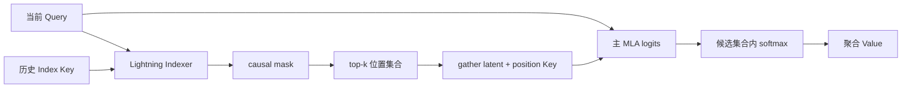

DSA（DeepSeek Sparse Attention）在 MLA cache 之上增加一条轻量的索引路径。它的关键不是“算出一组近似权重”，而是先确定主 attention 可以读哪些位置。

## 两套分数，两次归一化

Indexer 用独立的 Query/Key 路径得到 $I_{t,s}$，先屏蔽未来，再做 causal top-k。主 MLA 读取选中的 latent 和位置 Key，重新计算 logits、softmax 与 $PV$。Indexer 的分数只决定集合，不是最终输出的概率。

## 为什么必须先 mask

top-k 是排序操作。若先在包含未来位置的数组上取 top-k，再把未来位置删掉，合法历史可能已经被挤出候选集合。正确顺序是“mask → top-k → gather”；并列分数还要固定 tie-break 规则，才能让 CPU toy 与 kernel 结果可比。

主 MLA 在选中集合内重新做 softmax，分母只包含候选位置。候选变少不等于每个候选权重保持原来的值，也不等于缓存只剩 top-k 个 token。

## 代码边界

阅读实现时把 Indexer 的张量、主 MLA 的 latent/位置 cache、以及 gather 后的 candidate layout 分开标注。索引路径可以仍然扫描很长的历史；论文的稀疏收益还依赖块化、融合和硬件实现。

参考 [V3.2 §2.1](https://arxiv.org/html/2512.02556v1#S2.SS1)。本文的 toy 输入只检查因果 top-k 和候选集合内归一化，没有运行真实权重或设备 kernel。
