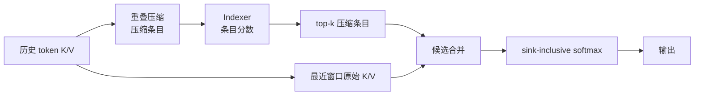

CSA（Compressed Sparse Attention）把 DSA 的选择单位从原始 token 换成压缩条目。这样做的核心收益是让选择器面对更短的序列，同时保留最近窗口中的原始细节。

## 先生成可选择的条目

V4 的教学配置把压缩率记为 $m=4$。重叠压缩会同时读取当前块的 $a$ 流和上一块的 $b$ 流，生成一条主压缩 KV；完成边界之外的条目不能直接参加当前 query 的选择。

Indexer 在压缩 Key 上打分并选 top-k；主 attention 再读取选中的压缩条目，把它们和原始窗口放进同一个候选列表。这里的“合流”意味着共享一个归一化分母，和 NSA 的三分支门控不同。

## sink 与重复覆盖

sink 只有分母贡献，没有 Value。若候选 logits 为 $z_i$、sink logit 为 $z_0$，则输出权重和可以小于 1，剩余概率质量留在 sink 中。压缩条目和窗口条目来自不同表示，覆盖同一原始位置也不做按 token 去重。

实现检查顺序应是：压缩条目完成边界 → Indexer mask → top-k → 候选 layout → 同一 softmax。任何一步提前合并都可能把未完成 token 或错误分母带进结果。

## 不要把压缩率当吞吐

$m$ 描述序列轴上的摘要密度，top-k 描述当前读取集合，窗口宽度描述局部保真度；缓存字节、索引扫描量和主 attention FLOPs 还受 head、量化和 kernel 布局影响。论文的性能数字属于特定实现，不能由一段 Python gather 推出。

参考 [V4 §2.3.3 与 §4.2.1](https://arxiv.org/html/2606.19348v1#S2.SS3.SSS3)。
