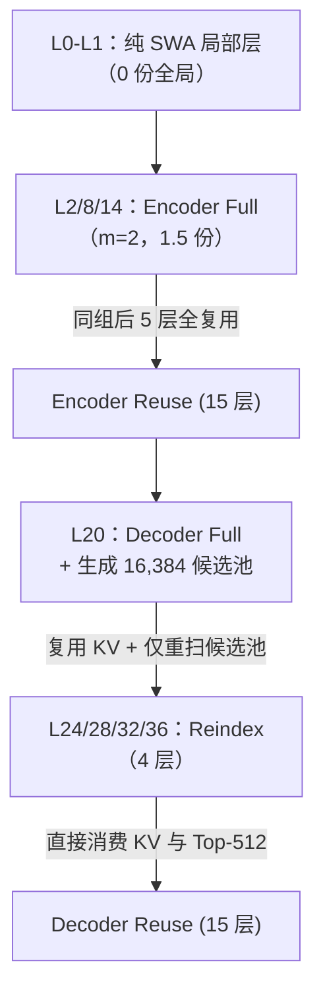

import Csa2HsiExplainer from '../../../../explainers/deepseek/Csa2HsiExplainer';

在多轮智能体（Agent）工作流里，工具调用每新增几十个报错词元，就要把十几万字的历史代码与日志反复塞回上下文。即便 DeepSeek-V4 压缩了单层内的连续序列，让每层独自维护并重扫全长全局缓存，依然会把 GPU HBM、SSD 持久化池和跨节点带宽拖垮。

DeepSeek-V4.1-Flash（总骨干 `552B`、外挂条件记忆 Engram `196B`、支持 `1M` 上下文）[^paper] 把稀疏压缩推向**三维乘法联合压缩（CSA2）**、**因果编码-解码分离（CED）**与 **SWA 有界重放**。读完本章，你可以带走四个确定结论：

1. **三维乘法 `890 B/tok` 账本**：位宽轴从 `1152 B` → V4 `584 B` → `288 B NVFP4`，叠乘序列压缩（$m=2$ 与 $m=1$）和跨层复用（40 层收敛至 `2.5` 份），把常驻全局缓存压到每词元仅 `890 B`[^paper]。
2. **CSA2 三态分工与两级分层索引（HSI）**：通过 `Full` / `Reindex` / `Reuse` 解耦缓存与索引复用，Decoder 只需对 `L20` 选出的固定 `16,384` 个候选槽位（$1\text{M}$ 下仅 `1.64%`）重打分[^paper]。
3. **CED 算力减半与 SWA 有界重放**：前 $L/2 = 20$ 层作为编码器后，后 `20` 层直接从 $H_{L/2}$ 一次性投影全局 KV，局部 SWA 仅重放末尾 $n_{\text{win}}=128$ 步，持久化体积降至 V4-Flash 的 `1/8`[^paper]。
4. **上游源码的真实抽象映射**：看清 `vllm@bb23c0a8` 与 `vllm-ascend@3649b8ff` 如何借助 `is_kv_source`、`is_index_source`、`DeepseekV41LayerRole` 与 `DecoderReplayLayers` 把论文章节落地为执行流。

## 先看一个例子：三维压榨、HSI 候选池与逆 RoPE 恢复

打开**图 1**，沿 5 个步骤追踪从单槽位宽压降到 `288 B` NVFP4（`256 B E2M1 + 32 B per-16 E4M3`）、40 层静态复用分配、HSI 两级候选海选以及输出端 $R_{-n}$ 逆旋恢复相对位置的全流程：

<Csa2HsiExplainer
  client:visible
  title="图 1：DeepSeek-V4.1 CSA2 三维压缩、HSI 两级稀疏索引与逆 RoPE 恢复"
/>

在**图 1** 背后，V4.1 相对 V4 做了两处干脆的简化：全面弃用重叠 $2m$ 窗与压缩器内绝对位置偏置，并让 `Indexer K` 直接从主 KV 线性投影产生，不再独立维护一条隐藏状态压缩链路[^paper]。

## CSA2 三维压缩、40 层拓扑与 890 B 精确账本

将 `40` 层静态划分为三段（`L0–L1` 纯局部 SWA 贡献 `0` 份全局 KV；`L2–L19` 编码器 `3` 组各 `6` 层且 `m=2` 贡献 `1.5` 份；`L20–L39` 解码器 `5` 组各 `4` 层且 `m=1` 共用同一份 KV 贡献 `1.0` 份），全网精确收敛至每词元 **`2.5`** 份全局槽位。其层间数据接力如**图 2** 所示：



对着**图 2** 核对字节账：主 KV 采用 QAT 训练后的后 RoPE 量化——`E2M1` 载荷（`512 × 0.5 = 256 B`）配每 16 通道 `1` 字节 `E4M3` 局部缩放（`32 B`），且省略 NVFP4 常见第二级全局缩放因子（因出口 RMSNorm 将向量 $L_2$ 范数锁在 $\sqrt{512} \approx 22.6$ 内，远低于 `448 × 6 = 2688` 上限），单槽主 KV 精确占 **`288 B`**；叠加 `128` 维 MXFP4（每 32 维 `UE8M0` 缩放）的 `Indexer K`（`68 B`）[^paper][^flashmla]，乘以 `2.5` 份得出：

| 缓存分量             | 原始维度与分组精度                                           | 单槽位小计 | 全网每 token 分摊（`× 2.5` 份） |
| :------------------- | :----------------------------------------------------------- | :--------: | :-----------------------------: |
| **全局主 KV**        | `512` 维（`448 NoPE + 64 RoPE`），`E2M1` + 每 `16` 维 `E4M3` |  `288 B`   |       `2.5 × 288 = 720 B`       |
| **全局 Indexer K**   | `128` 维，`MXFP4` + 每 `32` 维 `UE8M0`                       |   `68 B`   |       `2.5 × 68 = 170 B`        |
| **全网全局 KV 合计** | `L2–19`（`3 × 1/2`）+ `L20–39`（`1 × 1`）                    |  `356 B`   |        **`890 B/token`**        |

同时，因相邻层复用与 `Reuse` 层跳过索引，Decoder 后 4 个 `Reindex` 层借助两级分层稀疏索引器（HSI）恒定只扫 `2048` 个粗块 × `8` 槽位 = `16,384` 个候选位置，彻底摆脱 $O(L)$ 增长；`Reuse` 层解码时甚至只需 `11` 个融合内核[^paper]。

## CED 非对称编码-解码与智能体 SWA 有界重放

为避免缓存未命中时全长前缀穿行后半程深层网络，V4.1-Flash 引入受 YOCO 启发的**因果编码-解码架构（CED）**：前 $L/2 = 20$ 层跑完完整输入序列，后 `20` 层全球分支直接从编码器顶层输出 $H_{L/2}$ 一次性投影获取全局 KV（如**图 3** 左侧）[^paper]：

$$
C_l = H_{L/2} W_l^{KV}, \quad Z_l = H_{L/2} W_l^Z, \quad l > \frac{L}{2}
$$


如**图 3** 右侧所示，针对必须在每层局部状态 $H_l$ 上生成的 SWA KV，V4.1 利用其实际有效感受野远小于理论 $L \times n_{\text{win}}$ 的特征，推出 **SWA 有界重放（SWA Bounded Replay）**：SSD 持久化前缀池（`>= 72h`）彻底剔除短寿命 SWA、只存 `890 B/tok` 全局 KV（持久化占用降为 V4 的 **`1/8`**），SWA 仅留存于占主机内存 `10%` 的分钟级热池；一旦遇到 SWA 过期或解码前缀重算，仅截取末尾 $n_{\text{win}} = 128$ 词元重放恢复，将总预填充复杂度收敛到 $\mathcal{O}(NL/2 + n_{\text{win}} L/2) \approx \mathcal{O}(NL/2)$[^paper]。

## 论文概念与 vLLM / vLLM-Ascend 上游源码映射

必须如实说明的是：在 `vllm@bb23c0a8` 与 `vllm-ascend@3649b8ff` 上游主干源码中，字面 `CED` 或 `Full / Reindex / Reuse` 枚举类并未直接以此命名（仅 ROCm 路径下可见 `_forward_csa2_full` / `_forward_csa2_reindex`）；GPU 与昇腾后端实际上在继承 V3/V3.2 基础设施之上，通过极清晰的布尔路由与状态机在 `deepseek_v41/` 目录下精准实现了完全一致的控制流[^vllm_attn][^ascend_idx]：

| 论文机制（`arXiv:2609.19969`）  | `vllm` GPU（`vllm@bb23c0a8`）对应符号                                                        | `vllm-ascend` NPU（`vllm-ascend@3649b8ff`）对应符号                                              |
| :------------------------------ | :------------------------------------------------------------------------------------------- | :----------------------------------------------------------------------------------------------- |
| **Full / Reindex / Reuse 路由** | `DeepseekV4Attention` 的 `is_kv_source`、`is_index_source` 与 `candidate_source_layer`       | `DeepseekV41LayerRole`、`DeepseekV41Topology` 与 `build_layer_plan`                              |
| **HSI 两级候选筛选**            | `DeepseekV4Indexer` 的 `candidate_write`、`use_sparse_logits` 与 `candidate_block_buffer`    | `DeepseekV41Indexer.select_projected` 与 `npu_quant_lightning_indexer_v3`（`candidate_out`）     |
| **288 B NVFP4 与 MXFP4 布局**   | `compressed_bytes_per_token = 288`（`"nvfp4_ds_mla"`）+ `528 B`（`MXFP8`）                   | `quantize_mxfp4_indexer`、`packed_cache_ops.qsmla` 与 `npu_sparse_flash_mla`                     |
| **CED 截断与 Decoder 有界重放** | `nvidia/model.py` 中 `cut = max(kv_source_layer_ids)` 接 `DecoderReplayLayers` 与 `write_kv` | `DeepseekV41Attention.write_kv` 与 `AscendDSAV41Impl._forward_attention`（`replay_block_table`） |

## PyTorch 参考实现：HSI 两级索引与 CSA2 三态路由

下面这段自包含的 PyTorch 实现直接对应上表 `vLLM` 的 `is_kv_source`、`is_index_source` 与 `candidate_block_buffer` 抽象：`HierarchicalSparseIndexer` 演示 `L20 Full` 写入固定候选池与 `Reindex` 层常数量级重打分，`CSA2AttentionLayer` 则串起 `Full / Reindex / Reuse` 三态层间复用与 CED 编码器顶层投影：

```python
import torch
import torch.nn as nn


class HierarchicalSparseIndexer(nn.Module):
    """V4.1 两级分层稀疏索引器（HSI）。

    - Full 层调用 `select_full`：对每 blk_sz 个连续槽位取块极值粗筛 m_cand 块，物化固定候选池。
    - Reindex 层调用 `select_reindex`：仅重扫 candidate_slots（复杂度脱离上下文长度 L）。
    """

    def __init__(self, blk_sz: int = 8, m_cand: int = 64, k_top: int = 16):
        super().__init__()
        self.blk_sz, self.m_cand, self.k_top = blk_sz, m_cand, k_top

    def select_full(self, q_idx: torch.Tensor, k_slots: torch.Tensor) -> tuple[torch.Tensor, torch.Tensor]:
        n_slots = k_slots.shape[0]
        # 1. 按块长 blk_sz 分块并取每块最大内积，粗筛 m_cand 个候选块展开成 candidate_slots
        blk_max = (k_slots @ q_idx).view(n_slots // self.blk_sz, self.blk_sz).amax(dim=1)
        cand_blks = torch.topk(blk_max, k=self.m_cand, sorted=False).indices
        cand_slots = (cand_blks.unsqueeze(1) * self.blk_sz + torch.arange(self.blk_sz)).reshape(-1)
        # 2. 在固定候选池内执行细粒度 Top-k（对应 Decoder L20 Full）
        topk_ids = cand_slots[torch.topk(k_slots[cand_slots] @ q_idx, k=self.k_top, sorted=False).indices]
        return cand_slots, topk_ids

    def select_reindex(self, q_idx: torch.Tensor, k_slots: torch.Tensor, cand_slots: torch.Tensor) -> torch.Tensor:
        # 仅在共享候选池 cand_slots 上重打分，避免全量 O(L) 扫描
        local_ids = torch.topk(k_slots[cand_slots] @ q_idx, k=self.k_top, sorted=False).indices
        return cand_slots[local_ids]


class CSA2AttentionLayer(nn.Module):
    """CSA2 三态路由层（对应 vLLM `is_kv_source` 与 `is_index_source` 控制流）。"""

    def __init__(self, d_model: int, d_idx: int, is_kv_source: bool, is_index_source: bool):
        super().__init__()
        self.is_kv_source, self.is_index_source = is_kv_source, is_index_source
        # 仅当本层是 KV 源层时才持有独立的全局 KV / Indexer-K 投影权重（CED 下由 H_{L/2} 投影）
        self.kv_proj = nn.Linear(d_model, d_idx, bias=False) if is_kv_source else None
        self.q_proj = nn.Linear(d_model, d_idx, bias=False) if is_index_source else None
        self.indexer = HierarchicalSparseIndexer() if is_index_source else None

    def forward(
        self,
        h: torch.Tensor,
        h_enc_top: torch.Tensor | None = None,
        shared_kv: torch.Tensor | None = None,
        cand_slots: torch.Tensor | None = None,
        topk_ids: torch.Tensor | None = None,
    ) -> tuple[torch.Tensor, torch.Tensor, torch.Tensor]:
        # 1. Full / Reuse 之间按 is_kv_source 决定新写还是复用上游全局缓存（CED 模式读取 h_enc_top）
        if self.is_kv_source:
            kv_src = h_enc_top if h_enc_top is not None else h
            shared_kv = self.kv_proj(kv_src)  # [n_slots, d_idx]

        # 2. 按 (is_kv_source, is_index_source) 派发 Full / Reindex / Reuse 三条索引路径
        if self.is_kv_source and self.is_index_source:
            cand_slots, topk_ids = self.indexer.select_full(self.q_proj(h[-1]), shared_kv)
        elif self.is_index_source:
            topk_ids = self.indexer.select_reindex(self.q_proj(h[-1]), shared_kv, cand_slots)
        # else (Reuse 层): 直接沿用上游传来的 shared_kv 与 topk_ids，零索引开销
        return shared_kv, cand_slots, topk_ids


if __name__ == "__main__":
    torch.manual_seed(42)
    n_slots, d_model, d_idx = 4096, 32, 32
    full_layer = CSA2AttentionLayer(d_model, d_idx, is_kv_source=True, is_index_source=True)
    reindex_layer = CSA2AttentionLayer(d_model, d_idx, is_kv_source=False, is_index_source=True)
    reuse_layer = CSA2AttentionLayer(d_model, d_idx, is_kv_source=False, is_index_source=False)

    with torch.no_grad():
        h_enc_top = torch.randn(n_slots, d_model)
        kv_shared, cand_slots, topk_full = full_layer(torch.randn(n_slots, d_model), h_enc_top=h_enc_top)
        _, _, topk_reindex = reindex_layer(torch.randn(n_slots, d_model), shared_kv=kv_shared, cand_slots=cand_slots)
        _, _, topk_reuse = reuse_layer(torch.randn(n_slots, d_model), shared_kv=kv_shared, topk_ids=topk_reindex)
        assert cand_slots.shape == (64 * 8,) and topk_full.shape == topk_reindex.shape == topk_reuse.shape == (16,)
        assert int((3 * 0.5 + 1.0) * (288 + 68)) == 890  # 验证 40 层分摊 2.5 份 × 356 B == 890 B/tok
```

## 代价与边界

- **FP4 离群点敏感度**：`E2M1` 仅有 15 个非零/零离散值，极度依赖微缩放块粒度（`b=16`）与后训练 QAT 联合适配，否则单个通道极值就会拖垮全块有效位宽。
- **跨层 `Reuse` 与 HSI 的注意力重叠假设**：如果超长文档多跳推理导致中后层焦点发生剧烈跳跃，一旦相关粗块在 `L20` 首层粗筛落选，后续 `Reindex` 与 `Reuse` 层将无法跨池打捞。
- **有界重放与双层缓存管理复杂度**：CED 固锁了高层直接由 $H_{L/2}$ 生成全局 KV 的上限，同时服务端必须将长寿命 SSD 全局缓存（`>= 72h`）与短寿命 DRAM SWA 缓冲拆分调度[^paper]。

至此，注意力与 KV Cache 优化轴线已全部闭合；接下来进入第二条演化轴线——看看 DeepSeek 如何拆解庞大的参数激活墙：[06 细粒度混合专家（DeepSeekMoE）](../06-moe/)。

## 自测

1. 如果把 Decoder 段从仅 `L20` 为 `Full`、`L24/28/32/36` 为 `Reindex` 改为 5 组首层全设为 `Full`，全网每 token 全局 KV 字节数会从 `890 B` 涨到多少？

<details>
<summary>参考答案</summary>

Decoder 写入份数会从 `1.0` 份上升到 `5.0` 份，叠加上 Encoder 段的 `1.5` 份后全网共计 `6.5` 份；每份按 `288 + 68 = 356 B` 计算，全网每词元总全局 KV 将升至 `6.5 × 356 = 2,314 B/token`。

</details>

2. 为什么 DeepSeek-V4.1-Flash 宁愿在未命中时多算末尾 `n_win = 128` 词元的 SWA Bounded Replay，也不把 SWA KV 一起写进 SSD？

<details>
<summary>参考答案</summary>

SWA KV 只在活跃会话内有效（生命周期仅数分钟），且多轮交互频繁刷新不同尾部截断点，若写入持久化 SSD 会占掉近半容量并很快沦为死数据；而实际有效感受野远短于理论 $L \times n_{\text{win}}$，用廉价 GPU 重放最近 128 词元即可将 SSD 持久规模压低至 V4 的 1/8。

</details>

[^paper]: DeepSeek-AI, _DeepSeek-V4.1-Flash Technical Report_ (`arXiv:2609.19969`, 2026), Section 2.2 CED, Section 2.3 CSA2 & Section 3.2 Persistent KV Cache.

[^flashmla]: FlashMLA 开源内核仓库（`FlashMLA@395cb3af`）对 `288 B` FP4 与 `528 B` FP8 KV 布局及 fused-RoPE-attention-RoPE-cast 内核的定义。

[^vllm_attn]: `vllm@bb23c0a8`: `vllm/models/deepseek_v41/attention.py`、`compressor.py`、`decoder_replay_layers.py`、`nvidia/model.py` 与 `amd/rocm.py`。

[^ascend_idx]: `vllm-ascend@3649b8ff`: `vllm_ascend/models/deepseek_v41/{model.py,compressor.py,indexer.py}` 与 `vllm_ascend/attention/dsa_v41.py`（`AscendDSAV41Impl`）。
