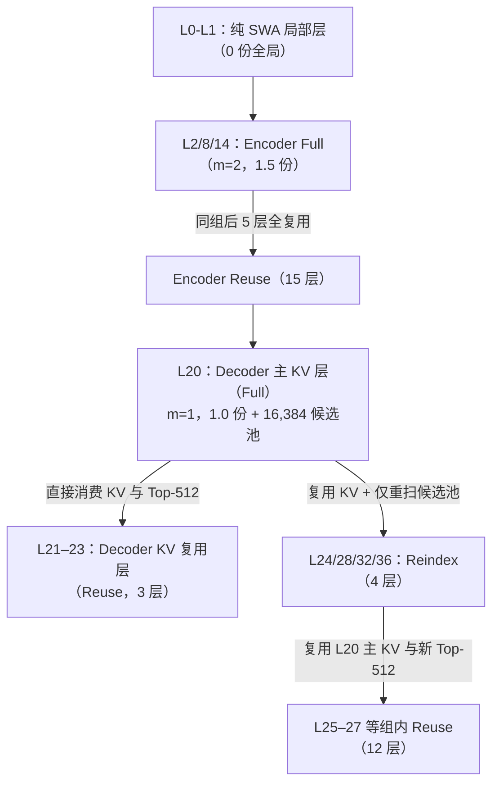

在多轮智能体（Agent）工作流里，工具调用每追加几十个报错输出或检索片段，就会触发一次围绕十几万字历史前缀的长上下文请求。即便 DeepSeek-V4 已经压窄了条目宽度并折叠了单层内的序列长度，只要网络中的每一层仍然各自写入全局缓存、各自扫描全长索引，HBM 容量、SSD 持久化池与跨节点缓存搬运带宽依然会迅速吃紧。

DeepSeek-V4.1-Flash（主干 552B 参数、外挂条件记忆 Engram 196B、支持 1M 上下文）从**条目位宽 × 序列长度 × 网络层数**三个维度同时做乘法压缩[^paper]，并在前向执行上按半程编码-解码切分（Prefill 激活 8B，Decode 激活 16B）。

借助跨层复用与两级索引的 **CSA2（Compressed Sparse Attention 2）**、**后 RoPE NVFP4 主缓存量化**以及 **SWA 有界重放**，全网 40 层全局 KV 缓存被压至每 token 仅 890 B（约为 V4-Flash 的 1/4、V1 的 1/437），持久化 SSD 体积进一步降至 V4-Flash 的 1/8。

## 三维乘法压缩与跨层复用拓扑

把长文本全局缓存压到每 token 890 B，来自条目位宽、序列长度和网络层数三条轴线的联合乘积[^paper]。

先看位宽与序列两轴的简化。V4.1 保持单头 512 维主潜空间（448 维 NoPE + 64 维 RoPE），通过后 RoPE NVFP4 将单槽主 KV 压至 288 B，并把 128 维索引键量化为 MXFP4 占 68 B，两者合计满速率单槽为 356 B。

同时，V4.1 简化了压缩器结构：取消 V4 的 $2m$ 重叠双窗与压缩器内绝对位置偏置，直接从主压缩潜向量线性投影出 Indexer K（替代从隐状态单独投影），在序列压缩率上编码器段取 $m = 2$、解码器段保持 $m = 1$。

真正的倍数缩减来自第三条轴——跨层复用与解耦。V4.1 将 40 层主干静态划分为三段：L0–L1 仅使用局部滑动窗口（SWA），贡献 0 份全局缓存；L2–L19 共 18 层编码器拆为 3 组各 6 层（L2–L7、L8–L13、L14–L19），每组首层按 $m = 2$ 生成 1 份全局缓存并由同组后 5 层共享，合计贡献 $3 \times 0.5 = 1.5$ 份等效槽位。

L20–L39 共 20 层解码器分为 5 组各 4 层，整段共用 L20 在 $m = 1$ 下生成的那 1 份全局缓存，贡献 1.0 份等效槽位。全网 40 层平均每个 token 仅驻留 $0 + 1.5 + 1.0 = 2.5$ 份全局槽位，乘以单槽 356 B 精确得出 890 B/token——即使塞满整条 1M 上下文，40 层全局 KV 总计也仅占约 849 MiB。

在层间分工上，CSA2 把每层静态指派为 Full、Reindex 或 Reuse 三种模式之一（均保留各自独立的 Query 与局部 SWA 缓存），将「写缓存」与「算索引」明确解耦[^paper]。位于 L2、L8、L14、L20 的 **Full 模式**层负责完整流程：生成本组全局主 KV、从中投影出索引键 Indexer K，并计算本层的索引查询 Indexer Q 以筛选出新的 Top-512 历史下标。

位于 L24、L28、L32、L36 的 **Reindex 模式**层跳过全局缓存写入，直接复用最近上游 Full 层的全局主 KV 与 Indexer K，仅保留本层的 Indexer Q 对复用键重新打分，让深层解码器仍能随推理焦点迁移调整检索下标。

其余 30 层（编码器 15 层、解码器 15 层）均处于 **Reuse 模式**，同时复用上游主 KV 与最新选出的 Top-512 下标，直接省去索引计算；凭借算子融合，Reuse 层在 Decode 阶段每层仅执行 11 个融合 Kernel，Prefill 阶段也仅 15 个 Kernel[^paper]。

即便 Reuse 模式跳过了 30 层索引，解码器的 4 个 Reindex 层在 1M 上下文下仍然面临线性扫描全长历史的开销。为此 V4.1 在解码器引入**两级分层稀疏索引器（HSI）**[^paper]：L20（Full）在扫描全长上下文并挑选自身 Top-512 的同时，按每 8 个连续槽位取块内最大索引分，保留得分最高的 2,048 个粗块，拼成固定容量 $2048 \times 8 = 16{,}384$ 的共享候选池（在 1M 上下文下仅占 1.64%）。

后续 4 个 Reindex 层只需重扫这 16,384 个候选位置即可选出各自的 Top-512，把深层重索引开销从 $O(L)$ 降至常数 $O(1)$。这一候选过滤规则在后训练阶段同步开启，保证推理分布与训练一致；综合以上改进，上下文从 4K 扩展 256 倍到 1M 时，V4.1-Flash 的单 token Decode FLOPs 仅增加约 25%[^paper]。

在多卡流水线并行训练期间，共享缓存的源层与消费层经常跨卡分布；V4.1 通过在消费端放置共享参数的轻量影子副本，并在流水线点对点通信中携带中间路由器负载状态，保证梯度聚合与显存释放对上层透明[^paper]。

图 1 汇总了条目位宽缩减、40 层三态分配、HSI 两级候选筛选以及输出端逆 RoPE 恢复的全流程；图 2 则给出 40 层之间的缓存与索引接力路径。




下表核对了全网 40 层每 token 的全局缓存精确账本（890 B/token）：

| 缓存分量         | 原始维度与分组精度                                     | 单槽位小计 | 全网每 token 分摊（2.5 份） |
| :--------------- | :----------------------------------------------------- | ---------: | --------------------------: |
| 全局主 KV        | 512 维（448 NoPE + 64 RoPE），E2M1 配每 16 维 E4M3     |      288 B |           2.5 × 288 = 720 B |
| 全局 Indexer K   | 128 维，MXFP4 配每 32 维 UE8M0                         |       68 B |            2.5 × 68 = 170 B |
| 全网全局 KV 合计 | L2–L19（$3 \times 1/2$）与 L20–L39（$1 \times 1$）合并 |      356 B |                 890 B/token |

### 后 RoPE NVFP4 与单级缩放

V4.1 在主 KV 缓存与索引缓存上分别选用两种不同的 4 比特格式[^paper]。索引器需要借助原生 FP4 Tensor Core 矩阵乘加速全序列粗筛，因此采用硬件通用的 OCP MXFP4（每 32 维配 1 字节 UE8M0 缩放，共 68 B）。

而主 KV 仅需压缩 HBM 与 SSD 存储占用，在核心注意力计算前会先反量化为 BF16，不受限于原生 FP4 矩阵乘格式约束，因而选用精度更高的 NVFP4 载荷格式：512 维全部采用 E2M1（256 B），每 16 维配 1 字节 E4M3 局部缩放因子（32 B），合计 288 B。

而且主缓存省略了传统 NVFP4 常带的二级全局 FP32 缩放因子。原因在于出口 `RMSNorm` 的训练权重上界接近 1，使 512 维向量的 $L_2$ 范数被压在约 $\sqrt{512} \approx 22.6$ 以内；又由于旋转位置编码（RoPE）保持向量 $L_2$ 范数不变，旋转后每个通道的最大绝对值也天然低于 $\sqrt{512} \approx 22.6$（训练期间观察到的最大值约 10），远小于单级 E2M1 × E4M3 所能表达的 $448 \times 6 = 2688$ 上限。

将量化放在 RoPE 之后执行，在精度上与 RoPE 前量化几乎无异，同时免去了 Decode 阶段读取后的额外旋转开销；局部 SWA 缓存则继续保留 FP8 以保护近端精度。

## CED 非对称编码-解码与 SWA 有界重放

解决缓存容量之后，多轮智能体面对未命中前缀的 Prefill 算力压力依然沉重。受 YOCO 启发，DeepSeek-V4.1-Flash 采用**因果编码-解码架构（CED）**，把 40 层拆成 20 层因果编码器与 20 层解码器[^paper]。

前 20 层在 Prefill 阶段仅激活 8B 参数，完整处理全部 $N$ 个输入 token；在编码器顶层输出 $H_{L/2}$ 处，后 20 层（L20–L39）的**全局分支**直接从 $H_{L/2}$ 一次性线性投影出全部所需的全局 KV 与压缩门控分，免去让长前缀穿行深层 MoE 网络（总激活在 Decode 时才回升至 16B）[^paper]：

$$
C_l = H_{L/2} W_l^{KV}, \qquad Z_l = H_{L/2} W_l^Z, \qquad l > \frac{L}{2}
$$

对于必须在每一层本地状态 $H_l$ 上生成的局部 SWA 缓存，理论上跨 20 层解码器精确重建最后一个 token 所需的 SWA 依赖链，必须向回重算 $L/2 \times n_{\text{win}} = 20 \times 128 = 2{,}560$ 个历史 token——在每轮只新增几十个 token 的多轮交互里，这笔固定开销依然偏高。

为此，V4.1 利用 SWA 的**实际有效感受野远小于理论线性累加深度**这一特性[^paper]：由于长程语境与锚点已经由残差流和编码器顶层 $H_{L/2}$ 承接，局部 SWA 的高权重随层数传播迅速衰减。

基于这一观测，V4.1 提出 **Decoder SWA Bounded Replay**：在 Prefill 阶段，后 20 层解码器仅截取输入序列末尾最近的 $n_{\text{win}} = 128$ 个 token，并将重放窗口内的 SWA 注意力边界截断为 $\max(s,\, i - W + 1)$（在后训练中同步模拟，几乎不损模型输出质量）。

这一局部边界截断使全网 Prefill 复杂度从 $\mathcal{O}(NL)$ 降至 $\mathcal{O}(NL/2 + n_{\text{win}} L/2) \approx \mathcal{O}(NL/2)$，前向算力直接减半。

在前缀存储系统设计上，有界重放同样改写了 SSD 与主机内存的分层策略（如图 3 所示）[^paper]。由于 SWA 缓存只在单次活跃会话的分钟级窗口内有效，V4.1 将短寿命的 SWA KV 从持久化 SSD 池中移除，只保留可跨日复用的 890 B/token 全局 KV（驻留周期不少于 72 小时）；全网全局 KV 压低至 V4-Flash 的 1/4 后，再去掉占全局同等规模的非持久化 SWA 落盘，两项相乘便把 SSD 持久化总占用降至 V4-Flash 的 1/8。

各节点仅划出 10% 的主机内存组成高周转率热缓冲池，专门缓存 Prompt 尾与输出尾两处 SWA 快照。一旦遇到全局 KV 命中而 SWA 过期未命中，**Encoder SWA Bounded Replay** 同样只需重放命中点前末尾 $n_{\text{win}} = 128$ 个 token（而非全网 $L \times n_{\text{win}} = 5{,}120$ 个 token）恢复局部状态，即可直接衔接新增后缀完成推理。


## 论文概念与双硬件上游源码映射

在 `vLLM`[^vllm_attn] 与 `vllm-ascend`[^ascend_idx] 的上游主干源码中，两大生产栈沿用 V3/V3.2 基础设施，通过布尔路由标志与拓扑规划器实现与论文 CED 及 Full / Reindex / Reuse 等价的数据流（仅 ROCm 路径保留了区分 full 与 reindex 的内部函数）。

在 `vLLM` GPU 栈中[^vllm_attn][^flashmla]，`DeepseekV4Attention` 使用 `is_kv_source`、`is_index_source` 与 `candidate_source_layer` 控制缓存与索引所有权，令消费层直接读取共享缓冲中的全局 KV 与候选下标缓存；SM100 上的 `FlashMLAMegaAttnBackend` 将 Q RoPE、稀疏注意力、输出逆 RoPE 与 FP8 转换融进单核，消费 288 B 的 `nvfp4_ds_mla` 主记录与 528 B MXFP8 SWA 记录。

模型主干则在最后一个 KV 源层边界处接入 `DecoderReplayLayers`，在较大 Prefill 批下仅抽取每个请求末尾窗口长度行运行解码器层，把前半程已由顶层投影出的全局特征与末段局部重放衔接起来。

在 `vllm-ascend` 昇腾 NPU 栈中[^ascend_idx]，`build_layer_plan` 根据配置预先生成不可变的 `DeepseekV41LayerRole` 与 `DeepseekV41Topology` 拓扑描述符，交由 `AscendDSAV41Impl` 统一调度。

执行索引筛选时，`DeepseekV41Indexer` 在各张量并行卡上复制全部索引头避免跨卡通信，通过 `npu_quant_lightning_indexer_v3`（或 A5 打包 MXFP4 算子）按模式参数切换生成候选池或仅在候选池内打分，最终由 `npu_sparse_flash_mla` 配合 `replay_block_table` 完成有界重放执行。

| 论文机制（arXiv:2609.19969） | `vLLM` GPU 对应抽象                                 | `vllm-ascend` NPU 对应抽象                                |
| :--------------------------- | :-------------------------------------------------- | :-------------------------------------------------------- |
| Full / Reindex / Reuse 路由  | `is_kv_source` / `is_index_source` 路由标志         | `DeepseekV41LayerRole` 与 `DeepseekV41Topology`           |
| HSI 两级候选筛选             | `DeepseekV4Indexer` 与共享 `candidate_block_buffer` | `DeepseekV41Indexer` 调 `npu_quant_lightning_indexer_v3`  |
| 288 B NVFP4 与 MXFP4 布局    | `nvfp4_ds_mla`（288 B）配 `FlashMLAMegaAttnBackend` | `quantize_mxfp4_indexer` 配 `qsmla` / 稀疏 Flash MLA 算子 |
| CED 截断与 Decoder 有界重放  | `DecoderReplayLayers` 按请求末窗口切分              | `AscendDSAV41Impl` 传 `replay_block_table` 执行           |

## PyTorch 参考实现与结构验证

下面的自包含 PyTorch 代码对应 `vLLM` 中的 `is_kv_source`、`is_index_source` 与共享候选池抽象：`HierarchicalSparseIndexer` 展示 Full 层构建固定候选池与 Reindex 层仅重扫候选槽位的两级选择，`CSA2AttentionLayer` 则串起三态层间复用与 CED 编码器顶层投影的张量路由：

```python
import torch
import torch.nn as nn


class HierarchicalSparseIndexer(nn.Module):
    """V4.1 两级分层稀疏索引器（HSI）。

    - Full 层调用 `select_full`：对每 blk_sz 个连续槽位取块极值粗筛 m_cand 块，物化固定候选池。
    - Reindex 层调用 `select_reindex`：仅重扫 candidate_slots（复杂度脱离上下文长度 L）。
    """

    def __init__(self, blk_sz: int = 8, m_cand: int = 64, k_top: int = 16):
        super().__init__()
        self.blk_sz, self.m_cand, self.k_top = blk_sz, m_cand, k_top

    def select_full(self, q_idx: torch.Tensor, k_slots: torch.Tensor) -> tuple[torch.Tensor, torch.Tensor]:
        n_slots = k_slots.shape[0]
        # 1. 按块长 blk_sz 分块并取每块最大内积，粗筛 m_cand 个候选块展开成 candidate_slots
        blk_max = (k_slots @ q_idx).view(n_slots // self.blk_sz, self.blk_sz).amax(dim=1)
        cand_blks = torch.topk(blk_max, k=self.m_cand, sorted=False).indices
        cand_slots = (cand_blks.unsqueeze(1) * self.blk_sz + torch.arange(self.blk_sz)).reshape(-1)
        # 2. 在固定候选池内执行细粒度 Top-k（对应 Decoder L20 Full）
        topk_ids = cand_slots[torch.topk(k_slots[cand_slots] @ q_idx, k=self.k_top, sorted=False).indices]
        return cand_slots, topk_ids

    def select_reindex(self, q_idx: torch.Tensor, k_slots: torch.Tensor, cand_slots: torch.Tensor) -> torch.Tensor:
        # 仅在共享候选池 cand_slots 上重打分，避免全量 O(L) 扫描
        local_ids = torch.topk(k_slots[cand_slots] @ q_idx, k=self.k_top, sorted=False).indices
        return cand_slots[local_ids]


class CSA2AttentionLayer(nn.Module):
    """CSA2 三态路由层（对应 vLLM `is_kv_source` 与 `is_index_source` 控制流）。"""

    def __init__(self, d_model: int, d_idx: int, is_kv_source: bool, is_index_source: bool):
        super().__init__()
        self.is_kv_source, self.is_index_source = is_kv_source, is_index_source
        # 仅当本层是 KV 源层时才持有独立的全局 KV / Indexer-K 投影权重（CED 下由 H_{L/2} 投影）
        self.kv_proj = nn.Linear(d_model, d_idx, bias=False) if is_kv_source else None
        self.q_proj = nn.Linear(d_model, d_idx, bias=False) if is_index_source else None
        self.indexer = HierarchicalSparseIndexer() if is_index_source else None

    def forward(
        self,
        h: torch.Tensor,
        h_enc_top: torch.Tensor | None = None,
        shared_kv: torch.Tensor | None = None,
        cand_slots: torch.Tensor | None = None,
        topk_ids: torch.Tensor | None = None,
    ) -> tuple[torch.Tensor, torch.Tensor, torch.Tensor]:
        # 1. Full / Reuse 之间按 is_kv_source 决定新写还是复用上游全局缓存（CED 模式读取 h_enc_top）
        if self.is_kv_source:
            kv_src = h_enc_top if h_enc_top is not None else h
            shared_kv = self.kv_proj(kv_src)  # [n_slots, d_idx]

        # 2. 按 (is_kv_source, is_index_source) 派发 Full / Reindex / Reuse 三条索引路径
        if self.is_kv_source and self.is_index_source:
            cand_slots, topk_ids = self.indexer.select_full(self.q_proj(h[-1]), shared_kv)
        elif self.is_index_source:
            topk_ids = self.indexer.select_reindex(self.q_proj(h[-1]), shared_kv, cand_slots)
        # else (Reuse 层): 直接沿用上游传来的 shared_kv 与 topk_ids，零索引开销
        return shared_kv, cand_slots, topk_ids


if __name__ == "__main__":
    torch.manual_seed(42)
    n_slots, d_model, d_idx = 4096, 32, 32
    full_layer = CSA2AttentionLayer(d_model, d_idx, is_kv_source=True, is_index_source=True)
    reindex_layer = CSA2AttentionLayer(d_model, d_idx, is_kv_source=False, is_index_source=True)
    reuse_layer = CSA2AttentionLayer(d_model, d_idx, is_kv_source=False, is_index_source=False)

    with torch.no_grad():
        h_enc_top = torch.randn(n_slots, d_model)
        kv_shared, cand_slots, topk_full = full_layer(torch.randn(n_slots, d_model), h_enc_top=h_enc_top)
        _, _, topk_reindex = reindex_layer(torch.randn(n_slots, d_model), shared_kv=kv_shared, cand_slots=cand_slots)
        _, _, topk_reuse = reuse_layer(torch.randn(n_slots, d_model), shared_kv=kv_shared, topk_ids=topk_reindex)
        assert kv_shared.shape == (n_slots, d_idx)
        assert cand_slots.shape == (64 * 8,) and topk_full.shape == topk_reindex.shape == topk_reuse.shape == (16,)
```

把全局缓存压到 890 B/token 并切出半程编码-解码，也带有几项明确的使用前提：4 比特 E2M1 每个数值区间仅有 15 个非零刻度，需要依靠每 16 维 E4M3 微缩放与后训练 QAT 才能稳住精度；同时 HSI 的 Reindex 与 Reuse 层假定解码器的注意力焦点落在大致相同的粗块范围内，跨多跳推理时若后半层焦点完全偏离 L20 选出的 16,384 候选槽位，便无法再读取落选块。

在推理系统侧，调度器还必须把长周期 SSD 全局缓存（不少于 72 小时）与分钟级 DRAM SWA 热池拆开管理[^paper]。

从 V2 MLA 到 V4.1 CSA2 + CED，注意力与 KV 缓存的压缩沿着宽度、序列与层数三维推进，单 token 全局缓存已降至 890 B。接下来的第二条演化轴线转向主干 FFN 的计算参数墙：看 [06 细粒度混合专家（DeepSeekMoE）](../06-moe/) 如何用专家细粒度切分、共享隔离与无辅损动态偏置在扩展总参数的同时控住单步激活量。

[^paper]: DeepSeek-AI，“DeepSeek-V4.1-Flash Technical Report”，2026。[arXiv:2609.19969](https://arxiv.org/abs/2609.19969)，§2.1–2.4、§3.2 与 §4.2.1。

[^vllm_attn]: `vLLM` 项目，`vllm/models/deepseek_v41/` 下的 `attention.py`（`DeepseekV4Attention`、`DeepseekV4Indexer`）、`compressor.py`、`decoder_replay_layers.py`（`DecoderReplayLayers`）、`nvidia/model.py`（`cut = max(config.kv_source_layer_ids)`）与 `amd/rocm.py`（`_forward_csa2_full`、`_forward_csa2_reindex`），commit `bb23c0a8`。[GitHub](https://github.com/vllm-project/vllm/tree/bb23c0a81779ba733923a7dab9b840b4e533f6a5)。

[^flashmla]: `vLLM` 项目，`vllm/models/deepseek_v41/sparse_mla.py`（`FlashMLAMegaAttnBackend`）与 `nvidia/flash_mla_mega_attn.py`（`nvfp4_ds_mla` 288 B 与 `fp8_ds_mla` 528 B 记录格式定义及 `FlashMLA` SM100 融合内核调度），commit `bb23c0a8`；另见 `FlashMLA` 仓库（commit `395cb3af`）。

[^ascend_idx]: `vllm-ascend` 项目，`vllm_ascend/models/deepseek_v41/` 下的 `model.py`（`DeepseekV41LayerRole`、`DeepseekV41Topology`、`build_layer_plan`）、`compressor.py`、`indexer.py`（`DeepseekV41Indexer`、`npu_quant_lightning_indexer_v3`、`packed_cache_ops`）与 `vllm_ascend/attention/dsa_v41.py`（`AscendDSAV41Impl`、`_forward_attention`、`replay_block_table`），commit `3649b8ff`。[GitHub](https://github.com/vllm-project/vllm-ascend/tree/3649b8ff7fd69e707db2c634073d2b4c40eadf15)。
