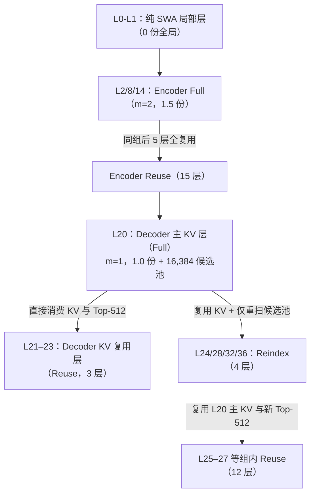
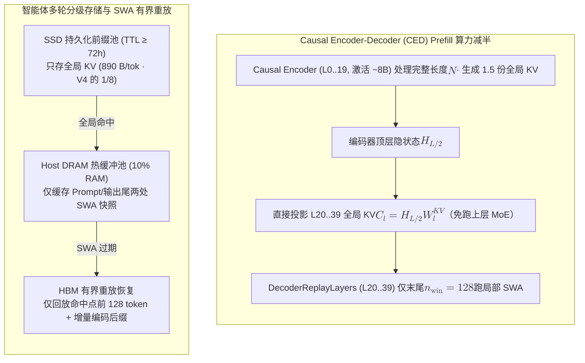

import Figure from 'astro-wisp/components/Figure.astro';
import paperFig2DecodeFlops from './images/paper-fig2-decode-flops.png';
import paperFig3CedArch from './images/paper-fig3-ced-arch.svg';
import paperFig4Csa2 from './images/paper-fig4-csa2.svg';
import paperFig5Hsi from './images/paper-fig5-hsi.svg';

在多轮 **Agent（智能体）**工作流里，工具调用每追加几十个报错输出或检索片段，就会触发一次围绕十几万字历史前缀的长上下文请求。即便 DeepSeek-V4 已经压窄了条目宽度并折叠了单层内的序列长度，只要网络中的每一层仍然各自写入全局缓存、各自扫描全长索引，HBM 容量、SSD 持久化池与跨节点缓存搬运带宽依然会迅速吃紧。

DeepSeek-V4.1-Flash 拥有 552B 主干参数与 196B 外挂条件记忆 Engram，支持 1M 上下文[^paper]。它从**条目位宽 × 序列长度 × 网络层数**三个维度同时做乘法压缩，并在前向执行上按半程编码-解码切分（Prefill 激活 8B，Decode 激活 16B）。

DeepSeek-V4.1 引入跨层复用与两级索引的 **CSA2（Compressed Sparse Attention 2）**。配合**后 RoPE NVFP4 主缓存量化**与 **SWA 有界重放**，40 层全局 KV 压至每 token 890 B。这约为 V4-Flash 的 1/4、V1 的 1/437，持久化 SSD 体积也降至 V4-Flash 的 1/8。

全篇符号承接[04 V4 CSA 与 HCA](../04-csa-and-hca/)并扩展至 V4.1-Flash 跨层与半程切分维度：

| 符号                            | 含义                                               | 典型维度 / 取值域                                        |
| :------------------------------ | :------------------------------------------------- | :------------------------------------------------------- |
| $L,\; l$                        | 主干总层数与当前层号                               | $L=40$（L0–L19 因果编码器，L20–L39 解码器）              |
| $H_{L/2},\; C_l,\; Z_l$         | 编码器顶层隐状态与解码器直接投影的全局 KV 及门控分 | $C_l = H_{L/2} W_l^{KV},\; Z_l = H_{L/2} W_l^Z\;(l>L/2)$ |
| $m,\; n_{\text{win}}$           | V4.1 简化非重叠压缩步长与局部 SWA 窗口长度         | 编码器段 $m=2$，解码器段 $m=1$；$n_{\text{win}}=128$     |
| $\text{Full / Reindex / Reuse}$ | CSA2 三类静态层模式（写 KV/重打分/全复用）         | 4 层 Full、4 层 Reindex、30 层 Reuse，配 2 层纯 SWA      |
| $\text{KV}_{\text{eff}}$        | 全网 40 层单 token 平均等效全局 KV 槽位数          | $0 + 3 \times 0.5 + 1.0 = 2.5$ 份等效槽位/token          |
| $d_c,\; d_{\text{idx}}$         | 全局主 KV 潜在维度（NVFP4）与索引键维度（MXFP4）   | 512 维（288 B NVFP4）+ 128 维（68 B MXFP4）= 356 B/槽    |
| $\text{KV}_{\text{global}}$     | 全网 40 层合并后单 token 全局缓存净字节开销        | $2.5 \times (288 + 68) = 890\;\text{B/token}$            |
| $M_{\text{cand}},\; k$          | HSI 共享候选池槽位数与每层最终保留的 Top-$k$       | $2048 \times 8 = 16{,}384$ 候选槽位；$k = 512$           |
| $R_{-t}$                        | 输出端末 64 维施加的相对位置逆向旋转（同 V4）      | 将共享 Key/Value 条目拉回相对偏移 $k_{\text{pos}}(j)-t$  |

图 1 展示了 DeepSeek-V4.1-Flash 的 40 层总体结构：20 层编码器串联 20 层解码器，并集成 CSA2、mHC、Engram 与 DSpark[^paper]。

<Figure
  src={paperFig3CedArch}
  alt="论文图 3：DeepSeek-V4.1-Flash 总体架构，包含 20 层因果编码器、20 层解码器、CSA2 复用配置、Single-Pass mHC、Engram 与 DSpark"
  caption="图 1：DeepSeek-V4.1-Flash 总体架构：40 层因果编码-解码切分与 CSA2 跨层配置（DeepSeek-V4.1-Flash 论文图 3）"
/>

## 三维乘法压缩与跨层复用拓扑

把长文本全局缓存压到每 token 890 B，来自条目位宽、序列长度和网络层数三个维度的联合乘积[^paper]。

先看位宽与序列两维的简化。V4.1 保持单头 512 维主潜空间（448 维 NoPE + 64 维 RoPE），用后 RoPE NVFP4 将单槽主 KV 压至 288 B。128 维索引键同时量化为 MXFP4（68 B），满速率单槽合计 356 B。

同时，V4.1 简化了压缩器结构，取消 V4 的 $2m$ 重叠双窗与压缩器内绝对位置偏置，直接从主压缩潜向量线性投影出 Indexer K。在序列压缩率上，编码器段取 $m = 2$，解码器段保持 $m = 1$。

真正的倍数缩减来自第三维——跨层复用与解耦。V4.1 将 40 层主干静态划分为三段：L0–L1 仅使用局部 **SWA（Sliding Window Attention，滑动窗口注意力）**，贡献 0 份全局缓存。L2–L19 共 18 层编码器拆为 3 组各 6 层（L2–L7、L8–L13、L14–L19），每组首层按 $m = 2$ 生成 1 份全局缓存并由同组后 5 层共享，合计贡献 $3 \times 0.5 = 1.5$ 份等效槽位。

L20–L39 共 20 层解码器分为 5 组各 4 层，整段共用 L20 在 $m = 1$ 下生成的那 1 份全局缓存，贡献 1.0 份等效槽位。全网 40 层平均每个 token 仅驻留 $0 + 1.5 + 1.0 = 2.5$ 份全局槽位，乘以单槽 356 B 即得 890 B/token。即使塞满整条 1M 上下文，40 层全局 KV 总计也仅占约 849 MiB。

在层间分工上，CSA2 把每层静态指派为 Full、Reindex 或 Reuse 三种模式之一（如图 2 所示），将“写缓存”与“算索引”明确解耦[^paper]。所有模式均保留各自独立的 Query 与局部 SWA 缓存。位于 L2、L8、L14、L20 的 **Full 模式**层负责完整流程。它们生成本组全局主 KV 并投影出 Indexer K，再计算本层 Indexer Q 以筛选新的 Top-512 历史下标。

<Figure
  src={paperFig4Csa2}
  alt="论文图 4：CSA2 三种运行模式对比，Full 计算主 KV 与 Indexer K，Reindex 复用 KV 并重算 Indexer Q，Reuse 直接复用主 KV 与 Top-K 下标"
  caption="图 2：CSA2 三类静态模式的数据流分工：Full、Reindex 与 Reuse（DeepSeek-V4.1-Flash 论文图 4）"
/>

位于 L24、L28、L32、L36 的 **Reindex 模式**层跳过全局缓存写入，直接复用最近上游 Full 层的全局主 KV 与 Indexer K。它们只保留本层 Indexer Q 对复用键重新打分，以适应深层推理焦点的迁移。

其余 30 层（编码器 15 层、解码器 15 层）均处于 **Reuse 模式**，同时复用上游主 KV 与最新选出的 Top-512 下标，直接省去索引计算。凭借算子融合，Reuse 层在 Decode 阶段每层仅执行 11 个融合 Kernel，Prefill 阶段也仅 15 个 Kernel[^paper]。

即便 Reuse 模式跳过了 30 层索引，解码器的 4 个 Reindex 层在 1M 上下文下仍然面临线性扫描全长历史的开销。为此 V4.1 在解码器引入 **HSI（Hierarchical Sparse Indexer，两级分层稀疏索引器）**[^paper]。如图 3 所示，L20（Full）在扫描全长并选出 Top-512 时，每 8 个连续槽位取块内最大分，挑出得分最高的 2,048 个粗块，拼成容量 $2048 \times 8 = 16{,}384$ 的共享候选池（1M 下仅占 1.64%）。

<Figure
  src={paperFig5Hsi}
  alt="论文图 5：HSI 两级分层稀疏索引器，L20 Full 层按块最大分选出共享候选池，后续 Reindex 层仅在候选池内筛选 Top-512"
  caption="图 3：HSI 两级分层稀疏索引：Full 层构建 16,384 共享候选池供后续 Reindex 层重扫（DeepSeek-V4.1-Flash 论文图 5）"
/>

后续 4 个 Reindex 层只需重扫这 16,384 个候选位置即可选出各自的 Top-512，把深层重索引开销从 $O(L)$ 降至常数 $O(1)$。这一候选过滤规则在后训练阶段同步开启，保证推理分布与训练一致。图 4 展示了实测收益：上下文从 4K 扩展 256 倍到 1M 时，V4.1-Flash 的单 token Decode FLOPs 仅增加约 25%[^paper]。

<Figure
  src={paperFig2DecodeFlops}
  alt="论文图 2：各代 DeepSeek 模型随上下文长度增长的单 token Decode FLOPs 曲线，DeepSeek-V4.1-Flash 在 4K 到 1M 间近乎保持常数"
  caption="图 4：各代 DeepSeek 模型随上下文长度变化的单 token Decode FLOPs 曲线（DeepSeek-V4.1-Flash 论文图 2）"
/>

在多卡流水线并行训练期间，共享缓存的源层与消费层经常跨卡分布；V4.1 通过在消费端放置共享参数的轻量影子副本，并在流水线点对点通信中携带中间路由器负载状态，保证梯度聚合与显存释放对上层透明[^paper]。

图 5 汇总了 40 层之间的缓存写存与索引接力路径。



下表核对了全网 40 层每 token 的全局缓存字节开销（890 B/token）：

| 缓存分量       | 原始维度与分组精度                   | 单槽小计 | 全网每 token（2.5 份） |
| :------------- | :----------------------------------- | -------: | ---------------------: |
| 全局主 KV      | 512 维（448+64），E2M1 配 16 维 E4M3 |    288 B |        2.5×288 = 720 B |
| 全局 Indexer K | 128 维，MXFP4 配 32 维 UE8M0         |     68 B |         2.5×68 = 170 B |
| 全网 KV 合计   | L2–L19（3×1/2）与 L20–L39（1×1）合并 |    356 B |            890 B/token |

### 后 RoPE NVFP4 与单级缩放

V4.1 在主 KV 缓存与索引缓存上分别选用两种不同的 4 比特格式[^paper]。Lightning Indexer 需借助原生 FP4 Tensor Core 矩阵乘加速全序列粗筛。因此它采用硬件通用的 OCP MXFP4（每 32 维配 1 字节 UE8M0 缩放，共 68 B）。

而主 KV 仅需压缩 HBM 与 SSD 存储占用，在核心注意力计算前会先反量化为 BF16，不受限于原生 FP4 矩阵乘格式约束。它因此选用精度更高的 NVFP4 载荷格式：512 维全部采用 E2M1（256 B），每 16 维配 1 字节 E4M3 局部缩放因子（32 B），合计 288 B。

而且主缓存省略了传统 NVFP4 常带的二级全局 FP32 缩放因子。原因在于出口 `RMSNorm` 的训练权重上界接近 1，使 512 维向量的 $L_2$ 范数被压在约 $\sqrt{512} \approx 22.6$ 以内。由于 RoPE 保持向量 $L_2$ 范数不变，旋转后每个通道的最大绝对值也低于 $\sqrt{512} \approx 22.6$（训练期观测最大值约 10），远小于单级 E2M1 × E4M3 所能表达的 $448 \times 6 = 2688$ 上限。

将量化放在 RoPE 之后执行，在精度上与 RoPE 前量化几乎无异，同时免去了 Decode 阶段读取后的额外旋转开销；局部 SWA 缓存则继续保留 FP8 以保留近期上下文精度。

## CED 非对称切分与有界重放

解决缓存容量之后，多轮智能体面对未命中前缀的 Prefill 算力压力依然沉重。受 YOCO 启发，DeepSeek-V4.1-Flash 采用 **CED（Causal Encoder-Decoder，因果编码-解码架构）**，把 40 层拆成 20 层因果编码器与 20 层解码器[^paper]。

前 20 层在 Prefill 阶段仅激活 8B 参数，完整处理全部 $N$ 个输入 token。在编码器顶层输出 $H_{L/2}$ 处，后 20 层（L20–L39）的全局分支直接投影出全部全局 KV 与压缩门控分，免去让长前缀穿行深层 MoE 网络（总激活在 Decode 时才回升至 16B）[^paper]：

$$
C_l = H_{L/2} W_l^{KV}, \qquad Z_l = H_{L/2} W_l^Z, \qquad l > \frac{L}{2}
$$

对于必须在每一层本地状态 $H_l$ 上生成的局部 SWA 缓存，跨 20 层解码器精确重建最后一个 token 所需的依赖链，理论上需回算 $L/2 \times n_{\text{win}} = 20 \times 128 = 2{,}560$ 个历史 token。在每轮只新增几十个 token 的多轮交互里，这笔固定开销依然偏高。

为此，V4.1 利用 SWA 的**实际有效感受野远小于理论线性累加深度**这一特性[^paper]：由于长程语境与锚点已经由残差流和编码器顶层 $H_{L/2}$ 承接，局部 SWA 的高权重随层数传播迅速衰减。

基于这一观测，V4.1 提出 **Decoder SWA Bounded Replay**。在 Prefill 阶段，后 20 层解码器仅截取输入序列末尾最近的 $n_{\text{win}} = 128$ 个 token，并将重放窗口内的 SWA 注意力边界截断为 $\max(s,\, i - W + 1)$（后训练中同步模拟，几乎不损输出质量）。

这一局部边界截断使全网 Prefill 复杂度从 $\mathcal{O}(NL)$ 降至 $\mathcal{O}(NL/2 + n_{\text{win}} L/2) \approx \mathcal{O}(NL/2)$，前向算力直接减半。

在前缀存储系统设计上，有界重放同样改写了 SSD 与主机内存的分层策略（如图 6 所示）[^paper]。由于 SWA 缓存只在单次活跃会话的分钟级窗口内有效，V4.1 将短寿命的 SWA KV 移出持久化 SSD 池。SSD 中只保留可跨日复用的 890 B/token 全局 KV，驻留周期不少于 72 小时。全局 KV 压至 V4-Flash 的 1/4 后，再省去同等规模的 SWA 落盘，两项相乘便把 SSD 持久化总占用降至 V4-Flash 的 1/8。

各节点仅划出 10% 的主机内存组成高周转率热缓冲池，专门缓存 Prompt 尾与输出尾两处 SWA 快照。一旦遇到全局 KV 命中而 SWA 过期未命中，**Encoder SWA Bounded Replay** 只重放命中点前末尾 $n_{\text{win}} = 128$ 个 token（而非全网 $5{,}120$ 个），即可恢复局部状态完成推理。



## 论文概念与双硬件上游源码映射

在 `vLLM`[^vllm_attn] 与 `vllm-ascend`[^ascend_idx] 的上游主干中，两大生产栈均沿用 V3/V3.2 基础设施。它们通过布尔路由标志与拓扑规划器，实现与论文 CED 及三态复用等价的数据流。其中仅 ROCm 路径保留了区分 full 与 reindex 的内部函数。

在 vLLM GPU 栈中[^vllm_attn][^flashmla]，`DeepseekV4Attention` 通过 `is_kv_source` 与 `is_index_source` 控制缓存与索引所有权。消费层按 `candidate_source_layer` 读取共享的全局 KV 与候选下标。

SM100 上的 `FlashMLAMegaAttnBackend` 将 Q RoPE、稀疏注意力、输出逆 RoPE 与 FP8 转换融合为单个 Kernel。它直接消费 288 B 的 `nvfp4_ds_mla` 主记录与 528 B MXFP8 SWA 记录。

模型主干则在最后一个 KV 源层边界接入 `DecoderReplayLayers`。在大 Prefill 批下，它仅抽取每个请求末尾窗口行运行解码器，将顶层全局特征与末段局部重放衔接起来。

在昇腾 `vllm-ascend` 栈中[^ascend_idx]，`build_layer_plan` 根据配置预生成 `DeepseekV41LayerRole` 与 `DeepseekV41Topology` 拓扑描述符。运行时由 `AscendDSAV41Impl` 统一调度。

执行索引筛选时，`DeepseekV41Indexer` 在各张量并行卡上复制全部索引头避免跨卡通信。算子层调用 `npu_quant_lightning_indexer_v3`（或 A5 打包 MXFP4 算子），按模式生成候选池或仅在候选池内打分。最终由 `npu_sparse_flash_mla` 配合 `replay_block_table` 完成有界重放。

| 论文机制（arXiv:2609.19969） | `vLLM` GPU 对应抽象                    | `vllm-ascend` NPU 对应抽象           |
| :--------------------------- | :------------------------------------- | :----------------------------------- |
| Full / Reindex / Reuse 路由  | `is_kv_source`、`is_index_source` 标志 | `DeepseekV41LayerRole` / `Topology`  |
| HSI 两级候选筛选             | `DeepseekV4Indexer`、`candidate_block` | `DeepseekV41Indexer` 配 `indexer_v3` |
| 288 B NVFP4 与 MXFP4         | `nvfp4_ds_mla` + `FlashMLAMegaAttn`    | `quantize_mxfp4_indexer` 配 `qsmla`  |
| CED 截断与 Decoder 有界重放  | `DecoderReplayLayers` 按末尾窗口切分   | `AscendDSAV41Impl` 传 `replay_block` |

## PyTorch 参考实现与结构验证

下面的自包含 PyTorch 代码对应 `vLLM` 中的 `is_kv_source`、`is_index_source` 与共享候选池抽象。其中 `HierarchicalSparseIndexer` 展示 Full 层建池与 Reindex 层重扫候选槽位的两级选择。`CSA2AttentionLayer` 则串起三态层间复用与 CED 顶层投影的张量路由：

```python
import torch
import torch.nn as nn


class HierarchicalSparseIndexer(nn.Module):
    def __init__(self, blk_sz: int = 8, m_cand: int = 64, k_top: int = 16):
        super().__init__()
        self.blk_sz, self.m_cand, self.k_top = blk_sz, m_cand, k_top

    def select_full(self, q_idx: torch.Tensor, k_slots: torch.Tensor) -> tuple[torch.Tensor, torch.Tensor]:
        n_slots = k_slots.shape[0]
        # 按块长取极值粗筛候选块，构建固定候选池（对应 L20 Full）
        blk_max = (k_slots @ q_idx).view(n_slots // self.blk_sz, self.blk_sz).amax(dim=1)
        cand_blks = torch.topk(blk_max, k=self.m_cand, sorted=False).indices
        offs = torch.arange(self.blk_sz)
        cand_slots = (cand_blks.unsqueeze(1) * self.blk_sz + offs).reshape(-1)
        cand_scores = k_slots[cand_slots] @ q_idx
        top_local = torch.topk(cand_scores, k=self.k_top, sorted=False).indices
        return cand_slots, cand_slots[top_local]

    def select_reindex(self, q_idx: torch.Tensor, k_slots: torch.Tensor, cand_slots: torch.Tensor) -> torch.Tensor:
        cand_scores = k_slots[cand_slots] @ q_idx  # 仅重扫共享候选池，脱离序列长度 L
        local_ids = torch.topk(cand_scores, k=self.k_top, sorted=False).indices
        return cand_slots[local_ids]


class CSA2AttentionLayer(nn.Module):
    def __init__(self, d_model: int, d_idx: int, is_kv_source: bool, is_index_source: bool):
        super().__init__()
        self.is_kv_source, self.is_index_source = is_kv_source, is_index_source
        self.kv_proj = nn.Linear(d_model, d_idx, bias=False) if is_kv_source else None
        self.q_proj = nn.Linear(d_model, d_idx, bias=False) if is_index_source else None
        self.indexer = HierarchicalSparseIndexer() if is_index_source else None

    def forward(
        self,
        h: torch.Tensor,
        h_enc_top: torch.Tensor | None = None,
        shared_kv: torch.Tensor | None = None,
        cand_slots: torch.Tensor | None = None,
        topk_ids: torch.Tensor | None = None,
    ) -> tuple[torch.Tensor, torch.Tensor, torch.Tensor]:
        if self.is_kv_source:
            kv_src = h_enc_top if h_enc_top is not None else h
            shared_kv = self.kv_proj(kv_src)
        if self.is_kv_source and self.is_index_source:
            cand_slots, topk_ids = self.indexer.select_full(self.q_proj(h[-1]), shared_kv)
        elif self.is_index_source:
            topk_ids = self.indexer.select_reindex(self.q_proj(h[-1]), shared_kv, cand_slots)
        return shared_kv, cand_slots, topk_ids


if __name__ == "__main__":
    torch.manual_seed(42)
    n_slots, d_model, d_idx = 4096, 32, 32
    full_layer = CSA2AttentionLayer(d_model, d_idx, is_kv_source=True, is_index_source=True)
    reindex_layer = CSA2AttentionLayer(d_model, d_idx, is_kv_source=False, is_index_source=True)
    reuse_layer = CSA2AttentionLayer(d_model, d_idx, is_kv_source=False, is_index_source=False)

    with torch.no_grad():
        h_enc_top = torch.randn(n_slots, d_model)
        x_in = torch.randn(n_slots, d_model)
        kv_shared, cand_slots, topk_full = full_layer(x_in, h_enc_top=h_enc_top)
        _, _, topk_reindex = reindex_layer(
            torch.randn(n_slots, d_model), shared_kv=kv_shared, cand_slots=cand_slots
        )
        _, _, topk_reuse = reuse_layer(
            torch.randn(n_slots, d_model), shared_kv=kv_shared, topk_ids=topk_reindex
        )
        assert kv_shared.shape == (n_slots, d_idx)
        assert cand_slots.shape == (64 * 8,)
        assert topk_full.shape == topk_reindex.shape == topk_reuse.shape == (16,)
        subset_ok = bool(torch.isin(topk_reindex, cand_slots).all().item())
        print(
            f"shared_kv={tuple(kv_shared.shape)} cand_pool={tuple(cand_slots.shape)} "
            f"topk={tuple(topk_reuse.shape)} subset_ok={subset_ok}"
        )
```

运行上述验证脚本，确认 Full 层、Reindex 层与 Reuse 层的张量形状和候选池包含关系全部成立：

```text
shared_kv=(4096, 32) cand_pool=(512,) topk=(16,) subset_ok=True
```

把全局缓存压到 890 B/token 并切出半程编码-解码，也带有明确的使用前提。4 比特 E2M1 每个数值区间仅有 15 个非零刻度，需要依靠每 16 维 E4M3 微缩放与后训练 **QAT（Quantization-Aware Training，量化感知训练）**稳住精度。同时 HSI 的 Reindex 与 Reuse 层假定解码器注意力焦点落在大致相同的粗块范围内，跨多跳推理时若后半层焦点偏离 L20 选出的 16,384 候选槽位，便无法读取落选块。

在推理系统侧，调度器还必须把长周期 SSD 全局缓存（不少于 72 小时）与分钟级 DRAM SWA 热池拆开管理[^paper]。

从 V2 MLA 到 V4.1 CSA2 + CED，注意力与 KV 缓存的压缩沿着宽度、序列与层数三维推进，单 token 全局缓存已降至 890 B。接下来的第二条技术主线转向主干 FFN 的计算参数墙。下一篇 [06 DeepSeekMoE：细粒度专家与无辅助损失负载均衡](../06-moe/) 将拆解如何通过细粒度切分、共享隔离与无辅助损失动态偏置在扩展总参数的同时控住单步激活量。

[^paper]: DeepSeek-AI，“DeepSeek-V4.1-Flash Technical Report”，2026。[arXiv:2609.19969](https://arxiv.org/abs/2609.19969)，§2.1–2.4、§3.2 与 §4.2.1。

[^vllm_attn]: `vLLM` 项目，`vllm/models/deepseek_v41/` 下的 `attention.py`（`DeepseekV4Attention` L271、`is_kv_source` L437、`is_index_source` L439、`candidate_source_layer` L432、`DeepseekV4Indexer` L1430）、`compressor.py`（`CompressorStateCache` L237、`DeepseekCompressor` L278）、`decoder_replay_layers.py`（`DecoderReplayLayers` L41–100）、`nvidia/model.py`（`cut = max(config.kv_source_layer_ids)` L1078）与 `amd/rocm.py`（`_forward_csa2_full` L886–951、`_forward_csa2_reindex` L953–980），commit `99b0b0b0`。[GitHub](https://github.com/vllm-project/vllm/tree/99b0b0b0f34adf48122e54396448950d72efb0fe)。

[^flashmla]: `vLLM` 项目，`vllm/models/deepseek_v41/sparse_mla.py`（`FlashMLAMegaAttnBackend` L285–300）与 `nvidia/flash_mla_mega_attn.py`（`packed_kv_cache_dtype` 返回 `nvfp4_ds_mla` L248；`_forward_decode_mega` 消费 288 B NVFP4 与 528 B FP8 SWA 记录 L438–440），commit `99b0b0b0`；另见 `FlashMLA` 仓库（commit `395cb3af`）。

[^ascend_idx]: `vllm-ascend` 项目，`vllm_ascend/models/deepseek_v41/` 下的 `model.py`（`DeepseekV41LayerRole` L499、`DeepseekV41Topology` L526、`build_layer_plan` L604）、`compressor.py`（`DeepseekV41Compressor` L17–78）、`indexer.py`（`DeepseekV41Indexer` L37–308、`quantize_mxfp4_indexer` L188、`packed_cache_ops.run_a5_indexer` L244、`npu_quant_lightning_indexer_v3` L285–300）与 `vllm_ascend/attention/dsa_v41.py`（`AscendDSAV41Impl` L351、`qsmla` L713、`replay_block_table` L749–755、`npu_sparse_flash_mla` L756），commit `b776261e`。[GitHub](https://github.com/vllm-project/vllm-ascend/tree/b776261e32d347095327b77228c6727e001509e8)。
