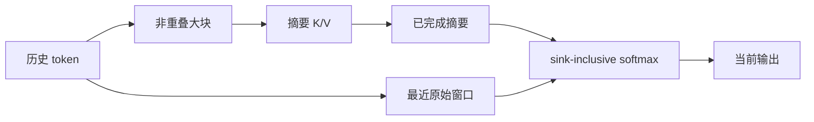

HCA（Heavily Compressed Attention）选择了另一条取舍：用更大的非重叠块生成摘要，直接读取所有已完成摘要，不再为摘要做 Indexer top-k。

## 全量摘要 + 局部原文

摘要覆盖远历史，窗口保留最近 token 的细节；二者进入同一个带 sink 的 softmax。摘要的数量随序列增长，但每条摘要的表示更短，读取模式更规则。

## 完成边界不能省略

当前块尚未收齐时，摘要可能还没有稳定定义。实现必须记录最后一个完成块，并让摘要读取和窗口读取各自执行因果 mask。物理 buffer 中有值不等于这些值已经被当前位置允许访问。

HCA 与 CSA 的区别可以写成一句话：CSA 先由 Indexer 选少量压缩条目，HCA 直接读全部完成摘要；二者都可能再加窗口，但选择路径和计算成本不同。它也不等于把整个模型变成局部注意力，其他层仍可传播更远信息。

## 版本与证据

V4 的层安排和压缩率绑定具体 checkpoint。请把“层类型”“摘要条目数”“窗口宽度”“sink 位置”分开记录，再对照 [V4 §2.3.3](https://arxiv.org/html/2606.19348v1#S2.SS3.SSS3)。本文只解释候选语义，没有本地硬件性能结论。
