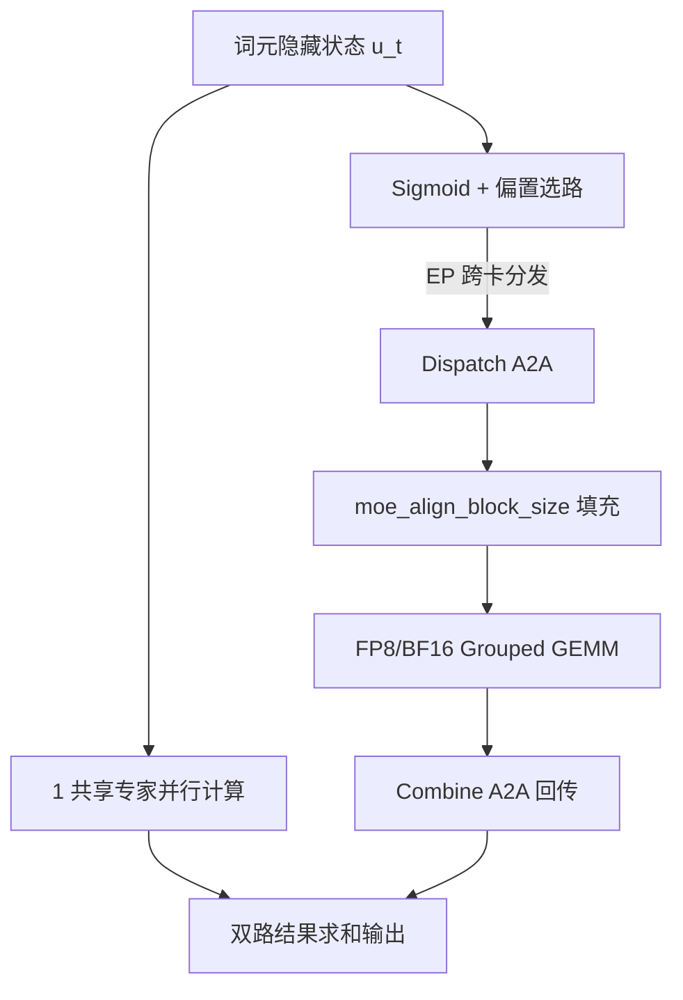

import MoeRoutingAlignExplainer from '../../../../explainers/deepseek/MoeRoutingAlignExplainer';

如果你把一个普通的稠密 Transformer（Dense）前馈网络从 70B 放大到 671B，推理每个词元所需的浮点计算量和访存带宽几乎会同步暴涨接近十倍。原因很简单：稠密层里所有权重必须针对每一个词元完整读入芯片 SRAM 计算一遍。

混合专家架构（Mixture-of-Experts，MoE）给出的解法是稀疏激活：在总参数量扩充到 671B 的前提下，每次前向推理只由轻量路由器挑出极少数专家参与计算。以 DeepSeek-V3 为例[^v3-paper]，全模型共 61 层，除前 3 层保持稠密 FFN 外，其余 58 层均采用 MoE，每个词元仅激活 37B 参数（约占总参数的 $5.5\%$）。

读完本章，你将重点掌握四个核心机制：细粒度拆分与共享隔离如何消除知识冗余；无辅助损失动态偏置路由如何在不污染主任务梯度的前提下压平负载；`moe_align_block_size` 如何把随机路由槽位垫齐为规整矩阵分块；以及 NVIDIA GPU（`DeepEP` + `DeepGEMM`）与华为昇腾 NPU（`AscendMoERunner` + `MC2`）的通信计算重叠路径。

## 先看一个例子：无辅损偏置路由与块对齐走查

早期 Mixtral 8x7B 式的粗粒度 Top-2 路由（共 8 个大专家，每次挑 2 个）只有 $\binom{8}{2} = 28$ 种组合；如果两个上下文只需要「语法主谓搭配」这类共性知识，不同路由专家各自都会被迫学一遍，造成严重的**知识冗余**。

DeepSeekMoE[^deepseekmoe] 将路由维度切细至 $1/4$ 或 $1/8$，划出 **1 个常驻共享专家**（Shared Expert）兜底共性知识，并将 **256 个细粒度路由专家** 拆为 8 个节点组（Node-Limited Top-$M=4$ 组），每词元最终激活 **Top-8** 个路由专家。

同时，DeepSeek-V3 废除了传统的 Auxiliary Balance Loss，改为 **选路加动态偏置、加权取原始分数** 的无辅损均衡策略。通过图 1 的 5 步交互走查，可以直观看到一个热点 Batch 如何完成偏置选路、步间更新与 `moe_align_block_size` 块对齐填充：

<MoeRoutingAlignExplainer
  client:visible
  title="图 1：DeepSeekMoE 无辅损偏置路由与 moe_align_block_size 块对齐"
/>

对照图 1，五步机制依次解决不同瓶颈：

1. **组限筛选与 Sigmoid 原始评分**：先把 256 个专家均分为 8 组（每组 32 个），取每组最高分之和保留 Top-$M=4$ 组，把单个词元的跨节点通信限制在最多 4 个节点内；随后用 Sigmoid 计算原始亲和度 $s_{i,t} = \sigma(\mathbf{u}_t^\top \mathbf{e}_i)$，避免 Softmax 在大量零散专家上相互挤压梯度。
2. **偏置选路与无偏加权分离**：仅在选 Top-$K$ 专家索引时使用偏移分数 $s_{i,t} + b_i$ 抑制冷热倾斜；一旦确定 `topk_ids`，写回合并的权重 $w_{i,t}$ 仍严格 gather **未加偏置** 的原始 $s_{i,t}$ 并做局部归一化。
3. **免梯度符号偏置更新**：每批统计各专家实际命中次数 $c_i$ 与批均值 $\bar{c}$，按 $\Delta b_i = \gamma \operatorname{sign}(\bar{c} - c_i)$ 微调偏置。过载专家下调偏置、冷门专家上调偏置，对交叉熵主任务梯度零干扰。
4. **稳态跨卡负载均衡**：经过数步迭代后，批内负载从热点扎堆迅速拉平，为 EP 集群避免单卡慢节点拖尾效应。
5. **Grouped GEMM 块填充对齐**：矩阵乘核（如 DeepGEMM、Triton、CANN `npu_grouped_matmul`）要求每组专家的连续输入行数对齐到硬件分块尺寸（`block_size=16` 或 `64`），因此 `moe_align_block_size` 按专家编号重排行索引并用 `-1` 补齐残块。

## 算法原理：细粒度组合、数学形式化与双硬件对照

在参数与计算总量严格受控下，将原本 $N$ 个专家切分成 $mN$ 个细粒度专家并等比例多选 $mK$ 个，有效组合空间从 $\binom{N}{K}$ 爆发式膨胀至 $\binom{mN}{mK}$（例如 256 选 8 共有超过 $4.4 \times 10^{14}$ 种专业子网络配置）[^deepseekmoe]。令常驻共享专家数量为 $N_s$，任意输入隐藏状态 $\mathbf{u}_t$ 的层输出写为：

$$
\mathbf{h}'_t = \mathbf{u}_t + \sum_{i=1}^{N_s} \mathrm{FFN}_i^{(s)}(\mathbf{u}_t) + \sum_{j \in \mathcal{T}_t} g_{j,t}\, \mathrm{FFN}_j^{(r)}(\mathbf{u}_t)
$$

其中路由集合 $\mathcal{T}_t = \operatorname{TopK}(\{ s_{j,t} + b_j \})$ 受到组掩码约束，而门控缩放因子仅采用原始无偏置信度归一：

$$
g_{j,t} = \frac{s_{j,t}}{\sum_{k \in \mathcal{T}_t} s_{k,t}} \cdot \text{routed\_scaling\_factor}, \qquad s_{j,t} = \sigma(\mathbf{u}_t^\top \mathbf{e}_j)
$$

工程实现上，常驻共享专家完全不需要参与路由和跨卡分发。在 NVIDIA GPU 与华为昇腾 NPU 上，推理引擎都会趁着路由专家还在跑跨卡 `All-to-All` Dispatch 的空档，直接在辅助流或协同计算流上把共享专家的 Gate/Up GEMM 先算完，从而吃掉通信等待窗口（图 2）。


跨卡 Expert Parallelism（EP）的物理执行顺序如图 3 所示：在进入本地 Grouped GEMM 前，系统必须先通过 `Dispatch A2A` 把分散在各个 DP 节点上的词元隐状态按目标专家归拢，计算完成并乘上路由权重后，再经过对称的 `Combine A2A` 送回各自的原始词元位置。



## PyTorch 参考实现与 GPU / 昇腾源码对照

下面给出不依赖外部权重的独立 PyTorch 参考实现，`AuxLossFreeGroupedRouter` 与 `moe_align_block_size` 分别复现 Node-Limited 组掩码、无辅损 `grouped_topk` 选路、无偏权重归一化、步间偏置更新与 Grouped GEMM 块填充对齐，可直接对照下文 `vLLM` 上游源码：

```python
import torch
import torch.nn as nn


class AuxLossFreeGroupedRouter(nn.Module):
    """DeepSeek-V3 组限无辅损负载均衡路由器（对应 vLLM `grouped_topk`）。

    输入：
        logits: [T, E]（各词元对 E 个路由专家的原始打分）
    输出：
        (topk_ids [T, K], topk_weights [T, K])
    """

    def __init__(self, num_experts: int = 256, num_groups: int = 8, topk_group: int = 4, topk: int = 8):
        super().__init__()
        self.num_experts, self.num_groups = num_experts, num_groups
        self.topk_group, self.topk = topk_group, topk
        # 动态均衡偏置不参与反向传播梯度更新，因此注册为持久化 buffer
        self.register_buffer("e_score_correction_bias", torch.zeros(num_experts))

    def forward(self, logits: torch.Tensor) -> tuple[torch.Tensor, torch.Tensor]:
        T, E = logits.shape
        # 1. Sigmoid 独立亲和度打分（避免 Softmax 在 256 个专家上互相挤压梯度）
        original_scores = torch.sigmoid(logits)
        # 2. 仅在选路阶段叠加修正偏置抑制过载热点，保留 original_scores 用于最终加权
        scores = original_scores + self.e_score_correction_bias.unsqueeze(0)

        # 3. Node-Limited 组筛选：取每组 Top-2 得分之和选出 Top-M 组，将跨卡通信限定在 <= M 个节点内
        group_scores = scores.view(T, self.num_groups, E // self.num_groups).topk(2, dim=-1).values.sum(dim=-1)
        top_groups = group_scores.topk(self.topk_group, dim=-1).indices
        group_mask = torch.zeros_like(group_scores, dtype=torch.bool).scatter_(1, top_groups, True)
        score_mask = group_mask.unsqueeze(-1).expand(T, self.num_groups, E // self.num_groups).reshape(T, E)
        tmp_scores = scores.masked_fill(~score_mask, float("-inf"))

        # 4. 选出 Top-K 专家下标，再回表 gather 未加偏置的原始亲和度做权重归一化
        topk_ids = torch.topk(tmp_scores, k=self.topk, dim=-1, sorted=False).indices
        raw_w = original_scores.gather(1, topk_ids)
        topk_weights = raw_w / raw_w.sum(dim=-1, keepdim=True)
        return topk_ids, topk_weights

    @torch.no_grad()
    def step_bias(self, topk_ids: torch.Tensor, gamma: float = 0.04) -> None:
        """免梯度符号更新：Δb_i = γ * sign(c̄ - c_i)，过载专家降偏置、冷门专家升偏置。"""
        counts = torch.bincount(topk_ids.reshape(-1), minlength=self.num_experts).float()
        self.e_score_correction_bias.add_(gamma * torch.sign(counts.mean() - counts))


def moe_align_block_size(topk_ids: torch.Tensor, num_experts: int, block_size: int = 16) -> torch.Tensor:
    """按专家编号重排行索引并用 -1 补齐至 block_size 整数倍，满足 Grouped GEMM 瓦片对齐要求。"""
    flat_e = topk_ids.reshape(-1)
    sorted_idx = torch.argsort(flat_e, stable=True)
    sorted_e = flat_e[sorted_idx]
    padded_tokens = []
    for e_id in range(num_experts):
        pos = torch.nonzero(sorted_e == e_id, as_tuple=True)[0]
        if pos.numel() == 0:
            continue
        # 仅对有命中的活跃专家尾部补 -1 哨兵槽位，后续计算核遇 -1 自动跳过
        rem = (-pos.numel()) % block_size
        padded_tokens.append(torch.cat([sorted_idx[pos], torch.full((rem,), -1, dtype=torch.long)]))
    return torch.cat(padded_tokens)


if __name__ == "__main__":
    torch.manual_seed(42)
    T, E, K, block_size = 64, 256, 8, 16
    router = AuxLossFreeGroupedRouter(num_experts=E, num_groups=8, topk_group=4, topk=K)
    with torch.no_grad():
        topk_ids, topk_weights = router(torch.randn(T, E))
        assert topk_ids.shape == (T, K) and topk_weights.shape == (T, K)
        assert torch.allclose(topk_weights.sum(dim=-1), torch.ones(T), atol=1e-6)
        router.step_bias(topk_ids)
        assert not torch.all(router.e_score_correction_bias == 0)
        aligned_tokens = moe_align_block_size(topk_ids, E, block_size=block_size)
        aligned_slots = aligned_tokens.numel()
        assert aligned_slots % block_size == 0
```

### NVIDIA GPU 实现路径（`vLLM` & `DeepEP`）

在 `vLLM` 上游提交 `bb23c0a8` 中，路由核心位于 `vllm/model_executor/layers/fused_moe/router/grouped_topk_router.py`[^vllm-router]。在支持融合算子的 CUDA 平台会直接调 `fused_grouped_topk`，而在通用 PyTorch 参考路径中，可以看到「加偏置选路、用原始分数加权」的清晰实现：

```python
# vllm/model_executor/layers/fused_moe/router/grouped_topk_router.py:134-169
if e_score_correction_bias is not None:
    # Store original scores before applying correction bias. We use biased
    # scores for expert selection but original scores for routing weights
    original_scores = scores
    scores = scores + e_score_correction_bias.unsqueeze(0)
    group_scores = (
        scores.view(num_token, num_expert_group, -1).topk(2, dim=-1)[0].sum(dim=-1)
    )
# ... 构造 score_mask 并屏蔽非选中组为 -inf ...
if e_score_correction_bias is not None:
    topk_ids = torch.topk(tmp_scores, k=topk, dim=-1, sorted=use_sorted)[1]
    topk_weights = original_scores.gather(1, topk_ids)
```

随后进入块对齐 `moe_align_block_size`[^vllm-align]（支持 `expert_map` 将非本卡负责的专家块号置 `-1` 直接跳过），而在 EP 通信侧由 `DeepEPLLPrepareAndFinalize` 对接 `DeepEP` 低时延异步缓冲区[^vllm-deepep][^deepep-ep]，并通过 `handles` 暂存 Dispatch 上下文句柄以完成最后的 Combine 归位。

### 华为昇腾 NPU 实现路径（`vllm-ascend`）

对照 `vllm-ascend` 提交 `3649b8ff`[^ascend-moe]，昇腾已将早期的 `AscendFusedMoE` 类演进并统一重构为 **`AscendMoERunner`**（`vllm_ascend/ops/fused_moe/fused_moe.py:85`）。在 `_forward_impl` 中，引擎在路由专家发出分发通信前，就先通过辅助流提交共享专家的 Gate-Up 投影以掩盖 Dispatch 耗时：

```python
# vllm_ascend/ops/fused_moe/fused_moe.py:526-539
# Submit Gate-Up now, before routed_experts.forward_impl enqueues TopK
# and dispatch. The auxiliary stream waits for router_output_ready, so
# Gate-Up starts together with routed TopK and can cover dispatch.
shared_experts = self.ascend_shared_experts
submitted_gate_up = (
    shared_experts.enqueue_gate_up_after_router(
        prepared_execution,
        router_output_ready,
    )
    if prepared_execution is not None
    else None
)
```

在 EP 通信与本地专家计算层，昇腾通过 `TokenDispatcherWithMC2` 调用融合通信与量化的 `torch_npu.npu_moe_distribute_dispatch_v2`[^ascend-mc2]（大 batch 路径则搭配 `npu_moe_init_routing_v2` 重排输入）。

随后，引擎在 `AscendUnquantizedFusedMoEMethod.apply_gmm1` 中调度 `torch_npu.npu_grouped_matmul` 完成分组矩阵乘[^ascend-gmm]。下表汇总了两套硬件在选路、分发与分组计算上的执行路径对照：

| 实现维度   | NVIDIA GPU（`vLLM` + `DeepEP`）              | 华为昇腾 NPU（`vllm-ascend`）                               |
| ---------- | -------------------------------------------- | ----------------------------------------------------------- |
| 分组选路   | `fused_grouped_topk` / `grouped_topk`        | 融合路由核 + 共享流事件同步                                 |
| 执行器抽象 | `FusedMoEModularMethod` / `FusedMoEKernel`   | `AscendMoERunner`（演进自 `AscendFusedMoE`）                |
| 跨卡分发   | `DeepEPLLPrepareAndFinalize` / `EPBuffer`    | `TokenDispatcherWithMC2` (`npu_moe_distribute_dispatch_v2`) |
| 本地计算   | `moe_align_block_size` + `DeepGEMM` / Triton | `apply_gmm1/2` (`torch_npu.npu_grouped_matmul`)             |

## 代价与边界

- **小批量下的 Padding 带宽放大**：在 `T` 很小（例如单卡 Decode 仅收到几个词元）但激活专家极分散时，256 个专家分摊极少词元，`moe_align_block_size` 按 `block_size=16/64` 补齐可能让补零 `-1` 槽位占比超过一半，拉低计算单元算术强度。
- **跨节点热点的木桶效应**：无辅损偏置主要抑制长期统计倾斜；若单个极端 Batch 内密集命中少数代码或数学专家，单卡 GEMM 与 `Combine A2A` 依然会出现局部拥堵，需要搭配动态 EPLB（冗余专家拷贝）削峰填谷。
- **对称缓冲区尺寸绑定整图捕获**：无论 GPU 的 `DeepEP` 还是昇腾 `TokenDispatcherWithMC2`，低时延分发缓冲区都需要按 `max_num_tokens_per_rank * ep_world_size` 预分配静态地址，否则无法跨步复用于 CUDA Graph / ACLGraph。

到这里我们已经解决了 FFN 侧「稀疏计算」的问题，但在每轮前向里那些只查字典的固定词组仍然在消耗昂贵的神经网络层算力。下一篇[07 条件记忆（Engram）](../07-engram/)将介绍另一条正交轴——把静态局部知识从 MoE 计算矩阵外包给主机内存 $O(1)$ 查表。

## 自测

1. 为什么无辅损负载均衡只在 `topk` 选择阶段加上偏置 $b_i$，而计算输出组合权重 `topk_weights` 时必须回头 gather 原始未偏置分数 $s_{i,t}$？
2. 在 DeepSeek-V3 的 8 组限流路由中，设置 `topk_group=4` 对跨机 All-to-All 网络拓扑有什么直接收益？
3. 对照 `AscendMoERunner._prepare_router_and_milestones` 的代码注释，说明为什么共享专家的 Gate-Up 计算可以和路由专家的 Top-K 及 Dispatch 重叠？
4. 若将上文 PyTorch 核心代码里的 `block_size=16` 调大到 `64`，在 `T=64, K=8` 规模下 `aligned_slots` 的有效负载率会升高还是降低？为什么？

[^v3-paper]: DeepSeek-AI, _DeepSeek-V3 Technical Report_, [arXiv:2412.19437](https://arxiv.org/abs/2412.19437)（2024），§2.1 阐述 256 细粒度专家与无辅助损失偏置负载均衡设计。

[^deepseekmoe]: Dai et al., _DeepSeekMoE: Towards Ultimate Expert Specialization in Mixture-of-Experts Language Models_, [arXiv:2401.06066](https://arxiv.org/abs/2401.06066)（2024），提出细粒度划分与共享专家隔离公式。

[^vllm-router]: `vLLM` 仓库（commit `bb23c0a8`）：`vllm/model_executor/layers/fused_moe/router/grouped_topk_router.py`（`L92-175` `grouped_topk`）。

[^vllm-align]: `vLLM` 仓库（commit `bb23c0a8`）：`vllm/model_executor/layers/fused_moe/moe_align_block_size.py`（`L55-127` `moe_align_block_size`）。

[^vllm-deepep]: `vLLM` 仓库（commit `bb23c0a8`）：`vllm/model_executor/layers/fused_moe/prepare_finalize/deepep_ll.py`（`L51-130` `DeepEPLLPrepareAndFinalize`）。

[^deepep-ep]: `DeepEP` 仓库（commit `f6aa38fe`）：`deep_ep/buffers/ep.py`（`EPBuffer.dispatch` 与 `combine` 低时延集合通信）。

[^ascend-moe]: `vllm-ascend` 仓库（commit `3649b8ff`）：`vllm_ascend/ops/fused_moe/fused_moe.py`（`L85-115, 515-602` `AscendMoERunner`）。

[^ascend-mc2]: `vllm-ascend` 仓库（commit `3649b8ff`）：`vllm_ascend/ops/fused_moe/token_dispatcher.py`（`L110-281` `TokenDispatcherWithMC2`）。

[^ascend-gmm]: `vllm-ascend` 仓库（commit `3649b8ff`）：`vllm_ascend/ops/fused_moe/routed_experts.py`（`L226-242` `AscendUnquantizedFusedMoEMethod.apply_gmm1`）。
