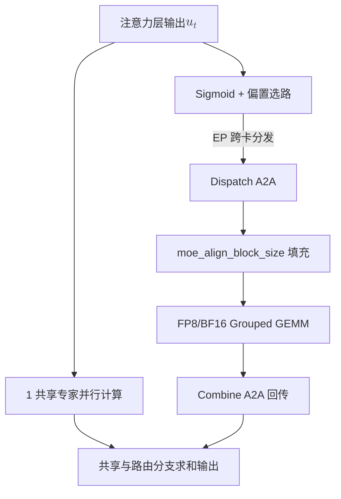

import Figure from 'astro-wisp/components/Figure.astro';
import MoeRoutingAlignExplainer from './explainers/MoeRoutingAlignExplainer';
import paperFig2DeepSeekMoE from './images/paper-fig2-deepseekmoe.svg';
import paperFig9V3ExpertLoad from './images/paper-fig9-v3-expert-load.png';
import paperFig5V4MegaMoE from './images/paper-fig5-v4-mega-moe.svg';

把稠密 Transformer 的 FFN（Feed-Forward Network，前馈网络）从 70B 放大到 671B，推理每个 token 的算力和权重访存会同步放大近十倍。因为稠密层里所有权重都必须针对每个 token 完整读入片上 SRAM 计算一遍。

**MoE（Mixture-of-Experts，混合专家架构）**用稀疏激活打破这笔线性开销：在保持 671B 总参数量的前提下，每次前向只由轻量路由器挑出少数专家参与计算。

以 DeepSeek-V3 为例[^v3-paper]，全模型共 61 层，除前 3 层保持稠密 FFN 外，其余 58 层均采用 MoE。每层设 1 个常驻共享专家和 256 个路由专家，单 token 仅激活其中 8 个路由专家，全模型激活参数约 37B，占总参数的 5.5%（$37/671$）。

沿用 [01 MLA](../01-mla/) 与 DeepSeek-V3 架构图的记号约定，全篇符号与生产维度如下：

| 符号                                           | 含义                                     | 张量形状 / V3 生产取值                                              |
| :--------------------------------------------- | :--------------------------------------- | :------------------------------------------------------------------ |
| $u_t,\; h'_t$                                  | 注意力层输出（MoE 输入）、MoE 层输出     | 均属于 $\mathbb{R}^d$，V3 中 $d = 7168$                             |
| $N_s,\; N_r,\; K_r$                            | 常驻共享专家数、路由专家总数、激活数     | V3 中 $N_s = 1,\; N_r = 256,\; K_r = 8$                             |
| $M_{\text{grp}},\; K_{\text{grp}}$             | 路由专家节点组数、单 token 保留组数      | $M_{\text{grp}} = 8,\; K_{\text{grp}} = 4$（每组 32 专家）          |
| $\mathrm{FFN}_i^{(s)},\; \mathrm{FFN}_j^{(r)}$ | 第 $i$ 个共享专家与第 $j$ 个路由专家网络 | 单专家中间隐藏维为 2048                                             |
| $e_i,\; s_{i,t}$                               | 第 $i$ 个路由专家质心向量、原始亲和度    | $s_{i,t} = \sigma(u_t^\top e_i) \in (0, 1)$                         |
| $b_i,\; \gamma$                                | 第 $i$ 个路由专家偏置、符号更新步长      | 预热期 $\gamma = 0.001$，仅作用于 Top-$K_r$ 选路                    |
| $g_{i,t},\; \eta$                              | 归一化门控权重、路由缩放因子             | $g_{i,t} = \eta \cdot s_{i,t} / \sum_{k \in \mathcal{T}_t} s_{k,t}$ |
| $c_i,\; \bar{c}$                               | 批内专家 $i$ 命中数、批内专家平均负载    | $\Delta b_i = \gamma \operatorname{sign}(\bar{c} - c_i)$            |

## 细粒度切分与无辅助损失负载均衡

早期 Mixtral 8x7B 式的粗粒度 Top-2 路由（共 8 个大专家、每次选 2 个）只有 $\binom{8}{2} = 28$ 种组合。不同上下文都要用到的“语法主谓搭配”等共性知识，只能分散塞进多个大专家里各自学一遍，带来严重的参数冗余。

DeepSeekMoE[^deepseekmoe] 从两个方向重构了专家布局（图 1）。一方面把专家中间隐藏维切细至 $1/m$，将 $N$ 个专家拆成 $mN$ 个细粒度专家并等比例选出 $mK$ 个。另一方面划出 $N_s$ 个常驻 **Shared Expert（共享专家）**，无需路由即可承接跨领域共性知识，让路由专家专心拟合细分语义。

<Figure
  src={paperFig2DeepSeekMoE}
  alt="论文图 2：DeepSeekMoE 架构演进图，依次对比传统 Top-2 MoE、细粒度专家切分与加入共享专家隔离后的完整架构"
  caption="图 1：从常规 Top-2 路由到细粒度专家切分与共享专家隔离的架构演进（DeepSeekMoE 论文图 2）"
/>

在 DeepSeek-V3 中，每层设 $N_r = 256$ 个细粒度路由专家并均分为 $M_{\text{grp}} = 8$ 个节点组，每组 32 个。单 token 先保留组内最高 2 项分数之和最大的 Top-4 组，将跨节点通信限定在最多 4 个节点内，再从保留组中挑出 Top-8 路由专家。

路由打分与均衡也从 Softmax 加辅助损失改为“组限 Sigmoid Top-$K_r$ + 无辅助损失偏置”。用独立 Sigmoid 计算原始亲和度 $s_{i,t} = \sigma(u_t^\top e_i)$，可以避免 Softmax 在 256 个离散专家之间互相挤压梯度。

随后仅在挑选 Top-$K_r$ 下标时叠加动态偏置 $s_{i,t} + b_i$ 以抑制冷热倾斜；一旦确定选中集合，回表乘入输出的权重仍取**未加偏置**的原始分数 $s_{i,t}$ 再归一化。每批结束后统计各专家命中数 $c_i$ 与批均值 $\bar{c}$，按免梯度符号规则 $\Delta b_i = \gamma \operatorname{sign}(\bar{c} - c_i)$ 更新偏置：过载专家下调、冷门专家上调（预热期 $\gamma = 0.001$）[^v3-paper]。

这种把“负载均衡”从主任务梯度里彻底剥离的设计，让路由专家能真正按领域专精分化。DeepSeek-V3 在 Pile 三个测试域上的统计表明（图 2），相比存在辅助损失干扰的基线，无辅助损失偏置方案在维基百科、GitHub 与数学语料上展现出更鲜明的专家分工[^v3-paper]。

<Figure
  src={paperFig9V3ExpertLoad}
  alt="论文图 9：Wikipedia、GitHub 与 DM Mathematics 三个领域上，Aux-Loss-Based 与 Aux-Loss-Free 模型第 9 层和第 18 层的专家相对负载热力图"
  caption="图 2：跨领域测试集上辅助损失方案与无辅助损失偏置方案的专家相对负载对比（DeepSeek-V3 论文图 9）"
/>

跨卡收集好路由 token 后，执行计算前还必须解决矩阵乘 Kernel 的硬件对齐限制。NVIDIA DeepGEMM、Triton 与昇腾 `npu_grouped_matmul` 都要求每个专家的输入行数对齐到硬件 `Tile`（分块）尺寸。常见 `block_size` 为 16 或 64。

因此，推理引擎会调用 `moe_align_block_size` 按专家编号重排 token 行索引，并在每个活跃专家尾部用哨兵下标 $-1$ 补齐残块，计算 Kernel 遇到 $-1$ 槽位时直接跳过。

为了把这一套路由更新和块填充串起来，图 3 对一个包含 4 个 token、6 个专家和块大小 4 的微型批次做了四步演示，依次呈现组限拥堵、偏置分离、符号规则反馈均衡到 $-1$ 对齐填充的全过程。

<MoeRoutingAlignExplainer client:visible title="图 3：DeepSeekMoE 无辅助损失负载均衡与块对齐机制" />

## 细粒度组合、共享隔离与 EP 跨卡流水

在总参数与激活 FLOPs 不变的约束下，把 $N$ 个专家切分为 $mN$ 个细粒度专家并选出 $mK$ 个，有效组合空间从 $\binom{N}{K}$ 跃升至 $\binom{mN}{mK}$。DeepSeek-V3 采用 256 选 8 方案，共有 $\binom{256}{8} \approx 4.10 \times 10^{14}$ 种组合[^deepseekmoe][^v3-paper]。令常驻共享专家数为 $N_s$，注意力输出 $u_t \in \mathbb{R}^d$ 经过 MoE 层的输出 $h'_t \in \mathbb{R}^d$ 写为：

$$
\begin{aligned}
h'_t &= u_t + \sum_{i=1}^{N_s} \mathrm{FFN}_i^{(s)}(u_t) \\
&\quad + \sum_{j \in \mathcal{T}_t} g_{j,t}\, \mathrm{FFN}_j^{(r)}(u_t)
\end{aligned}
$$

其中 $\mathcal{T}_t = \operatorname{TopK}_r(\{ s_{j,t} + b_j \})$ 受节点组掩码约束，仅用偏置挑选下标；每个选中专家的门控权重 $g_{j,t}$ 则使用无偏原始亲和度 $s_{j,t} = \sigma(u_t^\top e_j)$ 归一化并乘上缩放系数 $\eta$（即配置项 `routed_scaling_factor`）：

$$
g_{j,t} = \eta \cdot \frac{s_{j,t}}{\sum_{k \in \mathcal{T}_t} s_{k,t}}
$$

工程实现上，常驻共享专家不参与动态路由和跨卡分发。在 **EP（Expert Parallelism，专家并行）**集群里，上游注意力常按 DP 或 SP 切分批内序列，token 隐状态因此分散在不同计算卡上。

如图 4 所示，系统先经 `Dispatch` 集合通信把隐状态发往目标专家所在卡，完成 `moe_align_block_size` 填充对齐与 Grouped GEMM（分组矩阵乘）。计算后再经对称的 `Combine` 集合通信加权归位，与并发算完的共享分支相加输出。



如果只按整层粒度做“Dispatch 后再 Linear-1”，通信依然会暴露在关键路径上。DeepSeek-V4 进一步将单层内的 256 个专家切分为多个 **Wave（波次）**。通过开源融合算子 `MegaMoE`，当前波次的计算、下一波次的 Dispatch 与上一波次的 Combine 得以并发交叠（图 5），显著压低小批量下的通信暴露[^v4-paper]。

<Figure
  src={paperFig5V4MegaMoE}
  alt="论文图 5：传统非重叠、Comet 阶段重叠与 DeepSeek-V4 MegaMoE 波次级细粒度 EP 通信计算重叠流水线对比"
  caption="图 5：DeepSeek-V4 细粒度波次级 EP 通信计算重叠流水线与理论加速对比（DeepSeek-V4 论文图 5）"
/>

## PyTorch 实现与双硬件源码对照

下面的独立 PyTorch 实现复现了 `AuxLossFreeGroupedRouter` 的组限 Sigmoid 选路、无偏权重归一化与免梯度符号更新。代码还包含 `moe_align_block_size` 的排序与 $-1$ 哨兵补齐逻辑，末尾断言用于核对权重归一性与块对齐不变量。

```python
import torch
import torch.nn as nn


class AuxLossFreeGroupedRouter(nn.Module):
    """DeepSeek-V3 组限无辅助损失负载均衡路由器（对应 vLLM grouped_topk）。"""

    def __init__(self, num_experts: int = 256, num_groups: int = 8, topk_group: int = 4, topk: int = 8):
        super().__init__()
        self.num_experts, self.num_groups = num_experts, num_groups
        self.topk_group, self.topk = topk_group, topk
        self.register_buffer("e_score_correction_bias", torch.zeros(num_experts))

    def forward(self, logits: torch.Tensor) -> tuple[torch.Tensor, torch.Tensor]:
        T, E = logits.shape
        original_scores = torch.sigmoid(logits)
        # 仅在选路阶段叠加偏置抑制过载热点，保留 original_scores 用于最终加权
        scores = original_scores + self.e_score_correction_bias.unsqueeze(0)
        grouped = scores.view(T, self.num_groups, E // self.num_groups)
        top_groups = grouped.topk(2, dim=-1).values.sum(dim=-1).topk(self.topk_group, dim=-1).indices
        group_mask = torch.zeros(T, self.num_groups, dtype=torch.bool, device=logits.device).scatter_(1, top_groups, True)
        tmp_scores = scores.masked_fill(~group_mask.unsqueeze(-1).expand_as(grouped).reshape(T, E), float("-inf"))
        topk_ids = torch.topk(tmp_scores, k=self.topk, dim=-1, sorted=False).indices
        raw_w = original_scores.gather(1, topk_ids)
        return topk_ids, raw_w / raw_w.sum(dim=-1, keepdim=True)

    @torch.no_grad()
    def step_bias(self, topk_ids: torch.Tensor, gamma: float = 0.04) -> None:
        counts = torch.bincount(topk_ids.reshape(-1), minlength=self.num_experts).float()
        self.e_score_correction_bias.add_(gamma * torch.sign(counts.mean() - counts))


def moe_align_block_size(topk_ids: torch.Tensor, num_experts: int, block_size: int = 16) -> torch.Tensor:
    """按专家编号重排行索引并用 -1 补齐至 block_size 整数倍，对齐 Grouped GEMM。"""
    flat_e = topk_ids.reshape(-1)
    sorted_idx = torch.argsort(flat_e, stable=True)
    sorted_e = flat_e[sorted_idx]
    padded_tokens = []
    for e_id in range(num_experts):
        pos = torch.nonzero(sorted_e == e_id, as_tuple=True)[0]
        if pos.numel() == 0:
            continue
        rem = (-pos.numel()) % block_size
        padded_tokens.append(torch.cat([sorted_idx[pos], torch.full((rem,), -1, dtype=torch.long)]))
    return torch.cat(padded_tokens)


if __name__ == "__main__":
    torch.manual_seed(42)
    T, E, K, block_size = 64, 256, 8, 16
    router = AuxLossFreeGroupedRouter(num_experts=E, num_groups=8, topk_group=4, topk=K)
    with torch.no_grad():
        topk_ids, topk_weights = router(torch.randn(T, E))
        assert topk_ids.shape == (T, K) and topk_weights.shape == (T, K)
        assert torch.allclose(topk_weights.sum(dim=-1), torch.ones(T), atol=1e-6)
        router.step_bias(topk_ids)
        assert not torch.all(router.e_score_correction_bias == 0)
        aligned_tokens = moe_align_block_size(topk_ids, E, block_size=block_size)
        assert aligned_tokens.numel() % block_size == 0
        valid = int((aligned_tokens >= 0).sum().item())
        print(
            f"[06-moe] topk_ids={tuple(topk_ids.shape)}, weight_sum_max_err="
            f"{(topk_weights.sum(-1) - 1.0).abs().max().item():.2e}, "
            f"aligned_slots={aligned_tokens.numel()} (valid={valid}, pad={aligned_tokens.numel() - valid})"
        )
```

校验输出：

```text
[06-moe] topk_ids=(64, 8), weight_sum_max_err=1.19e-07, aligned_slots=3584 (valid=512, pad=3072)
```

上述校验输出直观暴露了小批量下的对齐膨胀：64 个 token 共产生 512 条有效激活。分散进 256 个专家后再按 `block_size=16` 补齐，总槽位膨胀到 3,584，其中 3,072 个都是无效的 $-1$ 空槽。

### NVIDIA GPU 路由与通信实现

在 `vLLM` 上游实现中，组限无辅助损失路由器通过 `grouped_topk` 入口分发[^vllm-router]，与 DeepSeek-V3 官方参考实现中的 `Gate` 逻辑保持一致[^v3-repo]。CUDA 平台启用融合算子时直接调用 `fused_grouped_topk`。通用回退路径则保留了“加 `e_score_correction_bias` 选下标、用 `original_scores` 采集权重”的双轨逻辑：

```python
# vllm/model_executor/layers/fused_moe/router/grouped_topk_router.py:134-165 (vllm@99b0b0b0)
if e_score_correction_bias is not None:
    # Store original scores before applying correction bias. We use biased
    # scores for expert selection but original scores for routing weights
    original_scores = scores
    scores = scores + e_score_correction_bias.unsqueeze(0)
    group_scores = (
        scores.view(num_token, num_expert_group, -1).topk(2, dim=-1)[0].sum(dim=-1)
    )
# ... 构造 score_mask 并屏蔽非选中组为 -inf ...
if e_score_correction_bias is not None:
    topk_ids = torch.topk(tmp_scores, k=topk, dim=-1, sorted=use_sorted)[1]
    # Use original unbiased scores for the routing weights
    topk_weights = original_scores.gather(1, topk_ids)
```

选路结束后，`moe_align_block_size` 按块尺寸整理每个专家的槽位[^vllm-align]，并借助 `expert_map` 将非本卡负责的专家块号置为 $-1$ 跳过，避免跨卡冗余计算。

EP 通信侧由 `DeepEPLLPrepareAndFinalize` 对接 `DeepEP` 低时延异步缓冲区[^vllm-deepep]。它把 Dispatch 返回的上下文句柄缓存在 `handles` 中，供 Combine 阶段将专家输出按原顺序归位。新版 `DeepEP` 则把高吞吐与低时延接口统一进 `EPBuffer`[^deepep-ep]。

### 华为昇腾 NPU 执行与调度实现

在 `vllm-ascend` 中，昇腾通过统一的 `AscendMoERunner` 管理共享与路由双分支[^ascend-moe]。为了掩盖路由器和分发通信的气泡，`AscendMoERunner` 在路由专家尚未下发 Top-K 与分发前，先经辅助流异步提交共享专家的 Gate-Up 计算，借助硬件事件把共享分支藏进通信窗口：

```python
# vllm_ascend/ops/fused_moe/fused_moe.py:539-551 (vllm-ascend@b776261e)
# Submit Gate-Up now, before routed_experts.forward_impl enqueues TopK
# and dispatch. The auxiliary stream waits for router_output_ready, so
# Gate-Up starts together with routed TopK and can cover dispatch.
shared_experts = self.ascend_shared_experts
assert shared_experts is not None
submitted_gate_up = (
    shared_experts.enqueue_gate_up_after_router(
        prepared_execution,
        router_output_ready,
    )
    if prepared_execution is not None
    else None
)
```

在 EP 通信阶段，昇腾通过 `TokenDispatcherWithMC2` 调用 `npu_moe_distribute_dispatch_v2` 完成量化融合派发[^ascend-mc2]。遇到大批量场景时，则改走 `AllGather` 配合 `npu_moe_init_routing_v2` 重排输入。随后在 `AscendUnquantizedFusedMoEMethod` 中调用 `npu_grouped_matmul` 执行本地分组矩阵乘[^ascend-gmm]。

把 256 个细粒度专家接入静态图模式时，系统还要面对两类现实约束。其一，Decode 小批量下单卡可能只收到寥寥几个 token，却要分散给数十个活跃专家；按块尺寸 16 或 64 向上取整后，填充的 $-1$ 空槽位占比往往过半，直接拉低矩阵乘算术强度。

其二，无辅助损失偏置只管长期批间均值，遇到单批密集的代码或数学请求仍会出现局部热点。这需要借助 EPLB（Expert Parallelism Load Balancer，专家并行负载均衡）动态复制热专家削峰。同时 `DeepEP` 与 `TokenDispatcherWithMC2` 都必须按单步最大 token 容量预分配对称通信缓冲区，才能捕获进 CUDA Graph 或 ACLGraph。

细粒度 MoE 与前置注意力压缩共同压低了单个子层的算力与显存负担，但标准单流残差通道的容量瓶颈依然存在。下一篇 [07 mHC 流形超连接：给四流残差装上稳压器](../07-mhc/) 将转向层间残差主干，看 DeepSeek 如何把残差流扩宽至四路并稳住深层连乘增益。

[^v3-paper]: DeepSeek-AI, _DeepSeek-V3 Technical Report_, [arXiv:2412.19437](https://arxiv.org/abs/2412.19437)（2024），§2.1 阐述 61 层架构、256 细粒度专家、37B/671B 激活比与无辅助损失偏置负载均衡，§4.2 说明 $\gamma = 0.001$ 更新率，§4.5 图 9 展示跨领域专家负载专精对比。

[^deepseekmoe]: Dai et al., _DeepSeekMoE: Towards Ultimate Expert Specialization in Mixture-of-Experts Language Models_, [arXiv:2401.06066](https://arxiv.org/abs/2401.06066)（2024），§3.1–3.2 与图 2 提出细粒度专家切分、组合空间计算公式与共享专家隔离机制。

[^v4-paper]: DeepSeek-AI, _DeepSeek-V4: Towards Highly Efficient Million-Token Context Intelligence_, [arXiv:2606.19348](https://arxiv.org/abs/2606.19348)（2026），§3.1 与图 5 提出基于 Wave 波次的细粒度 EP 通信计算重叠流水线与 `MegaMoE` 融合算子。

[^v3-repo]: `DeepSeek-V3` 官方推理仓库（commit `9b4e9788`）：`inference/model.py`（`L535-598` `Gate` 组限 Sigmoid 偏置路由与 `L636-693` `MoE` 前向）。

[^vllm-router]: `vLLM` 仓库（commit `99b0b0b0`）：`vllm/model_executor/layers/fused_moe/router/grouped_topk_router.py`（`L92-178` `grouped_topk` 及 `fused_grouped_topk`）。

[^vllm-align]: `vLLM` 仓库（commit `99b0b0b0`）：`vllm/model_executor/layers/fused_moe/moe_align_block_size.py`（`L55-169` `moe_align_block_size` 及 `expert_map` 掩码）。

[^vllm-deepep]: `vLLM` 仓库（commit `99b0b0b0`）：`vllm/model_executor/layers/fused_moe/prepare_finalize/deepep_ll.py`（`L51-145` `DeepEPLLPrepareAndFinalize`）。

[^deepep-ep]: `DeepEP` 仓库（commit `f6aa38fe`）：`deep_ep/buffers/ep.py`（`L208` `EPBuffer` 类定义，`L562-637` `dispatch` 与 `L770-843` `combine`）。

[^ascend-moe]: `vllm-ascend` 仓库（commit `b776261e`）：`vllm_ascend/ops/fused_moe/fused_moe.py`（`L86-130` `AscendMoERunner` 初始化，`L539-551` 共享专家 Gate-Up 异步提交与 `L554-615` `_forward_impl`）。

[^ascend-mc2]: `vllm-ascend` 仓库（commit `b776261e`）：`vllm_ascend/ops/fused_moe/token_dispatcher.py`（`L110-280` `TokenDispatcherWithMC2` 与 `npu_moe_distribute_dispatch_v2`，`L754-765` `npu_moe_init_routing_v2`）。

[^ascend-gmm]: `vllm-ascend` 仓库（commit `b776261e`）：`vllm_ascend/ops/fused_moe/routed_experts.py`（`L227-242` `AscendUnquantizedFusedMoEMethod.apply_gmm1`）。
