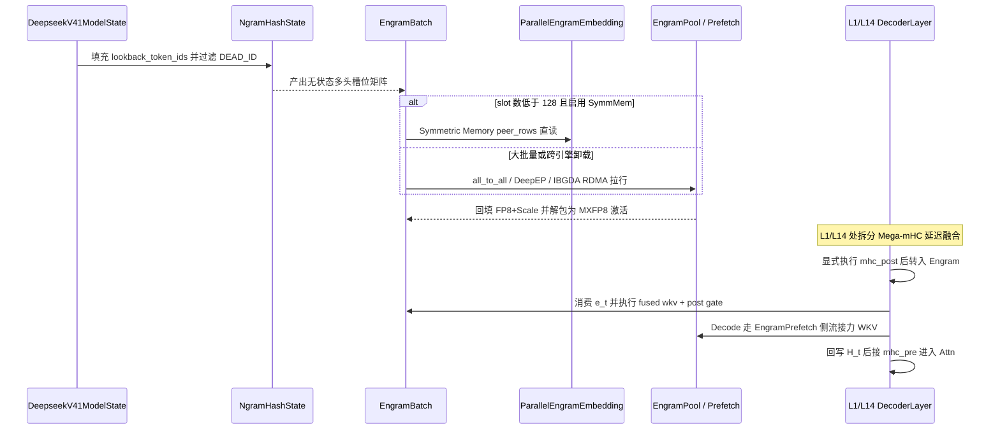
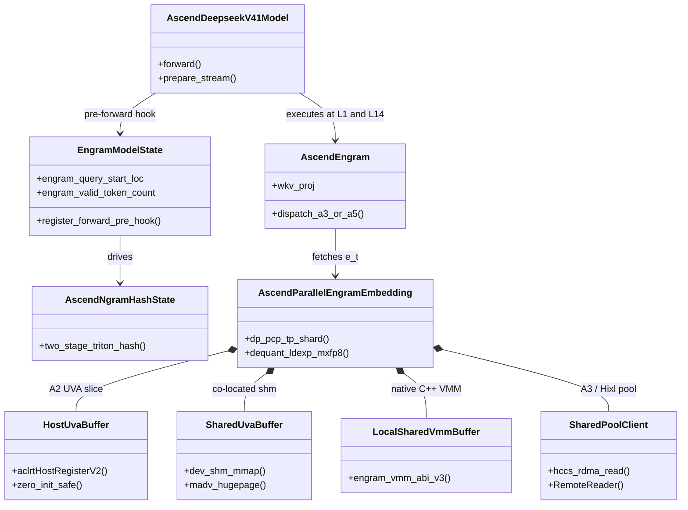

import Figure from 'astro-wisp/components/Figure.astro';
import EngramHashExplainer from './explainers/engram-hash';
import paperFig3 from './images/paper-fig3-scaling-law.svg';
import paperFig4 from './images/paper-fig4-logitlens-cka.png';
import paperFig5 from './images/paper-fig5-arch-ablation.svg';
import paperFig7 from './images/paper-fig7-gating-viz.svg';

在标准大语言模型推理中，当上下文出现“北京是中国的首”，模型不仅要靠注意力做深层逻辑推理。它还得让多层前馈网络激活多路专家去“拼出”“都”字常识。

DeepSeek 在条件记忆论文[^engram-paper]中拆出静态检索分支，引入 **Engram（记忆印迹）**。该结构随后在 DeepSeek-V4.1-Flash[^dsv41-paper] 与新版 `vllm`、`vllm-ascend` 中落地为主机内存直查系统。

下文先梳理命名由来、N-gram 与一维卷积等前置概念，再以统一算例推演建桶、哈希与门控，最后剖析两端生产源码的类图与调用链路。

## 引言：条件记忆与前置概念

### 为什么叫 Engram

生物学中的 **Engram（记忆印迹）** 指大脑受外部刺激后留下的物理性存储痕迹。触发对应线索时，神经元能直接唤醒整段记忆，而不必现场推演。

传统 MoE（Mixture-of-Experts，混合专家模型）属于条件计算，每个 token 仍需激活少数专家。面对“亚历山大大帝”等高频短语，浅层仍要耗费 FFN（Feed-Forward Network，前馈网络）算力和 HBM（High Bandwidth Memory，高带宽内存）带宽重复重建语义。

Engram 把这类静态共现知识抽取为确定性的 **条件记忆（Conditional Memory）** 大表。输入固定短语时，模型直接 $O(1)$ 按编号读出向量，把算力留给推理与长程依赖。


### 什么是 N-gram 与后缀 N-gram

自然语言处理中，**N-gram（N 元语法）** 指文本里连续出现的 $N$ 个词元。单个词叫 1-gram，相邻两词叫 2-gram，连续三词叫 3-gram。

自回归推理在第 $t$ 步读到当前词元 $x_t$ 时，需要结合刚过去的前缀词唤起记忆。因此模型实际提取以位置 $t$ 结尾的 **后缀 N-gram（Suffix N-gram）**：

- **后缀 2-gram**：截取前一词与当前词组成的窗口 $(x_{t-1}, x_t)$。
- **后缀 3-gram**：向左多看一步，截取三元组窗口 $(x_{t-2}, x_{t-1}, x_t)$。
- **线上三阶组合**：DeepSeek-V4.1-Flash 单层同时维护 2/3/4-gram 三组窗口。

### 词表规范化压缩：先把同义写法规一

原始 BPE 分词表常超过十万维。像 `"Apple"`、`"apple"` 与带前导空格的 `" apple"` 会被切出不同编号，直接分散相同概念的命中率。

参考代码在 `CompressedTokenizer`[^engram-demo] 中离线生成了一张一维映射表。它依次做 NFKC 规范化、NFD 剥离变音符、小写化与空白折叠，把 `129,280` 词表压缩了 `23.43%`。

空格相关变体合并了 163 个原始词元，字母 a 的多类大小写与重音变体合并了 54 个词元。推理期只需按原 ID 查一次下标，即可转为规范编号。

## 核心机制一：建桶与多头哈希流程

初次阅读 Engram 源码时，最容易卡在两个问题：千亿级大表如何在内存里排布？长度不定的前缀 ID 又如何算出精确物理行号？

### 离线建桶：找互异素数与累加偏移

如果为 12.9 万词建完整 3-gram 组合表，总行数将高达 $10^{15}$ 量级，存储根本放不下。Engram 改用多头哈希分桶，把多阶多头统一塞进一张扁平一维大表 `weight`。

第一步调用 `find_next_prime`[^engram-demo] 从预设下界递增寻找素数，并用全局 `seen_primes` 去重。这保证全部哈希头的模数两两互异且均为素数。

第二步将各头素数排成一列，求前缀和得到每头在扁平大表里的首地址 `offsets`。第三步申请 `[sum(primes), head_dim]` 连续张量，查表时只需整数偏移加模数余数。

下文统一采用一组最小配置来手算每一步：仅设 2-gram 与 3-gram 两阶、每阶 $K=2$ 头，四头最小素数下界分别取 `4, 6, 10, 12`。

经过寻素与去重，四头素数模长依次为 `[[5, 7], [11, 13]]`。累加可得首址 `offsets = [0, 5, 12, 23]`，物理表总行数等于 $5+7+11+13 = 36$，下标范围从 0 到 35。

<EngramHashExplainer client:visible title="图 2：多头质数建桶、滚动异或哈希与扁平查表步进推演" />

### 为什么必须使用有界奇乘数与前缀滚动异或

拿到前缀词元之后，需要一种位置敏感且计算轻量的哈希映射。设位置 $t$ 的规范 ID 为 $x'_t$，第 $n$ 阶混合值与物理槽位按下式递推：

$$
h_n(t) = \bigoplus_{k=0}^{n-1} \bigl(x'_{t-k} \cdot m_k\bigr), \qquad \text{slot}_{n,j}(t) = \bigl(h_n(t) \bmod p_{n,j}\bigr) + \text{offset}_{n,j}
$$

乘数 $m_k$ 取奇数值并限定区间，背后有三条明确的工程原因：

- **位置绑定打破对称**：乘数 $m_k$ 区分词序，防止 `(12, 88)` 与 `(88, 12)` 撞桶。
- **奇数保持双射满秩**：奇数在模 $2^{64}$ 下可逆，避免乘 $2^k$ 抹除二进制低位信息。
- **有界钳位防溢出**：限制 $m_k \in [1, 2^{31}-1]$，令混合乘积在 `int64` 内不回绕失真。

另外要注意递推的复用特性。算完 2-gram 的 $h_2(t)$ 后，只需再异或一项 $x'_{t-2} \cdot m_2$ 就能立刻拿到 3-gram 混合值 $h_3(t)$，不必重头连乘。

### 手算演练：“中国的首”完整寻址轨迹

设规范序列中五词分别为“北京”ID 14、“是”ID 9、“中国”ID 308、“的”ID 12、“首”ID 88。我们在位置 $t=5$ 为“首”计算槽位，取三枚奇乘数 `(3, 7, 9)`。


第一步截取 2-gram 后缀 `12, 88`，算出 $h_2 = (88\times 3)\oplus(12\times 7) = 264\oplus 84 = 348$。接着复用 $h_2$ 混合前词 ID 308，得到 $h_3 = 348\oplus(308\times 9) = 348\oplus 2772 = 2952$。

第二步将混合值对四枚素数取模，并叠加前缀首址 `offsets = [0, 5, 12, 23]`，即可一次获得四个物理行号：

- **2-gram 头 0**：模 5 偏移 0，$(348 \bmod 5) + 0 = 3 + 0 = 3$。
- **2-gram 头 1**：模 7 偏移 5，$(348 \bmod 7) + 5 = 5 + 5 = 10$。
- **3-gram 头 2**：模 11 偏移 12，$(2952 \bmod 11) + 12 = 4 + 12 = 16$。
- **3-gram 头 3**：模 13 偏移 23，$(2952 \bmod 13) + 23 = 1 + 23 = 24$。

直接用行号 `[3, 10, 16, 24]` 切片读出四段子向量并拼接，就得到当前 token 的记忆初值 $\mathbf{e}_t \in \mathbb{R}^{d_{\text{eng}}}$，全程无矩阵乘。

## 核心机制二：多头碰撞与上下文门控

有限容量的哈希表难免遭遇碰撞，而且一词多义也无法单凭局部词面判断。若把撞车读出的杂音向量直接加进主干，反而会干扰推理精度。

### 多头分桶隔离与上下文门控公式

延续上例，设另一句话出现“新任”ID 729、“的”ID 12、“首”ID 88。算得 $h_2$ 同为 348，但 3-gram 混合值跳变为 $h'_3 = 348\oplus(729\times 9) = 6397$。

头 3 对 13 取模并加偏移 23 得出行号 24，恰巧和“中国的首”撞在同一行。所幸头 2 对 11 取模并加偏移 12 得出 18，与前者的 16 错开两行。

互异素数使不同头很难同步撞车，最后一道防线则由 **上下文门控（Context-Aware Gating）** 担当。它用注意力算出的动态隐状态 $h_t$ 作查询，校验静态记忆 $\mathbf{e}_t$ 是否契合语境。


投影阵 $W_K, W_V$ 先把 $\mathbf{e}_t$ 映为键向量 $\mathbf{k}_t$ 与值向量 $\mathbf{v}_t$。随后 $\mathbf{k}_t$ 与隐状态 $h_t$ 各自做 `RMSNorm` 并求点积，经 **保号开方压缩（Signed-Sqrt Compression）** 送入 Sigmoid 得门控 $\alpha_t$：

$$
z_t = \frac{\langle \operatorname{RMSNorm}(h_t),\; \operatorname{RMSNorm}(W_K \mathbf{e}_t)\rangle}{\sqrt{d}}, \qquad \alpha_t = \sigma\!\Big(\operatorname{sign}(z_t)\sqrt{|z_t|}\Big)
$$

为什么要多做一次保号开方 $\operatorname{sign}(z)\sqrt{|z|}$，而不直接算线性 Sigmoid？用具体分值一对比便能明白它的防饱和作用。

当 $z = 9.0$ 时，线性 Sigmoid 已饱和到 0.9999、导数近乎为零。开方压缩先把 9.0 压到 3.00，输出变为 0.9526；同理 $z = -9.0$ 也会从 0.0001 缓和到 0.0474，使梯度长期保持有效。

<Figure
  src={paperFig7}
  alt="论文图 7：Engram-27B 在中英文语料上的门控标量 α_t 热力图，高响应主要落在固定命名实体与习语结尾 token"
  caption="图 5：门控激活分布实测（论文图 7）——“银河系”“Alexander the Great”等固定搭配结尾 token 才获得接近 1 的放行权重"
/>

### 4:1 合并投影与 V4.1 层内注入时序

在 DeepSeek 采用的多流残差架构中，残差携带 `hc_mult = 4` 条独立分支（单支维度 $d=1280$）。早期原型代码[^engram-demo]分别定义了一个值投影阵与四组键投影阵。

工程落地时，这五组线性层被合并成输出为 `5d` 的单一投影 `wkv`。前 `4d`（5120 维）切成四分支键向量 $K_0 \dots K_3$，后 `1d`（1280 维）作为四分支共享的值向量 $V_t$。

层内位置同样极其关键：Engram 并不位于层尾。它嵌在 DeepSeek-V4.1 的 L1 与 L14 开头处，夹在上一层的 `mhc_post` 输出和本层的 `mhc_pre` 聚合之间。


## 核心机制三：一维因果空洞卷积与演进

对比论文原型与最新 `vllm` 源码会发现：论文里紧跟门控之后的 `ShortConv` 在 V4.1 线上代码里已被彻底删掉。这一节先把一维卷积算法讲透，再解释为何工程侧选择舍弃它。

### 什么是 1D 卷积：滑窗乘加手算

文本序列上的 **一维卷积（1D Convolution）** 就像拿着一把长 $k$ 的固定权重尺子，从左到右沿时间轴移动，让尺子的刻度对齐序列元素做对应乘积求和。

设某通道数值序列为 $x = [1, 2, 4, 3, 1, 2, 4, 0, 2, 5]$（下标 0 到 9）。我们取核长 $k=4$、权重尺子为 $w = [w_0=0.5,\; w_1=0.25,\; w_2=-0.5,\; w_3=1.0]$。

目标位置 $t$ 的卷积结果由 4 个采样抽头相乘再相加得出。标准步长 $\delta=1$ 连续采相邻四个点 $(x_t, x_{t-1}, x_{t-2}, x_{t-3})$，而工程场景常需要调整间距与边界填充。

### 因果左填零、空洞 δ=3 与深度可分离

为了防止自回归模型偷看未来，并且契合 3-gram 感受野，论文版 `ShortConv`[^engram-demo] 施加了三项约束。

首先是 **因果左填零**。当刻度向左越过序列起点时，统一在序列最左侧补 `(k - 1) * dilation` 个 0 并在末尾截断 `[:, :, :T]`，确保第 $t$ 步绝对不会混入 $t$ 之后的词。

其次是 **空洞采样对齐与通道分离**。把步幅 `dilation` 设为 3 即可隔 3 步采点 `[t-9, t-6, t-3, t]` 消除重叠；再令 `groups = d * hc_mult` 使各通道独立卷积，参数由 $4d^2$ 骤降至 $4d$。

拿刚才的示例序列与权重 $w = [0.5, 0.25, -0.5, 1.0]$ 在 $\delta=3, k=4$ 下手算两个位置。在 $t=2$ 时左跨 0 点的三项全补 0，结果 $y_2 = 0.5\times 4 + 0 = 2.00$。

而走到前缀充足的位置 $t=9$ 时，四枚抽头恰好落在 $x_9=5, x_6=4, x_3=3, x_0=1$。算得 $y_9 = 0.5\times 5 + 0.25\times 4 - 0.5\times 3 + 1.0\times 1 = 3.00$。


### 为什么 V4.1 线上推理移除卷积

训练阶段序列一次铺开，加一层的深度空洞卷积几乎不费时间。但在高并发在线解码与图编译（CUDA Graph / ACLGraph）场景中，`ShortConv` 会引入沉重的状态成本。

因为每隔 3 步抽取历史隐状态，推理引擎每吐出一个新 token，都得替每个请求保留并调度过去 9 步门控激活缓存，极大破坏了图模式静态性。

因此 DeepSeek-V4.1-Flash[^dsv41-paper] 果断移除卷积，使 L1/L14 变为 **纯无状态静态查表与 `wkv` 门控融合** 模块。下面 68 行独立 PyTorch 参考实现[^engram-demo]串起了全部计算流程：

```python
import torch
import torch.nn as nn
import torch.nn.functional as F

def find_next_prime(start: int, seen: set[int]) -> int:
    c = start + 1
    while True:
        ok = c >= 2 and all(c % d != 0 for d in range(2, int(c**0.5) + 1))
        if ok and c not in seen:
            return c
        c += 1

def build_buckets(min_primes: list[list[int]]):
    seen, primes, offsets, cur = set(), [], [], 0
    for row in min_primes:
        p_row = []
        for lo in row:
            p = find_next_prime(lo, seen)
            seen.add(p)
            p_row.append(p)
            offsets.append(cur)
            cur += p
        primes.append(p_row)
    return primes, offsets, cur

class EngramReference(nn.Module):
    def __init__(self, d=8, hc_mult=4, head_dim=4, max_n=3, k=4, use_conv=True):
        super().__init__()
        self.d, self.hc_mult, self.max_n = d, hc_mult, max_n
        self.primes, self.offsets, rows = build_buckets([[4, 6], [10, 12]])
        self.register_buffer("mults", torch.tensor([3, 7, 9], dtype=torch.int64))
        self.table = nn.Embedding(rows, head_dim)
        self.wkv = nn.Linear(len(self.offsets) * head_dim, (hc_mult + 1) * d, bias=False)
        self.norm_h = nn.ModuleList([nn.RMSNorm(d) for _ in range(hc_mult)])
        self.norm_k = nn.ModuleList([nn.RMSNorm(d) for _ in range(hc_mult)])
        total_c = d * hc_mult
        self.conv = nn.Conv1d(total_c, total_c, k, groups=total_c, bias=False,
                              padding=(k - 1) * max_n, dilation=max_n) if use_conv else None
        self.c_norms = nn.ModuleList([nn.RMSNorm(d) for _ in range(hc_mult)]) if use_conv else None

    def hash_slots(self, ids: torch.Tensor) -> torch.Tensor:
        T = ids.shape[1]
        h = ids * self.mults[0]
        slots, idx = [], 0
        for order in range(2, self.max_n + 1):
            shifted = F.pad(ids, (order - 1, 0), value=0)[:, :T]
            h = h ^ (shifted * self.mults[order - 1])
            for p in self.primes[order - 2]:
                slots.append(torch.remainder(h, p) + self.offsets[idx])
                idx += 1
        return torch.stack(slots, dim=-1)

    def forward(self, ids: torch.Tensor, h_state: torch.Tensor) -> torch.Tensor:
        T = ids.shape[1]
        e_t = self.table(self.hash_slots(ids)).flatten(start_dim=-2)
        k_raw, v_shared = self.wkv(e_t).split([self.hc_mult * self.d, self.d], dim=-1)
        k_t = k_raw.view(*h_state.shape)
        gates = []
        for m in range(self.hc_mult):
            z = (self.norm_h[m](h_state[:, :, m]) * self.norm_k[m](k_t[:, :, m])).sum(-1)
            z = (z / (self.d ** 0.5)).abs().clamp_min(1e-6).sqrt() * z.sign()
            gates.append(z.sigmoid().unsqueeze(-1))
        val = torch.stack(gates, dim=2) * v_shared.unsqueeze(2)
        if self.conv is None:
            return h_state + val
        normed = torch.cat([self.c_norms[m](val[:, :, m]) for m in range(self.hc_mult)], dim=-1)
        y = self.conv(normed.transpose(1, 2))[..., :T].transpose(1, 2).view_as(val)
        return h_state + val + F.silu(y)
```

## 实验规律：扩展配比、深度解放与工业规格

明确了模块计算流，还须用定量实验确定三件事：稀疏参数配比怎么切？模块插在哪些层？百 GB 级主机查表是否会卡死 GPU 吞吐？

### U 型稀疏分配律与无限记忆幂律

在相同总参数（10B）与固定 FLOPs 下，定义 MoE 占全部稀疏参数的比例为 $\rho \in [0, 1]$。论文消融实验证实，验证损失随 $\rho$ 呈明显的 U 型分布[^engram-paper]。

纯 MoE 方案配置了 99 路路由专家，验证损失为 1.7248。当把约 `20%` 稀疏预算让渡给静态查表（即 $\rho \approx 80\%$），验证损失反而降到更优的 1.7109。

若彻底固定主干算力不变、单独把 Engram 槽位从 $2.58\times 10^5$ 扩充到 $1.0\times 10^7$，损失沿对数坐标呈平滑幂律下滑，零新增矩阵乘即能换取持续收益。

<Figure
  src={paperFig3}
  alt="论文图 3：左图固定总参数量与算力下验证损失随分配比例 ρ 呈 U 型曲线；右图固定主干计算量扩大记忆槽位数呈对数线性下降"
  caption="图 8：稀疏预算的 U 型分配律（左）与扩增存储槽位的对数线性幂律收益（右）（论文图 3）"
/>

### 浅层解放效应与插入层位置选择

借助 LogitLens（中间层投影词表的 KL 散度）与 CKA（跨模型表征相似度），论文解释了精度为何反升。浅层不再消耗专家去死记本地短语后，特征收敛大幅提前。

从 CKA 热力图可以看到，Engram 模型第 5 层的语义成熟度已对齐传统 MoE 第 12 层。浅层释放出来的非线性表达能力，被直接转化为了深层的复杂推理深度。

<Figure
  src={paperFig4}
  alt="论文图 4：(a) LogitLens 各层 KL 散度表明 Engram 模型在早期层显著提前收敛；(b)(c) CKA 相似度显示 Engram-27B 第 5 层对应 MoE-27B 第 12 层"
  caption="图 9：LogitLens 浅层快速收敛（a）与 CKA 跨模型表征对齐热力图（b, c）（论文图 4）"
/>

既然越早解耦越好，为何不放到第 0 层？12 层扫描对比显示，第 0 层缺乏上下文来精准驱动门控 $\alpha_t$；单层放在第 2 层最稳，而拆分为 `L2 + L6` 两层能在延迟与消歧间取到最优点。

<Figure
  src={paperFig5}
  alt="论文图 5：左图为 12 层模型的插入层扫描，第 2 层达单层最优而 L2+L6 双层更优；右图为分步消融结果"
  caption="图 10：插入层扫描（左）与上下文门控、分词压缩、ShortConv 逐步消融结果（右）（论文图 5）"
/>

### 主机内存卸载与 V4.1 规格

把百 GB 大表留在主机 CPU DDR 中再经 PCIe 拉取，延迟能否藏住？论文在 H800 挂载 100B 级静态单表并使用第 0 层预取掩盖，实测吞吐几乎无损[^engram-paper]：

- **4B Dense**：关闭卸载为 `9,031.62 tok/s`，卸载后为 `8,858.28 tok/s`（降 `1.9%`）。
- **8B Dense**：关闭卸载为 `6,315.52 tok/s`，卸载后为 `6,140.02 tok/s`（降 `2.8%`）。

在 **DeepSeek-V4.1-Flash** 与 **vLLM 官方规格**[^dsv41-paper][^vllm-doc] 中，核心参数配置如下：

| 规格维度     | DeepSeek-V4.1-Flash 线上生产参数                                                           |
| :----------- | :----------------------------------------------------------------------------------------- |
| 注入层位     | 0-indexed **L1** 与 **L14** 两处（无 ShortConv，接在 mHC 边界之间）                        |
| 窗口与分头   | `{2, 3, 4}`-gram 三阶共 24 头（每阶 8 头），每头约 16M 槽，单层约 384M 行                  |
| 维度与总参   | 每阶输出 2048 维，全模型静态表与投影总参数约 `196B`                                        |
| 单机存储占用 | FP8 加缩放因子（每行 `256B + 8B`）约 `200 GB`；MXFP4（`128B + 8B`）约 `104 GB`（`97 GiB`） |

## vLLM 生产源码剖析

在最新上游 `vllm@99b0b0b0`[^vllm-common] 中，Engram 已演进为一套完整内存子系统。它涵盖了主机共享大页、对称内存直读、侧流解码预取和跨引擎 `EngramPool`（NVLink / IBGDA RDMA）。

### 异步预取隐藏时序与总体类设计

因为 Engram 位于 **L1** 开头，第 0 层全层计算窗正好掩盖副流跨总线预取 L1 所需行的时间。而 L1 至 L14 之间十余层的漫长计算流，则为 L14 的异步读表提供了充裕窗口。


最新版 `vllm` 的核心类按照“配置约束 → 无状态步前哈希 → 并行分级表存储 → L1/L14 融合门控 → 跨引擎网络卸载池”分层，整体类图如下：

```mermaid caption="图 12：vllm@99b0b0b0 中 DeepSeek-V4.1 Engram 核心类关系与内存分级后端"
classDiagram
    class EngramConfig {
        +bool cpu_offload
        +bool dp_shared_memory
        +bool embedding_across_dp
        +int peer_group_size
        +str peer_group_transport
        +verify_model_config()
    }
    class DeepseekV41Model {
        +forward()
        +mhc_post_and_pre_split()
    }
    class DeepseekV41ModelState {
        +lookback_token_ids
        +build_ngram_hashes()
    }
    class NgramHashState {
        +compute_slot_ids()
    }
    class EngramLayout {
        +offsets
        +num_shards
    }
    class ParallelEngramEmbedding {
        +shard_weights
        +peer_rows
        +lookup()
    }
    class DPSharedEngramStorage {
        +cumem_fabric_alloc()
        +shm_fallback()
    }
    class EngramBatch {
        +build_plan()
        +unpack_mxfp8()
    }
    class Engram {
        +wkv_proj
        +forward()
    }
    class EngramPrefetch {
        +side_stream_wkv()
    }
    class EngramPool {
        +NvlinkTransport
        +RdmaTransport
    }

    DeepseekV41Model --> DeepseekV41ModelState : manages
    DeepseekV41Model --> Engram : hosts at L1 and L14
    DeepseekV41Model --> EngramBatch : runs multi-layer plan
    DeepseekV41Model --> EngramPrefetch : decode side-stream
    DeepseekV41ModelState --> NgramHashState : stateless hash
    Engram --> ParallelEngramEmbedding : fetches e_t
    ParallelEngramEmbedding --> EngramLayout : addresses
    ParallelEngramEmbedding --> DPSharedEngramStorage : shares host RAM
    ParallelEngramEmbedding ..> EngramConfig : configured by
    EngramBatch --> EngramPool : peer group fetch
```

### 无状态哈希与三种分片存储策略

最新 `vllm@99b0b0b0` 做了一项重要架构减负：`NgramHashState`[^vllm-common] **删掉了过去占显存又易错的 `slot_cache`（行槽位历史缓存）**。

如今所有回溯上下文由 `DeepseekV41ModelState`[^vllm-state] 用专用 gather 算子整理进 `lookback_token_ids`。每步前向直接结合 `input_ids` 无状态重算槽位，多模态图像占位则填 `-1` 跳过。

面向不同规模的节点内存与卡数，`EngramConfig`[^vllm-cfg] 与 `ParallelEngramEmbedding`[^vllm-common] 划分出三种存储路径：

- **同机主机共享**：`DPSharedEngramStorage` 优先用 `cuMem FABRIC` 建 2MB 锁页共享内存，不支持时回退 `/dev/shm`。
- **主机大页与排序阈值**：私有表支持 `use_thp` 大页；GB200 在查询超 36864 行时先排序聚簇，超 4096 token 则切回主流行内直查[^vllm-common]。
- **跨卡与卸载池**：开 `embedding_across_dp` 走对称内存直取；单机不够可经 `EngramPool`[^vllm-pool] 或 DeepEP[^deepep] 走 RDMA 拉行。

需要注意精度打包边界：官方推荐的 FP8 表走 `EngramBatch` 对齐并直接解包成 FlashInfer MXFP8 激活。若改用压缩率更高的 MXFP4，当前版本会自动关闭 `EngramBatch` 退回 BF16 交换[^vllm-doc]。

### 单步前向调用链路与 L1/L14 门控融合

下面通过时序图跟踪一次推理在 `vllm@99b0b0b0` 中的完整生命周期：包括无状态建槽、小批量与跨引擎路由切换、层边界拆分以及侧流解码加速。



在最内层融合环节，vLLM 不再像参考原型那样循环四次求归一化，而是调用融合 Triton 算子核内完成 `K`/`V` 拆分、保号开方点积、门控回写与 `mhc_pre` 准备。

在 Blackwell 等支持 `FlashInferCutedslMxfp8LinearKernel` 的解码流程中，`EngramPrefetch`[^vllm-prefetch] 还会在副流提前接力执行完 `wkv` 投影。以下片段展示了模型主干 L1/L14 拆开 mHC 融合的真实分支[^vllm-model]：

```python
# vllm/models/deepseek_v41/nvidia/model.py (L1/L14 边界拆开 Mega-mHC 融合)
if self.is_first_layer:
    ...  # L0 起始分支归一化
elif self.engram is not None:
    if fused_mhc_post_out is None:
        hidden_states = mhc_post_tilelang(residual, ...)
    hidden_states = self.engram(hidden_states, engram_input)
    hidden_states, residual = mhc_pre(hidden_states)
```

## vllm-ascend 昇腾 NPU 源码剖析

在华为昇腾 NPU（A2 与 A3 超节点系列）上，`vllm-ascend@b776261e`[^ascend-model] 针对 CANN 异构接口重写了整套管线。它专门适配了 BiShengIR Triton 编译器与 ACLGraph（Ascend Graph，昇腾计算图）。

### 昇腾核心类架构与四种存储后端

源码在 `deepseek_v41/engram/` 下划分为前向钩子状态、无状态两段式哈希、四类物理存储后端以及按 A2/A5 与 A3 分发的融合门控：



这四种物理存储后端按节点硬件与部署规模分担负载[^ascend-emb]。`HostUvaBuffer` 按 `2^22` 行切片并做 `64 KiB` 对齐，经 `aclrtHostRegisterV2` 映为设备指针后由 Triton 直读。

同机共享场景则选用 `SharedUvaBuffer`（`/dev/shm` 加大页）或依托原生 VMM 的 `LocalSharedVmmBuffer`。

而在 A3 超节点或多机部署下，`SharedPoolClient` 与 `RemoteReader` 按二维或三维并行域切分槽位，经共享池或 Hixl RDMA 拉行。

数据解压缩同样暗含精度细节[^ascend-npu]。除了 BF16 与 MXFP8（E8M0 指数掩码 `0xFF`），Group-32 INT8 缩放特意采用 `torch.ldexp`，规避 NPU 向量 `exp2` 可能少 1 ULP 的偏差。

### ACLGraph 双轨与边界防护

在工业联调阶段，昇腾平台暴露出编译器、启动探针和空跑边界三类典型问题，`vllm-ascend@b776261e` 用下面这条控制流彻底封住了所有漏洞：

```mermaid caption="图 15：vllm-ascend@b776261e 昇腾端到端流同步、ACLGraph 双轨分支与越界保护链路"
flowchart TD
    PRE["forward_pre_hook<br/>装载本步 batch 元数据"] --> DUMMY{"query_start_loc 元素数 > 1 ?"}
    DUMMY -->|"否 (DP dummy 空跑)"| SKIP["跳过 Hash 与查表<br/>防 -1 索引触发 GM 越界"]
    DUMMY -->|"是 (真实样本)"| MODE{"是否满足 FULL 图内产槽位条件 ?"}
    MODE -->|"单机局部无跨卡"| IN_G["图内捕获分支：<br/>固定张量驱动 Hash + Gather"]
    MODE -->|"多卡 / Pool 异步"| OUT_G["异步 PREP 副流：<br/>两阶段 Triton Hash 防编译器崩溃"]
    IN_G --> DEC["UVA / VMM / Pool 查表<br/>INT8(ldexp) 或 MXFP8(0xFF 掩码)"]
    OUT_G --> EVT["分桶 ExternalEvent 同步等待"]
    EVT --> DEC
    DEC --> GATE{"硬件代数分发"}
    GATE -->|"A5 新架构"| A5["非旋转 fused_engram_gate"]
    GATE -->|"A3 超节点"| A3["QuaRot 旋转门控（BLOCK=1024 防 UB 溢出）"]
```

图中最核心的三项安全防错机制均已固化在生产源码中[^ascend-triton][^ascend-emb][^ascend-model]。

首先是 **两段式拆解 Triton Hash**。把请求定界与滚动异或强行拆成两个独立 Kernel，彻底避开单核过大触发 `bishengir` 编译器 LLVM 缓冲释放崩溃。

其次是 **启动前主机内存显式清零**。vLLM 读入权重前会先跑显存探针 `Profiling Run`。若未对 `HostUvaBuffer` 立即执行 `zero_()`，未初始化脏值会算成 NaN 门控并击溃 MoE 路由。

最后是 **DP 空跑越界防护**。无请求空跑时长度张量只有 1 个元素，直接反推会读到 `-1` 钳位地址。代码用 `query_start_loc.numel() > 1` 判长与尾部掩码，堵死 48 位全局内存越界。

下面片段摘自昇腾主模型前向入口，演示如何按 `supports_engram_graph_producer` 判定直接在 ACLGraph 图内生成槽位[^ascend-model]：

```python
# vllm_ascend/models/deepseek_v41/model.py (ACLGraph 图内/图外双轨制备)
if (
    self.engram_state is not None
    and self.engram_state.supports_engram_graph_producer
    and engram_input_ids is not None
):
    engram_slot_mapping, engram_bucket_ids = self.model.captured_engram_inputs(
        engram_input_ids, self.engram_state.engram_query_start_loc,
        valid_token_count=self.engram_state.engram_valid_token_count,
    )
```

而在最后的门控收敛步[^ascend-layer]，A5 架构直接运行常规非旋转融合门控；启用 QuaRot 离线正交旋转的 A3 超节点则在算子内部按 `BLOCK=1024` 分块遍历隐维，防止超出片上统一缓冲区上限。

[^engram-paper]: Cheng et al., _Conditional Memory via Scalable Lookup: A New Axis of Sparsity for Large Language Models_, arXiv:2601.07372 (2026). 本站实验图与表格数值核对自论文 §2–§4 及附录 Table 1–6：U 型曲线见 `10B / 99 routed experts` 消融（1.7248 -> 1.7109），H800 Host 卸载吞吐表见 Table 4。

[^dsv41-paper]: DeepSeek-AI, _DeepSeek-V4.1-Flash Technical Report_, arXiv:2609.19969 (2026), §2.4.2, §2.5 & §3.1.3（L1 与 L14 接入 `{2,3,4}`-gram 8 头记忆表，每阶 2048 维、每头约 16M 槽、总参 196B，工程侧舍弃 ShortConv 以支持无状态执行与异步预取）。

[^engram-demo]: 参考原型仓库 `deepseek-ai/Engram`（`fb7f84a2`）`engram_demo_v1.py`：`CompressedTokenizer`（L1–122，NFKC/NFD 压缩率 23.43%）、`ShortConv`（L123–179）、`find_next_prime` 与 `NgramHashMapping`（L180–304）、`MultiHeadEmbedding`（L305–325）及 `Engram`（L326–379）。

[^vllm-doc]: `vllm@99b0b0b0` 官方文档 `docs/features/engram.md`（L1–273）：记录单层 ~384M 行与 FP8/MXFP4 容量测算，及 MXFP4 下禁用 `EngramBatch` 回退 BF16 跨卡交换的约束（L272–273）。

[^vllm-cfg]: `vllm@99b0b0b0` 配置校验 `vllm/config/engram.py`：`EngramConfig`（L42–113）定义 `cpu_offload`、`dp_shared_memory`、`use_thp`、`peer_group_size`、`peer_group_transport`、`peer_group_fetch`、`peer_group_rdma_inflight` 与 `peer_group_store`；`_NGRAM_LAYER_FIELDS`（L21–29）。

[^vllm-common]: `vllm@99b0b0b0` 核心实现 `vllm/models/deepseek_v41/common/engram.py`：`ENGRAM_A2A_MIN_SLOT = 128`（L71）、`DEAD_ID = -1`（L74）、`_engram_lookup_thresholds`（L77–90，GB200 排序 36864 / 行内回退 4096）、`NgramHashState`（L373–495，无 `slot_cache` 无状态哈希）、`ParallelEngramEmbedding`（L994–1355，含 `peer_rows` L1151–1173）、`DPSharedEngramStorage` 与 `EngramBatch`（L1593–1712）。

[^vllm-state]: `vllm@99b0b0b0` 步前准备 `vllm/models/deepseek_v41/nvidia/model_state.py`：`DeepseekV41ModelState` 通过 `_fill_lookback` 与 `_gather_lookback_kernel`（L41–70, L351–368）生成 `lookback_token_ids`。

[^vllm-pool]: `vllm@99b0b0b0` 跨卡与跨引擎池 `vllm/models/deepseek_v41/nvidia/ops/`（`engram_peer.py`、`engram_fabric_table.py`、`engram_pool.py`）与 `vllm/distributed/engram_pool/`（`__init__.py`、`nvlink.py`、`rdma.py`：`NvlinkTransport` 与 `RdmaTransport`；支持 NVLink IMEX 及 DeepEP[^deepep] RDMA 拉行）。

[^vllm-prefetch]: `vllm@99b0b0b0` 解码侧流 `vllm/models/deepseek_v41/nvidia/specialized_decode/engram/prefetch.py`（`EngramPrefetch` L47–150）。

[^vllm-model]: `vllm@99b0b0b0` 模型边界 `vllm/models/deepseek_v41/nvidia/model.py`（L659–712：L1/L14 `mhc_post_tilelang -> self.engram -> mhc_pre` 拆分控制流）。

[^deepep]: `DeepEP@f6aa38fe` 分布式缓冲 `deep_ep/buffers/engram.py`（`EngramBuffer` `set_config` / `write` / `fetch`，基于 NCCL GIN / GDAKI）。

[^ascend-triton]: `vllm-ascend@b776261e` 昇腾 Triton 算子：`vllm_ascend/ops/triton/engram_hash.py`（L9–154 拆分 `_engram_req_index_kernel` 与 `_hash_ids_kernel`）、`engram_lookback.py`、`engram_lookup.py`（`_decode_e8m0` `0xFF` 掩码）、`engram_gate.py` 与 `engram_gate_a3.py`（`fused_engram_gate_a3` `BLOCK=1024` 分块）。

[^ascend-emb]: `vllm-ascend@b776261e` 存储后端与钩子：`vllm_ascend/models/deepseek_v41/engram/embedding.py`（L56–380：`HostUvaBuffer` `2^22` 行与 `64 KiB` 对齐、显式 `zero_()` 防 Profiling 污染；`SharedUvaBuffer`；`LocalSharedVmmBuffer`；`SharedPoolClient` 与 `RemoteReader`、`DP x PCP x TP` 切分 L166–169）及 `model_state.py`（`EngramModelState` L69–335）、`hash_state.py`（`AscendNgramHashState` L76–186）。

[^ascend-npu]: `vllm-ascend@b776261e` 量化尺度修复 `vllm_ascend/models/deepseek_v41/engram/npu.py`（L51–61：用 `torch.ldexp` 替代 NPU 向量 `exp2` 以消除 1 ULP 误差）。

[^ascend-layer]: `vllm-ascend@b776261e` 门控分发 `vllm_ascend/models/deepseek_v41/engram/layer.py`（`AscendEngram` L20–64）。

[^ascend-model]: `vllm-ascend@b776261e` 图内与越界保护 `vllm_ascend/models/deepseek_v41/model.py`（L1469–1478 `query_start_loc.numel() > 1` 防空跑读 `-1` GM 越界；L1505–1509 `valid_token_count` 掩码；L1634–1681 & L2151–2162 图内 `captured_engram_inputs`；L1717–1851 `_engram_prepare_stream` 与分桶 `ExternalEvent`）。
