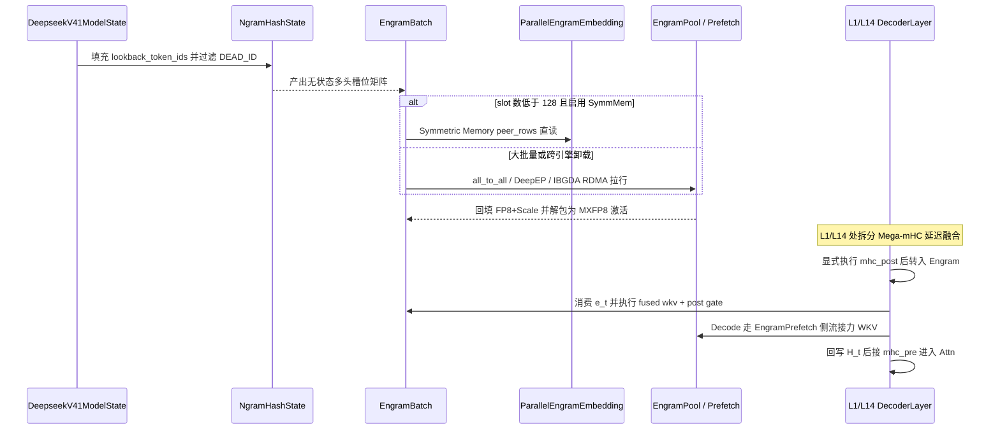
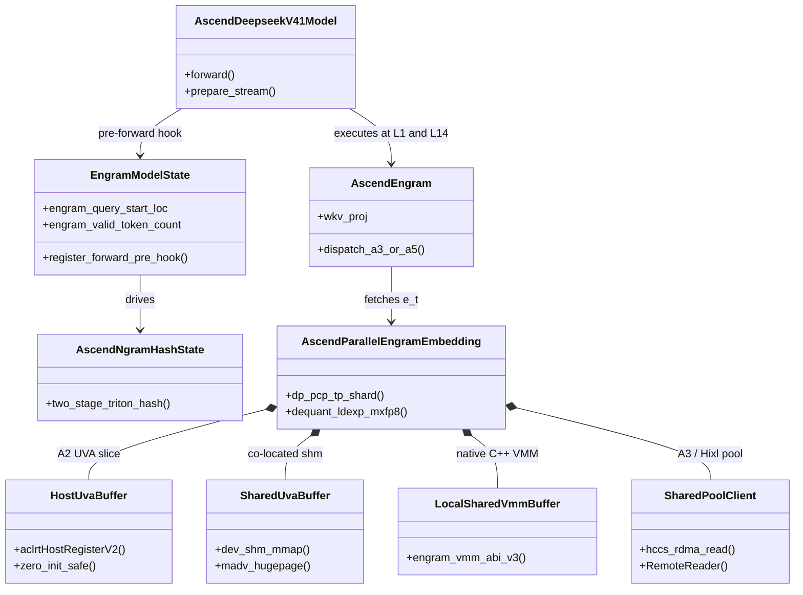

import Figure from 'astro-wisp/components/Figure.astro';
import EngramHashExplainer from './explainers/engram-hash';
import paperFig3 from './images/paper-fig3-scaling-law.svg';
import paperFig4 from './images/paper-fig4-logitlens-cka.png';
import paperFig5 from './images/paper-fig5-arch-ablation.svg';
import paperFig7 from './images/paper-fig7-gating-viz.svg';

在上一篇 [06 DeepSeekMoE](../06-moe/) 中，细粒度专家与无辅助损失路由把激活算力压到了极致。即使这样，当上下文出现“北京是中国的首”，浅层仍得激活多层 FFN（Feed-Forward Network，前馈网络）现场算出“都”字。

为了把这类固定常识从算力路径里剥离，DeepSeek 在条件记忆论文[^engram-paper]与 DeepSeek-V4.1-Flash[^dsv41-paper] 中引入了 **Engram（记忆印迹）**。生物学里它指脑受刺激后留下的物理存储痕迹，触发线索即可直接唤醒记忆。

落到模型层内部，Engram 每次前向其实只依次完成四步动作，如图 1 所示：

1. **截取后缀**：向回抓取包含当前词元在内的 2/3/4 词连续窗口。
2. **多头查表**：把词元 ID 折算成物理行号，$O(1)$ 读出静态向量并拼接。
3. **语境门控**：用注意力算出的动态隐状态当裁判，给查出的向量打分放行或抑噪。
4. **回写残差**：把调制后的值向量加回残差流，让 MoE 专注深层组合与推理。


## 直接查字典行不通：从词缀到多头哈希

要给“北京是中国的首”做静态查表，最朴素的想法是建一张大字典。沿着实现一路往下走，立刻会连续撞上三堵墙：

- **单字歧义太大**：孤立的“首”既可能是“首都”，也可能是“首相”或“首联”，必须结合前面几个词。
- **词表写法太碎**：`"Apple"`、`"apple"` 与带空格的 `" apple"` 在原始 BPE 词表里 ID 完全不同，直接分散命中率。
- **组合数爆炸**：仅 12.9 万词的 3-gram 精确组合表就高达 $10^{15}$ 行，内存完全装不下。

为跨过前两堵墙，先介绍 **N-gram（N 元语法）**，它指文本里连续出现的 $N$ 个词元，例如 2-gram “的 首” 与 3-gram “中国 的 首”。Engram 在位置 $t$ 专门截取以当前词元 $x_t$ 结尾的 **后缀 N-gram（Suffix N-gram）**，覆写多字实体全称。

紧接着，参考实现 `CompressedTokenizer`[^engram-demo] 离线构建一维映射表。它依次执行 NFKC 规范化、NFD 剥离变音符、小写化与空白折叠，将原 `129,280` 词表压缩了 `23.43%`，空格与字母 `a` 相关变体分别合并了 163 个与 54 个词元。

推理期按原 ID 查一次下标即可完成归一。要跨过第三堵“$10^{15}$ 行存不下”的墙，必须引入 **哈希（Hash，散列）**：用确定性整数函数把海量词组压缩进固定行数的数组里，实现 $O(1)$ 寻址。

### 为什么必须拆分多阶与多头哈希

压缩映射后，两个不同短语难免落进同一个槽位，这就是 **哈希碰撞（Hash Collision）**。理解 Engram 寻址的关键，在于分清“多阶”与“多头”各自负责什么。

**多阶（2/3/4-gram）管“看多长”**。第 2 阶只看 2 个词混合出整数 $h_2$，第 3 阶看 3 个词算出 $h_3$；各阶彼此独立，短词组与长专有名词都能各自留下指纹。

**多头（每阶 $K$ 个头）管“降碰撞”**。设某阶分配了 2048 维输出，若做成单头大表，一旦两个短语余数相同发生哈希碰撞，整条 2048 维向量都会被污染。

Engram 转而把 2048 维横向切给 $K$ 个独立哈希头（例如 8 头，每头 256 维），并为每个头配置两两互素的桶长 $p_j$：

- **碰撞伤害切片隔离**：单个头只占向量的一小段，即便头 3 碰撞，其余 7 个头依然完好保留原词义。
- **全头同时碰撞概率极低**：依据 **中国剩余定理（Chinese Remainder Theorem，CRT）**，模数互素时余数组合周期高达 $\prod p_j$。

中国剩余定理可以这样理解：若模数 5 与 7 互素，一个整数对它们取余得到的余数对，在乘积周期 35 内唯一确定。两段短语想在全部 $K$ 个素数头上同时发生哈希碰撞，哈希差值必须是全部素数乘积 $\prod_{j=1}^K p_j$ 的倍数，概率几乎为零。

因此总头数等于“阶数 × 每阶头数”。下面算例取 2 阶 × 2 头共 4 个头；而 DeepSeek-V4.1-Flash 取 2/3/4-gram 共 3 阶，每阶 8 头、每头 256 维，拼出完整查表维度为 $3 \times 8 \times 256 = 6144$ 维。

为了加速访存，所有头并无独立二维表格，而是首尾相接排进同一张扁平物理大表。查表时把取模余数加上该头的起始行偏移 `offsets`，一次 Gather 即可并行读回全部子向量。

### 离线奇乘子怎么生成与区分词序

多头哈希拿到后缀词元序列后，如何把一串整数稳定揉成一个混合值 $h_n(t)$？Engram 对位置 $t$ 的规范 ID 序列 $x'$ 按下式递推计算：

$$
h_n(t) = \bigoplus_{k=0}^{n-1} \bigl(x'_{t-k} \cdot m_k\bigr), \qquad \text{slot}_{n,j}(t) = \bigl(h_n(t) \bmod p_{n,j}\bigr) + \text{offset}_{n,j}
$$

公式里的乘子 $m_k$ 并非可训练权重，而是 **不参与反向传播、也不存入模型权重的离线固定奇数常量**。

每个 Engram 层按回看相对位置 $k = 0, \dots, N_{\max}-1$ 各分配 1 枚乘子。同层全部哈希头共用这组乘子把词序锁进混合整数，再分别对各自互异的素数取模散开。

在上游参考代码[^engram-demo]与 `vllm` 实现[^vllm-common]中，这组乘子按固定三步生成：

1. **算安全半界**：先求 `M_max = INT64_MAX // V'`，再取半界 `half_bound = max(1, M_max // 2)`。
2. **按层确定性抽样**：以 `10007 * layer_id` 作种子，用 NumPy RNG 抽出 `N_max` 个落于半界内的整数 $r_k$。
3. **映射为奇数**：统一计算 $m_k = 2r_k + 1$，当压缩词表 $V' \approx 9.9\times 10^4$ 时，实际值约为 $10^{13}$ 量级。

这套规则同时守住三条工程底线：绑定下标 $k$ 打破异或交换律，并确保乘积不超 `int64` 上限而发生符号翻转。此外乘子恒为奇数以保持模 $2^{64}$ 双射满秩，避免乘以 $2^k$ 抹除低位信息。

同时还要注意递推复用：算完 2-gram 混合值 $h_2(t)$ 后，只需再异或一项 $x'_{t-2} \cdot m_2$ 就能得到 3-gram 混合值 $h_3(t)$，无需从头连乘。

### 互异素数建桶与“中国的首”手算

建表初始化阶段，代码调用 `find_next_prime`[^engram-demo] 从预设桶长下界向上递增寻找素数，并用集合去重以保证任意两头模数互素。随后将素数依次排开，求前缀和得到各头起始偏移 `offsets`。

为了便于手算追踪每一步，下面取 2 阶（2-gram、3-gram）× 每阶 2 头，四头最小下界设为 `4, 6, 10, 12`。寻素去重后桶长为 `[[5, 7], [11, 13]]`，首址 `offsets = [0, 5, 12, 23]`，扁平表总行数 $5+7+11+13 = 36$。

输入序列设“北京”ID 14、“是”ID 9、“中国”ID 308、“的”ID 12、“首”ID 88。我们按位置 $k=0,1,2$ 取缩放后的演示小奇数 `3, 7, 9` 代表真实奇乘子，在 $t=5$ 为“首”做步进推演，如图 2 所示。

<EngramHashExplainer client:visible title="图 2：多头质数建桶、滚动异或哈希与扁平查表步进推演" />

完整计算流程也可以收拢在图 3 的寻址链路中。第一步先算 2-gram 后缀 `12, 88`，得 $h_2 = (88\times 3)\oplus(12\times 7) = 264\oplus 84 = 348$；再复用 $h_2$ 混合前词 ID 308，得 $h_3 = 348\oplus(308\times 9) = 2952$。


第二步把 $h_2$ 与 $h_3$ 分别对 4 个互异素数取模，并叠加前缀首址 `offsets = [0, 5, 12, 23]`，一次落定全部 4 个物理行号：

- **2-gram 头 0**：模 5 偏移 0，$(348 \bmod 5) + 0 = 3 + 0 = 3$。
- **2-gram 头 1**：模 7 偏移 5，$(348 \bmod 7) + 5 = 5 + 5 = 10$。
- **3-gram 头 2**：模 11 偏移 12，$(2952 \bmod 11) + 12 = 4 + 12 = 16$。
- **3-gram 头 3**：模 13 偏移 23，$(2952 \bmod 13) + 23 = 1 + 23 = 24$。

按 `[3, 10, 16, 24]` 切片拼接四段子向量，就得到了当前 token 的静态记忆初值 $\mathbf{e}_t \in \mathbb{R}^{d_{\text{eng}}}$，全程无矩阵乘。

## 哈希碰撞或一词多义，模型怎么消歧

就算拆成了多头互异素数，局部哈希碰撞仍然会发生。设另一句出现“新任”ID 729、“的”ID 12、“首”ID 88，算得 $h_2$ 仍为 348，而 $h'_3 = 348\oplus(729\times 9) = 6397$。

头 3 对 13 取模加偏移 23 算出第 24 行，恰巧和“中国的首”落入同一行；好在头 2 对 11 取模加偏移 12 算出第 18 行，与前者的第 16 行错开。

### 上下文门控与保号开方防饱和

部分头哈希碰撞带来的噪声，加上语言天然存在的一词多义，仅靠静态哈希无法自行消歧。Engram 请出注意力主干算出的动态隐状态 $h_t$ 当裁判，通过 **上下文门控（Context-Aware Gating）** 动态放行或抑噪，如图 4 所示。


具体做法是先把查表向量 $\mathbf{e}_t$ 线性投影为键向量 $\mathbf{k}_t = W_K \mathbf{e}_t$ 与值向量 $\mathbf{v}_t = W_V \mathbf{e}_t$。再对 $h_t$ 与 $\mathbf{k}_t$ 分别做 `RMSNorm` 并求缩放点积 $z_t$，经 **保号开方压缩（Signed-Sqrt Compression）** 送入 Sigmoid 得门控标量 $\alpha_t$：

$$
z_t = \frac{\langle \operatorname{RMSNorm}(h_t),\; \operatorname{RMSNorm}(W_K \mathbf{e}_t)\rangle}{\sqrt{d}}, \qquad \alpha_t = \sigma\!\Big(\operatorname{sign}(z_t)\sqrt{|z_t|}\Big)
$$

为什么要先做一步保号开方 $\operatorname{sign}(z)\sqrt{|z|}$，再去算 Sigmoid？对比一组典型分值便能直观看出它对梯度饱和的缓解。

当 $z = 9.0$ 时，直接套用线性 Sigmoid 已饱和至 0.9999、梯度近乎归零。开方压缩先把 9.0 压回 3.00，输出降到 0.9526；同理负向分数 $z = -9.0$ 也会从 0.0001 缓和到 0.0474，让权重在长期训练中保有清晰梯度。

论文[^engram-paper]实测门控响应如图 5 所示。高权重确实集中落在“银河系”“Alexander the Great”等固定专有名词的收尾词元上，无关上下文则接近关闭。

<Figure
  src={paperFig7}
  alt="论文图 7：Engram-27B 在中英文语料上的门控标量 α_t 热力图，高响应主要落在固定命名实体与习语结尾 token"
  caption="图 5：门控激活分布实测（论文图 7）——“银河系”“Alexander the Great”等固定搭配结尾 token 才获得接近 1 的放行权重"
/>

### 四路 Key 与共享 Value 的设计

在 DeepSeek 采用的 mHC 多流残差架构中，每个 token 携带 `hc_mult = 4` 条独立分支。早期参考实现[^engram-demo]原本声明了 1 个值投影和 4 个键投影阵。

工程代码中把这五次线性变化合并为单个无偏置投影 `wkv`，总输出维度 `5d`。前 `4d` 拆给四条分支各自的键向量 $K_0 \dots K_3$，后 `1d` 作为四分支共享的值向量 $V_t$，与层内位置一同展示在图 6（沿用原型示例维度 $d=1280$）。

之所以采用“4 份独立 Key + 1 份共享 Value”，是因为四条残差流各自承载不同的语义侧重，需要独立键向量决定“吸收多少”。而查出的实体事实本身只有一份，共享 $V_t$ 即可直接省下四分之三的值投影参数与矩阵乘开销。

同时要注意，Engram 嵌入在 DeepSeek-V4.1 的 L1 与 L14 开头处，正好夹在上一层的 `mhc_post` 与本层的 `mhc_pre` 之间。


## 论文里的短卷积怎么算，V4.1 为何删掉它

对照论文与 `vllm` 源码时常会发现一个差异：论文在门控加权 $\alpha_t \odot V_t$ 之后还接了一层 `ShortConv`，而 DeepSeek-V4.1-Flash 却把它彻底移除了。这一节先从零讲透这个卷积核怎么算，再交代删掉它的工程代价考量。

### 一维因果空洞卷积手算与参数压缩

文本序列上的 **一维卷积（1D Convolution）** 就像拿着一把刻度长 $k$ 的固定权重尺子，沿着时间步从左到右滑动，把尺子脚钉踩中的元素各自乘权再相加。

取一条单通道数值示例序列 $x = [1, 2, 4, 3, 1, 2, 4, 0, 2, 5]$（位置 0 到 9），以及核长 $k=4$ 的权重尺子 $w = [w_0=0.5,\; w_1=0.25,\; w_2=-0.5,\; w_3=1.0]$。为了兼顾自回归推理与 3-gram 感受野，论文版 `ShortConv`[^engram-demo] 加了三道设计：

- **因果左补零**：越过开头左侧统一补 `(k - 1) * dilation` 个 0 并截断右侧，保证不看未来。
- **空洞对齐 3-gram**：设 `dilation = 3` 隔 3 步抽取 `[t-9, t-6, t-3, t]`，与 3-gram 边界无重叠。
- **Depthwise 分组减参**：设 `groups = d * hc_mult`，让各隐藏通道独立滤波，参数量由 $4d^2$ 降为 $4d$。

代入刚才的示例序列与权重 $w$，我们在 $\delta=3, k=4$ 下手算两个位置。在早期位置 $t=2$ 时左跨 0 点的三个历史抽头全补 0，算得 $y_2 = 0.5\times 4 + 0 = 2.00$。

走到位置 $t=9$ 时前缀充足，四个脚钉恰好落在 $x_9=5, x_6=4, x_3=3, x_0=1$。于是算出 $y_9 = 0.5\times 5 + 0.25\times 4 - 0.5\times 3 + 1.0\times 1 = 3.00$，如图 7 所示。


### 无状态化取舍与 PyTorch 参考实现

训练阶段全序列一次铺开，加这层深度空洞卷积既省参数又能平滑局部语义。但落到高并发自回归解码与静态图编译（CUDA Graph / ACLGraph）时，情况就变了。

为了每隔 3 步抽取 $t-3, t-6, t-9$ 的门控激活，推理引擎必须为每个并发请求额外分配跨步滑窗状态，并在变长批处理间搬运维护。对比它的微小精度收益，工程复杂度显得得不偿失。

因此 DeepSeek-V4.1-Flash[^dsv41-paper] 直接删去了短卷积，把 Engram 简化为 **纯无状态静态查表与 `wkv` 门控融合** 模块。下方 75 行独立 PyTorch 参考实现[^engram-demo]整合了真实奇乘子构造、`pad_id` 填充与可选短卷积开关：

```python
import random
import torch
import torch.nn as nn
import torch.nn.functional as F

def find_next_prime(start: int, seen: set[int]) -> int:
    c = start + 1
    while True:
        ok = c >= 2 and all(c % d != 0 for d in range(2, int(c**0.5) + 1))
        if ok and c not in seen:
            return c
        c += 1

def build_buckets(min_primes: list[list[int]], seen: set[int] | None = None):
    seen = seen if seen is not None else set()
    primes, offsets, cur = [], [], 0
    for row in min_primes:
        p_row = []
        for lo in row:
            p = find_next_prime(lo, seen)
            seen.add(p)
            p_row.append(p)
            offsets.append(cur)
            cur += p
        primes.append(p_row)
    return primes, offsets, cur

def compute_hash_multipliers(layer_id: int, max_n: int, vocab_size: int) -> list[int]:
    half = max(1, (((1 << 63) - 1) // vocab_size) // 2)
    rng = random.Random(10007 * layer_id)
    return [rng.randrange(half) * 2 + 1 for _ in range(max_n)]

class EngramReference(nn.Module):
    def __init__(self, d=8, hc_mult=4, head_dim=4, max_n=3, k=4, pad_id=0, mults=(3, 7, 9), use_conv=True):
        super().__init__()
        self.d, self.hc_mult, self.max_n, self.pad_id = d, hc_mult, max_n, pad_id
        self.primes, self.offsets, rows = build_buckets([[4, 6], [10, 12]])
        self.register_buffer("mults", torch.tensor(mults, dtype=torch.int64))
        self.table = nn.Embedding(rows, head_dim)
        self.wkv = nn.Linear(len(self.offsets) * head_dim, (hc_mult + 1) * d, bias=False)
        self.norm_h = nn.ModuleList([nn.RMSNorm(d) for _ in range(hc_mult)])
        self.norm_k = nn.ModuleList([nn.RMSNorm(d) for _ in range(hc_mult)])
        total_c = d * hc_mult
        self.conv = nn.Conv1d(total_c, total_c, k, groups=total_c, bias=False,
                              padding=(k - 1) * max_n, dilation=max_n) if use_conv else None
        self.c_norms = nn.ModuleList([nn.RMSNorm(d) for _ in range(hc_mult)]) if use_conv else None

    def hash_slots(self, ids: torch.Tensor) -> torch.Tensor:
        T = ids.shape[1]
        h = ids * self.mults[0]
        slots, idx = [], 0
        for order in range(2, self.max_n + 1):
            shifted = F.pad(ids, (order - 1, 0), value=self.pad_id)[:, :T]
            h = h ^ (shifted * self.mults[order - 1])
            for p in self.primes[order - 2]:
                slots.append(torch.remainder(h, p) + self.offsets[idx])
                idx += 1
        return torch.stack(slots, dim=-1)

    def forward(self, ids: torch.Tensor, h_state: torch.Tensor) -> torch.Tensor:
        T = ids.shape[1]
        e_t = self.table(self.hash_slots(ids)).flatten(start_dim=-2)
        k_raw, v_shared = self.wkv(e_t).split([self.hc_mult * self.d, self.d], dim=-1)
        k_t = k_raw.view(*h_state.shape)
        gates = []
        for m in range(self.hc_mult):
            z = (self.norm_h[m](h_state[:, :, m]) * self.norm_k[m](k_t[:, :, m])).sum(-1)
            z = (z / (self.d ** 0.5)).abs().clamp_min(1e-6).sqrt() * z.sign()
            gates.append(z.sigmoid().unsqueeze(-1))
        val = torch.stack(gates, dim=2) * v_shared.unsqueeze(2)
        if self.conv is None:
            return h_state + val
        normed = torch.cat([self.c_norms[m](val[:, :, m]) for m in range(self.hc_mult)], dim=-1)
        y = self.conv(normed.transpose(1, 2))[..., :T].transpose(1, 2).view_as(val)
        return h_state + val + F.silu(y)
```

## 记忆该分多大预算：实验规律与 V4.1 规格

有了完整算法，工程选型还需解决三个定量问题：总稀疏预算分多少给静态记忆？模块插在哪些层最好？200 GB 级大表放到主机内存是否拖慢计算？

### U 型稀疏分配律与浅层解放效应

在总参 10B、计算量恒定前提下，设 MoE 占全部稀疏参数的比例为 $\rho \in [0, 1]$。论文[^engram-paper]扫点测量出如图 8 所示的两条定量规律：

- **U 型最优配比**：纯 MoE 配置 99 路路由专家时验证损失为 1.7248；让渡 `20%` 预算给 Engram（$\rho \approx 80\%$）时降至 1.7109。
- **无限记忆幂律**：主干计算不变，单把记忆槽从 $2.58\times 10^5$ 扩至 $1.0\times 10^7$，验证损失沿对数坐标呈线性下滑。

<Figure
  src={paperFig3}
  alt="论文图 3：左图固定总参数量与算力下验证损失随分配比例 ρ 呈 U 型曲线；右图固定主干计算量扩大记忆槽位数呈对数线性下降"
  caption="图 8：稀疏预算的 U 型分配律（左）与扩增存储槽位的对数线性幂律收益（右）（论文图 3）"
/>

为什么拿走一部分动态专家后模型反而更聪明？如图 9 的 LogitLens 与 CKA 表征对齐热力图所示，浅层不再替固定短语背书后，Engram 第 5 层的语义成熟度便追平了纯 MoE 第 12 层，直接替深层腾出了更多组合推理空间。

<Figure
  src={paperFig4}
  alt="论文图 4：(a) LogitLens 各层 KL 散度表明 Engram 模型在早期层显著提前收敛；(b)(c) CKA 相似度显示 Engram-27B 第 5 层对应 MoE-27B 第 12 层"
  caption="图 9：LogitLens 浅层快速收敛（a）与 CKA 跨模型表征对齐热力图（b, c）（论文图 4）"
/>

插入层位置同样存在权衡。如图 10 左图所示，第 0 层缺少上下文来校准门控，单层放在第 2 层最稳；拆成第 2 层与第 6 层双模块则在收敛深度与延迟隐藏间取得更优均衡。

<Figure
  src={paperFig5}
  alt="论文图 5：左图为 12 层模型的插入层扫描，第 2 层达单层最优而 L2+L6 双层更优；右图为分步消融结果"
  caption="图 10：插入层扫描（左）与上下文门控、分词压缩、ShortConv 逐步消融结果（右）（论文图 5）"
/>

### 主机内存卸载实测与 V4.1 架构规格

在 H800 上将 100B 级单表卸载到主机 CPU Pinned 内存并利用第 0 层计算窗口做异步预取，实测吞吐损耗极小[^engram-paper]：

- **4B Dense**：关闭卸载 `9,031.62 tok/s`，卸载后 `8,858.28 tok/s`（降 `1.9%`）。
- **8B Dense**：关闭卸载 `6,315.52 tok/s`，卸载后 `6,140.02 tok/s`（降 `2.8%`）。

在 DeepSeek-V4.1-Flash 报告[^dsv41-paper]与 vLLM 官方文档[^vllm-doc]中，实装模型的完整参数规模如下：

| 规格维度     | DeepSeek-V4.1-Flash 实装模型参数                                                             |
| :----------- | :------------------------------------------------------------------------------------------- |
| 注入层位     | 0-indexed **L1** 与 **L14** 两处（无 ShortConv，接在 mHC 边界之间）                          |
| 窗口与分头   | `{2, 3, 4}`-gram 三阶共 24 头（每阶 8 头），每头约 16M 槽，单层约 384M 行                    |
| 维度与总参   | 每阶输出 2048 维（单头 `head_dim = 256`），静态表与投影总参约 `196B`                         |
| 单机存储占用 | 按每 32 维配 1 字节 `UE8M0` 缩放：FP8 `256B + 8B` 约 `200 GB`，MXFP4 `128B + 8B` 约 `104 GB` |

存储字节数可由量化格式直接推算[^vllm-common]：每头 256 维在 FP8 下占 256 字节，在 4-bit MXFP4 下占 128 字节。两组均按每 32 维配 1 字节 `UE8M0` 缩放因子，每行多出 8 字节，这也是后文昇腾篇做 `0xFF` 掩码与幂次缩放的原因。

此外，在训练 196B 巨表时直接套用 Adam 会使一二阶矩状态撑爆显存。V4.1 技术报告[^dsv41-paper]改用 Nesterov 动量加 Sinkhorn 行列均衡更新，只留单份动量缓冲即可稳定收敛。

## 百 GB 大表放不下显存：vLLM 框架实现

理论算清楚之后，把近 200 GB 的静态大表塞进推理引擎才是真正的硬件难题。在最新 `vllm@99b0b0b0`[^vllm-common] 中，框架围绕“算子重叠掩盖”“无状态边界处理”与“分级存储池”搭建了整套支撑。

### 异步预取隐藏时序与总体类设计

因为 Engram 最早插入在 L1 开头，第 0 层解码器的计算时间刚好可以掩盖 L1 主机行数据的预取开销。而 L1 至 L14 之间十余层的计算窗口，则足以掩盖 L14 的搬运延迟，如图 11 所示。


`vllm@99b0b0b0` 的核心类职责按“配置校验 → 无状态步前哈希 → 分级大表存储 → L1/L14 融合执行 → 跨引擎卸载池”组织，类关系如图 12 所示：

```mermaid caption="图 12：vllm@99b0b0b0 中 DeepSeek-V4.1 Engram 核心类关系与内存分级后端"
classDiagram
    class EngramConfig {
        +bool cpu_offload
        +bool dp_shared_memory
        +bool embedding_across_dp
        +int peer_group_size
        +str peer_group_transport
        +verify_model_config()
    }
    class DeepseekV41Model {
        +forward()
        +mhc_post_and_pre_split()
    }
    class DeepseekV41ModelState {
        +lookback_token_ids
        +build_ngram_hashes()
    }
    class NgramHashState {
        +compute_slot_ids()
    }
    class EngramLayout {
        +offsets
        +num_shards
    }
    class ParallelEngramEmbedding {
        +shard_weights
        +peer_rows
        +lookup()
    }
    class DPSharedEngramStorage {
        +cumem_fabric_alloc()
        +shm_fallback()
    }
    class EngramBatch {
        +build_plan()
        +unpack_mxfp8()
    }
    class Engram {
        +wkv_proj
        +forward()
    }
    class EngramPrefetch {
        +side_stream_wkv()
    }
    class EngramPool {
        +NvlinkTransport
        +RdmaTransport
    }

    DeepseekV41Model --> DeepseekV41ModelState : manages
    DeepseekV41Model --> Engram : hosts at L1 and L14
    DeepseekV41Model --> EngramBatch : runs multi-layer plan
    DeepseekV41Model --> EngramPrefetch : decode side-stream
    DeepseekV41ModelState --> NgramHashState : stateless hash
    Engram --> ParallelEngramEmbedding : fetches e_t
    ParallelEngramEmbedding --> EngramLayout : addresses
    ParallelEngramEmbedding --> DPSharedEngramStorage : shares host RAM
    ParallelEngramEmbedding ..> EngramConfig : configured by
    EngramBatch --> EngramPool : peer group fetch
```

### 清洗边界、跨块回溯与多模态阻断

在真实框架代码里，`NgramHashState` 与 `EngramLayout`[^vllm-common] 补齐了前文简化例子省略的四项工程边界。

首先是 **词表清洗防冲突**。单空格 token 用私用区字符 `\ue000` 保护免于被 `Strip()` 清成空串，遇到 `\ufffd` 则回退原始形式，借此确保压缩词表规模 $V'$ 与训练端一致。

其次是 **跨层去重但逐层起算**。`EngramLayout` 让 L1 与 L14 共享同一个素数去重集合，使全部 48 个哈希头模数互异，但每层 `offsets` 各自从 0 起算并持有独立大表。

接着是 **无状态跨块回溯**。新版删掉了旧版易占显存的 `slot_cache`，`DeepseekV41ModelState`[^vllm-state] 只收集最近 3 个历史词元到 `lookback_token_ids`。Kernel 按 `lookback >= chunk_start` 跨批次无缝取词，句首越界则补压缩后的 `pad_id`。

最后是 **多模态阻断防串句**。图像占位 token 标记为 `DEAD_ID = -1`，循环内维护跨位移累积标记 `blocked`：一旦撞到越界或图像占位，更高阶位移统一替换成 `pad_id`，防止把图前图后错拼成伪短语。

### 存储后端分层与单步前向调用链路

面对不同显存与集群规模，`EngramConfig`[^vllm-cfg] 与 `ParallelEngramEmbedding`[^vllm-common] 提供了三层存储选项：

- **同机主机共享**：`DPSharedEngramStorage` 优先用 `cuMem FABRIC` 建 2MB 锁页共享内存，不支持时回退 `/dev/shm`。
- **主机大页与阈值**：私有表支持 `use_thp` 大页；GB200 超 36864 行先排序聚簇，超 4096 token 则切回主流行内直查[^vllm-common]。
- **跨卡与卸载池**：开 `embedding_across_dp` 走对称内存直取；单机不够可经 `EngramPool`[^vllm-pool] 或 DeepEP[^deepep] 走 RDMA 拉行。

需要注意精度打包边界：FP8 表走 `EngramBatch` 对齐并解包成 FlashInfer MXFP8 激活。若改用更高压缩率的 MXFP4，当前版本会关闭 `EngramBatch` 退回 BF16 交换[^vllm-doc]。

在调度层面，接收缓冲 `staged_rows` 预分配成固定显存地址以兼容 CUDA Graph 重放，且 L1 与 L14 故意共用同一条后台预取流。两层串行抓取主机行数据，防止并发抓表把解码主干所需的 SM 算力挤干[^vllm-common]。完整前向时序如图 13 所示：



在模型层边界处，L1 与 L14 必须显式拆开 `Mega-mHC` 单遍融合[^vllm-model]。常规层把上层 `mhc_post` 与本层 `mhc_pre` 融成一个算子省掉四流写回。而这两层必须在两者之间把完整四分支状态交给 Engram 原位更新，再接 `EngramPrefetch`[^vllm-prefetch] 在 Decode 侧流投影。真实拆分如下：

```python
# vllm/models/deepseek_v41/nvidia/model.py (L1/L14 边界拆开 Mega-mHC 融合)
if self.is_first_layer:
    ...  # L0 起始分支归一化
elif self.engram is not None:
    if fused_mhc_post_out is None:
        hidden_states = mhc_post_tilelang(residual, ...)
    hidden_states = self.engram(hidden_states, engram_input)
    hidden_states, residual = mhc_pre(hidden_states)
```

## 昇腾 NPU 上的 vllm-ascend 实现

转向华为昇腾 NPU（A2 与 A3 超节点系列），`vllm-ascend@b776261e`[^ascend-model] 针对 CANN 异构接口重写了整套管线。它重点适配了 BiShengIR Triton 编译器与 ACLGraph（Ascend Graph，昇腾计算图）。

### 昇腾核心类架构与四种存储后端

代码在 `deepseek_v41/engram/` 子目录下分为前向钩子状态、两段式无状态哈希、四类物理存储后端以及按 A5 与 A3 分发的融合门控，如图 14 所示：



这四种存储后端按硬件形态分担负载[^ascend-emb]。`HostUvaBuffer` 按 `2^22` 行切片并做 `64 KiB` 对齐，调用 `aclrtHostRegisterV2` 映为设备 UVA 指针后由 Triton 经 HCCS 零拷贝直读。

同机共享场景则选用 `SharedUvaBuffer`（`/dev/shm` 加大页）或基于原生 VMM 的 `LocalSharedVmmBuffer`。而在 A3 超节点或多机部署下，由 `SharedPoolClient` 与 `RemoteReader` 跨并行域经共享池或 Hixl RDMA 拉行。

数据解压缩也针对 NPU 精度做了适配[^ascend-npu]。除了 BF16 与 MXFP8（对 E8M0 指数做 `0xFF` 掩码），Group-32 INT8 缩放改用 `torch.ldexp` 还原，避开硬件向量 `exp2` 可能少 1 ULP 的微差。

### ACLGraph 双轨与三道安全边界

工程联调中，昇腾平台在编译器、显存探针与空跑边界处暴露出三类特殊陷阱。`vllm-ascend@b776261e` 的图内外协同控制流如图 15 所示：

```mermaid caption="图 15：vllm-ascend@b776261e 昇腾端到端流同步、ACLGraph 双轨分支与越界保护链路"
flowchart TD
    PRE["forward_pre_hook<br/>装载本步 batch 元数据"] --> DUMMY{"query_start_loc 元素数 > 1 ?"}
    DUMMY -->|"否 (DP dummy 空跑)"| SKIP["跳过 Hash 与查表<br/>防 -1 索引触发 GM 越界"]
    DUMMY -->|"是 (真实样本)"| MODE{"是否满足 FULL 图内产槽位条件 ?"}
    MODE -->|"单机局部无跨卡"| IN_G["图内捕获分支：<br/>固定张量驱动 Hash + Gather"]
    MODE -->|"多卡 / Pool 异步"| OUT_G["异步 PREP 副流：<br/>两阶段 Triton Hash 防编译器崩溃"]
    IN_G --> DEC["UVA / VMM / Pool 查表<br/>INT8(ldexp) 或 MXFP8(0xFF 掩码)"]
    OUT_G --> EVT["分桶 ExternalEvent 同步等待"]
    EVT --> DEC
    DEC --> GATE{"硬件代数分发"}
    GATE -->|"A5 新架构"| A5["非旋转 fused_engram_gate"]
    GATE -->|"A3 超节点"| A3["QuaRot 旋转门控（BLOCK=1024 防 UB 溢出）"]
```

图中固化了三道防错护栏[^ascend-triton][^ascend-emb][^ascend-model]。首先通过 **两段式拆解 Triton Hash**，把请求定界与滚动异或拆成两枚独立 Kernel，绕开单核过长触发 `bishengir` LLVM 缓冲释放崩溃。

其次是 **启动前显式清零主机内存**。引擎加载权重前会先跑 `Profiling Run`，申请 `HostUvaBuffer` 后立即执行 `zero_()`，防止脏数据算出 NaN 门控击溃 MoE 路由。

最后是 **DP 空跑越界防护**。某卡空跑时 `query_start_loc` 只有 1 个元素，反推边界会踩到 `-1` 地址引发 48 位 GM 越界，须加长度检查与尾部掩码。

在入口处，`AscendDeepseekV41LLMForCausalLM` 依据标志位选择直接在 ACLGraph 图内生成槽位还是走外部流预取[^ascend-model]。到了融合阶段[^ascend-layer]，A5 走非旋转融合门控，启用 QuaRot 的 A3 超节点则按 `BLOCK=1024` 分块遍历隐维防 UB 溢出：

```python
# vllm_ascend/models/deepseek_v41/model.py (ACLGraph 图内/图外双轨制备)
if (
    self.engram_state is not None
    and self.engram_state.supports_engram_graph_producer
    and engram_input_ids is not None
):
    engram_slot_mapping, engram_bucket_ids = self.model.captured_engram_inputs(
        engram_input_ids, self.engram_state.engram_query_start_loc,
        valid_token_count=self.engram_state.engram_valid_token_count,
    )
```

从更宏观的模型主干来看，Engram 只在 L1 与 L14 负责把静态常识注入那 4 条残差流。真正维持深层 60 余子层里这四路并行残差稳定传输、既要增强表征容量又不至于连乘发散的核心，正是下一篇 [08 mHC 流形超连接](../08-mhc/) 的主线。

[^engram-paper]: Cheng et al., _Conditional Memory via Scalable Lookup: A New Axis of Sparsity for Large Language Models_, arXiv:2601.07372 (2026). 本站实验图与表格数值核对自论文 §2–§4 及附录 Table 1–6：U 型曲线见 `10B / 99 routed experts` 消融（1.7248 -> 1.7109），H800 Host 卸载吞吐表见 Table 4。

[^dsv41-paper]: DeepSeek-AI, _DeepSeek-V4.1-Flash Technical Report_, arXiv:2609.19969 (2026), §2.4.2, §2.5 & §3.1.3（L1 与 L14 接入 `{2,3,4}`-gram 8 头记忆表，每阶 2048 维、每头约 16M 槽、总参 196B，工程侧舍弃 ShortConv 以支持无状态执行与异步预取）。

[^engram-demo]: 参考原型仓库 `deepseek-ai/Engram`（`fb7f84a2`）`engram_demo_v1.py`：`CompressedTokenizer`（L1–122，NFKC/NFD 压缩率 23.43%）、`ShortConv`（L123–179）、`find_next_prime` 与 `NgramHashMapping`（L180–304）、`MultiHeadEmbedding`（L305–325）及 `Engram`（L326–379）。

[^vllm-doc]: `vllm@99b0b0b0` 官方文档 `docs/features/engram.md`（L1–273）：记录单层 ~384M 行与 FP8/MXFP4 容量测算，及 MXFP4 下禁用 `EngramBatch` 回退 BF16 跨卡交换的约束（L272–273）。

[^vllm-cfg]: `vllm@99b0b0b0` 配置校验 `vllm/config/engram.py`：`EngramConfig`（L42–113）定义 `cpu_offload`、`dp_shared_memory`、`use_thp`、`peer_group_size`、`peer_group_transport`、`peer_group_fetch`、`peer_group_rdma_inflight` 与 `peer_group_store`；`_NGRAM_LAYER_FIELDS`（L21–29）。

[^vllm-common]: `vllm@99b0b0b0` 核心实现 `vllm/models/deepseek_v41/common/engram.py`：`ENGRAM_A2A_MIN_SLOT = 128`（L71）、`DEAD_ID = -1`（L74）、`build_compressed_token_map`（L126–174，含 `\ue000` 单空格哨兵与 `\ufffd` 回退）、`compute_hash_multipliers`（L177–196，按 `10007 * layer_id` 生成 `2r+1`）、`EngramLayout`（L199–250，跨层 `seen` 去重、每层 `offsets` 从 0 起算、UE8M0 `block_size=32`）、`_hash_ids_kernel`（L266–371，含 `blocked` 传染阻断）、`NgramHashState`（L373–495，无 `slot_cache`）、`ParallelEngramEmbedding`（L994–1355，含 `peer_rows` L1151–1173）、`DPSharedEngramStorage`、`EngramBatch`（L1593–1712）及 `staged_rows` 与共享预取流（L1713–1787）。

[^vllm-state]: `vllm@99b0b0b0` 步前准备 `vllm/models/deepseek_v41/nvidia/model_state.py`：`DeepseekV41ModelState` 通过 `_fill_lookback` 与 `_gather_lookback_kernel`（L41–70, L351–368）生成 `lookback_token_ids`。

[^vllm-pool]: `vllm@99b0b0b0` 跨卡与跨引擎池 `vllm/models/deepseek_v41/nvidia/ops/`（`engram_peer.py`、`engram_fabric_table.py`、`engram_pool.py`）与 `vllm/distributed/engram_pool/`（`__init__.py`、`nvlink.py`、`rdma.py`：`NvlinkTransport` 与 `RdmaTransport`；支持 NVLink IMEX 及 DeepEP[^deepep] RDMA 拉行）。

[^vllm-prefetch]: `vllm@99b0b0b0` 解码侧流 `vllm/models/deepseek_v41/nvidia/specialized_decode/engram/prefetch.py`（`EngramPrefetch` L47–150）。

[^vllm-model]: `vllm@99b0b0b0` 模型边界 `vllm/models/deepseek_v41/nvidia/model.py`（L659–712：L1/L14 `mhc_post_tilelang -> self.engram -> mhc_pre` 拆分控制流）。

[^deepep]: `DeepEP@f6aa38fe` 分布式缓冲 `deep_ep/buffers/engram.py`（`EngramBuffer` `set_config` / `write` / `fetch`，基于 NCCL GIN / GDAKI）。

[^ascend-triton]: `vllm-ascend@b776261e` 昇腾 Triton 算子：`vllm_ascend/ops/triton/engram_hash.py`（L9–154 拆分 `_engram_req_index_kernel` 与 `_hash_ids_kernel`）、`engram_lookback.py`、`engram_lookup.py`（`_decode_e8m0` `0xFF` 掩码）、`engram_gate.py` 与 `engram_gate_a3.py`（`fused_engram_gate_a3` `BLOCK=1024` 分块）。

[^ascend-emb]: `vllm-ascend@b776261e` 存储后端与钩子：`vllm_ascend/models/deepseek_v41/engram/embedding.py`（L56–380：`HostUvaBuffer` `2^22` 行与 `64 KiB` 对齐、显式 `zero_()` 防 Profiling 污染；`SharedUvaBuffer`；`LocalSharedVmmBuffer`；`SharedPoolClient` 与 `RemoteReader`、`DP x PCP x TP` 切分 L166–169）及 `model_state.py`（`EngramModelState` L69–335）、`hash_state.py`（`AscendNgramHashState` L76–186）。

[^ascend-npu]: `vllm-ascend@b776261e` 量化尺度修复 `vllm_ascend/models/deepseek_v41/engram/npu.py`（L51–61：用 `torch.ldexp` 替代 NPU 向量 `exp2` 以消除 1 ULP 误差）。

[^ascend-layer]: `vllm-ascend@b776261e` 门控分发 `vllm_ascend/models/deepseek_v41/engram/layer.py`（`AscendEngram` L20–64）。

[^ascend-model]: `vllm-ascend@b776261e` 图内与越界保护 `vllm_ascend/models/deepseek_v41/model.py`（L1469–1478 `query_start_loc.numel() > 1` 防空跑读 `-1` GM 越界；L1505–1509 `valid_token_count` 掩码；L1634–1681 & L2151–2162 图内 `captured_engram_inputs`；L1717–1851 `_engram_prepare_stream` 与分桶 `ExternalEvent`）。
