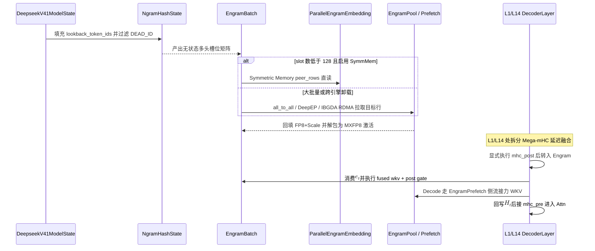

import Figure from 'astro-wisp/components/Figure.astro';
import EngramHashExplainer from './explainers/engram-hash';
import ShortConvExplainer from './explainers/short-conv';
import paperFig3 from './images/paper-fig3-scaling-law.svg';
import paperFig4 from './images/paper-fig4-logitlens-cka.png';
import paperFig5 from './images/paper-fig5-arch-ablation.svg';
import paperFig7 from './images/paper-fig7-gating-viz.svg';

在上一篇 [06 DeepSeekMoE](../06-moe/) 中，细粒度专家与无辅助损失路由把激活算力压到了极致。即便如此，每当模型读到“北京是中国的首”，浅层仍需反复激活多层 FFN（Feed-Forward Network，前馈网络）来现场推导出“都”字。

这类固定常识与命名实体其实只需记忆检索，不该长期占用昂贵的乘加计算。DeepSeek 在条件记忆论文[^engram-paper]与 DeepSeek-V4.1-Flash[^dsv41-paper] 中引入了 **Engram（记忆印迹）**，它相当于挂在残差主干旁的一套动态门控查表模块。

落到模型层内部，Engram 每次前向依次完成四步动作，如图 1 所示：

1. **截取后缀**：向回抓取包含当前词元在内的 2 词、3 词和 4 词连续窗口。
2. **多头查表**：把词元 ID 折算成物理行号，$O(1)$ 读出静态向量并拼接。
3. **语境门控**：用注意力算出的动态隐状态当裁判，对查出的向量打分，决定放行或抑制噪声。
4. **回写残差**：把调制后的值向量加回残差流，让 MoE 专注深层组合与推理。


## 直接查字典行不通：从词缀到多头哈希

要给“北京是中国的首”做静态查表，最朴素的想法是建一张大字典。沿着工程实现往下走，立刻会连续撞上三堵墙：

- **单字歧义太大**：孤立的“首”既可能是“首都”，也可能是“首相”或“首联”，必须看前几个词。
- **词表写法太碎**：`"Apple"`、`"apple"` 与带空格的 `" apple"` 在 BPE 词表里 ID 不同，会分散命中率。
- **组合数爆炸**：仅 12.9 万词的 3-gram 精确组合表就高达 $10^{15}$ 行，任何内存都装不下。

为跨过第一堵墙，Engram 在位置 $t$ 截取以当前词元结尾的 **后缀 N-gram（Suffix N-gram）**，也就是连续出现的 $N$ 个词元窗口。例如读到“首”时，2-gram 与 3-gram 后缀分别是“的 首”和“中国 的 首”，从而把多字实体完整包进来。

为跨过第二堵墙，参考实现 `CompressedTokenizer`[^engram-demo] 在离线阶段构建一维映射表 $\mathcal{P}$。它依次执行 NFKC 规范化、NFD 剥离变音符、转小写与空白折叠，让 `"Apple"`、`"apple"` 和 `" apple"` 映射到同一个 **规范 ID** $c_t = \mathcal{P}(x_t)$。

经过这轮归并，原 129,280 个词元被压缩了 23.43%，缩减至压缩词表规模 $V' \approx 9.9\times 10^4$（其中空白与字母 `a` 变体分别合并了 163 个与 54 个词元）。推理期输入原始 ID 张量 $\mathbf{x} \in \{0,\dots,V-1\}^{B\times T}$ 时，按下标直接查表即得规范 ID 张量 $\mathbf{c} \in \{0,\dots,V'-1\}^{B\times T}$，张量形状保持不变。

要跨过第三堵“$10^{15}$ 行存不下”的墙，必须引入 **哈希（Hash，散列）**：用确定性整数函数把海量词组压缩进固定行数的嵌入式大表，将寻址开销固定在 $O(1)$。进入正式推导前，先用下表固定全篇的核心符号与张量形状：

| 符号                               | 含义                                 | 张量形状 / 取值域                                                                                            |
| :--------------------------------- | :----------------------------------- | :----------------------------------------------------------------------------------------------------------- |
| $B,\; T,\; d$                      | 批大小、序列长、模型隐藏维           | 正整数标量                                                                                                   |
| $c_t,\; \mathbf{c}$                | 归并后的规范词元 ID 与整批序列       | 标量整数；$\mathbf{c} \in \mathbb{Z}^{B\times T}$                                                            |
| $m_k,\; g_n(t)$                    | 位置 $k$ 奇乘子、$n$-gram 异或混合值 | 非负 `int64` 标量                                                                                            |
| $p_{n,j},\; o_{n,j},\; \mathbf{S}$ | 素数桶长、偏移量、多头物理槽位       | $J$ 头；$\mathbf{S} \in \mathbb{Z}^{B\times T\times J}$                                                      |
| $E,\; \mathbf{e}_t,\; \mathbf{E}$  | 扁平大表、单位置及整批拼接向量       | $E \in \mathbb{R}^{N_{\text{rows}}\times d_h}$；$\mathbf{E} \in \mathbb{R}^{B\times T\times d_{\text{eng}}}$ |
| $\mathbf{h}_t,\; \mathbf{H}$       | 单流隐状态与 mHC 四流残差            | $\mathbf{h}_t \in \mathbb{R}^d$；$\mathbf{H} \in \mathbb{R}^{B\times T\times 4\times d}$                     |
| $\mathbf{U},\; \mathbf{Y}$         | 门控增量输出与短卷积输出             | $\mathbf{U},\; \mathbf{Y} \in \mathbb{R}^{B\times T\times 4\times d}$                                        |

### 为什么拆分多阶与多头哈希

把海量词组压进有限行数的大表后，不同短语难免落进同一个槽位，这就是 **哈希碰撞（Hash Collision）**。理解 Engram 寻址机制的关键，在于分清“多阶”与“多头”各自负责解决什么问题。

**多阶（$n \in \{2,\dots,N_{\max}\}$）管“看多长”**。第 2 阶只混合最近 2 个词元，负责捕获常见短搭配；第 3 阶与第 4 阶向回看 3 到 4 个词元，负责锁住长专有名词。各阶独立查表，长短实体都能留下指纹。

**多头（每阶 $K$ 个头）管“降碰撞”**。假设某阶总共分配 2048 维输出向量，若做成单头大表，一旦两个短语余数相同撞车，整条 2048 维向量都会被污染。

Engram 转而把该阶输出横向切给 $K$ 个独立哈希头，设总头数为 $J = (N_{\max}-1)K$、单头维度为 $d_h$，并为每个头配置两两互素的桶长 $p_{n,j}$，拼接后总维数为 $d_{\text{eng}} = J d_h$：

- **碰撞伤害切片隔离**：单个头只占输出向量的一小段 $d_h$ 维，某头碰撞时，其余头仍保留原词义。
- **全头同时碰撞概率极低**：由 **CRT（Chinese Remainder Theorem，中国剩余定理）**，余数组合周期高达 $\prod p_{n,j}$。

中国剩余定理在这里很直观：若模数 5 与 7 互素，一个整数对它们取余得到的余数对，在周期 35 内唯一确定。两段短语想在全部 $K$ 个素数头上同时撞车，它们的哈希差值必须是全部素数乘积的倍数，概率几乎为零。

在 DeepSeek-V4.1-Flash 中，模型取 2/3/4-gram 共 3 阶，每阶 $K=8$ 头（总头数 $J=24$）、单头 $d_h=256$ 维，拼出完整查表维度 $d_{\text{eng}} = 3 \times 8 \times 256 = 6144$ 维。

### 离线准备：奇乘子与素数桶怎么生成

在真正推理查表之前，Engram 还要完成两项离线准备工作：生成 **哈希奇乘子** 与 **互异素数桶布局**。这两组数值都在初始化期确定，**既不参与反向传播训练，也不存入模型权重文件**。

先看奇乘子 $m_k$ 的定义规则。要把后缀里 $n$ 个规范 ID 揉成一个整数，最快的位运算是按位异或（XOR，记作 $\oplus$）。但直接对词元 ID 做异或会立刻出错，因为异或满足交换律，且相同值会互相抵消：

- 词序会丢失：“上海”和“海上”包含相同两个字，直接异或结果完全相同。
- 叠词会归零：“谢谢”两个字 ID 相同，直接异或会变成 0，与其它叠词无法区分。

为了锁死词序，Engram 给每个回看相对位置 $k = 0, \dots, N_{\max}-1$（$k=0$ 为当前词，$k=1$ 为前 1 个词）分配固定乘子 $m_k$，先乘后异或。论文[^engram-paper]仅概括为乘加异或，具体乘子与素数去重规则源自开源原型与 vLLM 实现[^engram-demo][^vllm-common]：

1. **防溢出定上界**：规范 ID 最大不超过 $V'-1$，为防乘积超过有符号 64 位上限 `INT64_MAX` 变负，先取 $M_{\max} = \lfloor (2^{63}-1) / V' \rfloor$。
2. **留空间转奇数**：因下一步要把随机数 $r_k$ 映射为奇数 $m_k = 2r_k + 1$，抽样上界再减半取 `half_bound = max(1, M_max // 2)`。
3. **按层定种子抽样**：以 `10007 * layer_id` 作 NumPy 随机数种子抽得 $N_{\max}$ 个整数 $r_k$，转为 $m_k = 2r_k + 1$。

为什么要费心把乘子强制转成奇数？因为偶数二进制末位为 0，ID 乘以偶数相当于左移并抹掉低位区分度；而奇数在 64 位整数环里是一一映射，能无损保留低位信息。在 $V' \approx 9.9\times 10^4$ 时，生成出的真实乘子落在 $10^{13}$ 量级，且不同层之间相互独立。

再看互异素数桶与扁平大表 $E \in \mathbb{R}^{N_{\text{rows}}\times d_h}$ 怎么布局。如果为每个头单独分配二维矩阵，每次查表就得发几十次零散读取。工程上把同一层所有 $J$ 个头的行空间首尾相接，拼成一张总行数 $N_{\text{rows}} = \sum_{n,j} p_{n,j}$ 的连续大表 $E$，再用一次 Gather 读出全部切片。

建表初始化阶段，代码[^engram-demo][^vllm-common] 为各阶设定目标容量下界 `vocab_size`（如 V4.1 每头约 1600 万行）。随后调用 `find_next_prime`，从 `vocab_size - 1` 起顺延找素数 $p_{n,j}$，并用全局 `seen` 集合跳过已占用的素数。最后对各头桶长求前缀和，即得起始行号 `offsets`（记作 $o_{n,j}$）。

规则立好后，下面设定一套贯穿后文的 **迷你手算配置**：取 2 阶（2-gram、3-gram）× 每阶 $K=2$ 头共 $J=4$ 个头（头 0 至头 3）。桶长统一从下界 4 出发，并用小奇数 $m_0=3,\; m_1=7,\; m_2=9$ 代替 13 位大乘子：

- **2-gram 顺延**：从 4 向上找得头 0 素数 $p_{2,0}=5$、头 1 素数 $p_{2,1}=7$，集合 `seen` 记录 `{5, 7}`。
- **3-gram 顺延**：再次从 4 出发，跳过已被占用的 5 和 7，顺延拿到头 2 素数 $p_{3,0}=11$ 与头 3 素数 $p_{3,1}=13$。

拿到四枚互异素数 `[[5, 7], [11, 13]]` 后，求前缀和即得起始偏移 `offsets = [0, 5, 12, 23]`。四个头依次占区间 `0..4`、`5..11`、`12..22` 与 `23..35`。四段拼出扁平嵌入大表 $E \in \mathbb{R}^{36\times d_h}$（总行数 $5+7+11+13=36$），拼接总维 $d_{\text{eng}} = 4d_h$。

### 在线滚动递推与“中国的首”手算

先立在线寻址的数学定义与张量形状变换。对规范 ID 序列中位置 $t$ 的 $n$-gram 后缀（$n \ge 2$），定义整数哈希混合值 $g_n(t)$，其中 $g_1(t) = c_t \cdot m_0$ 仅作递推初值而不单独查表：

$$
g_1(t) = c_t \cdot m_0, \qquad g_n(t) = g_{n-1}(t) \oplus \bigl(c_{t-(n-1)} \cdot m_{n-1}\bigr) = \bigoplus_{k=0}^{n-1} \bigl(c_{t-k} \cdot m_k\bigr)
$$

上式中间是 vLLM Triton 算子采用的滚动递推写法，每升一阶只多做 1 次乘法和 1 次异或；最右端是等价展开式。拿到各阶混合整数 $g_n(t)$ 后，第 $n$ 阶第 $j$ 个哈希头按自身素数 $p_{n,j}$ 与起始偏移 $o_{n,j}$ 并行算出大表物理行号：

$$
\text{slot}_{n,j}(t) = \bigl(g_n(t) \bmod p_{n,j}\bigr) + o_{n,j}
$$

整批推理时的张量形状变换一路明确：

$$
\mathbf{c}\,[B, T] \xrightarrow{\text{滚动哈希寻址}} \mathbf{S}\,[B, T, J] \xrightarrow{\text{按行 Gather } E\,[N_{\text{rows}}, d_h]} [B, T, J, d_h] \xrightarrow{\text{尾维展平拼接}} \mathbf{E}\,[B, T, d_{\text{eng}}]
$$

在单个词元位置 $t$，上述 Gather 与拼接操作把 $J$ 个单头向量 $\mathbf{e}_{t,j} \in \mathbb{R}^{d_h}$ 直接拼成静态记忆初值 $\mathbf{e}_t \in \mathbb{R}^{d_{\text{eng}}}$，全程没有一次矩阵乘。

现在把主贯穿案例代入公式手算。设模型按 1-indexed 位置 $t = 1 \dots 5$ 读入序列“北京 是 中国 的 首”，归并后的规范 ID 为 `14, 9, 308, 12, 88`。在目标位置 $t = 5$（“首”，$c_5 = 88$），沿迷你配置 $m = (3, 7, 9)$ 计算：

- **2-gram（“的 首”，`12, 88`）**：当前词乘 $m_0$ 得 $88 \times 3 = 264$，前 1 词乘 $m_1$ 得 $12 \times 7 = 84$，异或得 $g_2(5) = 264 \oplus 84 = 348$。
- **3-gram（“中国 的 首”，`308, 12, 88`）**：直接复用 $g_2(5) = 348$，只把新滑入的“中国”（$k=2$）乘 $m_2 = 9$ 得 2772 再异或，得 $g_3(5) = 348 \oplus 2772 = 2952$。

接着把 $g_2(5) = 348$ 与 $g_3(5) = 2952$ 代入槽位公式（`primes = [[5, 7], [11, 13]]`，`offsets = [0, 5, 12, 23]`），一次落定全部 4 个物理行号：

- **头 0（2-gram，模 5 偏移 0）**：$(348 \bmod 5) + 0 = 3 + 0 = 3$。
- **头 1（2-gram，模 7 偏移 5）**：$(348 \bmod 7) + 5 = 5 + 5 = 10$。
- **头 2（3-gram，模 11 偏移 12）**：$(2952 \bmod 11) + 12 = 4 + 12 = 16$。
- **头 3（3-gram，模 13 偏移 23）**：$(2952 \bmod 13) + 23 = 1 + 23 = 24$。

按 `[3, 10, 16, 24]` 从 $E \in \mathbb{R}^{36\times d_h}$ 切片读取 `[4, d_h]` 并展平，即得 $\mathbf{e}_5 \in \mathbb{R}^{4d_h}$。

最后验证前文提到的 **多头局部碰撞隔离**。假设另一段文本出现“新任 的 首”（规范 ID `729, 12, 88`），其 2-gram 混合值仍为 $g_2^{(B)} = 348$，3-gram 混合值为 $g_3^{(B)} = 348 \oplus (729 \times 9) = 6397$。代入头 2 与头 3 公式：头 3 算得 $(6397 \bmod 13) + 23 = 24$，与“中国的首”撞在同一行；但头 2 算得 $(6397 \bmod 11) + 12 = 18$，与前者的第 16 行错开 2 行。完整流程如图 2 所示。


## 哈希碰撞或一词多义，模型怎么消歧

即使拆成了多头互异素数，单个头上的局部碰撞（如上节的头 3 行 24）依然会混入无关特征；此外，语言天然存在一词多义，单靠静态查表无法区分“中国 的 首”与“唐诗 的 首”。因此，Engram 用注意力主干算出的动态隐状态向量作为裁判，通过 **上下文门控（Context-Aware Gating）** 决定放行或抑制静态记忆。

### 上下文门控与保号开方防饱和

先看单流主干下的数学定义与张量形状变换。给定单流动态隐状态 $\mathbf{h}_t \in \mathbb{R}^d$ 与拼接查表向量 $\mathbf{e}_t \in \mathbb{R}^{d_{\text{eng}}}$，首先用两个线性投影矩阵 $W_K, W_V \in \mathbb{R}^{d\times d_{\text{eng}}}$ 分别映射出键向量 $\mathbf{k}_t = W_K \mathbf{e}_t \in \mathbb{R}^d$ 与值向量 $\mathbf{v}_t = W_V \mathbf{e}_t \in \mathbb{R}^d$（整批变换为 $[B, T, d_{\text{eng}}] \to [B, T, d]$）。

接着对 $\mathbf{h}_t$ 与 $\mathbf{k}_t$ 分别做 `RMSNorm` 并求缩放点积 $z_t \in \mathbb{R}$。原始论文[^engram-paper]直接把 $z_t$ 送入 Sigmoid，官方原型代码[^engram-demo]则先做一步 **保号开方压缩（Signed-Sqrt Compression）** 防梯度饱和，算出门控标量 $\alpha_t \in (0, 1)$ 后调制值向量并加回残差：

$$
z_t = \frac{\langle \operatorname{RMSNorm}(\mathbf{h}_t),\; \operatorname{RMSNorm}(\mathbf{k}_t)\rangle}{\sqrt{d}}, \qquad \alpha_t = \sigma\!\Big(\operatorname{sign}(z_t)\sqrt{|z_t|}\Big), \qquad \mathbf{u}_t = \alpha_t \mathbf{v}_t, \qquad \mathbf{h}'_t = \mathbf{h}_t + \mathbf{u}_t
$$

其中门控增量 $\mathbf{u}_t \in \mathbb{R}^d$ 与更新后隐状态 $\mathbf{h}'_t \in \mathbb{R}^d$ 维度与输入严格一致。为什么要在 Sigmoid 前先做一步保号开方 $\operatorname{sign}(z)\sqrt{|z|}$？对比一组具体数值就能看清效果：当 $z = 9.0$ 时，直接进 Sigmoid 会饱和到 0.9999、梯度几近消失；而开方压缩先把 9.0 压回 3.00，输出拉回 0.9526。同理 $z = -9.0$ 也会从 0.0001 缓和到 0.0474，保证门控投影在长期训练里保留有效梯度。

图 3 总结了“中国的首”与“新任的首”在头 3 同槽碰撞下的门控消歧过程。图 4 的交互推演则按“词表归一与离线建桶 → 后缀滚动查表 → 碰撞与门控消歧”拆成 8 步，并支持切换不同短语语境对比多头落位与门控响应。


<EngramHashExplainer
  client:visible
  title="图 4：从词表归一、离线建桶到滚动查表与门控消歧的 8 步推演"
/>

论文[^engram-paper] 在中英文语料上的实测门控分布如图 5 所示，高权重集中落在“银河系”“Alexander the Great”等固定专有名词与习语的收尾词元上，无关上下文则接近关闭。

<Figure
  src={paperFig7}
  alt="论文图 7：Engram-27B 在中英文语料上的门控标量 α_t 热力图，高响应主要落在固定命名实体与习语结尾 token"
  caption="图 5：门控激活分布实测（论文图 7）——“银河系”“Alexander the Great”等固定搭配结尾 token 才获得接近 1 的放行权重"
/>

### 四路 Key 与共享 Value 的设计

DeepSeek 随后引入了多流残差架构 mHC（Manifold-Constrained Hyper-Connections，流形超连接）。在该结构中，主干并行携带 4 条残差支流（详见 [08 mHC 流形超连接](../08-mhc/)），因此隐状态变成四维张量 $\mathbf{H} \in \mathbb{R}^{B\times T\times 4\times d}$，其中位置 $t$ 的第 $s \in \{0,1,2,3\}$ 条支流记为 $\mathbf{h}_{t,s} \in \mathbb{R}^d$。

在最初的参考原型[^engram-demo]里，模块为 4 条支流分别声明了 4 个键投影和 1 个值投影。工程实现[^vllm-common]把这五次矩阵乘合并成单个无偏置投影矩阵 $W_{KV} \in \mathbb{R}^{5d\times d_{\text{eng}}}$（代码名 `wkv`），完成如下形状变换与切分：

$$
\mathbf{E}\,[B, T, d_{\text{eng}}] \xrightarrow{\;W_{KV}\;} [B, T, 5d] \xrightarrow{\;\text{split}(4d,\; d)\;} \mathbf{K}\,[B, T, 4, d] \text{ 与共享 } \mathbf{v}\,[B, T, d]
$$

随后四条支流各自用 $\mathbf{h}_{t,s} \in \mathbb{R}^d$ 与切分出的键向量 $\mathbf{k}_{t,s} \in \mathbb{R}^d$ 独立打分，拼出门控张量 $\boldsymbol{\alpha} \in \mathbb{R}^{B\times T\times 4\times 1}$，再与扩维后的共享值向量 $\mathbf{v}\,[B, T, 1, d]$ 广播相乘并回写残差：

$$
z_{t,s} = \frac{\langle \operatorname{RMSNorm}(\mathbf{h}_{t,s}),\; \operatorname{RMSNorm}(\mathbf{k}_{t,s})\rangle}{\sqrt{d}}, \qquad \alpha_{t,s} = \sigma\!\Big(\operatorname{sign}(z_{t,s})\sqrt{|z_{t,s}|}\Big), \qquad \mathbf{U} = \boldsymbol{\alpha} \odot \mathbf{v} \in \mathbb{R}^{B\times T\times 4\times d}, \qquad \mathbf{H}' = \mathbf{H} + \mathbf{U}
$$

采用“四路独立 Key + 一路共享 Value”的原因很直接。四条残差流各自关注不同语义侧面，需要独立打分决定吸收多少记忆。而查表得到的静态事实只有一份，共享 $\mathbf{v}_t$ 即可省下四分之三的值投影参数与算力。在 DeepSeek-V4.1 中，Engram 挂载在 L1 与 L14 开头，夹在 `mhc_post` 与 `mhc_pre` 之间，如图 6 所示。


## 论文里的短卷积怎么算，V4.1 为何删掉它

对照原始论文与 `vllm` 源码会发现一个明显演进：论文版本在门控输出 $\mathbf{U} = \boldsymbol{\alpha} \odot \mathbf{v}$ 之后还接了一层 `ShortConv` 短卷积，而 DeepSeek-V4.1-Flash 却把它彻底移除了。

### 一维因果空洞卷积手算与参数压缩

先明确 `ShortConv` 的张量变换链与数学定义。模块接收上一节的四流门控增量 $\mathbf{U} \in \mathbb{R}^{B\times T\times 4\times d}$，先按支流执行 `RMSNorm`，再把支流维 4 与隐藏维 $d$ 合并并转置通道维到中间，得到卷积输入 $\tilde{\mathbf{U}} \in \mathbb{R}^{B\times 4d\times T}$。

在此输入上，论文版 `ShortConv`[^engram-demo] 采用核长 $k=4$、空洞步幅 $\delta=3$ 的分组一维卷积，包含三道设计：

- **Depthwise 分组压缩**：设 `groups = 4d`，使各通道独立滤波；核张量从 $[4d, 4d, k]$ 压到 $[4d, 1, k]$（单流参数由 $4d^2$ 降至 $4d$）。
- **因果左补零**：在序列左侧补 `(k-1)\delta` 格（$[B, 4d, T] \to [B, 4d, T+(k-1)\delta]$），卷积后截断右侧恢复 $[B, 4d, T]$，防止偷看未来词元。
- **空洞对齐 3-gram**：设步幅 $\delta = 3$ 抽取 $t, t-3, t-6, t-9$，避免相邻 3-gram 窗口重复覆盖。

对单个通道按 0-indexed 位置 $t = 0, \dots, T-1$ 写出一维因果空洞卷积公式，卷积结果再转置还原为 $\mathbf{Y} \in \mathbb{R}^{B\times T\times 4\times d}$ 并经 `SiLU` 激活加回四流残差：

$$
y_t = \sum_{i=0}^{k-1} w_i\, u_{t - i\delta} \quad (t - i\delta < 0 \text{ 时取 } u_{t-i\delta} = 0), \qquad \mathbf{H}' = \mathbf{H} + \mathbf{U} + \operatorname{SiLU}(\mathbf{Y})
$$

上式约定 $w_0$ 乘当前时刻 $u_t$、$w_3$ 乘最远抽头 $u_{t-9}$；若对照 PyTorch 的 `nn.Conv1d`，核张量 `[4d, 1, 4]` 在最后一维从左到右存为 $[w_3, w_2, w_1, w_0]$。

现在代入具体数值手算验证。为贴合 1D 卷积习惯，把前文“北京 是 中国 的 首”续写为 10 词序列“北京 是 中国 的 首 都 拥有 悠久 的 历史”，改按 0-indexed 位置 $t = 0\dots 9$ 编号。取该序列在某通道归一化门控后的激活 $u = [1, 2, 4, 3, 1, 2, 4, 0, 2, 5]$，核权 $[w_0=0.5,\; w_1=0.25,\; w_2=-0.5,\; w_3=1.0]$，在 $\delta=3, k=4$ 下手算两个时刻：

- **早期位置 $t = 2$（“中国”）**：向左退 3 步已越界，三个历史抽头全部补 0，因此 $y_2 = 0.5 \times 4 + 0 = 2.00$。
- **末尾位置 $t = 9$（“历史”）**：前缀充足，四根抽头落在 $u_9 = 5,\; u_6 = 4,\; u_3 = 3,\; u_0 = 1$，算得 $y_9 = 0.5\times 5 + 0.25\times 4 - 0.5\times 3 + 1.0\times 1 = 3.00$。

图 7 对照了标准连续卷积与空洞因果卷积的抽头覆盖差异。图 8 的交互推演用刚性四齿卷积核沿这 10 个词元从左向右逐格扫描，直观展示左补 9 个 0、$\delta=3$ 空洞抽头与 $y_0 \dots y_9$ 逐格生成过程。


<ShortConvExplainer
  client:visible
  title="图 8：承接前文例子的 ShortConv 卷积核滑动扫描与残差回写 5 步推演"
/>

### 无状态化取舍与 PyTorch 参考实现

训练阶段整条序列一次铺开，加这层深度空洞卷积既省参数又能平滑局部语义。但落到高并发自回归解码与静态图捕获（CUDA Graph / ACLGraph）时，工程代价反转了。为了隔 3 步抽取历史门控输出，推理引擎必须为每个请求维护跨步滑窗缓存。

对比后面消融实验里微小的精度收益，这份状态管理复杂度显得得不偿失。因此 DeepSeek-V4.1-Flash[^dsv41-paper] 直接删去了 `ShortConv`，把 Engram 简化为 **纯无状态静态查表与 `wkv` 门控融合** 模块。下方独立的 PyTorch 参考实现整合了去重顺延建桶、真实奇乘子生成、滚动异或查表与可选短卷积开关：

```python
import numpy as np
import torch
import torch.nn as nn
import torch.nn.functional as F

def find_next_prime(start: int, seen: set[int]) -> int:
    c = start + 1
    while True:
        if c >= 2 and all(c % d != 0 for d in range(2, int(c**0.5) + 1)) and c not in seen:
            return c
        c += 1

def build_buckets(base_vocab: int, num_orders: int, num_heads: int, seen: set[int] | None = None):
    seen = seen if seen is not None else set()
    primes, offsets, cur = [], [], 0
    for _ in range(num_orders):
        p_row, lo = [], base_vocab - 1
        for _ in range(num_heads):
            p = find_next_prime(lo, seen)
            seen.add(p)
            p_row.append(p)
            offsets.append(cur)
            cur, lo = cur + p, p
        primes.append(p_row)
    return primes, offsets, cur

def compute_hash_multipliers(layer_id: int, max_n: int, vocab_size: int, seed: int = 0) -> list[int]:
    m_max = ((1 << 63) - 1) // vocab_size
    half = max(1, m_max // 2)
    rng = np.random.default_rng(seed + 10007 * layer_id)
    return (rng.integers(low=0, high=half, size=(max_n,), dtype=np.int64) * 2 + 1).tolist()

class EngramReference(nn.Module):
    def __init__(self, d=8, hc_mult=4, head_dim=4, max_n=3, base_vocab=5,
                 n_head=2, k=4, pad_id=0, mults=(3, 7, 9), layer_id=1, vocab_size=99000, use_conv=True):
        super().__init__()
        self.d, self.hc_mult, self.max_n, self.pad_id = d, hc_mult, max_n, pad_id
        self.primes, self.offsets, rows = build_buckets(base_vocab, max_n - 1, n_head)
        m = mults if mults is not None else compute_hash_multipliers(layer_id, max_n, vocab_size)
        self.register_buffer("mults", torch.tensor(m, dtype=torch.int64))
        self.table = nn.Embedding(rows, head_dim)
        self.wkv = nn.Linear(len(self.offsets) * head_dim, (hc_mult + 1) * d, bias=False)
        self.norm_h = nn.ModuleList([nn.RMSNorm(d) for _ in range(hc_mult)])
        self.norm_k = nn.ModuleList([nn.RMSNorm(d) for _ in range(hc_mult)])
        total_c = d * hc_mult
        self.conv = nn.Conv1d(total_c, total_c, k, groups=total_c, bias=False,
                              padding=(k - 1) * max_n, dilation=max_n) if use_conv else None
        self.c_norms = nn.ModuleList([nn.RMSNorm(d) for _ in range(hc_mult)]) if use_conv else None

    def hash_slots(self, ids: torch.Tensor) -> torch.Tensor:
        T = ids.shape[1]
        g = ids * self.mults[0]  # [B, T]
        slots, idx = [], 0
        for order in range(2, self.max_n + 1):
            shifted = F.pad(ids, (order - 1, 0), value=self.pad_id)[:, :T]
            g = g ^ (shifted * self.mults[order - 1])
            for p in self.primes[order - 2]:
                slots.append(torch.remainder(g, p) + self.offsets[idx])
                idx += 1
        return torch.stack(slots, dim=-1)  # [B, T, J]

    def forward(self, ids: torch.Tensor, h_state: torch.Tensor) -> torch.Tensor:
        T = ids.shape[1]
        e_t = self.table(self.hash_slots(ids)).flatten(start_dim=-2)  # [B, T, d_eng]
        k_raw, v_shared = self.wkv(e_t).split([self.hc_mult * self.d, self.d], dim=-1)
        k_t = k_raw.view(*h_state.shape)  # [B, T, 4, d]
        gates = []
        for s in range(self.hc_mult):
            z = (self.norm_h[s](h_state[:, :, s]) * self.norm_k[s](k_t[:, :, s])).sum(-1)
            z = (z / (self.d ** 0.5)).abs().clamp_min(1e-6).sqrt() * z.sign()
            gates.append(z.sigmoid().unsqueeze(-1))
        u_t = torch.stack(gates, dim=2) * v_shared.unsqueeze(2)  # [B, T, 4, d]
        if self.conv is None:
            return h_state + u_t
        u_norm = torch.cat([self.c_norms[s](u_t[:, :, s]) for s in range(self.hc_mult)], dim=-1)
        y_t = self.conv(u_norm.transpose(1, 2))[..., :T].transpose(1, 2).view_as(u_t)  # [B, T, 4, d]
        return h_state + u_t + F.silu(y_t)

if __name__ == "__main__":
    mod = EngramReference(use_conv=False)
    ids = torch.tensor([[14, 9, 308, 12, 88]])
    assert mod.hash_slots(ids)[0, -1].tolist() == [3, 10, 16, 24]
    assert mod(ids, torch.randn(1, 5, 4, 8)).shape == (1, 5, 4, 8)
```

## 记忆该分多大预算：实验规律与 V4.1 规格

算法打通后，工程落地需要回答三个定量问题：稀疏预算分多少给静态表？模块插在哪些层最好？百 GB 大表放进主机内存会不会拖慢推理？

### U 型稀疏分配律与浅层解放效应

在总参数 10B、单步计算量恒定的前提下，设 MoE 占全部稀疏参数的比例为 $\rho \in [0, 1]$。论文[^engram-paper] 扫点测出了如图 9 所示的两条定量规律：

- **U 型最优配比**：纯 MoE 配 99 路专家时验证损失为 1.7248；让渡 20% 预算给 Engram（$\rho \approx 80\%$）时降至 1.7109。
- **无限记忆幂律**：保持主干算力不变，单把记忆槽位从 $2.58\times 10^5$ 扩至 $1.0\times 10^7$，验证损失沿对数坐标线性下滑。

<Figure
  src={paperFig3}
  alt="论文图 3：左图固定总参数量与算力下验证损失随分配比例 ρ 呈 U 型曲线；右图固定主干计算量扩大记忆槽位数呈对数线性下降"
  caption="图 9：稀疏预算的 U 型分配律（左）与扩增存储槽位的对数线性幂律收益（右）（论文图 3）"
/>

为什么拿走一部分动态专家后模型反而更强？如图 10 的 LogitLens 与 CKA 表征对齐热力图所示，浅层不再需要替固定短语背书。因此 Engram 第 5 层的语义成熟度便追平了纯 MoE 的第 12 层，直接给深层腾出了组合推理空间。

<Figure
  src={paperFig4}
  alt="论文图 4：(a) LogitLens 各层 KL 散度表明 Engram 模型在早期层显著提前收敛；(b)(c) CKA 相似度显示 Engram-27B 第 5 层对应 MoE-27B 第 12 层"
  caption="图 10：LogitLens 浅层快速收敛（a）与 CKA 跨模型表征对齐热力图（b, c）（论文图 4）"
/>

插入层位置同样存在权衡。如图 11 左图所示，第 1 层（1-indexed 计数，对应 0-indexed 的 L0）尚未经过注意力聚合上下文。单层放在第 2 层（对应 L1）效果最稳；拆成第 2 层与第 6 层双模块则在收敛深度与预取掩盖间取得更好均衡。

<Figure
  src={paperFig5}
  alt="论文图 5：左图为 12 层模型的插入层扫描，第 2 层达单层最优而 L2+L6 双层更优；右图为分步消融结果"
  caption="图 11：插入层扫描（左）与上下文门控、分词压缩、ShortConv 逐步消融结果（右）（论文图 5）"
/>

### 主机内存卸载实测与 V4.1 架构规格

将 100B 级单表放到主机 CPU 锁页（Pinned）内存，并利用第 0 层的计算窗口异步预取，在 H800 上实测吞吐损耗极小[^engram-paper]：

- **4B Dense 模型**：关闭卸载为 9,031.62 tok/s，开启卸载后为 8,858.28 tok/s，仅下降 1.9%。
- **8B Dense 模型**：关闭卸载为 6,315.52 tok/s，开启卸载后为 6,140.02 tok/s，仅下降 2.8%。

在 DeepSeek-V4.1-Flash 技术报告[^dsv41-paper] 与 vLLM 官方文档[^vllm-doc] 中，实装模型的完整参数规模如下表所示：

| 规格维度     | DeepSeek-V4.1-Flash 实装模型参数                                                         |
| :----------- | :--------------------------------------------------------------------------------------- |
| 注入层位     | 0-indexed **L1** 与 **L14** 两处（无 ShortConv，接在 mHC 边界之间）                      |
| 窗口与分头   | `{2, 3, 4}`-gram 三阶共 24 头（每阶 8 头），每头约 16M 槽，单层约 384M 行                |
| 维度与参数量 | 每阶输出 2048 维（单头 `head_dim = 256`），静态表与投影总参数约 196B                     |
| 单机存储占用 | 按每 32 维配 1 字节 `UE8M0` 缩放：FP8 `256B + 8B` 约 200 GB，MXFP4 `128B + 8B` 约 104 GB |

表中的 `UE8M0` 是一种只存 8 位无符号指数、不存尾数的共享缩放格式，用 1 字节记录 $2^e$ 的尺度因子。每头 256 维在 FP8 下占 256 字节、在 4-bit MXFP4 下占 128 字节，按每 32 维配 1 字节缩放因子，每行固定多出 8 字节[^vllm-common]。

此外，训练 196B 静态大表时若直接套用 Adam，一二阶动量缓冲会撑爆训练显存。V4.1 技术报告[^dsv41-paper] 改用 Nesterov 动量配合 Sinkhorn 行列均衡更新，只保留单份动量缓冲即可稳定收敛。

## 百 GB 大表放不下显存：vLLM 框架实现

算法明确之后，把近 200 GB 静态大表塞进推理引擎并藏住跨总线搬运延迟，是真正的系统挑战。在 `vllm@99b0b0b0`[^vllm-common] 中，框架围绕“预取掩盖”“无状态边界处理”与“分级存储池”搭建了整套支撑。

### 异步预取隐藏时序与总体类设计

因为 Engram 挂载在 L1 与 L14 开头，第 0 层解码器的计算时间刚好用来掩盖 L1 的主机预取开销。而 L1 到 L13 之间十余层的计算窗口，则足以完全掩盖 L14 的搬运延迟，如图 12 所示。


`vllm@99b0b0b0` 把核心职责拆成四条线：配置校验、无状态哈希、分级大表存储，以及 L1/L14 融合执行与跨机卸载池，主要类关系如图 13 所示：

```mermaid caption="图 13：vllm@99b0b0b0 中 DeepSeek-V4.1 Engram 核心类关系与内存分级后端"
classDiagram
    class EngramConfig {
        +bool cpu_offload
        +bool dp_shared_memory
        +bool embedding_across_dp
        +int peer_group_size
        +str peer_group_transport
        +verify_model_config()
    }
    class DeepseekV41Model {
        +forward()
        +mhc_post_and_pre_split()
    }
    class DeepseekV41ModelState {
        +lookback_token_ids
        +build_ngram_hashes()
    }
    class NgramHashState {
        +compute_slot_ids()
    }
    class EngramLayout {
        +offsets
        +num_shards
    }
    class ParallelEngramEmbedding {
        +shard_weights
        +peer_rows
        +lookup()
    }
    class DPSharedEngramStorage {
        +cumem_fabric_alloc()
        +shm_fallback()
    }
    class EngramBatch {
        +build_plan()
        +unpack_mxfp8()
    }
    class Engram {
        +wkv_proj
        +forward()
    }
    class EngramPrefetch {
        +side_stream_wkv()
    }
    class EngramPool {
        +NvlinkTransport
        +RdmaTransport
    }

    DeepseekV41Model --> DeepseekV41ModelState : manages
    DeepseekV41Model --> Engram : hosts at L1 and L14
    DeepseekV41Model --> EngramBatch : runs multi-layer plan
    DeepseekV41Model --> EngramPrefetch : decode side-stream
    DeepseekV41ModelState --> NgramHashState : stateless hash
    Engram --> ParallelEngramEmbedding : fetches $$e_t$$
    ParallelEngramEmbedding --> EngramLayout : addresses
    ParallelEngramEmbedding --> DPSharedEngramStorage : shares host RAM
    ParallelEngramEmbedding ..> EngramConfig : configured by
    EngramBatch --> EngramPool : peer group fetch
```

### 四道工程边界怎么兜底

真实线上推理比前面 80 行玩具代码多了四类极易踩坑的边界，`NgramHashState` 与 `EngramLayout`[^vllm-common] 逐一做了兜底：

第一道是 **词表清洗防吞空格**。如果某个原始 token 刚好是单个空格，直接调用 `Strip()` 会把它清成空串并与其它词合并。框架用私用区字符 `\ue000` 临时护住单空格，遇到残缺 UTF-8 字符 `\ufffd` 则直接回退原始 token 文本，确保线上压缩词表规模 $V'$ 与训练端一致。

第二道是 **跨层素数去重、单层偏移归零**。`EngramLayout` 让 L1 与 L14 共享全局 `seen` 集合，确保全部 48 个头模数两两互素。同时两层各自的起始偏移 `offsets` 都从 0 起算，分别持有独立大表。

第三道是 **Chunked Prefill（分块预填充）下的无状态跨块回溯**。当长请求被切块送入时，新块开头必须能回看上一块末尾的最多 3 个词。新版删去了占用显存的旧缓存，改为由 `DeepseekV41ModelState`[^vllm-state] 收集末尾词元到 `lookback_token_ids`。Kernel 按 `lookback >= chunk_start` 跨块取词，越出句首则补 `pad_id`。

第四道是 **多模态图像占位阻断**。图文混排场景里，图像占位 token 被标为 `DEAD_ID = -1`。滚动递推循环里维护着逐位传递的阻断标志 `blocked`：一旦回看撞上句首越界或图像占位，更高阶位移的输入统一替成 `pad_id`，防止把图像前后的文本错拼成伪短语。

### 存储后端分层与静态图调度

面对不同显存预算与集群拓扑，`EngramConfig`[^vllm-cfg] 与 `ParallelEngramEmbedding`[^vllm-common] 按扩展规模划分了三层存储路径：

- **单机共享内存**：`DPSharedEngramStorage` 优先走 `cuMem FABRIC` 建 2MB 锁页内存，不支持时回退 `/dev/shm`[^vllm-common]。
- **跨卡对称内存**：启用 `embedding_across_dp` 后，多张数据并行卡共享切片表，小批量请求可直接通过对称内存指针互相读取。
- **跨机卸载池**：单机主机内存装不下时，经 `EngramPool`[^vllm-pool] 或 `DeepEP`[^deepep] 走 NVLink 或 RDMA 跨节点拉行。

量化格式上也有一条明确边界：FP8 大表由 `EngramBatch` 对齐并解包成 FlashInfer MXFP8 激活。若改用更高压缩率的 MXFP4，当前版本会关闭该路径并退回 BF16 交换[^vllm-doc]。

在调度层面，接收缓冲 `staged_rows` 预分配成固定显存地址以兼容 CUDA Graph 重放。此外，L1 与 L14 故意共用同一条后台预取流串行抓表，避免两层并发抢占导致解码主干所需的 SM（Streaming Multiprocessor，流式多处理器）算力被挤占[^vllm-common]。完整前向时序如图 14 所示：



在层边界处，常规层会把上一层的 `mhc_post` 与本层的 `mhc_pre` 融合成一个 `Mega-mHC` 算子省掉四流写回。而 L1 与 L14 必须在两者之间把完整的四分支状态交给 Engram 原位更新[^vllm-model]，并在 Decode 阶段接 `EngramPrefetch`[^vllm-prefetch] 在侧流投影，真实控制流如下：

```python
# vllm/models/deepseek_v41/nvidia/model.py (L1/L14 边界拆开 Mega-mHC 融合)
if self.is_first_layer:
    ...  # L0 起始分支归一化
elif self.engram is not None:
    if fused_mhc_post_out is None:
        hidden_states = mhc_post_tilelang(residual, ...)
    hidden_states = self.engram(hidden_states, engram_input)
    hidden_states, residual = mhc_pre(hidden_states)
```

## 昇腾 NPU 上的 vllm-ascend 实现

转向华为昇腾 NPU（A2 与 A3 超节点系列），`vllm-ascend@b776261e`[^ascend-model] 针对 CANN 异构栈重写了整套管线。它重点适配了 BiShengIR Triton 编译器与 ACLGraph（Ascend Graph，昇腾计算图）。

### 昇腾核心架构与四种存储后端

在 `deepseek_v41/engram/` 目录下，昇腾实现按前向钩子状态、两段式无状态哈希、四类物理存储后端以及硬件代数门控分发组织，结构如图 15 所示：


这四种存储后端分别对应不同的部署形态[^ascend-emb]。单卡本地部署走 `HostUvaBuffer`，它把主机内存切块并注册为设备可经 HCCS 直读的 UVA（Unified Virtual Address，统一虚拟地址）指针。同机多卡共享选用 `SharedUvaBuffer` 或基于原生 VMM 的 `LocalSharedVmmBuffer`。而在 A3 超节点或多机池化下，则由 `SharedPoolClient` 配合 `RemoteReader` 经共享池或 Hixl RDMA 拉行。

反量化精度也针对 NPU 向量指令做了专门处理[^ascend-npu]。MXFP8 路径对 `UE8M0` 字节施加 `0xFF` 掩码提取无符号指数。而 Group-32 INT8 改用 `torch.ldexp` 直接移位缩放，避开硬件 `exp2` 指令少 1 个 ULP（Unit in the Last Place，最小精度单位）的误差。

### ACLGraph 双轨与三道防错护栏

为了兼顾静态图重放与跨节点异步通信，昇腾入口按场景分为图内、图外两条轨道。单机局部查表可以直接捕获进 ACLGraph 以减少调度开销。遇到跨卡或远端池化时则切到外部异步准备流，再用 `ExternalEvent` 与计算流同步，如图 16 所示：

```mermaid caption="图 16：vllm-ascend@b776261e 昇腾端到端流同步、ACLGraph 双轨分支与越界保护链路"
flowchart TD
    PRE["forward_pre_hook<br/>装载本步 batch 元数据"] --> DUMMY{"query_start_loc 元素数 > 1 ?"}
    DUMMY -->|"否 (DP dummy 空跑)"| SKIP["跳过 Hash 与查表<br/>防 -1 索引触发 GM 越界"]
    DUMMY -->|"是 (真实样本)"| MODE{"是否满足 FULL 图内生成槽位条件 ?"}
    MODE -->|"单机局部无跨卡"| IN_G["图内捕获分支：<br/>固定张量驱动 Hash + Gather"]
    MODE -->|"多卡 / Pool 异步"| OUT_G["异步 PREP 副流：<br/>两阶段 Triton Hash 防编译器崩溃"]
    IN_G --> DEC["UVA / VMM / Pool 查表<br/>INT8(ldexp) 或 MXFP8(0xFF 掩码)"]
    OUT_G --> EVT["分桶 ExternalEvent 同步等待"]
    EVT --> DEC
    DEC --> GATE{"硬件代数分发"}
    GATE -->|"A5 新架构"| A5["非旋转 fused_engram_gate"]
    GATE -->|"A3 超节点"| A3["QuaRot 旋转门控（BLOCK=1024 防 UB 溢出）"]
```

联调过程中暴露出的三类平台陷阱，在图中固化成了三道安全护栏[^ascend-triton][^ascend-emb][^ascend-model]：

- **两段式拆解 Triton Hash**：把请求定界与滚动异或拆成两个独立 Kernel，绕开单个 Kernel 过长触发 `bishengir` 缓冲崩溃。
- **主机内存显式清零**：加载权重前先跑 `Profiling Run`，分配 `HostUvaBuffer` 后立即清零，防止脏数据触发 NaN 门控。
- **DP 空跑越界防护**：某卡空跑时 `query_start_loc` 仅 1 个元素，反推边界会踩到 `-1` 地址，须检查长度并加掩码。

在模型主干入口处，`AscendDeepseekV41LLMForCausalLM` 依据标志位决定直接在 ACLGraph 图内生成槽位还是走外部准备流[^ascend-model]：

```python
# vllm_ascend/models/deepseek_v41/model.py (ACLGraph 图内/图外双轨制备)
if (
    self.engram_state is not None
    and self.engram_state.supports_engram_graph_producer
    and engram_input_ids is not None
):
    engram_slot_mapping, engram_bucket_ids = self.model.captured_engram_inputs(
        engram_input_ids, self.engram_state.engram_query_start_loc,
        valid_token_count=self.engram_state.engram_valid_token_count,
    )
```

到了门控融合阶段[^ascend-layer]，硬件按代数自动分流。A5 架构走非旋转融合算子，启用 QuaRot 旋转量化的 A3 超节点则按 1024 维分块遍历隐藏维。这样能防止中间激活撑爆片上 `UB（Unified Buffer，片上统一缓存）`。

至此，Engram 只负责在 L1 与 L14 开头把静态常识注入这 4 条并行残差流。而在深层 60 余子层里维持四路残差既增强表征容量、又不至于连乘发散的约束机制，正是下一篇 [08 mHC 流形超连接](../08-mhc/) 的主线。

[^engram-paper]: Cheng et al., _Conditional Memory via Scalable Lookup: A New Axis of Sparsity for Large Language Models_, arXiv:2601.07372 (2026). 本站实验图与表格数值核对自论文 §2–§4 及附录 Table 1–6：U 型曲线见 `10B / 99 routed experts` 消融（1.7248 -> 1.7109），H800 Host 卸载吞吐表见 Table 4。

[^dsv41-paper]: DeepSeek-AI, _DeepSeek-V4.1-Flash Technical Report_, arXiv:2609.19969 (2026), §2.4.2, §2.5 & §3.1.3（L1 与 L14 接入 `{2,3,4}`-gram 8 头记忆表，每阶 2048 维、每头约 16M 槽、总参数约 196B，工程侧舍弃 ShortConv 以支持无状态执行与异步预取）。

[^engram-demo]: 参考原型仓库 `deepseek-ai/Engram`（`fb7f84a2`）`engram_demo_v1.py`：`CompressedTokenizer`（L1–122，NFKC/NFD 压缩率 23.43%）、`ShortConv`（L123–179）、`find_next_prime` 与 `NgramHashMapping`（L180–304）、`MultiHeadEmbedding`（L305–325）及 `Engram`（L326–379）。

[^vllm-doc]: `vllm@99b0b0b0` 官方文档 `docs/features/engram.md`（L1–273）：记录单层 ~384M 行与 FP8/MXFP4 容量测算，及 MXFP4 下禁用 `EngramBatch` 回退 BF16 跨卡交换的约束（L272–273）。

[^vllm-cfg]: `vllm@99b0b0b0` 配置校验 `vllm/config/engram.py`：`EngramConfig`（L42–113）定义 `cpu_offload`、`dp_shared_memory`、`use_thp`、`peer_group_size`、`peer_group_transport`、`peer_group_fetch`、`peer_group_rdma_inflight` 与 `peer_group_store`；`_NGRAM_LAYER_FIELDS`（L21–29）。

[^vllm-common]: `vllm@99b0b0b0` 核心实现 `vllm/models/deepseek_v41/common/engram.py`：`ENGRAM_A2A_MIN_SLOT = 128`（L71）、`DEAD_ID = -1`（L74）、`build_compressed_token_map`（L126–174，含 `\ue000` 单空格哨兵与 `\ufffd` 回退）、`compute_hash_multipliers`（L177–196，按 `10007 * layer_id` 生成 `2r+1`）、`EngramLayout`（L199–250，跨层 `seen` 去重、每层 `offsets` 从 0 起算、UE8M0 `block_size=32`）、`_hash_ids_kernel`（L266–371，含 `blocked` 传染阻断）、`NgramHashState`（L373–495，无 `slot_cache`）、`ParallelEngramEmbedding`（L994–1355，含 `peer_rows` L1151–1173、超 36864 行聚簇与超 4096 token 回退直查）、`DPSharedEngramStorage`、`EngramBatch`（L1593–1712）及 `staged_rows` 与共享预取流（L1713–1787）。

[^vllm-state]: `vllm@99b0b0b0` 步前准备 `vllm/models/deepseek_v41/nvidia/model_state.py`：`DeepseekV41ModelState` 通过 `_fill_lookback` 与 `_gather_lookback_kernel`（L41–70, L351–368）生成 `lookback_token_ids`。

[^vllm-pool]: `vllm@99b0b0b0` 跨卡与跨引擎池 `vllm/models/deepseek_v41/nvidia/ops/`（`engram_peer.py`、`engram_fabric_table.py`、`engram_pool.py`）与 `vllm/distributed/engram_pool/`（`__init__.py`、`nvlink.py`、`rdma.py`：`NvlinkTransport` 与 `RdmaTransport`；支持 NVLink IMEX 及 DeepEP[^deepep] RDMA 拉行）。

[^vllm-prefetch]: `vllm@99b0b0b0` 解码侧流 `vllm/models/deepseek_v41/nvidia/specialized_decode/engram/prefetch.py`（`EngramPrefetch` L47–150）。

[^vllm-model]: `vllm@99b0b0b0` 模型边界 `vllm/models/deepseek_v41/nvidia/model.py`（L659–712：L1/L14 `mhc_post_tilelang -> self.engram -> mhc_pre` 拆分控制流）。

[^deepep]: `DeepEP@f6aa38fe` 分布式缓冲 `deep_ep/buffers/engram.py`（`EngramBuffer` `set_config` / `write` / `fetch`，基于 NCCL GIN / GDAKI）。

[^ascend-triton]: `vllm-ascend@b776261e` 昇腾 Triton 算子：`vllm_ascend/ops/triton/engram_hash.py`（L9–154 拆分 `_engram_req_index_kernel` 与 `_hash_ids_kernel`）、`engram_lookback.py`、`engram_lookup.py`（`_decode_e8m0` `0xFF` 掩码）、`engram_gate.py` 与 `engram_gate_a3.py`（`fused_engram_gate_a3` `BLOCK=1024` 分块）。

[^ascend-emb]: `vllm-ascend@b776261e` 存储后端与钩子：`vllm_ascend/models/deepseek_v41/engram/embedding.py`（L56–380：`HostUvaBuffer` `2^22` 行与 `64 KiB` 对齐、显式 `zero_()` 防 Profiling 污染；`SharedUvaBuffer`；`LocalSharedVmmBuffer`；`SharedPoolClient` 与 `RemoteReader`、`DP x PCP x TP` 切分 L166–169）及 `model_state.py`（`EngramModelState` L69–335）、`hash_state.py`（`AscendNgramHashState` L76–186）。

[^ascend-npu]: `vllm-ascend@b776261e` 量化尺度修复 `vllm_ascend/models/deepseek_v41/engram/npu.py`（L51–61：用 `torch.ldexp` 替代 NPU 向量 `exp2` 以消除 1 ULP 误差）。

[^ascend-layer]: `vllm-ascend@b776261e` 门控分发 `vllm_ascend/models/deepseek_v41/engram/layer.py`（`AscendEngram` L20–64）。

[^ascend-model]: `vllm-ascend@b776261e` 图内与越界保护 `vllm_ascend/models/deepseek_v41/model.py`（L1469–1478 `query_start_loc.numel() > 1` 防空跑读 `-1` GM 越界；L1505–1509 `valid_token_count` 掩码；L1634–1681 & L2151–2162 图内 `captured_engram_inputs`；L1717–1851 `_engram_prepare_stream` 与分桶 `ExternalEvent`）。
