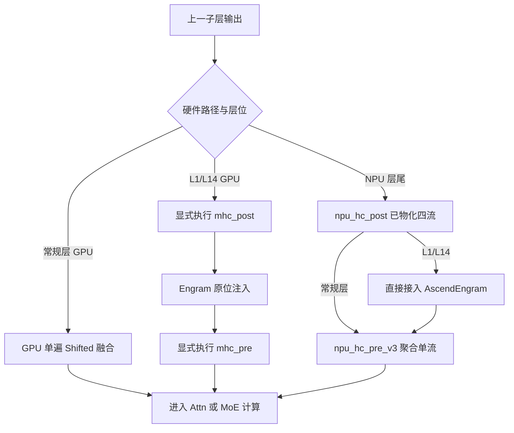

在 [07 条件记忆（Engram）](../07-engram/) 的层间接口里，我们见到了 `mhc_post` 与 `mhc_pre` 两个算子，以及它们维护的四分支残差张量 `[T, 4, d]`。这里 $T$ 是 token 数量，$d$（mHC 原论文记作 $C$）是隐藏维，中间的通道维 $4$ 用来在算子外侧扩宽残差容量。

在经典 ResNet 与 Transformer 中，各层通过单流残差连接（Residual Connection）串联，即 $\mathbf{x}_{l+1} = \mathbf{x}_l + \mathcal{F}(\mathbf{x}_l, \mathcal{W}_l)$。想在不丢信息的前提下扩大层间特征容量，最直接的做法是把隐藏维 $C$ 扩大 $n$ 倍，但注意力与 FFN 的矩阵乘法计算量随宽度平方增长——宽度扩至 4 倍，FLOPs 会增至 16 倍。

超连接（Hyper-Connections，HC）改走另一条路：保持算子 $\mathcal{F}$ 内部宽度 $C$ 不变，仅把层间传递的隐藏状态扩宽为 $n = 4$ 条并行流 $\mathbf{x}_l \in \mathbb{R}^{4 \times C}$[^mhc-paper]。然而无约束线性映射会破坏标准残差的恒等映射性质：跨 60 个子层连乘后，27B 训练出现约 3000 倍的信号增益发散与损失尖峰，且显存读写随 $n$ 倍放大。DeepSeek 提出的流形受限超连接（mHC）[^mhc-paper] 与 V4.1 的单遍 `Mega-mHC`[^v41-flash] 分别从流形约束与算子时移两方面解开了这两个瓶颈。

## 三组映射架构与四流单层数值推演

对照图 1 自左向右观察三代残差连接的单层拓扑差异[^mhc-paper]。最左侧（a）为经典单流残差，$\mathbf{x}_l \in \mathbb{R}^{1 \times C}$ 直接恒等直连到加法节点，旁路经算子 $\mathcal{F}$ 后加回。中间（b）为无约束 HC：输入展成 $n$ 条并行流 $\mathbf{x}_l \in \mathbb{R}^{n \times C}$，主干侧经 `Res` 映射 $\mathcal{H}_l^{\mathrm{res}} \in \mathbb{R}^{n \times n}$ 混合跨流特征得到 $\mathbf{h}_l^{\mathrm{res}}$，旁路先经 `Pre` 映射 $\mathcal{H}_l^{\mathrm{pre}} \in \mathbb{R}^{1 \times n}$ 压成单流 $\mathbf{h}_l^{\mathrm{in}} \in \mathbb{R}^{1 \times C}$ 送入算子 $\mathcal{F}$，再经 `Post` 映射 $\mathcal{H}_l^{\mathrm{post}\,\top} \in \mathbb{R}^{n \times 1}$ 写回 4 条流与主干相加。右侧（c）即本文讨论的 mHC：拓扑与 HC 完全一致，核心改动是对 `Pre`、`Res`、`Post` 三组映射分别施加流形投影 $\mathcal{P}_{\mathcal{M}^{\mathrm{pre}}}$、$\mathcal{P}_{\mathcal{M}^{\mathrm{res}}}$、$\mathcal{P}_{\mathcal{M}^{\mathrm{post}}}$，把自由漂移的系数约束在守恒多面体内。


在实际 Transformer 中，Attention 和 MoE（或 FFN）各做一次残差更新，因此 1 个 Transformer 层对应 2 个 mHC 子层（图 2 左栏）[^dsv4-paper]——一个 30 层的模型就会连续穿过 60 个 `Res Mixing` 节点。顺着图 2 右栏，取 4 条流第 0 维的初值 $\mathbf{x}_l = [10.0, 20.0, 30.0, 40.0]^\top$（均值为 25.0），可以把单子层前向传播手算一遍。

![左栏按 DeepSeek-V4 结构将 1 个 Transformer 层展开为 Attention 与 MoE/FFN 两个连续 mHC 子层；右栏用 [10, 20, 30, 40] 首维示例逐项推演单子层的 Res 混合、Pre 聚合、F 计算与 Post 写回流程](./diagrams/08-mhc-block-trace.drawio '图 2：Transformer 双子层展开与 n=4 单子层数值推演')

首先由旁路聚合权重 $\mathcal{H}_l^{\mathrm{pre}} = [0.5, 0.2, 0.2, 0.1]$ 加权求和，把 `[4, C]` 压回算子所需的单流宽度 `[1, C]`，算出 $h_l^{\mathrm{in}} = 0.5 \times 10 + 0.2 \times 20 + 0.2 \times 30 + 0.1 \times 40 = 19.0$；经过 `RMSNorm` 与 $\mathcal{F}$ 算得单流增量 4.0——算子内部矩阵维度仍为 $C$，计算量零膨胀。与此同时，主干侧 4 条流直接左乘双随机矩阵 $\mathcal{H}_l^{\mathrm{res}}$ 原地交换跨流信息：

$$
\mathcal{H}_l^{\mathrm{res}} = \begin{bmatrix} 0.5 & 0.2 & 0.2 & 0.1 \\ 0.2 & 0.4 & 0.2 & 0.2 \\ 0.2 & 0.2 & 0.4 & 0.2 \\ 0.1 & 0.2 & 0.2 & 0.5 \end{bmatrix}, \quad \mathbf{h}_l^{\mathrm{res}} = \mathcal{H}_l^{\mathrm{res}} \begin{bmatrix} 10 \\ 20 \\ 30 \\ 40 \end{bmatrix} = \begin{bmatrix} 19.0 \\ 24.0 \\ 26.0 \\ 31.0 \end{bmatrix}
$$

所得 $\mathbf{h}_l^{\mathrm{res}} = [19.0, 24.0, 26.0, 31.0]^\top$ 融合了其他分支的特征，而元素总和依然为 100.0，均值仍保持 25.0。最后旁路写回映射 $\mathcal{H}_l^{\mathrm{post}\,\top} = [1.2, 0.8, 0.5, 1.5]^\top$ 将算子增量 4.0 分配回 4 个分支得到 $[4.8, 3.2, 2.0, 6.0]^\top$，与 $\mathbf{h}_l^{\mathrm{res}}$ 相加输出 $\mathbf{x}_{l+1} = [23.8, 27.2, 28.0, 37.0]^\top$。

### 旁路归一化边界与双随机守恒

从图 1 和图 2 可以看出 `RMSNorm` 与残差主干的边界：`RMSNorm` 只位于右侧算子分支 $\mathcal{F}$ 内部，无法约束左侧 `Res` 直连主干。若往残差直连通道中也插入 `RMSNorm`，就会切断直连路径上的恒等导数，深层反向传播同样会出现梯度消失。而若为了稳定把 $\mathcal{H}_l^{\mathrm{res}}$ 固定为单位阵 $\mathbf{I}_4$（四流互不混合），原论文表 1 的消融已经给出了对比结论[^mhc-paper]：仅开 `Pre` 和 `Post` 而固定 $\mathcal{H}_l^{\mathrm{res}} = \mathbf{I}$ 时收益有限；放开可学习的 $\mathcal{H}_l^{\mathrm{res}}$ 单独一项就带来 -0.022 / -0.027（超过八成）的损失降幅，可见主干跨流混合正是超连接表达力的主要来源。

要同时保住跨流混合和深层信号守恒，mHC 把 $\mathcal{H}_l^{\mathrm{res}}$ 限制在**双随机矩阵（Doubly Stochastic Matrix）**流形上。双随机矩阵满足三条性质：矩阵元素全为非负（$\mathcal{H}_{ij} \ge 0$），避免无约束 HC 中出现正负权重（如 -5.58 与 +6.77）互相抵消与放大；每行元素之和为 1（$\mathcal{H}_l^{\mathrm{res}}\mathbf{1}_4 = \mathbf{1}_4$），使输出每一维成为输入 4 条流的非负凸组合，输出幅值严格夹在旧值的最小与最大值之间；每列元素之和也为 1（$\mathbf{1}_4^\top\mathcal{H}_l^{\mathrm{res}} = \mathbf{1}_4^\top$），既让前向 4 条流总和守恒，又因为反向传播的雅可比矩阵恰为 $(\mathcal{H}_l^{\mathrm{res}})^\top$（原矩阵列和即转置矩阵行和），一并保证了反向梯度不爆炸。

将神经网络预测的无约束实数打分 $\tilde{\mathcal{H}}_l^{\mathrm{res}}$ 投影到双随机流形，mHC 采用经典的 Sinkhorn-Knopp 算法[^mhc-paper]：先逐元素取指数 $\mathbf{M}^{(0)} = \exp(\tilde{\mathcal{H}}_l^{\mathrm{res}}) > 0$，随后交替执行列归一化 $\mathcal{T}_c$ 与行归一化 $\mathcal{T}_r$。用一个简单的 $2 \times 2$ 正矩阵手算 1 轮可见收敛速度：

$$
\mathbf{M}^{(0)} = \begin{bmatrix} 1 & 3 \\ 1 & 1 \end{bmatrix}
\xrightarrow{\text{除列和 } [2,\,4]}
\begin{bmatrix} 0.50 & 0.75 \\ 0.50 & 0.25 \end{bmatrix}
\xrightarrow{\text{除行和 } [1.25,\,0.75]}
\begin{bmatrix} 0.40 & 0.60 \\ 0.67 & 0.33 \end{bmatrix}
$$

第 1 步每列除以列和后，列和对齐为 $[1.00, 1.00]$、行和为 $[1.25, 0.75]$；第 2 步每行除以行和后，行和对齐为 $[1.00, 1.00]$、列和收敛到 $[1.07, 0.93]$。论文固定迭代 $t_{\max} = 20$ 轮，偏差几乎收敛为零。

## Birkhoff 流形投影、计算重排与 27B 实证

阅读 mHC 原论文、DeepSeek-V4 技术报告与推理引擎源码时，常会碰到三套等价变量名。下表统一了各组映射符号及其流形约束[^mhc-paper][^dsv4-paper][^mhc-vllm][^mhc-ascend]：

| 架构角色 | 论文 / V4 记号                                | 源码变量与形状             | 流形约束与含义                                               |
| :------- | :-------------------------------------------- | :------------------------- | :----------------------------------------------------------- |
| 输入聚合 | $\mathcal{H}^{\mathrm{pre}}_l$ / $A_l$        | `pre_mix` `[T, 1, 4]`      | $\sigma(\cdot)$ 非负加权汇聚 4 流至单流 `[1, d]`             |
| 主干混合 | $\mathcal{H}^{\mathrm{res}}_l$ / $B_l$        | `comb_res_mix` `[T, 4, 4]` | Sinkhorn 投影至 Birkhoff 多面体 $\mathcal{M}^{\mathrm{res}}$ |
| 输出写回 | $\mathcal{H}^{\mathrm{post}\,\top}_l$ / $C_l$ | `post_mix` `[T, 4, 1]`     | $2\sigma(\cdot)\in[0, 2]$，零初值对齐单位写回                |

写回映射 $\mathcal{H}_l^{\mathrm{post}} = 2\sigma(\tilde{\mathcal{H}}_l^{\mathrm{post}})$ 乘上系数 2，使线性层零初始化时 $\sigma(0) \times 2 = 1.0$ 精确对齐标准残差的单位写回权重，同时保留向上放大学习特征至 2.0 的余量。

### 跨层递归增益、Birkhoff 多面体与 27B 实证

把单层方程从浅层 $l$ 递归展开到深层 $L$，得到多流跨层传播公式[^mhc-paper]：

$$
\mathbf{x}_{L} = \left(\prod_{i=1}^{L-l}\mathcal{H}_{L-i}^{\mathrm{res}}\right)\mathbf{x}_{l} + \sum_{i=l}^{L-1}\left(\prod_{j=1}^{L-1-i}\mathcal{H}_{L-j}^{\mathrm{res}}\right)\mathcal{H}_{i}^{\mathrm{post}\,\top}\mathcal{F}(\mathcal{H}_{i}^{\mathrm{pre}}\mathbf{x}_{i},\mathcal{W}_{i})
$$

在无约束 HC 中，主干直连项是 60 个自由矩阵的连乘积。论文以复合矩阵的最大绝对行和度量前向信号增益、最大绝对列和度量反向梯度增益：在 27B MoE 实验里，无约束 HC 单层行和虽在 1 附近波动，连乘 60 子层后却在 12k 步处飙升至约 3000 倍复合增益并引发损失尖峰[^mhc-paper]。


图 3 上半部分还原了原论文 Fig. 8 的 27B 60 子层复合矩阵[^mhc-paper]：左侧 HC 连乘矩阵出现 +142.3 与 -139.3 的剧烈正负震荡，复合行和达到 +509.1、全序列峰值接近 3000 倍；右侧 mHC 连乘矩阵各元素平稳落在 0.21–0.29 之间，60 子层连乘行和仍保持在 1.00–1.01。这一长期稳定性来自双随机流形（Birkhoff 多面体）$\mathcal{M}^{\mathrm{res}}$ 的几何与代数结构：作为所有置换矩阵凸组合构成的凸包，双随机矩阵本身满足谱范数非膨胀（$\|\mathcal{H}_l^{\mathrm{res}}\|_2 \le 1$），单步不会放大任何方向的特征；更重要的是双随机矩阵集合对**矩阵乘法封闭**——任意两个双随机矩阵的乘积依然是双随机矩阵，因此无论网络堆到 60 个还是上百个子层，连乘项 $\prod \mathcal{H}_k^{\mathrm{res}}$ 始终留在同一守恒流形内而不发散。

下表汇总原论文 27B 同算力基准（262B tokens、$t_{\max} = 20$ 步 Sinkhorn、训练端到端耗时仅增加 6.7%）的评测结果[^mhc-paper]：

| 方案（27B / 262B） | 训练稳定性     |   BBH    |   DROP   |  GSM8K   |   MMLU   | 复合增益 |
| :----------------- | :------------- | :------: | :------: | :------: | :------: | :------: |
| Baseline 单流      | 基准曲线       |   43.8   |   47.0   |   46.7   |   59.0   |   1.0×   |
| HC 无约束 4 流     | 12k 步尖峰     |   48.9   |   51.6   |   53.2   |   63.0   |  ~3000×  |
| mHC 双随机 4 流    | 稳定（-0.021） | **51.0** | **53.9** | **53.8** | **63.4** |  ≤1.6×   |

### 动态参数化与 RMSNorm 除法后置重排

为了既随输入 token 动态调节三组映射矩阵，又省去多读写一遍高维归一化张量的显存带宽，mHC 把 `RMSNorm` 与线性投影合并重排[^mhc-paper]：

$$
\begin{aligned}
\mathbf{x}^{\mathrm{flat}}_l &= \operatorname{flatten}(\mathbf{x}_l) \in \mathbb{R}^{1 \times 4C}, \qquad r = \frac{\|\mathbf{x}^{\mathrm{flat}}_l\|_2}{\sqrt{4C}} \\
[\tilde{\mathcal{H}}^{\mathrm{pre}}_l,\, \tilde{\mathcal{H}}^{\mathrm{post}}_l,\, \tilde{\mathcal{H}}^{\mathrm{res}}_l] &= \frac{1}{r}\Big(\alpha_l \odot (\mathbf{x}^{\mathrm{flat}}_l \varphi_l)\Big) + \mathbf{b}_l
\end{aligned}
$$

其中 $\varphi_l \in \mathbb{R}^{4C \times 24}$ 合并算出 `Pre`（4）、`Post`（4）、`Res`（16）共 24 个动态打分并吸收 `RMSNorm` 权重，门控初值 $\alpha_l$ 设为 0.01。利用齐次性 $(\mathbf{x}^{\mathrm{flat}}_l / r)\varphi_l = (\mathbf{x}^{\mathrm{flat}}_l \varphi_l)/r$，计算核先把除以 $r$ 挪到矩阵乘之后，只需把 $\mathbf{x}_l$ 从 HBM 读进片上寄存器一遍，同时累加点积和平方和，最后对输出的 24 个标量除以 $r$ 即可，免去反复读写 `[T, 4C]` 中间张量。

## 系统优化：从原论文算子融合到 V4.1 单遍 Mega-mHC

数值稳定后，工程上面临的主要瓶颈转向显存带宽墙。按元素计算，若按公式分立发射 Kernel，每层仅残差维护就要读 $(5n + 1)C$、写 $(3n + 1)C$（$n = 4$ 时为 $21C$ 读 + $13C$ 写）[^mhc-paper]。原论文在训练侧通过 TileLang 融合算子、按分段长度 $L_r^* \approx \sqrt{nL/(n+2)}$ 选择性重计算以及在 `DualPipe` 中重叠通信与旁路混合计算，把 27B 训练总耗时增幅压在 6.7%。

在单批延迟高度受限于 HBM 带宽的推理解码侧，DeepSeek-V4.1 进一步将每子层边界访存压到信息论下界 $(2n + 2)d = 10d$，演进过程如图 4 上半区所示[^v41-flash]。若朴素分立发射上层 `Post + Res` 更新、系数量算、`Pre` 聚合与 `RMSNorm` 四个 Kernel，每子层共搬运 $(4n + 4)d = 20d$。合并更新与归约做成两遍融合时，由于分母 $r$ 与本层系数 $A_l$ 必须等整条 $4d$ 维度归约完毕才就绪，Pass 1（读写 $9d$）无法同时完成 $A_l X_l$ 聚合，被迫再开 Pass 2 重读 $X_l$ 并做完 `RMSNorm`（$5d$），总访存为 $(3n + 2)d = 14d$。


V4.1 的单遍 `Mega-mHC` 把输入聚合权重错位时移一步，改用上一子层早已算出的 $A_{l-1}$[^v41-flash]：

$$
X_{l+1} = B_l X_l + C_l \,\mathcal{F}_l(A_{l-1} X_l), \qquad (A_l, B_l, C_l) = \mathcal{H}(X_l)
$$

解除数据依赖后，Tile 扫描能在单遍读 $5d$（$y_{l-1} + X_l$）与单遍写 $5d$（$X_{l+1} + \operatorname{Norm}(A_{l-1}X_l)$）、合计 $10d$ 内一次完成。首子层固定 $A_{-1} = [1, 0, 0, 0]$ 起步，整网末尾再用多算出的 `ffn_pre` 完成向单流 `[T, d]` 的归并。

观察图 4 下半区与图 5 的控制流可以发现两套硬件的边界差异：NVIDIA GPU 采用跨子层延迟合并，因此仅在第 1、14 层遇到 `Engram` 注入时才显式拆开融合边界，先用 `mhc_post` 物化 `[T, 4, d]` 再进入 `Engram`；而昇腾 NPU 在每个子层末尾都调用 `npu_hc_post` 物化四流，在常规层直接进入下一层 `npu_hc_pre_v3`，遇到第 1、14 层则直接衔接 `AscendEngram` 后再归并进注意力，无需调整子层内部控制流[^mhc-vllm][^mhc-ascend]。



## PyTorch 参考实现：从无约束 HC 到 mHC

下面先给出标准无约束超连接（HC）的可运行参考实现，再仅替换归一化投影、流形激活、logit 空间偏置与首尾接口四处设计，落地带有不变量校验的 `ManifoldHyperConnection`。

### 无约束 HC 实现与张量映射

以下 `HyperConnection` 模块支持任意保持隐藏维 `dim` 不变的子层 `f`[^hc-paper][^mhc-paper]。对每个 token 的多流状态 $H \in \mathbb{R}^{n \times d}$，`_rms_norm` 先逐流归一化；再经由零初始化动态权重 $\Theta$ 与 `tanh` 门控生成 `pre_map`、`res_map` 和 `post_map`。因为初始步动态项严格归零，仅剩静态基线 $\beta_{\mathrm{pre}} = \frac{1}{n}\mathbf{1}$、$\beta_{\mathrm{res}} = \mathbf{I}_n$ 与 $\beta_{\mathrm{post}} = \mathbf{1}$，所以各流初值相同时第 0 步精确退化为普通残差 $h + f(h)$。外部若维护展平张量 `[..., n * dim]`，直接通过 `unflatten` 与 `flatten` 视图切换接入即可。

```python
import torch
import torch.nn as nn
import torch.nn.functional as F


class HyperConnection(nn.Module):
    """Hyper-Connection over n parallel residual streams.

    Args:
        f:   Transformer block, attention, MLP, or another module.
        n:   Number of parallel residual streams.
        dim: Hidden size of each stream.
        eps: RMSNorm epsilon.

    Input / Output:
        Tensor with shape (..., n, dim).
    """

    def __init__(self, f: nn.Module, n: int = 4, dim: int = 4096, eps: float = 1e-6):
        super().__init__()
        if n < 1 or dim < 1:
            raise ValueError("n and dim must be positive")

        self.f = f
        self.n = n
        self.dim = dim
        self.eps = eps

        # 动态门控缩放系数：形状 (1,) 可直接广播到任意批大小与序列长度前导维
        self.alpha_pre = nn.Parameter(torch.full((1,), 0.01))
        self.alpha_res = nn.Parameter(torch.full((1,), 0.01))
        self.alpha_post = nn.Parameter(torch.full((1,), 0.01))

        # 静态基线偏置：初始时 Pre 取 1/n 均值，Res 为单位阵，Post 全为 1
        self.beta_pre = nn.Parameter(torch.full((1, n), 1.0 / n))
        self.beta_res = nn.Parameter(torch.eye(n))
        self.beta_post = nn.Parameter(torch.ones(1, n))

        # 动态投影权重零初始化，使初始步 tanh(linear(...)) == 0
        self.theta_pre = nn.Parameter(torch.zeros(1, dim))
        self.theta_res = nn.Parameter(torch.zeros(n, dim))
        self.theta_post = nn.Parameter(torch.zeros(1, dim))

    def _rms_norm(self, x: torch.Tensor) -> torch.Tensor:
        """Apply RMSNorm independently to each residual stream."""
        dtype = x.dtype
        x = x.float()
        x = x * torch.rsqrt(x.square().mean(dim=-1, keepdim=True) + self.eps)
        return x.to(dtype)

    def forward(self, x: torch.Tensor) -> torch.Tensor:
        if x.shape[-2:] != (self.n, self.dim):
            raise ValueError(
                f"expected x[..., {self.n}, {self.dim}], got {tuple(x.shape)}"
            )

        # 对 n 条流各自按隐藏维 dim 做归一化，形状保持 (..., n, dim)
        x_norm = self._rms_norm(x)

        # 三个动态 + 静态门控系数：pre/post 为 (..., 1, n)，res 为 (..., n, n)
        pre_map = (
            self.alpha_pre
            * torch.tanh(F.linear(x_norm, self.theta_pre)).transpose(-1, -2)
            + self.beta_pre
        )
        res_map = (
            self.alpha_res * torch.tanh(F.linear(x_norm, self.theta_res))
            + self.beta_res
        )
        post_map = (
            self.alpha_post
            * torch.tanh(F.linear(x_norm, self.theta_post)).transpose(-1, -2)
            + self.beta_post
        )

        # 1) Pre 聚合 n 条流送入单流模块 f；2) Res 混洗旧残差；3) Post 广播写回相加
        block_input = (pre_map @ x).squeeze(-2)
        block_output = self.f(block_input)
        if block_output.shape != block_input.shape:
            raise ValueError(
                "f must preserve hidden dimension: "
                f"input {tuple(block_input.shape)}, output {tuple(block_output.shape)}"
            )

        residual = res_map @ x
        injection = post_map.transpose(-1, -2) * block_output.unsqueeze(-2)
        return residual + injection
```

### 流形受限 mHC 实现与不变式校验

从无约束 HC 升级到工程可稳健训练的 mHC，拓扑骨架保持不变，改动集中在以下四项对照：

| 改动维度         | `HyperConnection`（HC）               | `ManifoldHyperConnection`（mHC）                           |
| :--------------- | :------------------------------------ | :--------------------------------------------------------- |
| 归一化与投影视野 | 逐流 `RMSNorm` 配共享投影（局部感知） | 展平 `[..., n * d]` 合并投影 $\varphi$（除法后置全局感知） |
| 动态激活与约束   | `tanh` 加静态偏置，可正可负无守恒     | $\sigma(\cdot)$、$2\sigma(\cdot)$ 与 20 轮 FP32 Sinkhorn   |
| 静态偏置空间     | 直接落在最终权重空间                  | 落在 logit 空间：$-\ln(n-1)$、$0$、$\gamma I_n$            |
| 首尾流接口       | `unflatten` / `flatten` 维持多流      | 入口 `expand_streams` 复制，末层 `collapse_streams` 归并   |

以下自包含实现将除法后置重排与 FP32 流形投影精度落地为 `ManifoldHyperConnection`，并在结尾同时验证了零初值残差等价性与 20 轮 Sinkhorn 双随机行和/列和收敛性。

```python
import math
import torch
import torch.nn as nn
import torch.nn.functional as F


def expand_streams(x: torch.Tensor, n: int = 4) -> torch.Tensor:
    """将词嵌入后的单流状态 [..., dim] 沿残差分支维扩宽为 [..., n, dim]。"""
    return x.unsqueeze(-2).expand(*x.shape[:-1], n, x.shape[-1]).contiguous()


def collapse_streams(
    x: torch.Tensor, pre_map: torch.Tensor | None = None
) -> torch.Tensor:
    """末层退出时把 [..., n, dim] 归并回单流 [..., dim]；未传入权重时退化为均分。"""
    if pre_map is None:
        return x.mean(dim=-2)
    return (pre_map @ x.float()).squeeze(-2).to(x.dtype)


class ManifoldHyperConnection(nn.Module):
    """Manifold-Constrained Hyper-Connection (mHC) over n parallel streams."""

    def __init__(
        self,
        f: nn.Module,
        n: int = 4,
        dim: int = 4096,
        sinkhorn_iters: int = 20,
        diag_bias: float = 8.0,
        eps: float = 1e-6,
        sinkhorn_eps: float = 1e-12,
    ):
        super().__init__()
        if n < 1 or dim < 1:
            raise ValueError("n and dim must be positive")

        self.f = f
        self.n = n
        self.dim = dim
        self.sinkhorn_iters = sinkhorn_iters
        self.eps = eps
        self.sinkhorn_eps = sinkhorn_eps

        # 合并线性投影 phi（含 Pre(n)、Post(n)、Res(n*n) 共 n^2+2n 路输出，零初始化）
        self.phi = nn.Parameter(torch.zeros(n * n + 2 * n, n * dim))
        self.alpha = nn.Parameter(torch.full((3,), 0.01))

        # Logit 空间静态偏置：使初始 step-0 对齐 sigmoid(b_pre)=1/n, 2*sigmoid(0)=1
        pre_init = -math.log(n - 1) if n > 1 else 8.0
        self.b_pre = nn.Parameter(torch.full((1, n), pre_init))
        self.b_post = nn.Parameter(torch.zeros(1, n))
        self.b_res = nn.Parameter(torch.eye(n) * diag_bias)

    def _sinkhorn_knopp(self, logits: torch.Tensor) -> torch.Tensor:
        """在 FP32 下减去每矩阵最大值以稳健取指数，并交替执行列、行归一化。"""
        shifted = logits - logits.amax(dim=(-2, -1), keepdim=True)
        m = torch.exp(shifted)
        for _ in range(self.sinkhorn_iters):
            m = m / (m.sum(dim=-2, keepdim=True) + self.sinkhorn_eps)
            m = m / (m.sum(dim=-1, keepdim=True) + self.sinkhorn_eps)
        return m

    def forward(self, x: torch.Tensor) -> torch.Tensor:
        if x.shape[-2:] != (self.n, self.dim):
            raise ValueError(
                f"expected x[..., {self.n}, {self.dim}], got {tuple(x.shape)}"
            )

        orig_dtype = x.dtype
        x_fp32 = x.float()
        x_flat = x_fp32.flatten(-2)

        # RMSNorm 除法后置重排：(x_flat / r) @ phi^T == (x_flat @ phi^T) * (1 / r)
        inv_rms = torch.rsqrt(x_flat.square().mean(dim=-1, keepdim=True) + self.eps)
        # 合并投影一次算出 Pre(n) + Post(n) + Res(n^2) 共 n^2 + 2n 个动态 logit
        raw = F.linear(x_flat, self.phi.float()) * inv_rms
        raw_pre, raw_post, raw_res = raw.split([self.n, self.n, self.n * self.n], dim=-1)

        # Pre 用 sigmoid 非负加权，Post 用 2*sigmoid（0 初值对齐单位写回 1.0），Res 经 FP32 Sinkhorn 投向双随机流形
        pre_map = torch.sigmoid(self.alpha[0] * raw_pre.unsqueeze(-2) + self.b_pre)
        post_map = 2.0 * torch.sigmoid(
            self.alpha[1] * raw_post.unsqueeze(-2) + self.b_post
        )
        res_logits = self.alpha[2] * raw_res.unflatten(-1, (self.n, self.n)) + self.b_res
        res_map = self._sinkhorn_knopp(res_logits)

        # 单流算子 f 在 [..., dim] 上运算，FLOPs 与标准残差完全一致
        block_input = (pre_map @ x_fp32).squeeze(-2).to(orig_dtype)
        block_output = self.f(block_input)
        if block_output.shape != block_input.shape:
            raise ValueError(
                "f must preserve hidden dimension: "
                f"input {tuple(block_input.shape)}, output {tuple(block_output.shape)}"
            )

        # 主干 Res 跨流混洗与旁路 Post 写回相加 -> [..., n, dim]
        residual = res_map @ x_fp32
        injection = post_map.transpose(-1, -2) * block_output.float().unsqueeze(-2)
        return (residual + injection).to(orig_dtype)


if __name__ == "__main__":
    torch.manual_seed(8)
    with torch.no_grad():
        B, T, n, dim = 2, 8, 4, 64
        f = nn.Linear(dim, dim)
        h = torch.randn(B, T, dim)
        x_eq = expand_streams(h, n)
        expected = expand_streams(h + f(h), n)

        # 不变式 1：phi=0 时等值流步 0 必须精确退化为标准残差连接 h + f(h)
        hc = HyperConnection(f, n=n, dim=dim)
        mhc = ManifoldHyperConnection(f, n=n, dim=dim)
        assert torch.allclose(hc(x_eq), expected, atol=1e-5)
        assert torch.allclose(mhc(x_eq), expected, atol=1e-5)
        assert collapse_streams(mhc(x_eq)).shape == h.shape

        # 不变式 2：20 轮 Sinkhorn-Knopp 输出的行和、列和同时收敛至 1.0（Birkhoff 双随机流形）
        mat = mhc._sinkhorn_knopp(torch.randn(B, n, n) * 1.5)
        assert torch.allclose(mat.sum(dim=-1), torch.ones(B, n), atol=1e-3)
        assert torch.allclose(mat.sum(dim=-2), torch.ones(B, n), atol=1e-3)
```

在初始步 $\varphi = 0$ 时，logit 空间静态偏置同样把首步锁回标准残差：`pre_map` 通过 $\sigma(-\ln(n-1)) = 1/n$ 求均值，`post_map` 通过 $2\sigma(0) = 1.0$ 等权写回，而任何双随机矩阵作用在 `expand_streams` 构造的等值流上都有 $P_{\mathrm{res}}H = H$（配合对角偏置 `diag_bias` 让不同分支在训练早期依然接近恒等矩阵）。

## NVIDIA GPU 与昇腾 NPU 源码对照

把单遍时移落地到两大异构硬件栈时，`vLLM` 与 `vllm-ascend` 在「跨子层延迟融合」还是「子层尾立即物化四流」上做出了截然不同的架构选择。

### NVIDIA GPU 跨子层延迟融合路径

在 `vLLM` 的 DeepSeek-V4.1 模型中[^mhc-vllm]，`DeepseekV4DecoderLayer` 将上一子层未写回的单流增量与映射系数 `(x, residual, post_mix, res_mix, ffn_pre)` 透传给下一子层入口的 `mhc_shifted_post_pre`，再按批量和硬件能力分发：SM100 上小批量解码走 CuTe DSL `MhcBoundaryKernel`、大批量走 DeepGEMM `mega_mhc`，开启 `FULL` 图且 token 数不超过 16 时还会把 CuTe Lamport `AllReduceMHC` 直接融进写回核并用副流预计算系数，否则回落 TileLang 延迟融合核。这套跨子层合并路径只在 `layers.1` 和 `layers.14` 遇到 `Engram` 时显式拆开，先调 `mhc_post_tilelang` 物化完整四流喂给 `Engram`，随后再调 `mhc_pre` 聚合进注意力。

```python
# vllm/models/deepseek_v41/nvidia/ops/mega_mhc.py:47-64 (vllm@bb23c0a8)
def mhc_shifted_post_pre_deep_gemm(
    x: torch.Tensor,
    residual: torch.Tensor,
    shifted_prev_mix: torch.Tensor,  # 上一子层传来的 A_{l-1}
    post_mix: torch.Tensor,
    comb_res_mix: torch.Tensor,
    fn: torch.Tensor,
    ...,
    rmsnorm_weight: torch.Tensor,
    rmsnorm_eps: float,
) -> tuple[torch.Tensor, torch.Tensor, torch.Tensor, torch.Tensor, torch.Tensor]:
    """Run DSV4.1 shifted post, next pre, and BF16 RMSNorm with Mega mHC."""
```

### 华为昇腾 NPU 子层成对物化路径

与 GPU 的跨子层延迟合并相对，`vllm-ascend` 中的 `DeepseekV41DecoderLayer` 将 `Pre` 与 `Post` 固化为子层首尾成对算子[^mhc-ascend]。进入子层时，`hc_pre` 调用 `npu_hc_pre_v3` 消费上一子层算好的 `pre_mix` 完成四流聚合与 20 轮 Sinkhorn 迭代，并同时产出本子层 `post`、`comb` 与下一子层的 `pre_mix`；Attention 之后通过 `rms_norm_cast` 同步生成 BF16 激活和 FP32 MoE 路由输入；在 Attention 与 MoE 子层结尾则立即调用 `npu_hc_post` 物化完整 `[T, 4, hidden_size]` 四流。因为层间残差始终处于已物化状态，遇到第 1、14 层的 `Engram` 时无需拆开控制流即可直接原位读写，整网末端则由 `hc_collapse` 归并。

```python
# vllm_ascend/models/deepseek_v41/model.py:860-875 (vllm-ascend@3649b8ff)
@staticmethod
def hc_collapse(x, pre_mix):
    return (pre_mix.unsqueeze(-1) * x.float()).sum(-2).to(x.dtype)

def hc_pre(self, x, hc_fn, hc_scale, hc_base, pre_mix=None):
    return torch.ops._C_ascend.npu_hc_pre_v3(
        x, hc_fn, hc_scale, hc_base, pre_mix,
        hc_mult=self.hc_mult, hc_sinkhorn_iters=self.hc_sinkhorn_iters,
        norm_eps=self.norm_eps, hc_eps=self.hc_eps,
    )

def hc_post(self, x, residual, post, comb):
    return torch.ops._C_ascend.npu_hc_post(
        x.unsqueeze(0), residual.unsqueeze(0),
        post.unsqueeze(0), comb.unsqueeze(0),
    ).squeeze(0)
```

两套生态的核心架构差异浓缩在下表中：

| 对比维度     | NVIDIA GPU 延迟融合栈      | 华为昇腾 NPU 子层成对栈       |
| :----------- | :------------------------- | :---------------------------- |
| 融合边界组织 | 跨子层合并上层写回         | 子层首尾各自成对归并          |
| Norm 协同    | 融进写回聚合边界尾声       | 独立调用 `rms_norm_cast` 产出 |
| Engram 衔接  | 第 1/14 层显式拆开边界     | 层间已物化可直接原位读写      |
| 通信协同     | 小批融进 Lamport AllReduce | 前后衔接序列并行集合通信      |

即使单子层访存已被 `Mega-mHC` 压到 $10d$，仍有两笔成本无法绕开：层间驻留的 `[T, 4, d]` 残差体积始终是单流的 4 倍，流水线并行跨卡传输或向 DSpark 传入展平隐藏态时都必须按 $4d$ 规划带宽与显存[^mhc-paper][^mhc-ascend]；同时两套栈对投影权重、门控尺度与 20 轮 Sinkhorn 迭代均强制留在 FP32 精度，降低精度或缩减迭代步数留下的微小列和偏差，在 60 个子层连乘后依然会放大成数值漂移。

到这里，我们已经拆解完主干网络上的两项关键创新：`Engram` 的 $O(1)$ 静态查表记忆与 `mHC` 的四流双随机残差。下一篇 [09 多 token 预测与动态推测解码（DSpark）](../09-mtp-and-dspark/) 将转向解码末端的权重带宽瓶颈，看模型如何一次前向并行验证多个草稿 token。

[^mhc-paper]: Xie et al., _mHC: Manifold-Constrained Hyper-Connections_, [arXiv:2512.24880](https://arxiv.org/abs/2512.24880)（2025-12），Fig. 1、Fig. 8、§3.1–3.2 Table 1–2、§4.1–4.3 式 (3)–(20) 及 §5 Table 4。

[^v41-flash]: DeepSeek-AI, _DeepSeek-V4.1-Flash Technical Report_, [arXiv:2609.19969](https://arxiv.org/abs/2609.19969)（2026-09），§2.4.1 式 (3)–(6)（Single-Pass 时移 $A_{l-1}$ 与 `Mega-mHC` 从 $(4n+4)d = 20d$ 到 $(2n+2)d = 10d$ 的访存下界推导）。

[^dsv4-paper]: DeepSeek-AI, _DeepSeek-V4 Technical Report_, [arXiv:2606.19348](https://arxiv.org/abs/2606.19348)（2026-06），Fig. 2（Transformer Block 双子层 mHC 结构）与 §2.2 式 (1)–(5)（统一 $A_l / B_l / C_l$ 记号）。

[^mhc-vllm]: `vLLM` 仓库（commit `bb23c0a8`）：`vllm/model_executor/kernels/mhc/torch.py`（`L6-45`）、`vllm/model_executor/layers/mhc.py`、`vllm/models/deepseek_v41/nvidia/ops/{mhc.py,mega_mhc.py,mhc_boundary.py}` 与 `nvidia/model.py`（`L539-719`）。

[^mhc-ascend]: `vllm-ascend` 仓库（commit `3649b8ff`）：`vllm_ascend/models/deepseek_v41/model.py`（`L826-940, 1664-1736` `DeepseekV41DecoderLayer`、`npu_hc_pre_v3`、`npu_hc_post`、`rms_norm_cast` 与 `hc_collapse`）。

[^hc-paper]: Zhu et al., _Hyper-Connections_, [arXiv:2409.19606](https://arxiv.org/abs/2409.19606)（ICLR 2025），提出在残差流上引入动态（`tanh` 门控）与静态偏置组合的 `Pre` / `Res` / `Post` 多流超连接及标准残差退化初始化。
