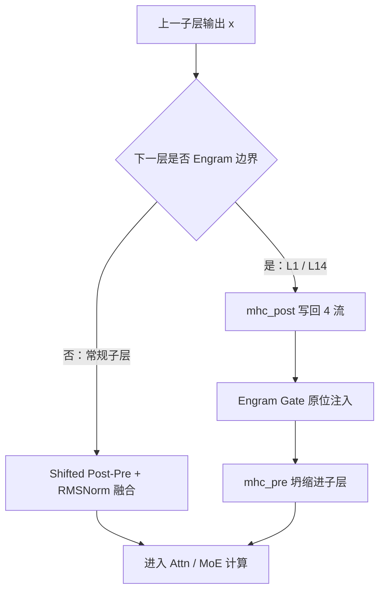

import MhcSinkhornExplainer from '../../../../explainers/deepseek/MhcSinkhornExplainer';

在[07 条件记忆（Engram）](../07-engram/)的层边界里，我们已经见过了两条成对出现的算子 `mhc_post` 与 `mhc_pre`——它们把沿用近十年的单条残差流扩宽成了 **4 条并行支路**（`[T, 4, d]`）。

标准残差 $\mathbf{x}_{l+1} = \mathbf{x}_l + \mathcal{F}(\mathbf{x}_l)$ 把所有历史层输出压进同一条宽为 $d$ 的通道。超连接（Hyper-Connections，HC）把它扩宽为 $n = 4$ 条并列流（总带宽 $4d$），允许每层通过可学习矩阵互相交叉混合，显著拓宽表征容量。可当网络叠到 30 层以上，无约束矩阵连乘会把前反向信号振幅推爆到 **`3000×` 以上**，直接击穿训练稳定性[^mhc-paper]。

**流形受限超连接（Manifold-Constrained Hyper-Connections，mHC）**给出了既稳固又节省访存的方案。读完本篇你能回答三个关键问题：为什么无约束 HC 会在深层引发数千倍指数失控；Sinkhorn-Knopp 如何用交替归一化把混合矩阵锁进 Birkhoff 双随机凸包；以及 V4.1 的 Shifted Post-Pre（`Mega-mHC`）如何让 `n=4` 残差流的单层 HBM 流量直接减半。

## 先看一个例子：30 层矩阵连乘的信号爆炸与 Sinkhorn 驯服

假设某 token 的 4 条并行残差分支在起点均值稳定，但每穿过一个子层都要乘上一次混合矩阵 $H_{\text{res}}^{(l)}$。如果不加任何流形约束，$H_{\text{res}}^{(l)}$ 里既有正负大权重、行和也不等于 1；经过 30 层 $\prod_l H_{\text{res}}^{(l)}$ 累积，复合增益极易突破三千倍。

在图 1 的 5 步交互推演中，可以完整追踪无约束矩阵发散、$t=0$ 指数正化、$t=1\text{–}4+$ 迭代投影到 Birkhoff 双随机多面体，以及 V4.1 `Mega-mHC` 把 HBM 读写从 `20d` 压到 `10d` 的全过程：

<MhcSinkhornExplainer
  client:visible
  title="图 1：mHC Sinkhorn-Knopp 双随机投影与 Mega-mHC 单遍融合"
/>

从图 1 可以得出一条核心结构判断：**单纯在子层内部加 `RMSNorm` 救不了主干直连通路**，因为跨层梯度和激活的指数爆炸发生在 $H_{\text{res}}^{(l)}$ 组成的恒等跳连主干上。只有把 $H_{\text{res}}^{(l)}$ 本身约束进谱半径严格有界且对乘法封闭的凸集，信号才不会越滚越大。

## 算法原理：Birkhoff 多面体、算子融合与边界切换

DeepSeek mHC 对三组动态映射施加正交约束（均由 4 流输入先归一化后投影生成）：

$$
\mathbf{x}_{l+1} = H_{\text{res}, l}\, \mathbf{x}_l + H_{\text{post}, l}^\top \mathcal{F}\!\big(H_{\text{pre}, l}\, \mathbf{x}_l\big)
$$

其中注入与汇聚向量 $H_{\text{pre}, l} = \sigma(\tilde{H}_{\text{pre}, l})$、$H_{\text{post}, l} = 2\sigma(\tilde{H}_{\text{post}, l})$ 保持非负防抵消。

关键的流间混洗矩阵 $H_{\text{res}, l}$ 先取指数确保全正 $M^{(0)} = \exp(\tilde{H}_{\text{res}, l})$，再经过 $t = 1 \dots T$（实装常取 $4\text{–}20$ 步）Sinkhorn-Knopp 交替迭代：

$$
M^{(t)} = \mathcal{T}_r\!\Big(\mathcal{T}_c\big(M^{(t-1)}\big)\Big), \qquad \mathcal{T}_r(A)_{ij} = \frac{A_{ij}}{\sum_k A_{ik}}, \quad \mathcal{T}_c(A)_{ij} = \frac{A_{ij}}{\sum_k A_{kj}}
$$

迭代收敛后，$H_{\text{res}, l} \in \mathcal{B}_n$ 成为**双随机矩阵**（行和与列和均为 1）。Birkhoff 多面体对矩阵乘法天然封闭（两个双随机矩阵相乘依然是双随机矩阵），谱范数 $\le 1$，无论模型堆到 30 层还是上百层，复合增益严格收敛，前向能量与反向梯度守恒。

图 2 将传统的单流残差与 `n=4` 的 mHC 多流残差总线摆在一起对比：


### 为什么需要 Shifted Post-Pre 与 Mega-mHC

扩宽为 4 条流带来的直接系统代价是激活访存膨胀 4 倍。如果把上一层的 `Post` 写回、当前层的 `Pre` 系数生成、混合坍缩与下层 `RMSNorm` 拆成分立内核，单子层要在 HBM 之间反复搬运 `~20d` 数据[^v41-flash]。

DeepSeek-V4.1 通过**时移融合边界**（`mhc_shifted_post_pre`）把计算重组：只要两层之间不插 Engram 查表（非 L1、L14 边界），就将上一子层的 `post_mix` 写回、`res_mix` 更新、下一子层的系数生成及 `RMSNorm` 全部塞进单遍寄存器内核里，总 HBM 访存从 `20d` 直降一半到 `10d`。如图 3 所示，引擎仅在第 1 和第 14 层 Engram 注入边界才切回显式分立调用，确保静态门控能看到更新后的完整四流状态。



## 核心实现与 GPU / 昇腾源码对照

下面给出独立 NumPy 核心实现，直接验证 30 层无约束 HC 与 20 步 Sinkhorn-Knopp 在 4 流残差矩阵连乘下的复合幅值差距与行/列和投影精度：

```python
import numpy as np


def run_mhc_stability_check() -> None:
    rng = np.random.default_rng(8)
    n, L = 4, 30

    # 1. 无约束 Hyper-Connections 30 层连乘
    prod_raw = np.eye(n, dtype=np.float64)
    for _ in range(L):
        h_raw = rng.standard_normal((n, n)) * 0.8 + np.eye(n)
        prod_raw = h_raw @ prod_raw
    amax_raw = float(np.max(np.abs(prod_raw)))

    # 2. mHC Sinkhorn-Knopp 投影到 Birkhoff 双随机流形
    def sinkhorn(logits: np.ndarray, iters: int = 20, eps: float = 1e-12) -> np.ndarray:
        m = np.exp(logits - logits.max())
        for _ in range(iters):
            m = m / (m.sum(axis=0, keepdims=True) + eps)
            m = m / (m.sum(axis=1, keepdims=True) + eps)
        return m

    prod_mhc = np.eye(n, dtype=np.float64)
    row_err = col_err = 0.0
    for _ in range(L):
        m = sinkhorn(rng.standard_normal((n, n)))
        row_err = max(row_err, float(np.max(np.abs(m.sum(axis=1) - 1.0))))
        col_err = max(col_err, float(np.max(np.abs(m.sum(axis=0) - 1.0))))
        prod_mhc = m @ prod_mhc

    amax_mhc = float(np.max(np.abs(prod_mhc)))
    assert row_err < 1e-6 and col_err < 1e-3 and amax_mhc <= 1.05
    print(
        f"30L unconstrained_Amax={amax_raw:.1f}, "
        f"mHC_Amax={amax_mhc:.4f}, row_err={row_err:.2e}, col_err={col_err:.2e}"
    )


if __name__ == "__main__":
    run_mhc_stability_check()
```

本地执行输出如下：30 层无约束矩阵连乘绝对值飙升到 `15641070.4`，而经过 Sinkhorn-Knopp 双随机投影后稳稳压在 `0.2500`，行和、列和偏差全部收敛在 $10^{-5}$ 以下：

```text
30L unconstrained_Amax=15641070.4, mHC_Amax=0.2500, row_err=1.00e-12, col_err=7.36e-06
```

### NVIDIA GPU 实现路径（`vLLM` `Mega-mHC` & `CuTe Boundary`）

在 `vLLM` 提交 `bb23c0a8` 中，通用抽象 `MHCPreOp` 位于 `vllm/model_executor/layers/mhc.py`[^mhc-vllm]，而在 V4.1 NVIDIA 专项优化栈里则分出两条核心融合算子：面向 SM100 的 DeepGEMM `mega_mhc` 内核（`vllm/models/deepseek_v41/nvidia/ops/mega_mhc.py:47-95`）与面向超小批量低延迟的 CuTe DSL 边界内核（`mhc_boundary.py:1025-1053`）：

```python
# vllm/models/deepseek_v41/nvidia/ops/mega_mhc.py:47-65
def mhc_shifted_post_pre_deep_gemm(
    x: torch.Tensor,
    residual: torch.Tensor,
    shifted_prev_mix: torch.Tensor,
    post_mix: torch.Tensor,
    comb_res_mix: torch.Tensor,
    fn: torch.Tensor,
    ...
    rmsnorm_weight: torch.Tensor,
    rmsnorm_eps: float,
) -> tuple[torch.Tensor, torch.Tensor, torch.Tensor, torch.Tensor, torch.Tensor]:
    """Run DSV4.1 shifted post, next pre, and BF16 RMSNorm with Mega mHC."""
```

而在需要同时处理 MoE 延迟归约（`_all_reduce_mhc.finalize`）的场景下，`mhc_shifted_post_pre` 还会直接与 TP All-Reduce 合并执行，并在 CUDA Graph 外部或 `capture_aux` 开启时自动安全退回分立路径[^mhc-vllm]。

### 华为昇腾 NPU 实现路径（`vllm-ascend` `npu_hc_pre_v3` & `npu_hc_post`）

在 `vllm-ascend` 提交 `3649b8ff` 中，`DeepseekV41DecoderLayer` 直接挂载了由 CANN 自定义算子注册的 `torch.ops._C_ascend.npu_hc_pre_v3` 与 `torch.ops._C_ascend.npu_hc_post`[^mhc-ascend]：

```python
# vllm_ascend/models/deepseek_v41/model.py:863-882
def hc_pre(self, x, hc_fn, hc_scale, hc_base, pre_mix=None):
    return torch.ops._C_ascend.npu_hc_pre_v3(
        x,
        hc_fn,
        hc_scale,
        hc_base,
        pre_mix,
        hc_mult=self.hc_mult,
        hc_sinkhorn_iters=self.hc_sinkhorn_iters,
        norm_eps=self.norm_eps,
        hc_eps=self.hc_eps,
    )

def hc_post(self, x, residual, post, comb):
    return torch.ops._C_ascend.npu_hc_post(
        x.unsqueeze(0),
        residual.unsqueeze(0),
        post.unsqueeze(0),
        comb.unsqueeze(0),
    ).squeeze(0)
```

在常规层的 `forward` 中，NPU 侧同样传递上一层的 `pre_mix` 到 `hc_pre` 完成融合，而在第 1、14 层 Engram 注入边界前先调 `hc_post` 把更新后的完整四流残差交还给 `AscendEngram` 门控模块。

| 实现维度 | NVIDIA GPU（`vLLM` `bb23c0a8`）                   | 华为昇腾 NPU（`vllm-ascend` `3649b8ff`）              |
| -------- | ------------------------------------------------- | ----------------------------------------------------- |
| 核心算子 | `mega_mhc` / CuTe `MhcBoundaryKernel` / TileLang  | `torch.ops._C_ascend.npu_hc_pre_v3` + `npu_hc_post`   |
| 融合边界 | `mhc_shifted_post_pre` 连带 `RMSNorm` 与 MoE 归约 | `pre_mix` 跨子层传递 + `DeviceOperator.rms_norm_cast` |
| 激活形状 | `[T, 4, hidden_size]`（`hc_mult = 4`）            | `[T, 4, hidden_size]`（仅边界 expand/unsqueeze）      |
| Sinkhorn | `sinkhorn_repeat` 寄存器展开（列先、行后）        | `hc_sinkhorn_iters` 算子内原地迭代                    |

## 代价与边界

- **残差显存占用的 4× 放大**：虽然单遍 `Mega-mHC` 把带宽压到了常规的 `10d`，但跨层驻留的残差张量仍然维持 `[B, 4, H]` 体积；在训练反向或长序列激活内存受限场景需要配套选择性重计算与流复用。
- **Engram 边界打断单遍融合**：一旦进入配置了 `engram` 的层（如 L1、L14），必须显式拆开上一层的 `mhc_post` 与下一层的 `mhc_pre`，以防止 `Engram` 漏看本层刚写回的多流更新，从而在对应两层回吐少量额外 HBM 带宽。
- **硬件对齐强约束**：无论是 SM100 上的 `is_mega_mhc_supported`（要求 `hidden_size % 1024 == 0` 且 `hc_mult == 4`），还是 `aiter` / CANN 自定义算子，都假定固定流数 $n=4$ 与整除维度；更改配置后会立刻回退到未融合参考核。

解决了长距离跨层传播与通道宽度矛盾后，整个骨干解码计算流已经相当高效；接下来唯一限制自回归生成速度上限的，就是「每个词必须依次串行发射一次全卡扫描」的内存墙。下一篇[09 多词元预测与动态推测解码](../09-mtp-and-dspark/)将聚焦 V3 串联 MTP 与 V4.1 DSpark 如何突破单个 token 的时间瓶颈。

## 自测

1. 为什么在 4 流 Hyper-Connections 中只靠每层子层前的 `RMSNorm` 无法阻止深层信号发生 3000 倍级爆炸？
2. Birkhoff 双随机多面体的两条核心线性约束是什么？为什么任意数量双随机矩阵相乘后依然落在该凸包内？
3. 解释 V4.1 `mhc_shifted_post_pre_deep_gemm` 是如何在不改变数学结果的前提下把每子层 HBM 流量从 `20d` 砍到 `10d` 的；第 1、14 层为何必须打破该融合？
4. 在上述 NumPy 验证脚本中，如果把 `sinkhorn` 的迭代步数从 `20` 降到 `4`，重新运行观察 `col_err` 与 `amax_mhc` 会出现什么量级的变化？

[^mhc-paper]: Xie et al., _mHC: Manifold-Constrained Hyper-Connections_, [arXiv:2512.24880](https://arxiv.org/abs/2512.24880)（2025-12），§2–4 分析 HC 3000x 增益崩溃、Birkhoff 双随机流形与 20 步 Sinkhorn-Knopp。

[^v41-flash]: DeepSeek-AI, _DeepSeek-V4.1-Flash Technical Report_, [arXiv:2609.19969](https://arxiv.org/abs/2609.19969)，§2.4.1 提出 Single-Pass `A_{l-1}` 错位时移与 `Mega-mHC` 带宽下界分析。

[^mhc-vllm]: `vLLM` 仓库（commit `bb23c0a8`）：`vllm/model_executor/layers/mhc.py`、`vllm/models/deepseek_v41/nvidia/ops/{mhc.py,mega_mhc.py,mhc_boundary.py}` 与 `nvidia/model.py:539-719`。

[^mhc-ascend]: `vllm-ascend` 仓库（commit `3649b8ff`）：`vllm_ascend/models/deepseek_v41/model.py:772-940`（`DeepseekV41DecoderLayer`、`npu_hc_pre_v3`、`npu_hc_post`）。
