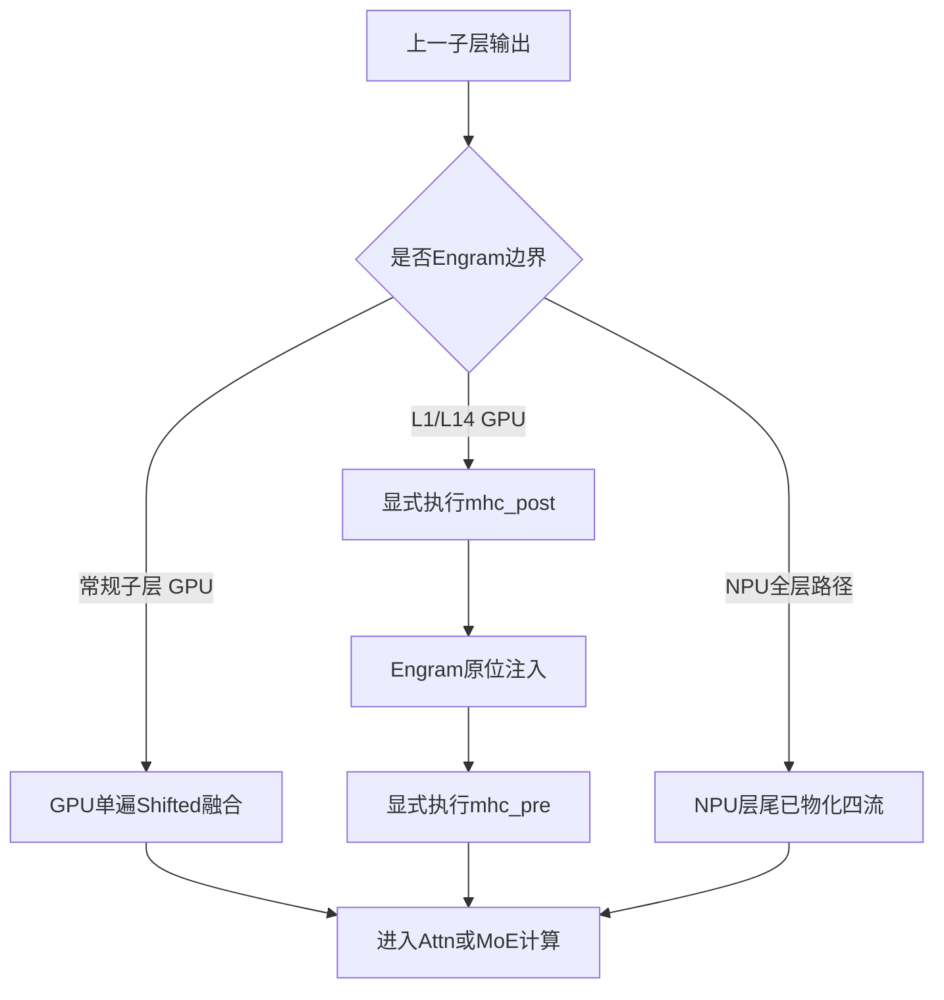

在[07 条件记忆（Engram）](../07-engram/)的层间接口里，我们第一次见到了两个陌生算子 `mhc_post` 与 `mhc_pre`，以及它们维护的四分支残差张量 `[T, 4, d]`。这里 $T$ 是词元数，$d$（mHC 原论文记作 $C$）是隐藏维，中间多出来的 $4$ 到底起什么作用？

在经典 ResNet 与 Transformer 里，各层通过单流**残差连接（Residual Connection）**串联，即 $\mathbf{x}_{l+1} = \mathbf{x}_l + \mathcal{F}(\mathbf{x}_l, \mathcal{W}_l)$。想在不丢信息的前提下扩大层间特征容量，最直接的做法是把隐藏维 $C$ 扩大 $n$ 倍，可注意力与 FFN 的矩阵乘法计算量随宽度平方增长——宽度扩 $4$ 倍，FLOPs 会直接暴涨 **16 倍**。

**超连接（Hyper-Connections，HC）**改用一条正交路径：保持算子 $\mathcal{F}$ 内部宽度 $C$ 不变，仅把层间传递的隐藏状态扩宽为 $n=4$ 条并行流 $\mathbf{x}_l \in \mathbb{R}^{4 \times C}$[^mhc-paper]。但这会丢掉标准残差的「恒等映射（Identity Mapping）」性质：跨 60 个子层连乘后，27B 训练出现 `~3000×` 信号爆炸与 Loss 突刺，且显存 I/O 随 $n$ 倍放大。

DeepSeek 提出的**流形受限超连接（mHC）**[^mhc-paper]与 V4.1 **`Mega-mHC`**[^v41-flash]同时解决了这两个问题。读完本章你能回答四个问题：mHC 的 `Pre / Res / Post` 三组映射如何衔接四流主干与单流算子；为什么在算子前放了 `RMSNorm` 仍拦不住主干爆炸；双随机矩阵如何兼顾跨流混洗与恒等守恒；以及 V4.1 如何通过时移 $A_{l-1}$ 把每子层 HBM 访存压到 $10d$。


## 先看一个例子：三组映射架构与单层数值走查

对照图 1 自底向上看 mHC 原论文的三个结构面板[^mhc-paper]：左边 **(a)** 是经典单流残差，$\mathbf{x}_l \in \mathbb{R}^{1\times C}$ 直接恒等直连到加法节点 `⊕`，旁路过 `Layer F` 后加回。

中间 **(b)** 是无约束 **HC**：输入先扩展成叠加的 $n$ 条流 $\mathbf{x}_l \in \mathbb{R}^{n \times C}$，主干侧经过 **`Res Mapping`** $\mathcal{H}_l^{\mathrm{res}} \in \mathbb{R}^{n\times n}$ 产生 $\mathbf{h}_l^{\mathrm{res}}$，旁路先经 **`Pre Mapping`** $\mathcal{H}_l^{\mathrm{pre}} \in \mathbb{R}^{1\times n}$ 压成单流 $\mathbf{h}_l^{\mathrm{in}} \in \mathbb{R}^{1\times C}$ 送进算子 $\mathcal{F}$，再经 **`Post Mapping`** $\mathcal{H}_l^{\mathrm{post}\,\top} \in \mathbb{R}^{n\times 1}$ 展开为 $\mathbf{h}_l^{\mathrm{post}}$，与 $\mathbf{h}_l^{\mathrm{res}}$ 相加得 $\mathbf{x}_{l+1}$。

右边 **(c)** 是本文主角 **mHC**：拓扑与 HC 完全一致，唯一却最关键的改动是分别对 `Pre`、`Res`、`Post` 加上**流形投影约束** $\mathcal{P}_{\mathcal{M}^{\mathrm{pre}}}$、$\mathcal{P}_{\mathcal{M}^{\mathrm{res}}}$、$\mathcal{P}_{\mathcal{M}^{\mathrm{post}}}$，把原本自由漂移的权重强行锁回守恒多面体。

![左栏按 DeepSeek-V4 结构将 1 个 Transformer 层展开为 Attention 与 MoE/FFN 两个连续 mHC 子层；右栏用 [10, 20, 30, 40] 首维示例走查单子层的 Res 混合、Pre 聚合、F 计算与 Post 写回全流程](./diagrams/08-mhc-block-trace.drawio '图 2：Transformer 双子层展开与 n=4 单子层数值走查')

在实际 Transformer 中，Attention 和 MoE（或 FFN）各算一次残差更新，因此 **$1$ 个 Transformer 层对应 $2$ 个 mHC 子层**（图 2 左栏）[^dsv4-paper]——一个 30 层的模型就会连续穿过 **$60$ 个** `Res Mixing` 节点！我们顺着图 2 右栏，取 4 条流的第 0 维初值 $\mathbf{x}_l = [10.0, 20.0, 30.0, 40.0]^\top$（均值 `25.0`），完整手算一遍单子层前向传播：

1. **旁路聚合 `Pre`（$\mathcal{H}_l^{\mathrm{pre}} \in \mathbb{R}^{1\times 4}$）**：先对 4 条流按非负权重 `[0.5, 0.2, 0.2, 0.1]` 加权求和，把 `[4, C]` 压回算子所需的单流宽度 `[1, C]`，算出 $h_l^{\mathrm{in}} = 0.5\times10 + 0.2\times20 + 0.2\times30 + 0.1\times40 = 19.0$。经过 `RMSNorm` 与 $\mathcal{F}$（Attention 或 MoE）算得单流增量 $+4.0$——**算子内部矩阵维度仍为 $C$，FLOPs 零膨胀**。
2. **主干混合 `Res`（$\mathcal{H}_l^{\mathrm{res}} \in \mathbb{R}^{4\times 4}$）**：与此同时，4 条残差分支直接乘以双随机矩阵 $\mathcal{H}_l^{\mathrm{res}}$，在主干上原地交换跨流信息：
   $$
   \mathcal{H}_l^{\mathrm{res}} = \begin{bmatrix} 0.5 & 0.2 & 0.2 & 0.1 \\ 0.2 & 0.4 & 0.2 & 0.2 \\ 0.2 & 0.2 & 0.4 & 0.2 \\ 0.1 & 0.2 & 0.2 & 0.5 \end{bmatrix}, \quad \mathbf{h}_l^{\mathrm{res}} = \mathcal{H}_l^{\mathrm{res}} \begin{bmatrix} 10 \\ 20 \\ 30 \\ 40 \end{bmatrix} = \begin{bmatrix} 19.0 \\ 24.0 \\ 26.0 \\ 31.0 \end{bmatrix}
   $$
   所得 $\mathbf{h}_l^{\mathrm{res}} = [19.0, 24.0, 26.0, 31.0]^\top$ 融合了其他分支特征，而总和依然为 `100.0`、**均值严格保持 `25.0`**，极值也被温和拉向中心。
3. **旁路写回 `Post`（$\mathcal{H}_l^{\mathrm{post}} \in \mathbb{R}^{1\times 4}$）**：$\mathcal{H}_l^{\mathrm{post}\,\top} = [1.2, 0.8, 0.5, 1.5]^\top$ 将算子增量 `+4.0` 映射回 4 分支 `[+4.8, +3.2, +2.0, +6.0]`，再在 `⊕` 处与 $\mathbf{h}_l^{\mathrm{res}}$ 逐元素相加，输出 $\mathbf{x}_{l+1} = [23.8, 27.2, 28.0, 37.0]^\top$。

### 两个零基础最容易问的问题

**问题一：图 2 左栏里 `RMSNorm` 明明卡在 Attention / MoE 之前，为什么还拦不住 3000 倍信号爆炸？能不能把主干 $\mathcal{H}_l^{\mathrm{res}}$ 锁死成单位阵 $\mathbf{I}$？**

仔细看图 1 和图 2 的旁路边界：`RMSNorm` 只包在**右侧算子分支内部**，根本管不到左侧 `Res Mapping` 直连主干。要是强行往残差主干也插进 `RMSNorm`，就会把直连通道的恒等导数截断，深层反向传播照样梯度消失。

而直接把 `Res Mapping` 锁成单位阵 $\mathbf{I}$（四流互不混合）行不行？原论文表 1 的消融实验直接排除了这种做法[^mhc-paper]：禁用 $\mathcal{H}_l^{\mathrm{res}}$（锁为 $\mathbf{I}$）只开 `Pre/Post` 时收益极微；一旦放开可学习的 $\mathcal{H}_l^{\mathrm{res}}$，**单独一项就带来了 `-0.022 / -0.027`（超过八成）的 Loss 降幅**。也就是说，主干混合本身恰恰是超连接最核心的表达来源。

**问题二：把 $\mathcal{H}_l^{\mathrm{res}}$ 约束为「双随机矩阵」，凭什么就能同时保住混合表达与信号守恒？**

**双随机矩阵（Doubly Stochastic Matrix）**定义非常干净，只包含三条加权规则：

- **非负（$\mathcal{H}_{ij} \ge 0$）**：杜绝正负权重相互抵消造成的剧烈震荡（如无约束 HC 中单层元素竟会出现 `-5.58` 与 `+6.77` 的极值对撞）。
- **行和等于 $1$（$\mathcal{H}_l^{\mathrm{res}}\mathbf{1}_4 = \mathbf{1}_4$）**：输出向量 $\mathbf{h}_l^{\mathrm{res}}$ 的每一维都是输入 4 条流的**非负凸组合（加权平均）**——新值被严丝合缝夹在旧值最小与最大值之间，绝不会越界暴涨。
- **列和等于 $1$（$\mathbf{1}_4^\top\mathcal{H}_l^{\mathrm{res}} = \mathbf{1}_4^\top$）**：不仅保证了前向全部 $n$ 条流的特征总和严格守恒，更关键的是——反向传播时的雅可比系数正是 $(\mathcal{H}_l^{\mathrm{res}})^\top$，**原矩阵的列和就是转置矩阵的行和**，从而一并保住了反向梯度不爆炸。

怎么把神经网络预测的任意实数打分 $\tilde{\mathcal{H}}_l^{\mathrm{res}}$ 变成双随机矩阵？mHC 采用经典的 **Sinkhorn-Knopp 算法**[^mhc-paper]：先逐元素取指数 $\mathbf{M}^{(0)} = \exp(\tilde{\mathcal{H}}_l^{\mathrm{res}}) > 0$，随后交替执行列归一化 $\mathcal{T}_c$ 与行归一化 $\mathcal{T}_r$。用一个简单的 $2\times 2$ 正矩阵手算 1 轮即可看清：

$$
\mathbf{M}^{(0)} = \begin{bmatrix} 1 & 3 \\ 1 & 1 \end{bmatrix}
\xrightarrow{\text{除列和 } [2,\,4]}
\begin{bmatrix} 0.50 & 0.75 \\ 0.50 & 0.25 \end{bmatrix}
\xrightarrow{\text{除行和 } [1.25,\,0.75]}
\begin{bmatrix} 0.40 & 0.60 \\ 0.67 & 0.33 \end{bmatrix}
$$

第 1 步每列除以列和，列和对齐为 `[1.00, 1.00]`、行和是 `[1.25, 0.75]`；第 2 步每行除以行和，行和对齐为 `[1.00, 1.00]`、列和迅速收拢到 `[1.07, 0.93]`；论文固定迭代 **$t_{\max} = 20$ 轮**（收拢至 $[0.37, 0.63;\ 0.63, 0.37]$），偏差几乎完全消失。

## 一般原理与架构：流形投影、计算重排与 27B 实证

阅读 mHC 原论文、DeepSeek-V4 技术报告与 `vLLM` / `vllm-ascend` 推理源码时，经常会遇到三套等价记号。下表把本文与全网代码库的变量体系一次性对齐[^mhc-paper][^dsv4-paper][^mhc-vllm][^mhc-ascend]：

| 架构角色 | 论文 / V4 记号                                | 源码变量 & 形状            | 流形约束与含义                                               |
| :------- | :-------------------------------------------- | :------------------------- | :----------------------------------------------------------- |
| 输入聚合 | $\mathcal{H}^{\mathrm{pre}}_l$ / $A_l$        | `pre_mix` `[T, 1, 4]`      | $\sigma(\cdot)$ 非负加权汇聚 4 流至单流 `[1, d]`             |
| 主干混合 | $\mathcal{H}^{\mathrm{res}}_l$ / $B_l$        | `comb_res_mix` `[T, 4, 4]` | Sinkhorn 投影进 Birkhoff 多面体 $\mathcal{M}^{\mathrm{res}}$ |
| 输出写回 | $\mathcal{H}^{\mathrm{post}\,\top}_l$ / $C_l$ | `post_mix` `[T, 4, 1]`     | $2\sigma(\cdot)\in[0, 2]$，零初值即 `1.0` 且防正负抵消       |

写回映射 $\mathcal{H}_l^{\mathrm{post}} = 2\sigma(\tilde{\mathcal{H}}_l^{\mathrm{post}})$ 乘以系数 `2` 的工程意图很清晰：当线性层初始化在 `0` 附近时，$\sigma(0)=0.5$ 乘 `2` 刚好为 `1.0`（精确对齐标准残差的单位写回权重），同时仍保留放大学习特征至 `2.0` 的余量。

### 跨层递归连乘、27B 实测对比与 Birkhoff 多面体性质

把原论文单层方程（式 (3)）从浅层 $l$ 递归展开到深层 $L$，得到多流跨层传播公式（式 (4)）[^mhc-paper]：

$$
\mathbf{x}_{L} = \left(\prod_{i=1}^{L-l}\mathcal{H}_{L-i}^{\mathrm{res}}\right)\mathbf{x}_{l} + \sum_{i=l}^{L-1}\left(\prod_{j=1}^{L-1-i}\mathcal{H}_{L-j}^{\mathrm{res}}\right)\mathcal{H}_{i}^{\mathrm{post}\,\top}\mathcal{F}(\mathcal{H}_{i}^{\mathrm{pre}}\mathbf{x}_{i},\mathcal{W}_{i})
$$

在无约束 HC 中，主干直连项是 60 个自由矩阵的连乘积。论文以复合矩阵最大绝对行和度量**前向信号增益**、最大绝对列和度量**反向梯度增益**（统称 `Amax Gain Magnitude`）：在 27B MoE 实验里，无约束 HC 单层行和虽在 `1` 附近抖动，连乘 60 子层后却在 `12k` 步爆发 `~3000×` 复合增益与剧烈 Loss 突刺[^mhc-paper]。


图 3 上半部分直接还原了原论文 Fig. 8 的真实 27B 60 子层复合矩阵[^mhc-paper]：左侧 HC 连乘矩阵出现 `+142.3 / -139.3` 的剧烈正负震荡（复合行和高达 `+509.1`、全序列峰值逼近 `3000×`）；右侧 mHC 连乘矩阵每一项均在 `0.21–0.29` 之间平稳分布，60 子层行和仍稳居 `1.00–1.01`。这是因为双随机流形（**Birkhoff 多面体**）$\mathcal{M}^{\mathrm{res}}$ 拥有三条代数铁律：

1. **谱范数非膨胀（$\|\mathcal{H}_l^{\mathrm{res}}\|_2 \le 1$）**：单步混洗不会放大任何方向的特征向量，切断梯度爆炸源头。
2. **矩阵乘法封闭**：两个双随机矩阵相乘结果仍为双随机矩阵，任意深度连乘 $\prod \mathcal{H}_k^{\mathrm{res}}$ 永不越界。
3. **置换矩阵凸组合**：所有 $n\times n$ 置换矩阵（保持总量仅重排通道）构成的凸包，使混洗在守恒前提下自由分配跨流权重。

下表汇总原论文 27B 同算力基准（`262B Tokens`，`t_max = 20` 步 Sinkhorn，训练墙钟时间仅增 `6.7%`）的核心评测提升[^mhc-paper]：

| 方案（27B / 262B）  | Loss 曲线      |   BBH    |   DROP   |  GSM8K   |   MMLU   | 复合增益  |
| :------------------ | :------------- | :------: | :------: | :------: | :------: | :-------: |
| **Baseline 单流**   | 基准线         |   43.8   |   47.0   |   46.7   |   59.0   |   1.0×    |
| **HC 无约束 4 流**  | 12k 步突刺     |   48.9   |   51.6   |   53.2   |   63.0   |  ~3000×   |
| **mHC 双随机 4 流** | 稳定（-0.021） | **51.0** | **53.9** | **53.8** | **63.4** | **≤1.6×** |

### 动态参数化与 RMSNorm 除法后置重排

为了既随输入 token 动态调节三组映射矩阵，又省去多读写一遍高维归一化张量的显存带宽，mHC 把 `RMSNorm` 与三个线性投影合并重排（原论文式 (10)–(16)）[^mhc-paper]：

$$
\begin{aligned}
\mathbf{x}^{\mathrm{flat}}_l &= \mathrm{flatten}(\mathbf{x}_l) \in \mathbb{R}^{1 \times 4C}, \qquad r = \frac{\|\mathbf{x}^{\mathrm{flat}}_l\|_2}{\sqrt{4C}} \\
[\tilde{\mathcal{H}}^{\mathrm{pre}}_l,\, \tilde{\mathcal{H}}^{\mathrm{post}}_l,\, \tilde{\mathcal{H}}^{\mathrm{res}}_l] &= \frac{1}{r}\Big(\alpha_l \odot (\mathbf{x}^{\mathrm{flat}}_l \varphi_l)\Big) + \mathbf{b}_l
\end{aligned}
$$

其中 $\varphi_l \in \mathbb{R}^{4C \times 24}$ 合并算出 `Pre(4)`、`Post(4)`、`Res(16)` 共 `24` 个动态打分并吸收 `RMSNorm` 权重；标量门控 $\alpha_l$ 初值为 `0.01`。因为 $(\mathbf{x}^{\mathrm{flat}}_l / r)\varphi_l = (\mathbf{x}^{\mathrm{flat}}_l \varphi_l)/r$，内核先把分母 $r$ 的乘法挪到矩阵乘之后，只需把 $\mathbf{x}_l$ 从 HBM 读进片上寄存器**一遍**，同时累加点积和平方和，最后对区区 `24` 个标量除以 $r$ 即可，彻底免去读写 `[T, 4C]` 中间张量。

## 系统优化：从原论文算子融合到 V4.1 单遍 Mega-mHC

数值稳定后，工程落地面对的核心矛盾是**显存带宽墙（Memory Wall）**。原论文 Table 2 按元素算了一笔清楚账本[^mhc-paper]：若按公式顺序分立发射，每层仅残差维护就要读 `(5n+1)C`、写 `(3n+1)C`（当 $n=4$ 时为 `21C` 读 + `13C` 写；若仅合并统计与写回仍需多遍扫描）。为此 mHC 原论文在训练侧通过 TileLang 融合内核、按最优分段长度 $L_r^* \approx \sqrt{nL/(n+2)}$ 只保存段首 $\mathbf{x}_{l_0}$ 并于反向现场重算，以及在 `DualPipe` 高优先级计算流中重叠通信与 MLP 的 $\mathcal{F}_{\mathrm{post,res}}$，把整体训练时间增量压到 **`6.7%`**。

而在推理解码侧（单批延迟极度受限于 HBM 带宽），DeepSeek-V4.1 把单子层边界访存进一步压到了信息论下界 **`(2n + 2)d = 10d`**（图 4 上半区）[^v41-flash]：

1. **分立 4 内核（$(4n + 4)d = 20d$）**：依次执行 ① 上层 `Post + Res` 更新 $\mathbf{x}_l$（读 $y_{l-1}$ 与 $4d$ + 写 $4d = 9d$）、② 扫描 $\mathbf{x}_l$ 算系数（读 $4d$）、③ `Pre` 聚合（读 $4d$ + 写 $1d = 5d$）、④ `RMSNorm`（读 $1d$ + 写 $1d = 2d$），共搬运 **`20d`**。
2. **标准两遍融合（$(3n + 2)d = 14d$）**：Pass 1 合并更新 $\mathbf{x}_l$ 与累加 $\varphi_l$ 归约（`9d`）；但因必须等整条 `4d` 维度归约完才能得出分母 $r$ 与 $A_l$，内核无法边更新切片边执行 $A_l X_l$，被迫另开 Pass 2 重读 $X_l$ 并做完 `RMSNorm`（`5d`），合计 **`14d`**。
3. **V4.1 Single-Pass `Mega-mHC`（$(2n + 2)d = 10d$）**：直接把本层 `Pre` 聚合所需的权重**错位时移一步**，改用上一子层早已算完的 $A_{l-1}$：

$$
X_{l+1} = B_l X_l + C_l \,\mathcal{F}_l(A_{l-1} X_l), \qquad (A_l, B_l, C_l) = \mathcal{H}(X_l)
$$

依赖解开后，Tile 扫描能在**单遍读 `5d`（$y_{l-1} + X_l$）+ 单遍写 `5d`（$X_{l+1} + \mathrm{Norm}(A_{l-1}X_l)$）= `10d`** 内一次完工！首子层固定 $A_{-1} = [1, 0, 0, 0]$ 起步，整网末尾再用多算出的一组 `ffn_pre` 完成向单流 `[T, d]` 的坍缩。


注意图 4 下半区的硬件路径差异：NVIDIA GPU 上仅在第 `1`、`14` 层遇到 `Engram` 注入时必须显式拆开融合边界、先把更新好的 `[T, 4, d]` 物化吐出；而在昇腾 NPU 上，每子层尾均显式调用 `npu_hc_post` 物化四流，因此在 `Engram` 层无需改变内部控制流（图 5）[^mhc-vllm][^mhc-ascend]。



## PyTorch 建议实现：从 HC 到 mHC

理解原理之后，把算法翻译成可直接放进模型骨架的 PyTorch `nn.Module` 组件，是最快核对张量维度与工程边界的方式。本节先给出标准超连接（HC）的对照实现与逐行公式映射，再只改四处关键设计，给出流形受限超连接（mHC）的推荐实现与形状/守恒断言。

### 标准超连接（HC）建议实现与公式对照

下面给出独立可运行的 `HyperConnection` 参考实现[^hc-paper][^mhc-paper]：只要任意子层模块 `f` 保持隐藏维 `dim` 不变，就能直接包装在输入输出为 `(..., n, dim)` 的残差流上（每个 `(b, t)` 词元位置彼此独立运算）。

```python
import torch
import torch.nn as nn
import torch.nn.functional as F


class HyperConnection(nn.Module):
    """Hyper-Connection over n parallel residual streams.

    Args:
        f:   Transformer block, attention, MLP, or another module.
        n:   Number of parallel residual streams.
        dim: Hidden size of each stream.
        eps: RMSNorm epsilon.

    Input / Output:
        Tensor with shape (..., n, dim).
    """

    def __init__(self, f: nn.Module, n: int = 4, dim: int = 4096, eps: float = 1e-6):
        super().__init__()
        if n < 1 or dim < 1:
            raise ValueError("n and dim must be positive")

        self.f = f
        self.n = n
        self.dim = dim
        self.eps = eps

        # 动态门控缩放系数：形状 (1,) 可直接广播到任意批大小与序列长度前导维
        self.alpha_pre = nn.Parameter(torch.full((1,), 0.01))
        self.alpha_res = nn.Parameter(torch.full((1,), 0.01))
        self.alpha_post = nn.Parameter(torch.full((1,), 0.01))

        # 静态基线偏置：初始时 Pre 取 1/n 均值，Res 为单位阵，Post 全为 1
        self.beta_pre = nn.Parameter(torch.full((1, n), 1.0 / n))
        self.beta_res = nn.Parameter(torch.eye(n))
        self.beta_post = nn.Parameter(torch.ones(1, n))

        # 动态投影权重零初始化，使初始步 tanh(linear(...)) == 0
        self.theta_pre = nn.Parameter(torch.zeros(1, dim))
        self.theta_res = nn.Parameter(torch.zeros(n, dim))
        self.theta_post = nn.Parameter(torch.zeros(1, dim))

    def _rms_norm(self, x: torch.Tensor) -> torch.Tensor:
        """Apply RMSNorm independently to each residual stream."""
        dtype = x.dtype
        x = x.float()
        x = x * torch.rsqrt(x.square().mean(dim=-1, keepdim=True) + self.eps)
        return x.to(dtype)

    def forward(self, x: torch.Tensor) -> torch.Tensor:
        if x.shape[-2:] != (self.n, self.dim):
            raise ValueError(
                f"expected x[..., {self.n}, {self.dim}], got {tuple(x.shape)}"
            )

        # 对 n 条流各自按隐藏维 dim 做归一化，形状保持 (..., n, dim)
        x_norm = self._rms_norm(x)

        # 三个动态 + 静态门控系数：pre/post 为 (..., 1, n)，res 为 (..., n, n)
        pre_map = (
            self.alpha_pre
            * torch.tanh(F.linear(x_norm, self.theta_pre)).transpose(-1, -2)
            + self.beta_pre
        )
        res_map = (
            self.alpha_res * torch.tanh(F.linear(x_norm, self.theta_res))
            + self.beta_res
        )
        post_map = (
            self.alpha_post
            * torch.tanh(F.linear(x_norm, self.theta_post)).transpose(-1, -2)
            + self.beta_post
        )

        # 1) Pre 聚合 n 条流送入单流模块 f；2) Res 混洗旧残差；3) Post 广播写回相加
        block_input = (pre_map @ x).squeeze(-2)
        block_output = self.f(block_input)
        if block_output.shape != block_input.shape:
            raise ValueError(
                "f must preserve hidden dimension: "
                f"input {tuple(block_input.shape)}, output {tuple(block_output.shape)}"
            )

        residual = res_map @ x
        injection = post_map.transpose(-1, -2) * block_output.unsqueeze(-2)
        return residual + injection
```

如果工程骨架对外暴露的是展平张量 `[..., n * dim]`，只需在模块前后做 `unflatten` 与 `flatten` 视图变换即可零拷贝接入：

```python
n, dim = 4, 4096
x_streams = x_flat.unflatten(-1, (n, dim))  # [..., n * dim] -> [..., n, dim]
y_streams = hc(x_streams)                   # (..., n, dim)
y_flat = y_streams.flatten(-2)              # [..., n, dim] -> [..., n * dim]
```

忽略批量与序列前导维、聚焦单个 token 的多流状态 $H \in \mathbb{R}^{n \times d}$（第 $i$ 条流记为 $H_i \in \mathbb{R}^d$），上述代码每一行都与数学式严格一一对应：

1. **逐流 `RMSNorm`**：`_rms_norm` 对每一行独立归一化，$\bar{H}_i = H_i / \sqrt{\frac{1}{d}\sum_{j=1}^d H_{i,j}^2 + \epsilon}$，堆叠为 $\bar{H} \in \mathbb{R}^{n \times d}$。
2. **三组动态与静态门控**：用共享投影矩阵 $\Theta_{\mathrm{pre}}, \Theta_{\mathrm{post}} \in \mathbb{R}^{1 \times d}$ 与 $\Theta_{\mathrm{res}} \in \mathbb{R}^{n \times d}$ 分别算出输入聚合门控 $P_{\mathrm{pre}} \in \mathbb{R}^{1 \times n}$、主干混洗矩阵 $P_{\mathrm{res}} \in \mathbb{R}^{n \times n}$ 与输出写回门控 $P_{\mathrm{post}} \in \mathbb{R}^{1 \times n}$：
   $$
   \begin{aligned}
   P_{\mathrm{pre}} &= \alpha_{\mathrm{pre}}\big[\tanh(\bar{H}\Theta_{\mathrm{pre}}^\top)\big]^\top + \beta_{\mathrm{pre}} \in \mathbb{R}^{1 \times n} \\
   P_{\mathrm{res}} &= \alpha_{\mathrm{res}}\tanh(\bar{H}\Theta_{\mathrm{res}}^\top) + \beta_{\mathrm{res}} \in \mathbb{R}^{n \times n} \\
   P_{\mathrm{post}} &= \alpha_{\mathrm{post}}\big[\tanh(\bar{H}\Theta_{\mathrm{post}}^\top)\big]^\top + \beta_{\mathrm{post}} \in \mathbb{R}^{1 \times n}
   \end{aligned}
   $$
3. **单流算子计算与多流写回**：`(pre_map @ x).squeeze(-2)` 把 $U = P_{\mathrm{pre}}H \in \mathbb{R}^{1 \times d}$ 压为向量 $u = U^\top \in \mathbb{R}^d$ 后送入算子算得 $o = f(u) \in \mathbb{R}^d$；同时主干侧执行 $R = P_{\mathrm{res}}H \in \mathbb{R}^{n \times d}$，写回侧按列向量广播计算 $I = P_{\mathrm{post}}^\top o^\top \in \mathbb{R}^{n \times d}$，总输出仍保持 $\mathbb{R}^{n \times d}$：
   $$
   H' = P_{\mathrm{res}}H + P_{\mathrm{post}}^\top \big[f(P_{\mathrm{pre}}H)\big]^\top \in \mathbb{R}^{n \times d}
   $$
   推广到带批量和序列维度的输入 $X \in \mathbb{R}^{B \times T \times n \times d}$ 时，上式在每个 $(b, t)$ 位置并行独立执行，三个门控分别扩维为 $P_{\mathrm{pre}}, P_{\mathrm{post}} \in \mathbb{R}^{B \times T \times 1 \times n}$ 与 $P_{\mathrm{res}} \in \mathbb{R}^{B \times T \times n \times n}$，输出形状不变。
4. **初始步退化为标准残差连接**：构造时令 $\alpha_{\mathrm{pre}} = \alpha_{\mathrm{res}} = \alpha_{\mathrm{post}} = 0.01$、$\Theta = 0$，由于 $\tanh(0) = 0$，第 0 步所有动态项严格归零，仅剩静态基线 $\beta_{\mathrm{pre}} = \frac{1}{n}\mathbf{1}_{1\times n}$、$\beta_{\mathrm{res}} = \mathbf{I}_n$ 与 $\beta_{\mathrm{post}} = \mathbf{1}_{1\times n}$，因此：
   $$
   H' = H + \mathbf{1}_n \left[f\!\left(\frac{1}{n}\sum_{i=1}^{n}H_i\right)\right]^\top
   $$
   当各分支以相同隐藏状态起步（$H_1 = \dots = H_n = h$）或取 $n = 1$ 时，均值恰好等于 $h$，每条分支同步更新为 $h' = h + f(h)$，精确退化为普通残差连接。

### 流形受限超连接（mHC）建议实现与改动对照

从标准 HC 升级到工程可稳健训练的 mHC，拓扑代码几乎无需大改，核心差异集中在以下四点（对应原论文式 (7)–(19)）：

| 改动维度         | `HyperConnection`（HC）                    | `ManifoldHyperConnection`（mHC）                                                                    |
| :--------------- | :----------------------------------------- | :-------------------------------------------------------------------------------------------------- |
| 归一化与投影视野 | 逐流 `RMSNorm` + 共享 $\Theta$（局部感知） | 展平 `[..., n * d]` 合并投影 $\varphi$（除法后置全局感知）                                          |
| 动态激活与约束   | `tanh` 加静态偏置，可正可负无守恒          | 取消 `tanh`，改用 $\sigma(\cdot)$、$2\sigma(\cdot)$ 与 20 轮 FP32 **Sinkhorn**                      |
| 静态偏置空间     | 直接落在最终权重空间                       | 落在 logit 空间：$b_{\mathrm{pre}}=-\ln(n-1)$、$b_{\mathrm{post}}=0$、$b_{\mathrm{res}}=\gamma I_n$ |
| 首尾流接口       | `unflatten` / `flatten` 维持多流           | 入口 `expand_streams` 复制，末层 `collapse_streams` 坍缩                                            |

对照上表直接落地 PyTorch `ManifoldHyperConnection` 与首尾辅助函数（完整保留动态除法后置重排与 FP32 流形投影精度）：

```python
import math
import torch
import torch.nn as nn
import torch.nn.functional as F


def expand_streams(x: torch.Tensor, n: int = 4) -> torch.Tensor:
    """将词嵌入后的单流状态 [..., dim] 沿残差分支维扩宽为 [..., n, dim]。"""
    return x.unsqueeze(-2).expand(*x.shape[:-1], n, x.shape[-1]).contiguous()


def collapse_streams(
    x: torch.Tensor, pre_map: torch.Tensor | None = None
) -> torch.Tensor:
    """末层退出时把 [..., n, dim] 收口回单流 [..., dim]；未传入权重时退化为均分。"""
    if pre_map is None:
        return x.mean(dim=-2)
    return (pre_map @ x.float()).squeeze(-2).to(x.dtype)


class ManifoldHyperConnection(nn.Module):
    """Manifold-Constrained Hyper-Connection (mHC) over n parallel streams."""

    def __init__(
        self,
        f: nn.Module,
        n: int = 4,
        dim: int = 4096,
        sinkhorn_iters: int = 20,
        diag_bias: float = 8.0,
        eps: float = 1e-6,
        sinkhorn_eps: float = 1e-12,
    ):
        super().__init__()
        if n < 1 or dim < 1:
            raise ValueError("n and dim must be positive")

        self.f = f
        self.n = n
        self.dim = dim
        self.sinkhorn_iters = sinkhorn_iters
        self.eps = eps
        self.sinkhorn_eps = sinkhorn_eps

        # 合并线性投影 phi（含 Pre(n)、Post(n)、Res(n*n) 共 n^2+2n 路输出，零初始化）
        self.phi = nn.Parameter(torch.zeros(n * n + 2 * n, n * dim))
        self.alpha = nn.Parameter(torch.full((3,), 0.01))

        # Logit 空间静态偏置：使初始 step-0 对齐 sigmoid(b_pre)=1/n, 2*sigmoid(0)=1
        pre_init = -math.log(n - 1) if n > 1 else 8.0
        self.b_pre = nn.Parameter(torch.full((1, n), pre_init))
        self.b_post = nn.Parameter(torch.zeros(1, n))
        self.b_res = nn.Parameter(torch.eye(n) * diag_bias)

    def _sinkhorn_knopp(self, logits: torch.Tensor) -> torch.Tensor:
        """在 FP32 下减去每矩阵最大值以稳健取指数，并交替执行列、行归一化。"""
        shifted = logits - logits.amax(dim=(-2, -1), keepdim=True)
        m = torch.exp(shifted)
        for _ in range(self.sinkhorn_iters):
            m = m / (m.sum(dim=-2, keepdim=True) + self.sinkhorn_eps)
            m = m / (m.sum(dim=-1, keepdim=True) + self.sinkhorn_eps)
        return m

    def forward(self, x: torch.Tensor) -> torch.Tensor:
        if x.shape[-2:] != (self.n, self.dim):
            raise ValueError(
                f"expected x[..., {self.n}, {self.dim}], got {tuple(x.shape)}"
            )

        orig_dtype = x.dtype
        x_fp32 = x.float()
        x_flat = x_fp32.flatten(-2)

        # RMSNorm 除法后置重排：(x_flat / r) @ phi^T == (x_flat @ phi^T) * (1 / r)
        inv_rms = torch.rsqrt(x_flat.square().mean(dim=-1, keepdim=True) + self.eps)
        # 合并投影一次算出 Pre(n) + Post(n) + Res(n^2) 共 n^2 + 2n 个动态 logit
        raw = F.linear(x_flat, self.phi.float()) * inv_rms
        raw_pre, raw_post, raw_res = raw.split([self.n, self.n, self.n * self.n], dim=-1)

        # Pre 用 sigmoid 非负加权，Post 用 2*sigmoid（0 初值对齐单位写回 1.0），Res 经 FP32 Sinkhorn 投向双随机流形
        pre_map = torch.sigmoid(self.alpha[0] * raw_pre.unsqueeze(-2) + self.b_pre)
        post_map = 2.0 * torch.sigmoid(
            self.alpha[1] * raw_post.unsqueeze(-2) + self.b_post
        )
        res_logits = self.alpha[2] * raw_res.unflatten(-1, (self.n, self.n)) + self.b_res
        res_map = self._sinkhorn_knopp(res_logits)

        # 单流算子 f 在 [..., dim] 上运算，FLOPs 与标准残差完全一致
        block_input = (pre_map @ x_fp32).squeeze(-2).to(orig_dtype)
        block_output = self.f(block_input)
        if block_output.shape != block_input.shape:
            raise ValueError(
                "f must preserve hidden dimension: "
                f"input {tuple(block_input.shape)}, output {tuple(block_output.shape)}"
            )

        # 主干 Res 跨流混洗与旁路 Post 写回相加 -> [..., n, dim]
        residual = res_map @ x_fp32
        injection = post_map.transpose(-1, -2) * block_output.float().unsqueeze(-2)
        return (residual + injection).to(orig_dtype)


if __name__ == "__main__":
    torch.manual_seed(8)
    with torch.no_grad():
        B, T, n, dim = 2, 8, 4, 64
        f = nn.Linear(dim, dim)
        h = torch.randn(B, T, dim)
        x_eq = expand_streams(h, n)
        expected = expand_streams(h + f(h), n)

        # 不变式 1：phi=0 时等值流步 0 必须精确退化为标准残差连接 h + f(h)
        hc = HyperConnection(f, n=n, dim=dim)
        mhc = ManifoldHyperConnection(f, n=n, dim=dim)
        assert torch.allclose(hc(x_eq), expected, atol=1e-5)
        assert torch.allclose(mhc(x_eq), expected, atol=1e-5)
        assert collapse_streams(mhc(x_eq)).shape == h.shape

        # 不变式 2：20 轮 Sinkhorn-Knopp 输出的行和、列和同时收敛至 1.0（Birkhoff 双随机流形）
        mat = mhc._sinkhorn_knopp(torch.randn(B, n, n) * 1.5)
        assert torch.allclose(mat.sum(dim=-1), torch.ones(B, n), atol=1e-3)
        assert torch.allclose(mat.sum(dim=-2), torch.ones(B, n), atol=1e-3)
```

在初始步 $\varphi = 0$ 时，logit 静态偏置同样把首步精确锁回标准残差：`pre_map` 通过 $\sigma(-\ln(n-1)) = 1/n$ 求均值，`post_map` 通过 $2\sigma(0) = 1.0$ 等权写回，而在 `expand_streams` 构造的等值流（$H_i = h$）下，**任何双随机矩阵**都有 $P_{\mathrm{res}}H = H$（进一步用较大的对角偏置 `diag_bias` 让不同分支在训练早期依然接近恒等矩阵）。进入后文介绍的 V4.1 生产推理路径时，仅需再把 `post_map` 延迟到下一子层并复用上一子层预留的 `pre_map` 即可做到 `10d` 单遍融合（见下一节 `NVIDIA GPU 与昇腾 NPU 源码实现对照`）。

## NVIDIA GPU 与昇腾 NPU 源码实现对照

### NVIDIA GPU 实现路径（`vLLM` `bb23c0a8`）

上游参考实现 `mhc_pre_delayed_torch` 位于 `vllm/model_executor/kernels/mhc/torch.py:6-45`，配合 `vllm/model_executor/layers/mhc.py` 注册 `MHCPreOp` 与 `MHCFusedPostPreOp`[^mhc-vllm]。

在 DeepSeek-V4.1 生产模型（`vllm/models/deepseek_v41/nvidia/model.py:539-719`）中，`DeepseekV4DecoderLayer.forward` 直接把上一子层未写回的 `(x, residual, post_mix, res_mix, ffn_pre)` 透传给下一子层入口 `mhc_shifted_post_pre`（`nvidia/ops/mhc.py:216-360`），并按批大小与架构分级派发：

1. **小批延迟重叠 + Lamport All-Reduce**：CUDA FULL Graph 且 `0 < tokens <= 16`（`MHC_OVERLAP_MAX_TOKENS`）时，利用 CuTe DSL `AllReduceMHC` 融合跨卡归约与写回，并用副流重叠系数预计算。
2. **SM100 单遍 `Mega-mHC` / CuTe Boundary**：满足 `can_use_mega_mhc` 时（`mega_mhc.py:17-65` 要求 SM100、`hidden_size % 1024 == 0`、`hc_mult == 4` 且未开 `capture_aux`），解码小批走 `MhcBoundaryKernel`（`mhc_boundary.py:1026-1053`），大批量走 DeepGEMM `mega_mhc`。
3. **L1 / L14 Engram 显式打断**：挂有 `Engram` 的层（`nvidia/model.py:621-652`）先调用 `mhc_post_tilelang` 物化四流喂给 `self.engram`，再调 `mhc_pre`（非 SM100 常规层退回 `mhc_fused_post_pre_delayed_tilelang`）。

```python
# vllm/models/deepseek_v41/nvidia/ops/mega_mhc.py:47-64 (vllm@bb23c0a8)
def mhc_shifted_post_pre_deep_gemm(
    x: torch.Tensor,
    residual: torch.Tensor,
    shifted_prev_mix: torch.Tensor,  # 上一子层传来的 A_{l-1}
    post_mix: torch.Tensor,
    comb_res_mix: torch.Tensor,
    fn: torch.Tensor,
    ...,
    rmsnorm_weight: torch.Tensor,
    rmsnorm_eps: float,
) -> tuple[torch.Tensor, torch.Tensor, torch.Tensor, torch.Tensor, torch.Tensor]:
    """Run DSV4.1 shifted post, next pre, and BF16 RMSNorm with Mega mHC."""
```

### 华为昇腾 NPU 实现路径（`vllm-ascend` `3649b8ff`）

与 GPU 的「跨子层延迟合并」相对，`vllm-ascend` 的 `DeepseekV41DecoderLayer`（`vllm_ascend/models/deepseek_v41/model.py:826-940`）将 **`Pre` 与 `Post` 分别固化为子层首尾成对算子**[^mhc-ascend]：

- **入子层 `Pre` 融合**：`hc_pre` 调用 `torch.ops._C_ascend.npu_hc_pre_v3`，读入上一子层传来的 `pre_mix`（$A_{l-1}$），单算子内完成四流聚合与 Sinkhorn，算出本子层 `post`、`comb` 与下一子层 `pre_mix`。
- **精度与 MoE 衔接**：Attention 后调用 `self.rms_norm_cast(x)` 同步产出 BF16 激活与 FP32 MoE 路由输入。
- **子层尾立即物化四流**：Attention 与 MoE 结尾都直接调 `torch.ops._C_ascend.npu_hc_post` 更新完整 `[T, 4, hidden_size]`。因此 `DeepseekV41Model.forward`（`L1696-1723`）在第 1、14 层无需重写层内分支即可直接让 `layer.engram(...)` 原位读写最新四流；整网收口则调 `last_layer.hc_collapse(hidden_states, pre_mix)`（`L1733`）。

```python
# vllm_ascend/models/deepseek_v41/model.py:860-882 (vllm-ascend@3649b8ff)
@staticmethod
def hc_collapse(x, pre_mix):
    return (pre_mix.unsqueeze(-1) * x.float()).sum(-2).to(x.dtype)

def hc_pre(self, x, hc_fn, hc_scale, hc_base, pre_mix=None):
    return torch.ops._C_ascend.npu_hc_pre_v3(
        x, hc_fn, hc_scale, hc_base, pre_mix,
        hc_mult=self.hc_mult, hc_sinkhorn_iters=self.hc_sinkhorn_iters,
        norm_eps=self.norm_eps, hc_eps=self.hc_eps,
    )

def hc_post(self, x, residual, post, comb):
    return torch.ops._C_ascend.npu_hc_post(
        x.unsqueeze(0), residual.unsqueeze(0),
        post.unsqueeze(0), comb.unsqueeze(0),
    ).squeeze(0)
```

| 对比维度       | NVIDIA GPU（`vLLM` `bb23c0a8`）                             | 华为昇腾 NPU（`vllm-ascend` `3649b8ff`）                           |
| :------------- | :---------------------------------------------------------- | :----------------------------------------------------------------- |
| 核心算子栈     | DeepGEMM `mega_mhc` / CuTe `MhcBoundaryKernel` / TileLang   | `torch.ops._C_ascend.npu_hc_pre_v3` + `npu_hc_post`                |
| 融合边界组织   | 跨子层延迟融合（`mhc_shifted_post_pre` 吞并上层 Post）      | 子层内 `hc_pre` 时移汇聚 + 子层尾 `hc_post` 显式写回               |
| `RMSNorm` 协同 | 融进 `Mega-mHC` / `MhcBoundaryKernel` 尾声产出 `y_bf16`     | 独立调 `input_layernorm` 或 `DeviceOperator.rms_norm_cast`         |
| Engram 层衔接  | 需在 `layers.1/14` 显式拆回 `mhc_post -> engram -> mhc_pre` | 层间已物化四流，`DeepseekV41Model` 直接原位调 `layer.engram`       |
| 多卡通信融合   | 小批（`≤16` token）用 CuTe Lamport All-Reduce 融进 mHC      | 通过 `sp_all_gather` / `sp_reduce_scatter` 在 mHC 前后衔接序列并行 |
| 末层单流收口   | 末尾子层输出或 `hc_contract` 汇总四流状态                   | `last_layer.hc_collapse(hidden_states, pre_mix)`（`L1733`）        |

## 代价与边界

- **激活显存与流水线通信仍为 4×**：即使 V4.1 `Mega-mHC` 把每子层边界 I/O 压至理论下界 $10d$，层间传递的残差张量 `[T, 4, d]` 体积仍是单流的 `4×`；流水线并行（PP）与向 `DSpark` 传递 `hidden_states.flatten(1)` 仍须按 `4d` 核算带宽与显存[^mhc-paper][^mhc-ascend]。
- **严格形状与能力回退条件**：NVIDIA `can_use_mega_mhc` 硬性要求 SM100、`hc_mult == 4` 且 `hidden_size % 1024 == 0`；一旦开启 `capture_aux` 或使用非 SM100 显卡，就会回退至 `TileLang` 分立或次级融合核；昇腾定制算子同样假定固定 `hc_mult = 4` 与整除对齐。
- **Sinkhorn 必须常驻 FP32 精度**：两套推理栈对投影权重 `fn`、门控尺度 `hc_scale` 及 20 轮 Sinkhorn 迭代均强制用 `float32`（`tfloat32`）。若降至低精度或削减迭代轮数，残留的列和偏差在 60 个子层连乘后依然会引发数值漂移。

到这里，我们走完了 DeepSeek 主干网络的两项核心创新：`Engram` 的 $O(1)$ 查表记忆与 `mHC` 的多流双随机残差。下一篇[09 多词元预测与动态推测解码（DSpark）](../09-mtp-and-dspark/)将聚焦推理最末尾的内存带宽瓶颈，看模型如何单步前向并行验证多个草稿词元。

## 自测与实验

1. 对照图 1 与图 2，为什么已经在 `Attention / MoE` 入口放置了 `RMSNorm`，却依然拦不住 27B 训练到 60 个子层时的 `~3000×` 信号爆炸？如果改在主干直接加 `RMSNorm`，或把 $\mathcal{H}_l^{\mathrm{res}}$ 锁成单位矩阵 $\mathbf{I}$，各自会带来什么后果？

<details>
<summary>参考答案</summary>

`RMSNorm` 仅作用在旁路算子分支 `Layer F` 内部，无法约束左路经过 `Res Mapping` 的跨层直连主干；60 个无约束子层连乘 $\prod \mathcal{H}_k^{\mathrm{res}}$ 仍会使信号与梯度以指数放大。若往主干直连强行加入 `RMSNorm`，会打断恒等映射导数导致深层梯度消失；若将 $\mathcal{H}_l^{\mathrm{res}}$ 锁为单位矩阵 $\mathbf{I}$，4 条残差分支之间失去信息交互，依据原论文 Table 1 会损失 `-0.022 / -0.027` 中超过八成的精度收益。

</details>

2. 从矩阵代数角度说明：Birkhoff 双随机约束的「非负」「行和为 1」「列和为 1」三条规则，分别保住了前向传播与反向传播里的哪一项关键性质？

<details>
<summary>参考答案</summary>

「非负」消除了正负系数相互抵消带来的权值剧烈震荡；「行和为 1」使 $\mathbf{h}_l^{\mathrm{res}}$ 的每个输出维度都是输入的非负凸组合加权平均，数值严格落在输入极值范围内、不会越界放大；「列和为 1」则保证所有分支的前向总特征和严格守恒，同时由于反向传播梯度乘以转置矩阵 $(\mathcal{H}_l^{\mathrm{res}})^\top$，原矩阵的列和即转置矩阵的行和，从而同步保住反向梯度不发生爆炸。

</details>

3. 为什么标准两遍融合的 HBM 访存卡在 $(3n+2)d = 14d$，而 V4.1 `Single-Pass Mega-mHC` 改用时移 $A_{l-1}$ 就能一次性降至下界 $(2n+2)d = 10d$？

<details>
<summary>参考答案</summary>

因为计算本层 $A_l$ 必须先归约整条 `4d` 维度得出均方根 $r$ 与全局投影和，在 $A_l$ 未就绪前无法边扫描边执行 $A_l X_l$，只能另开 Pass 2 重读一遍 $X_l$（`+4d` 访存）。V4.1 将输入汇聚权重错位改用上一子层已算好的 $A_{l-1}$，彻底解开了「鸡生蛋」数据依赖，从而能在单遍 Tile 扫描里同时完成本层汇聚、归一化与下层系数累积，把访存压至 `10d`。

</details>

4. 对照真实源码，为什么 `vLLM` NVIDIA GPU 路径在第 1、14 层遇到 `Engram` 时必须显式拆回 `mhc_post_tilelang -> engram -> mhc_pre`，而 `vllm-ascend` 无需修改子层内融合控制流？

<details>
<summary>参考答案</summary>

因为 NVIDIA GPU 主路径通过 `mhc_shifted_post_pre` 把上一子层的 `Post` 延迟到了下一子层开头再执行，若不拆开，`Engram` 读到的将是上一层尚未写回更新的旧残差流。而 `vllm-ascend` 在每个子层末尾已显式调用 `npu_hc_post` 物化了完整 `[T, 4, d]` 状态，因此在进入第 1、14 层时 `DeepseekV41Model` 可直接让 `layer.engram` 原位读写最新状态。

</details>

5. **动手实验**：把上文 PyTorch `ManifoldHyperConnection` 的 `sinkhorn_iters=20` 分别改为 `1` 与 `4`，堆叠 60 个子层对比连乘矩阵的最大绝对行和、列和偏差与均值守恒，体会原论文选定 20 轮迭代及常驻 FP32 精度的必要性。

[^mhc-paper]: Xie et al., _mHC: Manifold-Constrained Hyper-Connections_, [arXiv:2512.24880](https://arxiv.org/abs/2512.24880)（2025-12），Fig. 1（单层结构对照）、Fig. 3 / 7 / 8（27B 60 子层连乘复合矩阵与增益分析）、§3.1–3.2 Table 1–2（消融与 I/O 账本）、§4.1–4.3 式 (3)–(20)（Birkhoff 多面体、RMSNorm 重排、20 步 Sinkhorn、TileLang 融合与重计算）及 §5 Table 4（27B 实证）。

[^v41-flash]: DeepSeek-AI, _DeepSeek-V4.1-Flash Technical Report_, [arXiv:2609.19969](https://arxiv.org/abs/2609.19969)（2026-09），§2.4.1 式 (3)–(6)（Single-Pass 时移 $A_{l-1}$ 与 `Mega-mHC` 从 $(4n+4)d = 20d$ 到 $(2n+2)d = 10d$ 访存下界推导）。

[^dsv4-paper]: DeepSeek-AI, _DeepSeek-V4 Technical Report_, [arXiv:2606.19348](https://arxiv.org/abs/2606.19348)（2026-06），Fig. 2（Transformer Block 双子层 mHC 结构）、§2.2 式 (1)–(5)（统一 $A_l / B_l / C_l$ 记号）与 §3.4.2（训练期融合核与选择性重计算）。

[^mhc-vllm]: `vLLM` 仓库（commit `bb23c0a8`）：`vllm/model_executor/kernels/mhc/torch.py:6-45`（`mhc_pre_delayed_torch`）、`vllm/model_executor/layers/mhc.py`、`vllm/models/deepseek_v41/nvidia/ops/{mhc.py,mega_mhc.py,mhc_boundary.py}` 与 `nvidia/model.py:539-719`。

[^mhc-ascend]: `vllm-ascend` 仓库（commit `3649b8ff`）：`vllm_ascend/models/deepseek_v41/model.py:826-940, 1664-1736`（`DeepseekV41DecoderLayer`、`npu_hc_pre_v3`、`npu_hc_post`、`rms_norm_cast` 与 `hc_collapse`）。

[^hc-paper]: Zhu et al., _Hyper-Connections_, [arXiv:2409.19606](https://arxiv.org/abs/2409.19606)（ICLR 2025），提出在残差流上引入动态（`tanh` 门控）与静态偏置组合的 `Pre / Res / Post` 多流超连接及标准残差退化初始化。
