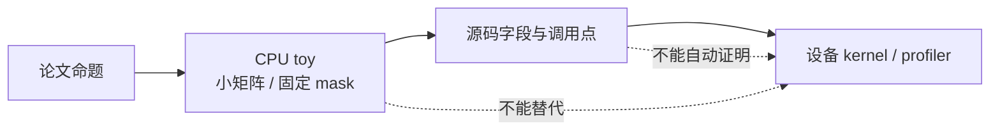

这篇不是“跑一个 benchmark 就证明模型更快”。它提供一套在没有 GPU/NPU 时仍能工作的阅读方法：先把命题缩成算术，再把算术对象映射到源码，最后标注仍然未知的设备事实。

## 三层证据

适合 toy 检查的命题包括：MLA 展开和吸收路径一致、top-k 前因果 mask、候选集合内 softmax、环形窗口映射、sink 分母。它们都应固定输入、dtype、求和顺序和 tie-break。

## 一个最小记录模板

| 字段     | 例子                              |
| -------- | --------------------------------- |
| 命题     | DSA 必须先 mask 再 top-k          |
| 输入     | 5 个位置、2 个候选、一个未来高分  |
| 期望     | 未来位置不在索引集合              |
| 源码锚点 | Indexer mask → top-k → gather     |
| 未覆盖   | 融合 kernel、真实权重、并发和通信 |

记录“未覆盖”很重要。CPU toy 省略量化、张量并行、分页 cache、padding batch、融合 kernel 和真实权重；公开源码能证明字段和调用关系，不能单独证明生产调度或吞吐。

## 如何读已有结果

MLA 双路径一致只能说明矩阵重排正确；NSA 的梯度检查只能说明 toy 分支可微；CSA/HCA/SWA 的输出数值只对应给定块边界和 sink。把这些结果写成“模型在真实数据上更快”会越过证据边界。

本机没有 GPU/NPU，本页不安装设备依赖。需要判断性能时，再固定模型、软件版本、输入长度、并发、采样参数和 profiler 采样范围，做 eager 与图/稀疏路径的成对对照。
