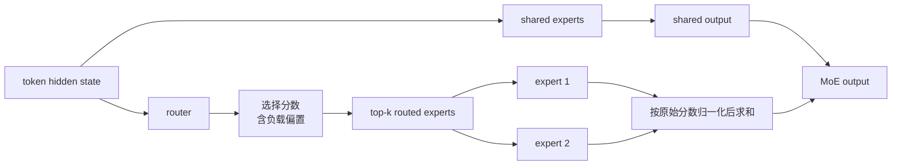

MoE 的目标不是让每个 token 都跑完整 FFN，而是在近似固定激活计算下增加参数容量。DeepSeekMoE 再把宽专家切成更多窄专家，并保留共享专家处理通用模式。

## 一枚 token 的路径

细粒度设计把一个宽专家拆成多个窄专家，使 token 可以组合更细的能力。共享专家不参加 routed experts 的 top-k 分母，而是直接与路由输出相加。

## 选择分数不等于路由权重

V3 的实现先计算 sigmoid 原始分数，再把负载反馈 bias 加到选择分数上做 top-k；选中后从未加 bias 的原始分数取值、归一化并乘 `route_scale`。这让 bias 改变“谁被选中”，而不直接改变选中专家的数值权重。

版本差异必须绑定 checkpoint：V2 使用 softmax 和设备受限路由；V3 使用 sigmoid、节点/分组约束和序列均衡；V4 的分数形式与前几层 token ID 路由又不同。不能把某个版本的 router 公式套到另一个版本。

## 负载均衡的工程含义

专家并行时，平均激活数只是起点；top-k 分布、容量限制、跨设备 all-to-all 和 token 重排共同决定尾延迟。训练期辅助损失或 bias 更新不等于推理时已经自动均衡。

参考 [DeepSeekMoE §3](https://arxiv.org/html/2401.06066v1#S3)、[DeepSeek-V2 §2.2](https://arxiv.org/html/2405.04434v5#S2.SS2) 和 [DeepSeek-V3 §2.1.2](https://arxiv.org/html/2412.19437v2#S2.SS1.SSS2)。
