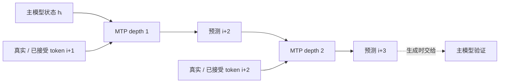

MTP（Multi-Token Prediction）经常被一句“同时预测多个 token”带过。真正需要区分的是两个方向：训练时为未来 token 提供额外监督，生成时则可能成为草稿并交给主模型验证。

## 预测深度不是序列位置

固定序列位置 $i$ 和预测深度 $k$，第 $k$ 个模块读取上一深度状态 $h_i^{k-1}$ 与一个 token embedding，输出更远位置的分布。沿 $k$ 滚动和沿序列轴向右移动是不同的依赖。

训练时新 token 来自真实文本，因此 MTP loss 可以改善主模型，即使部署入口只采样一枚 token。生成时 token 来自候选，必须经过主模型验证，并对拒绝位置做校正采样；模块存在不等于推测解码已经启用。

## 版本边界

V3 的正式配置包含一个额外预测层，损失分母按论文的 $T$ 约定；V4 延续该思路。固定 inference 代码里可能同时存在 `MTPBlock`、共享 embedding/head 和普通 `generate` 入口，阅读时要沿调用链确认是否真的执行。

DSpark 也使用草稿和验证，但它的并行主干、Markov head 与 MTP 深度并非同一个模块。不要因为字段都叫 `mtp` 就把两套算法合并。

参考 [DeepSeek-V3 §2.2](https://arxiv.org/html/2412.19437v2#S2.SS2) 与 [V4 §2.1](https://arxiv.org/html/2606.19348v1#S2.SS1)。论文的接受率和 TPS 属于原实验条件，本页没有复测。
