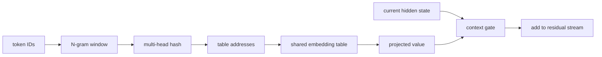

Engram 针对的是另一类重复工作：某些短 token 模式可以通过共享参数表直接取回，而不必每次都让深层网络重新组合。它不是把长上下文整体改成查表。

## 地址和内容分开

KV cache 保存某个请求的历史激活，生命周期随请求变化；Engram 表是模型参数，可跨请求共享。短 N-gram 经过多头哈希映射到有限桶，多头降低单次碰撞影响但不保证没有碰撞。

## 门控与版本边界

查表向量先投影为 Key/Value，再用当前隐藏状态与 Key 的关系得到门控分数，最后把门控 Value 加回残差。地址可复现依赖 tokenizer、Unicode 归一化、哈希乘子和素数分配，不能只记录表大小。

原始研究包含短卷积；V4.1 的实现移除卷积并直接注入残差。V4 讨论过 Engram 方向，不等于 V4 已集成；具体常数、主机卸载和量化策略都要绑定报告或源码 revision。

参考 [Engram 原始论文](https://arxiv.org/html/2601.07372v1)、[V4.1 §2.4.2](https://arxiv.org/html/2609.19969v1#S2.SS4.SSS2) 和固定的 [`engram.py`](https://huggingface.co/deepseek-ai/DeepSeek-V4.1-Flash/blob/314113f8a7dadb388215396ba5fbee2c610a04d6/inference/engram.py)。
