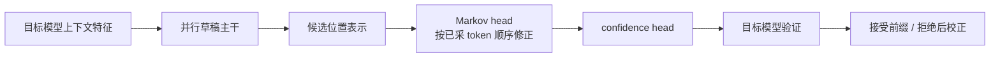

推测解码的瓶颈不是“能不能一次吐出很多 token”，而是草稿必须足够便宜且容易被目标模型接受。DSpark 把这两个条件拆到不同模块。

## 重型部分并行，轻量 head 保留依赖

草稿主干一次处理多个候选位置；Markov head 仍依赖前一个实际采样 token，逐位置修正 logits。因此它是半自回归，而不是把所有 token 完全并行解码。

## 置信度只是调度信号

confidence head 预测条件接受概率 $c_k$，前缀通过概率为 $a_j=\prod_{i=1}^jc_i$。调度器需要同时考虑预期推进量、验证成本和目标引擎的 batch 形状。更多候选可能提高接受长度，也可能让验证批次更重。

$c_k$ 不是目标模型对已采 token 的 softmax 概率。真实接受仍由目标模型校验，拒绝位置需要按推测解码规则重新采样。论文中的硬件感知异步调度、校准和吞吐属于特定系统；公开静态评估器或 `DSparkBlock` 都不能单独证明完整生产链路已经运行。

参考 [DSpark 论文 §2–§5](https://arxiv.org/html/2607.05147v1#S2) 与 [DeepSpec 固定源码](https://github.com/deepseek-ai/DeepSpec/tree/005e03b81cec38b7da6399833d609ee89a2587f2)。
