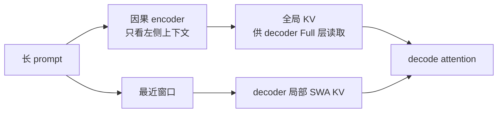

CED（Causal Encoder-Decoder）把长 prompt 的工作拆成两类：可提前生成的全局 KV，以及 decode 前仍需按 decoder 层重建的局部窗口状态。它改变的是 prefill 的工作组织，不是把 decoder 变成双向 encoder。

## 三种状态来源

V4.1-Flash 的报告把前 20 层作为因果 encoder、后 20 层作为 decoder。encoder 仍遵守因果约束；decoder 的全局 KV 可以由 encoder 末状态经过各 Full 源层投影得到，但局部 SWA KV 仍要按 decoder 层计算。

## replay 是有边界的近似

长 prompt 的 token-layer 工作量可以用 $NL/2+WL/2$ 做简化账本，其中 $W$ 是窗口宽度。这个式子只说明工作量方向；跨层局部依赖会累积，最后 $W$ 个位置的 bounded replay 不能严格还原完整 prompt 的高层状态。报告中“影响较小”是实验结论，不是数学等价。

缓存命中时要分别检查 encoder 全局状态、decoder 局部状态、活跃窗口和 host DRAM 池。公开最小 inference 代码展示的参考算子可能没有覆盖报告中的完整 prefill 提前结束与生产 replay 路径。

参考 [V4.1 技术报告 §2.1–§3.2.2](https://huggingface.co/deepseek-ai/DeepSeek-V4.1-Flash/blob/314113f8a7dadb388215396ba5fbee2c610a04d6/DeepSeek_V41_Tech_Report.pdf) 与固定 [inference 目录](https://huggingface.co/deepseek-ai/DeepSeek-V4.1-Flash/tree/314113f8a7dadb388215396ba5fbee2c610a04d6/inference)。
