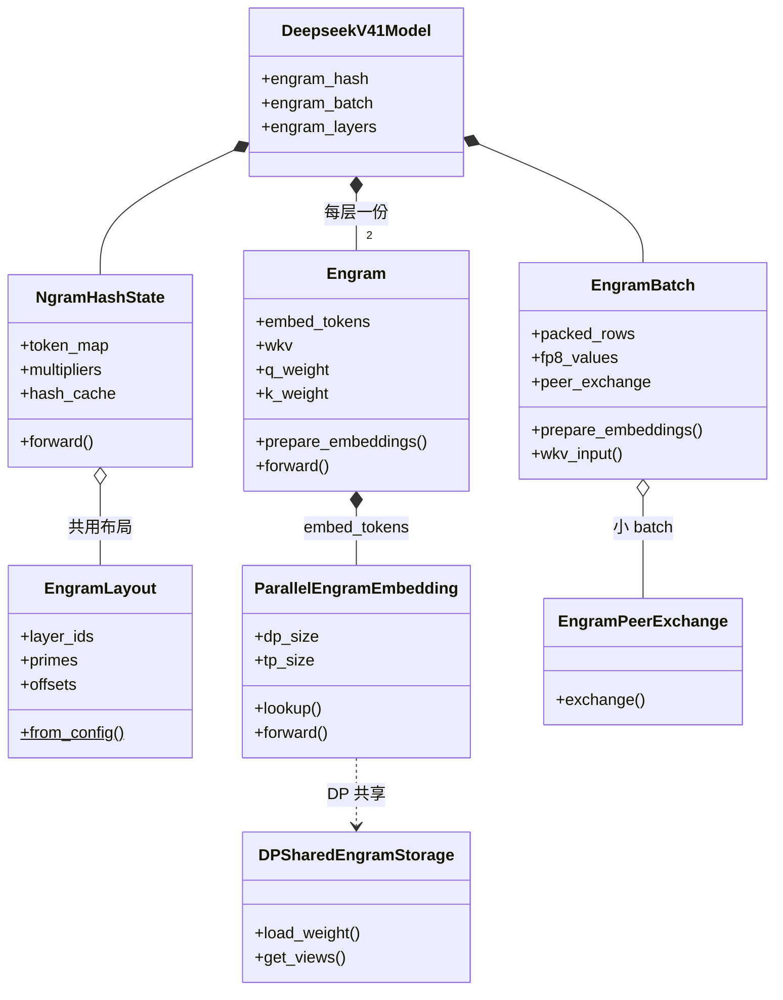
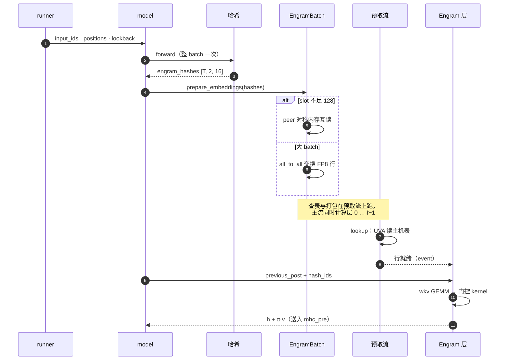
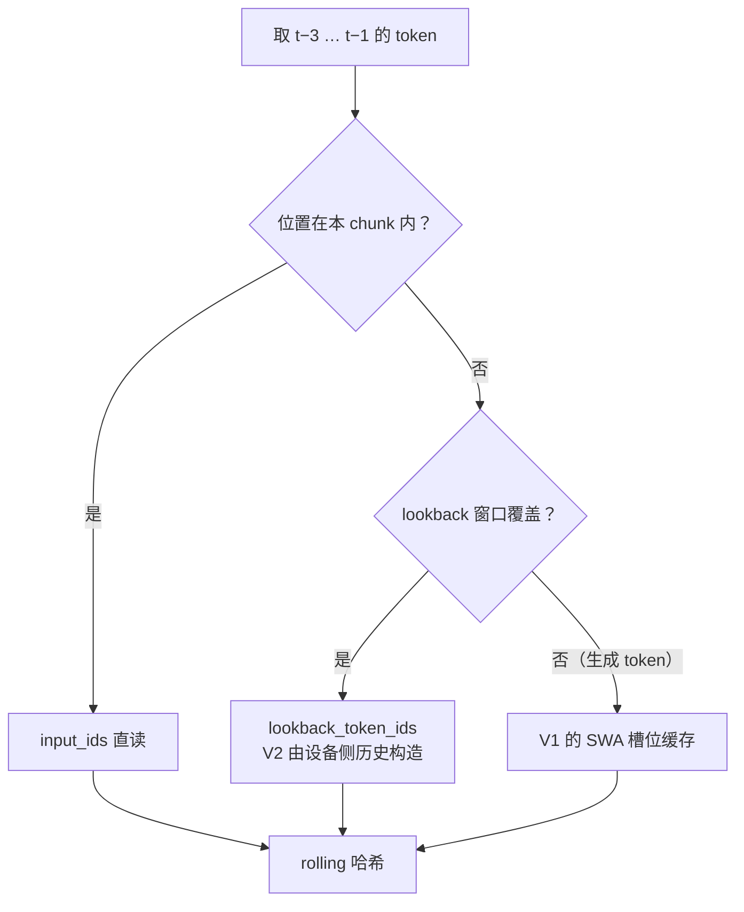

import Figure from 'astro-wisp/components/Figure.astro';
import paperFig1 from './images/paper-fig1-engram-arch.svg';
import paperFig2 from './images/paper-fig2-engram-system.svg';
import paperFig3 from './images/paper-fig3-scaling-law.svg';
import paperFig4 from './images/paper-fig4-logitlens-cka.png';
import paperFig5 from './images/paper-fig5-arch-ablation.svg';
import paperFig7 from './images/paper-fig7-gating-viz.svg';

第 13 篇的 MoE 把「参数多、计算少」做到了 3.5% 的激活比例。但它的稀疏有一个前提：**未激活的那些专家，仍然是神经网络的参数**，要参与训练、占显存、按 token 动态路由。

Engram（[Conditional Memory via Scalable Lookup](https://arxiv.org/abs/2601.07372)，DeepSeek，2026-01）问的是另一个问题：**有没有一类知识，根本不需要「计算」，只需要「查」？**

读完你能回答：conditional memory 和 conditional computation 的区别、N-gram 哈希查表为什么是 $O(1)$ 且不增加 FLOPs、U 型曲线说明了什么。顺着理论往下，本篇还会读 vLLM 的实现（`vllm/models/deepseek_v41/common/engram.py`，commit `2173d712`）——Engram 部署在 V4.1 的哪些层、哈希与门控 kernel 如何实现、百亿参数的表如何驻留主机内存；最后对照 vllm-ascend（commit `c116bebb`）在 NPU 上改了哪些地方。

## 先看一个例子

「北京是中国的首」后面大概率是「都」。这个知识需要多层注意力和 FFN 去「推理」吗？不需要——它是一个**查表**就能解决的固定搭配。

但标准 Transformer 没有「表」这个东西，它只能把这类局部模式**用深度和计算重建出来**。论文的 Table 3 给了个实例：识别「Diana, Princess of Wales」这个实体，模型要用掉前 6 层——第 1–2 层只解析出「Wales」，第 4–5 层才是「Princess of Wales（不特指）」，到第 6 层才组合成黛安娜本人。这些层本可以省下来做更高级的推理。

Engram 的做法是直接给它一张表：


关键在于：**这条路径里没有矩阵乘，只有一次哈希和一次行读取**。表扩大 10 倍，每个 token 的计算量**完全不增加**。

## 机制

整体结构如图 15-1（论文图 1）：Engram 作为旁路模块部署在个别层上，取回的静态记忆经门控融合到动态 hidden state，输入 embedding 与输出 un-embedding 保持原样。

<Figure
  src={paperFig1}
  alt="论文图 1：Engram 模块结构——N-gram 哈希取回静态 embedding，与 hidden state 做缩放点积门控后加回残差流；模块仅部署在特定层"
  caption="图 15-1：Engram 架构总览（论文图 1）"
/>

### 两条稀疏的轴

这是本篇的核心区分：

|            | **MoE**                       | **Engram**                   |
| ---------- | ----------------------------- | ---------------------------- |
| 论文的叫法 | conditional **computation**   | conditional **memory**       |
| 稀疏的是   | 计算（未选中的专家不算）      | **存储**（只取固定几行）     |
| 如何选     | gate 打分后动态 top-$k$ 路由  | **确定性** N-gram 哈希       |
| 扩容的代价 | 显存 + 训练复杂度，FLOPs 不变 | **只有存储**，FLOPs 完全不变 |
| 能放在哪   | 必须在 GPU 显存               | HBM / 主机内存 / NVMe 多级   |

最后一行是 Engram 独有的性质。因为访问分布服从 Zipf 定律（少数 N-gram 极高频、长尾极低频），可以把高频行放 HBM、长尾放更慢更大的存储（§2.5）。**MoE 的专家做不到这件事**——它们随时可能被任何 token 选中。

### 查表路径

**① tokenizer 压缩**：先把 token ID 按 NFKC、大小写归一等规则折叠成 canonical ID，再组成后缀 N-gram：

$$
x'_t=\mathcal{P}(x_t),\qquad g_{t,n}=(x'_{t-n+1},\dots,x'_t)
$$

其中 $x_t$ 是位置 $t$ 的原始 token id；$\mathcal{P}$ 是把归一化后写法相同的 token 折到同一个 id 的投影；$x'_t$ 是折叠后的**压缩 id**；$g_{t,n}$ 是以 $t$ 结尾、长度为 $n$ 的**后缀 N-gram**，阶数 $n$ 取 $2$ 到 $N$（论文取 $N=3$）。

论文说 128k 的 tokenizer 经此压缩后有效词表减少 23.43%（§2.2、附录 C）。合并最多的是空白变体（163 个 token 折成一类）、大小写与变音符号（「A、a、á、ä、ą…」54 个折成「a」）。这一步是为了让「Beijing」「beijing」「BEIJING」命中同一行。

**② 多头哈希**（式 (1)–(2)）：对每个阶数 $n$ 和哈希头 $k$，用一个确定性的 multiplicative-XOR 哈希算出行号，取出对应行再拼接：

$$
\begin{aligned}
z_{t,n,k} &= \varphi_{n,k}(g_{t,n})\\
\mathbf{e}_{t,n,k} &= \mathbf{E}_{n,k}[z_{t,n,k}]\\
\mathbf{e}_t &= \big\|_{n=2}^{N}\big\|_{k=1}^{K}\mathbf{e}_{t,n,k}
\end{aligned}
$$

其中 $k\in\{1,\dots,K\}$ 是**哈希头**编号（论文取 $K=8$）；$\varphi_{n,k}$ 是第 $(n,k)$ 个确定性的 multiplicative-XOR 哈希；$z_{t,n,k}$ 是它算出的**行号**；$\mathbf{E}_{n,k}[z]$ 表示取表中第 $z$ 行的 embedding 向量；$\mathbf{e}_t$ 是把 $(N-1)\times K$ 共 16 行拼接后的**记忆向量**。

每个 $(n,k)$ 对应一张**质数大小**的表 $\mathbf{E}_{n,k}$。多头的作用是缓解哈希冲突：单个哈希撞了，其他头大概率没撞。（论文没有给出哈希的乘数与异或常数，也没解释表为什么取质数；图 15-2 左列给出了 vLLM 的初始化方式，桶构建细节见图 15-11。）

**③ 上下文门控**（式 (3)–(4)）：取出来的是**静态**的记忆，是否采用取决于当前上下文。当前隐藏状态作为 Query，取回向量作为 Key/Value：

$$
\begin{aligned}
\mathbf{k}_t &= \mathbf{W}_K\mathbf{e}_t,\quad \mathbf{v}_t=\mathbf{W}_V\mathbf{e}_t\\
\alpha_t &= \sigma\!\left(\frac{\mathrm{RMSNorm}(\mathbf{h}_t)^\top \mathrm{RMSNorm}(\mathbf{k}_t)}{\sqrt{d}}\right)\\
\tilde{\mathbf{v}}_t &= \alpha_t\mathbf{v}_t
\end{aligned}
$$

其中 $\mathbf{W}_K$、$\mathbf{W}_V$ 是可学习投影，把记忆向量映射为键 $\mathbf{k}_t$ 与值 $\mathbf{v}_t$；$\mathbf{h}_t$ 是当前隐藏状态（充当 Query）；$\sigma$ 是 sigmoid；$d$ 是 hidden size；$\alpha_t\in(0,1)$ 是门控标量；$\tilde{\mathbf{v}}_t$ 是门控后的记忆值。

这个门控很重要：**查表是确定性的，但是否采用由上下文决定**。「首」后面不总是「都」——在「首席执行官」里就不是。$\alpha_t$ 负责抑制不匹配的记忆。

**④ 融合回残差流**（式 (5)）：过 RMSNorm、深度可分离因果卷积（kernel $w=4$，**膨胀 $\delta$ 取最大 N-gram 阶数**，即 3）和 SiLU，再加回门控值：

$$
\mathbf{Y}=\mathrm{SiLU}\big(\mathrm{Conv1D}(\mathrm{RMSNorm}(\tilde{\mathbf{V}}))\big)+\tilde{\mathbf{V}}
$$

其中 $\tilde{\mathbf{V}}$ 是序列上各位置 $\tilde{\mathbf{v}}_t$ 堆成的矩阵，$\mathbf{Y}$ 是模块输出，$\mathbf{H}^{(\ell)}$ 是第 $\ell$ 层的残差流（mHC 的 4 份分支拷贝）。卷积参数初始化为 0，使模块在训练开始时是恒等映射（§2.3、§4.1）——接入新模块的常见稳妥做法。最后 $\mathbf{H}^{(\ell)}\leftarrow\mathbf{H}^{(\ell)}+\mathbf{Y}$，之后才是标准的 Attention 和 MoE。

①–② 的完整流程见图 15-2，分两栏。**左栏是模型加载时执行一次的初始化**——压缩表（NFKC / 小写折叠，128k → 98k）、奇乘数（每层以种子 $10007\times$ 层号 确定性生成、×2+1 保证为奇数）、质数桶（EngramLayout 从 `engram_vocab_size−1` 起逐个取不重复质数）。

**右栏是 decode 时逐 token 的执行**：压缩 id 组成 2/3-gram，rolling XOR 累乘得哈希，取模加偏移得 16 个行号。「张仲景」正是论文图 7 里高门控的例子，数值全部实算：


这条链路里唯一的「计算」是异或乘和取模：表从每桶 10 万行扩到 226 万行（Engram-27B 尺度），每一步都不变。③–④ 的 shape 流：

![查表与门控的 shape 流：16 个行号取回 [16,80] 的行，拼接成 [1280]，wkv 投影成 [5d]（4 份每分支 Key + 1 份共享 Value）；hidden state [4,d] 作为 Query 与 Key 归一化点积得 [4] 个门控标量，加权共享 Value 得 [4,d]，卷积后与残差相加](./diagrams/15-engram-lookup.drawio#page=2 '图 15-3：查表与门控——每个节点的输入输出 shape')

### mHC 多分支：共享表与每分支门控

论文的主干不是单流残差，而是 mHC 多分支（$M=4$，膨胀率 4，§2.4）。Engram 的接法做了一个参数共享的折中：

$$
\alpha_t^{(m)}=\sigma\!\left(\frac{\mathrm{RMSNorm}(\mathbf{h}_t^{(m)})^\top \mathrm{RMSNorm}(\mathbf{W}_K^{(m)}\mathbf{e}_t)}{\sqrt d}\right),
\qquad
\mathbf{u}_t^{(m)}=\alpha_t^{(m)}\cdot(\mathbf{W}_V\mathbf{e}_t)
$$

**表和 $\mathbf{W}_V$ 全分支共享，$\mathbf{W}_K^{(m)}$ 每分支一份**：$m\in\{1,\dots,M\}$ 是 mHC 分支编号，$\alpha_t^{(m)}$ 与 $\mathbf{u}_t^{(m)}$ 分别是第 $m$ 条分支的门控标量与门控值——4 个门各自决定这条记忆对第 $m$ 条残差分支是否有用，但取回的内容只有一份。论文还说这 $M+1$ 组投影可以拼成**一个稠密 FP8 GEMM**，对 GPU 友好；这个设计在 vLLM 里原样出现（一个 `wkv` 矩阵）。

### 门控在真实文本上的表现

论文图 7 将 Engram-27B 的门控标注回原文：英文里「Alexander the Great」「the Milky Way」「By the way」这类多词实体和固定搭配处显著激活，中文里「四大发明」「张仲景」这类成语与历史人名处显著激活。门控确实在「局部静态模式完成时」激活——这正是设计意图的直接证据。

<Figure
  src={paperFig7}
  alt="论文图 7：门控 α 的可视化，深红表示强激活；实体与固定搭配处呈现强激活，如 Alexander the Great、Princess of Wales、四大发明、张仲景"
  caption="图 15-4：门控在实体与固定搭配处激活（论文图 7）"
/>

### 稀疏预算的分配：U 型曲线

论文把「MoE 和 Engram 各分多少」形式化成 Sparsity Allocation 问题（§3.1）。定义总参数 $P_{\rm tot}$、每 token 激活参数 $P_{\rm act}$（决定 FLOPs），稀疏预算是两者之差：

$$
P_{\rm sparse}=P_{\rm tot}-P_{\rm act}
$$

令 $\rho$ 是稀疏预算里分给 MoE 的比例：

$$
P^{(\rm sparse)}_{\rm MoE}=\rho\,P_{\rm sparse},\qquad P_{\rm Engram}=(1-\rho)P_{\rm sparse}
$$

$\rho=1$ 是纯 MoE。**固定 $P_{\rm tot}$ 和 $P_{\rm act}$**（也就是固定参数量和 FLOPs）扫描 $\rho$，validation loss 呈 **U 型**（图 15-5，论文图 3 左半）：纯 MoE 端 1.7248（10B 档，$C=6\times10^{20}$），$\rho\approx80\%$ 处最低 1.7109（$\Delta=0.0139$）；降到 $\rho\approx40\%$ 才退回纯 MoE 水平。最优点在 $\rho\approx75\%$–$80\%$ 且跨计算档位稳定——即**约 20%–25% 的稀疏预算给 Engram**。

<Figure
  src={paperFig3}
  alt="论文图 3 左：两个计算档位下 loss 对分配比 ρ 都呈 U 型，纯 MoE 都不是最优；右：固定 3B 骨干只扫表槽数，loss 呈 log-linear 下降，且同预算下优于 OverEncoding"
  caption="图 15-5：稀疏分配的 U 型曲线与 Engram 自身的幂律（论文图 3）"
  wide
/>

两端为什么都差（§3.1）：

- **纯 MoE 端**缺少静态记忆，被迫用深度和计算去重建局部模式——浪费算力。
- **纯 Engram 端**缺少动态计算，查表替代不了上下文推理。

U 型意味着两条轴**不是互相替代，而是互补**：如果 Engram 只是「另一种存参数的方式」，曲线应该单调。

另一组实验（§3.2）固定约 3B 的 MoE 骨干和 568M 激活参数，只扫 Engram 的槽数（$2.58\times10^5$ 到 $1.0\times10^7$，最多新增约 13B 参数）：**loss 对槽数呈严格幂律（log-linear）下降，计算完全不变**；同预算下比 OverEncoding（把 N-gram embedding 平均进词向量）好得多。这是「表本身就是一条 scaling 轴」的证据。

### 为什么有效：等效加深

Engram-27B 最反直觉的结果是**推理类任务的提升大于知识类任务**（BBH +5.0 > MMLU +3.0）。论文的解释（§6.1）是：查表替代了早期层的「特征拼装」，等效于把网络加深。

两个证据：

- **LogitLens**：把中间层 hidden state 直接过 LM head，算与最终分布的 KL 散度。Engram 两条曲线在前几层就明显更低——预测收敛得更早。
- **CKA**：算 Engram 各层与 MoE 各层表示的相似度矩阵。对齐曲线整体上移：**Engram 第 5 层的表示最像 MoE 的第 12 层**。表 3 那个「6 层拼出黛安娜」的过程，被查表一步替掉了。

<Figure
  src={paperFig4}
  alt="论文图 4：左，逐层 LogitLens KL 散度，Engram 在前几层就明显更低；右，CKA 相似度热图与对齐曲线，Engram 的浅层对齐 MoE 的深层"
  caption="图 15-6：Engram 加速预测收敛、等效加深（论文图 4）"
/>

### 层位置：浅层与中层的折中

层位置存在一个内在矛盾（§6.2）：位置越浅，局部模式的重建越早被卸载，但 hidden state 尚未经过足够的注意力层，**门控的 Query 表征不足**；位置越深，Query 越充分，但可节省的计算已被消耗。单模块扫层的结论是**第 2 层最优**（loss 1.770，基线 1.808）；把同一份 1.6B 预算拆成两个小模块放第 2、6 层更好（1.768）。27B 的主实验取第 2、15 层，同样是「浅层 + 中层」的组合。

组件消融（同图右侧）显示贡献最大的是**多分支融合、上下文门控、tokenizer 压缩**；去掉卷积只轻微变差，把预算分给 4-gram 反而略差（稀释了更高频的 2/3-gram 容量）。

<Figure
  src={paperFig5}
  alt="论文图 5：左，单模块插入层从 1 扫到 12，第 2 层最优、越深越差；右侧标记为各组件消融，多分支融合、门控与 tokenizer 压缩的损失最大"
  caption="图 15-7：层敏感性与组件消融（论文图 5）"
/>

### 27B 的对照实验

论文的主实验（§4.1–4.2，表 1）设计得很干净：30 层、hidden 2560、MLA + mHC 骨干，Muon 优化器，262B token，全部模型同数据同课程、激活参数严格一致。

| 模型           | 总参数    | 激活参数 | 构成                                                    |
| -------------- | --------- | -------- | ------------------------------------------------------- |
| MoE-27B        | 26.7B     | 3.8B     | DeepSeekMoE，2 shared + 72 routed，top-6                |
| **Engram-27B** | **26.7B** | **3.8B** | routed 从 72 减到 55，换成 5.7B Engram（$\rho=74.3\%$） |
| Engram-40B     | 39.5B     | 3.8B     | 同骨干，表扩到 18.5B                                    |

**Engram-27B 和 MoE-27B 是 iso-parameter 且 iso-FLOPs 的**——总参数相同、激活参数相同，只是把一部分专家换成了查表。结果（表 1）：

|               | MoE-27B | Engram-27B | 差       |
| ------------- | ------- | ---------- | -------- |
| Pile loss     | 1.960   | 1.950      | −0.010   |
| MMLU          | 57.4    | 60.4       | **+3.0** |
| CMMLU         | 57.9    | 61.9       | **+4.0** |
| BBH           | 50.9    | 55.9       | **+5.0** |
| ARC-Challenge | 70.1    | 73.8       | +3.7     |
| HumanEval     | 37.8    | 40.8       | +3.0     |
| GSM8K         | 58.4    | 60.6       | +2.2     |

Engram 模块部署在第 2 与第 15 层，$N\in\{2,3\}$、$K=8$、$d_{\rm mem}=1280$（恰好 16 列 × 80 维）；embedding 用 Adam，学习率是普通参数的 5 倍且不加 weight decay（§4.1）。

> 一处要注意的不一致：**论文摘要写 MMLU +3.4，而正文表 1 是 +3.0**。本文以表格和正文为准。

### 长上下文：注意力容量转向全局

将局部依赖委托给查表的另一个推论：**注意力容量得以专注于全局上下文**。长上下文扩展（YaRN 到 32k，表 2）里，同预训练 loss 的对照下 Engram-27B 的 Multi-Query NIAH 从 84.2 提升至 97.0、Variable Tracking 从 77.0 提升至 87.2；甚至只用 82% 预训练算力的 Engram-27B（41k 步）就能匹配基线的 LongPPL 并超过 RULER。论文据此强调：长上下文能力不只取决于注意力机制本身，还取决于骨干的注意力容量是否已被局部模式占用。

### 敏感性分析：移除 Engram 输出

推理时直接将表的输出置零（保持骨干不变，§6.3）：**事实类基准崩塌**——TriviaQA 仅保留 29% 的原始性能，事实类整体保留 29–44%；而阅读理解类几乎不受影响，保留 81–93%。这条「功能二分」说明参数化知识主要存储在表里，上下文理解仍依靠骨干——正是 conditional memory 与 conditional computation 分工互补的直接证据。

### 工程与预取

哈希地址是**确定性**的——前向开始之前就能算出要取哪些行。于是：

- **训练**（论文图 2a）：表按 GPU 切片，All-to-All 收集本步激活的行、反向再分发梯度，表的容量随卡数线性扩展。
- **推理**（图 2b）：表整个放在主机内存，host 侧异步预取、PCIe 传输与前面各层的计算重叠；再配合 Zipf 局部性把高频行缓存进 HBM。

<Figure
  src={paperFig2}
  alt="论文图 2：训练时表按 GPU 切片、All-to-All 收集行；推理时表 offload 至主机内存，利用确定性地址异步预取，与前面层的计算重叠"
  caption="图 15-8：训练的 All-to-All 与推理的预取重叠（论文图 2）"
/>

论文的实测（§6.4，表 4，nano-vLLM 骨架、H800、512 条序列）：在 4B 稠密骨干的第 2 块处引入一个 **100B 参数**的 Engram 层、整表驻留主机 DRAM，吞吐 9031.6→8858.3 tok/s（−1.9%）；8B 骨干 6315.5→6140.0（−2.8%）。且这是**全部读取都经由 PCIe** 的保守设定——未利用 Zipf 缓存。论文据此主张「每步通信量正比于激活行数而非表大小」。

Engram 的层位置因此受两重约束：**位置越深，可用于掩盖传输延迟的计算窗口越长；但消融显示浅层注入更有利于提前卸载局部模式重建**——因此采用浅层与中层各设一处的组合（第 2、15 层）。

## vLLM 里的 Engram 实现

DeepSeek-V4.1 把 Engram 带进了生产：vLLM 的 `vllm/models/deepseek_v41/` 下有一个 1891 行的 `common/engram.py`，NVIDIA 侧另有 `nvidia/ops/engram_host_table.py`（主机表）、`nvidia/ops/engram_peer.py`（peer 交换）和 `nvidia/specialized_decode/engram/prefetch.py`（解码预取）。以下行号均指本机 checkout（commit `2173d712`）。

配置分两层：checkpoint 的 `config.json` 带 `engram_layer_ids`、`engram_num_embeddings`、`engram_max_ngram_size`、`engram_n_heads`、`engram_head_dim`、`engram_compressed_vocab_size` 等（`EngramLayout` 读取，engram.py:221-227）；引擎侧的 `--engram-config` 控制**存储**——`cpu_offload`（**默认 True**，表放 pinned 主机内存走 UVA）、`dp_shared_memory`（DP 副本共享一张主机表，默认自动开）、`embedding_across_dp`、`use_thp`（config/engram.py:37-62）。

### 模块位置与注入点

层号是 0 起的 **1 和 14**（model.py:1002 的注释；对应论文 1 起数的第 2、15 层）。构造时按 `layer_id in engram_layout.layer_ids` 决定（model.py:335-347）。

注入点选在 mHC 的两个混合之间——上一层 MoE 的 post 混合之后、本层 attention 的 pre-norm 之前（model.py:568-584）：

```python
previous_post = mhc_post_tilelang(x, residual, post_mix, res_mix)  # 577
residual = self.engram(                                            # 580
    previous_post,
    engram_hashes[:, self.engram.layer_hash_index],
    engram_mask,
)
post_mix, res_mix, x, attn_pre = mhc_pre(residual, ...)            # 586
```

注释给的理由有二：mHC 的混合系数要能**看到注入后的流**；注入也避免让 post 进 pre-norm GEMM 的融合 prologue。哈希则在整个 batch 展平后**算一次**，早于任何序列并行分片（model.py:1000-1003）——两个 Engram 层共用这份 `[T, 2, 16]` 的行号。


### 模块结构

`engram.py` 的类分工如下，关系见图 15-10：

| 类                        | 行号 | 职责                                                                     |
| ------------------------- | ---- | ------------------------------------------------------------------------ |
| `EngramLayout`            | 211  | 从 config 确定性分配每层 16 个 $(n,\text{head})$ 质数桶与偏移            |
| `NgramHashState`          | 426  | 压缩表 `token_map`、哈希乘数、V1 的 slot 缓存；`forward` 启动哈希 kernel |
| `ParallelEngramEmbedding` | 1021 | 表的 TP×DP 分片、权重加载、`lookup`（UVA 读主机表）                      |
| `EngramBatch`             | 1539 | 两个 Engram 层的 WKV 输入**一次** DP 交换，打成 MXFP8                    |
| `Engram`                  | 1664 | 模块本体：`embed_tokens`、`wkv`、逐分支 `q/k_weight`、门控               |
| `DPSharedEngramStorage`   | 839  | DP 副本共享主机表（cuMem FABRIC 或 /dev/shm）                            |

字段、方法与持有关系的 UML 视角（实心菱形为组合，空心为聚合，虚线为运行时依赖）：




### 哈希：质数桶与逐 token rolling

桶的分配（`EngramLayout.__init__`，engram.py:230-246）：每个 $(n,\text{head})$ 从 `engram_vocab_size−1` 起找一个**没用过的质数**作为桶大小，桶与桶用累加偏移隔开。论文的 226 万/桶（27B）与 724 万/桶（40B）就是这个数的两档。构建过程见图 15-11：


乘数（`compute_hash_multipliers`，engram.py:189-208）**按 (layer, lookback) 取随机奇数**，种子 `10007 × layer_id`——确定到所有 rank 一致，不用广播。注意一个实现细节：同阶的 8 个头**共用乘数、靠不同的质数桶区分**，与论文「K 个独立哈希头」的表述略有出入。

kernel 的主循环（`_hash_ids_kernel`，engram.py:413-419）：

```python
blocked |= (lookback < 0) | (source == dead_id)      # 410
value = tl.where(blocked, pad_id, source)            # 411
multiplier = tl.load(multipliers + layer * MAX_NGRAM + shift)
rolling ^= value * multiplier                        # 413
hashed = rolling % prime[None, :] + offset[None, :]  # 419
```

每个 token 先**二分** `query_start_loc` 定位所属请求与 chunk 起点（334-350），然后按三级来源取 lookback：本 chunk → runner 传入的 `lookback_token_ids` 窗口 → V1 的 slot 缓存（387-406）。图像 span 的 token 标成 `DEAD_ID=-1`，整条 N-gram 落到 pad 行、门控再被 `engram_mask` 关死。图 15-2 里的质数、乘数、中间哈希与行号，就是用同样的算法对「张仲景」实算的结果。

### 查表、交换与门控

decode 一步的全链路：


同一过程按**组件交互的时序**再看一遍——注意查表被挪到预取流上，与主流的层计算并行：



三个值得展开的点：

**表的存储与交换**。表本身是 FP8E4M3 + 每 32 列一个 ue8m0 scale（engram.py:1156-1160），权重键 `layers.{1,14}.engram.embed.weight` 映射到模块 `embed_tokens`（1699-1702，模块名专为这条规则保留）。DP>1 时默认共享一张主机表（`DPSharedEngramStorage`，FABRIC 句柄或 /dev/shm）。

行交换有两条路（`EngramBatch.prepare_embeddings`，1612-1613）：batch 小（`slot < 128`）走**对称内存 peer 互读**——每 rank 读取所有 peer 的哈希、查自己负责的头、将行写入 peer 可直读的缓冲，全程无集合通信（engram_peer.py）；batch 大则 `all_to_all_single` 一次交换两层打包好的 FP8 行（1632），再解包成 MXFP8 供 FlashInfer 的 CuTe DSL GEMM 使用（1636-1650）。

**门控与论文的差别**。`_fused_engram_post_wkv_kernel`（1395-1421）把 RMSNorm、门控、残差相加全部融在一个 Triton kernel 里：

```python
dot = tl.sum(hidden * q * k * key, axis=0)     # 1397 逐维乘 q_weight/k_weight
dot *= hidden_rms * key_rms * tl.rsqrt(DIM)     # 1398
gate_input = tl.sqrt(tl.maximum(tl.abs(dot), clamp_value))
gate_input = tl.where(dot < 0.0, -gate_input, gate_input)  # signed-sqrt
gate = tl.sigmoid(gate_input)                   # 1401
tl.store(output ..., hidden + gate * value)     # 1420
```

与式 (4) 相比有三处不同：点积先乘**每分支的逐维 `q_weight/k_weight`**（mHC 式 (6) 的门控强化）；两侧各自乘 RMS（等价于归一化点积）；**signed-sqrt 后才过 sigmoid**——注释说明这是与训练 kernel 对齐的，论文公式没有写这一步。更明显的差别是：**式 (5) 的卷积支路在 vLLM 中不存在**——在整个 `deepseek_v41` 目录中检索不到 engram 相关的 Conv/SiLU，输出即为 `hidden + gate·value`。发布的 V4.1 checkpoint 只保留了门控值支路（模型权重里也只有 `embed`、`wkv`、`q_weight`、`k_weight`）。

**offload 与预取**。`cpu_offload` 默认开：私有表使用 pinned/透明大页；共享表走 FABRIC 或 /dev/shm；host-NUMA 的 cuMem 路径按 2 GiB 分块、预留 5% NUMA 余量。查表在共享预取流上先行执行（1768-1789），到 Engram 层仅需等待事件；GB200 上有两个实测阈值（93-102）：查表行数 ≥36864 时先按表序**排序**（提升 TLB 局部性），token ≥4096 时直接改为在主流内联执行。specialized decode 更进一步：行数 ≤16 时把查表后的整条 TP all-gather + WKV GEMM 都提前到旁路流（prefetch.py）。

V1 与 V2 runner 的差别只在 lookback 来源。哈希 kernel 按「本 chunk → lookback 窗口 → slot 缓存」三级取历史 token：



V1 用 SWA KV 槽位上的 `hash_cache`（写入用 `_write_hash_cache_kernel`，256-278）补齐生成 token；V2 的 token 历史本来就在设备上，用 `_gather_lookback_kernel` 直接取，不需要缓存。

## vllm-ascend：NPU 上的同一模块

vllm-ascend 没有复用上游的实现，而是自建了一个包 `vllm_ascend/models/deepseek_v41/engram/`（commit `c116bebb`）：`common.py`（门控数学与 Quarot 旋转）、`hash_state.py`（哈希状态）、`embedding.py`（表存储/查表/加载）、`layer.py`（`AscendEngram`）、`parallel.py`（EDP 交换）、`npu.py`（host 注册与 UVA 查表）、`model_state.py`（V2 runner 侧状态）。

复用的是**算法骨架**：`EngramLayout.from_config`、`NgramHashState` 基类（只重写了 kernel 启动）、`_write_hash_cache_kernel`、`DEAD_ID` 与 EDP 分片排布——质数桶、乘数、rolling 哈希与上游完全一致，两层各查 16 行的语义不变。重写的是**执行层**：

| 项          | 上游 vLLM（GPU）                            | vllm-ascend（NPU）                                                                                                               |
| ----------- | ------------------------------------------- | -------------------------------------------------------------------------------------------------------------------------------- |
| 哈希 kernel | 单 kernel，二分内嵌                         | 拆成 2 个 Triton kernel（组合 kernel 触发 bishengir 编译器 abort，engram_hash.py:19-23）                                         |
| 查表输出    | packed FP8 / BF16，持久 grid、可排序        | 每行一个 program 的 gather+dequant，**恒为 BF16**                                                                                |
| 表精度      | 仅 FP8E4M3+E8M0                             | 按表头 BF16 / INT8+FP32 / MXFP8；非 A5 硬件把 MXFP8 checkpoint 重量化成 INT8（组 32）                                            |
| offload     | `cpu_offload` 默认开                        | **opt-in**；开时用 `aclrtHostRegisterV2` 注册主机内存、发布设备指针表                                                            |
| DP 交换     | peer SHM / all_to_all / EngramBatch         | all_gather + `all_to_all_single`，无 peer；MRV2 且 DP/PCP>1 时**强制** `dp_shared_memory`（ascend_config.py:690-698）            |
| 并行组      | EDP（DP-only）                              | EDP = **DP×PCP**（prefill context parallel 也进组，worker.py:1456-1469）                                                         |
| 重叠        | 共享 cuda 预取流 + 逐层 event + eager break | 共享 npu 生产者流，消费者在**第一个 Engram 层**才 `wait_lookup`；FULL 图经 `torch.npu.ExternalEvent` 等待，V2 可把生产者捕获进图 |


两个只属于 Ascend 的设计：

- **`engram_rotation`**：若量化配置带 Quarot（`optional/quarot.safetensors` 的 `global_rotation`，取 32×32 块对角），门控点积在**原始基**下计算——把 hidden 反旋转回去再与 key 归一化点积（common.py:80-97）。上游没有对应物：GPU 的门控 kernel 不含旋转。
- **类 UVA 的自建路径**：CANN 的 host 注册发布设备地址后，表按 $2^{22}$ 行分块发指针表——单个 Triton tile 的 **32 位偏移装不下 384M 行的表**（npu.py:25-29）。这是「没有 UVA 就自己造一个」的典型工程。

读代码时值得注意的实现细节（均有代码注释佐证）：

- `aclrtMallocHost` 返回脏页，而 profiling forward 会在权重加载前查表——**表必须清零**，否则脏数据会污染流并破坏后续 MoE 路由（embedding.py:146-169）。
- masked load 也会算地址：lookback 为负的位置必须先 clamp；DP dummy batch 的单元素 `query_start_loc` 曾让二分越界造成 48 位 GM fault（model.py:1173-1182）。
- INT8 量化的 scale 用 `ldexp` 精确构造二次幂，因为 NPU 的 `exp2` 差 1 ULP（npu.py:56-59）。
- 每 rank 的表有 24–51 GiB，分配前先 preflight 校验 checkpoint 的键与尺度再执行分配（embedding.py:447-488）。

结构上还有一个取舍：上游在层内查表+门控一体，Ascend 把**查表提升到 runner/model 层**（`AscendEngram.forward` 只消费查好的行，layer.py:34-57），代价是 `wkv` 退化为 `ReplicatedLinear`、TP 头拼接靠 all_gather——换来的是整段生产过程可与主流重叠、且能进 FULL 图。

## 代价与边界

- Engram 省的是 FLOPs，**不省存储**——它把参数挪到了更便宜的存储层级，总量反而更大（Engram-40B 有 39.5B 参数）。
- 哈希必然有冲突。多头缓解但不能消除；论文没有给出冲突率的测量。
- 查表是静态的：它记住的是训练语料里的 N-gram 统计，**不能处理训练时没见过的搭配**，也不随上下文更新。动态推理仍然要靠主干——这正是 U 型曲线右端下降的原因；移除实验（事实类仅保留 29–44% 性能）同样说明骨干并非完全依赖表。
- 预取依赖「地址提前可知」。这条性质很强，但也意味着 Engram 的层位置受通信窗口约束，不能任意选择。
- 论文的「不到 3% 开销」是 nano-vLLM + H800 + 全表走 PCIe 的特定实测（−1.9%/−2.8%），不可照搬；vLLM 的 36864/4096 阈值也是 GB200 实测，其他硬件家族返回 `None`、尚未调优（engram.py:101 的注释）。
- vLLM 实现与论文式 (5) 不一致：**没有卷积支路**，门控多了逐维 q/k 权重与 signed-sqrt——以 checkpoint 为准读代码时，不宜用论文公式逐项对照。
- U 型曲线的最优点 $\rho\approx75\%$–$80\%$ 绑定论文的计算档位与数据，换配置要重新扫；Ascend 的非 A5 路径还叠加了 MXFP8→INT8 的重量化损失。
- 本机没有 GPU/NPU，本篇未做任何性能验证；源码结论以文中标注的 commit 为准。

## 自测

1. conditional computation 和 conditional memory 的区别是什么？为什么只有后者能放到主机内存？
2. 为什么表扩大 1000 倍不增加每 token 的 FLOPs？这和 MoE 扩专家有什么本质不同？
3. 门控 $\alpha_t$ 解决什么问题？去掉它会怎样（想想「首席执行官」）？论文图 7 的可视化说明了什么？
4. U 型曲线的两端为什么都差？各自缺了什么？LogitLens 与 CKA 分别给出了什么证据？
5. 为什么 Engram 的位置既不能太浅也不能太深？vLLM 将它注入在 mHC 的哪两步之间，注释给出了哪两个理由？
6. 对照式 (4)：vLLM 的门控 kernel 多了哪三处？哪条论文里的支路在实现里整个不见了？
7. 上游 GPU 与 vllm-ascend 在「表放哪、谁来查、怎么重叠」上各是什么做法？Ascend 为什么要自己建指针表？

## 来源

- 论文：[Conditional Memory via Scalable Lookup](https://arxiv.org/abs/2601.07372)（arXiv 2601.07372，DeepSeek-AI 与北大，2026-01）。§2.1–2.4（模块结构与式 (1)–(6)）、§2.5（Zipf、All-to-All、预取）、§3.1–3.2（U 型分配与幂律，式 (7)）、§4.1–4.2 表 1（27B 对照）、§5.1–5.2 表 2（长上下文）、§6.1–6.5（LogitLens/CKA、层消融、敏感性、系统实测、门控可视化）、附录 A 表 5（超参）与附录 C（tokenizer 压缩）。代码仓库 [deepseek-ai/Engram](https://github.com/deepseek-ai/Engram)。
- 图 15-1、15-4–15-8 取自论文图 1、7、3、4、5、2（[HTML 版](https://arxiv.org/html/2601.07372v1)）；论文采用 CC BY 4.0 许可，图表保留原始出处标注。
- vLLM（commit `2173d712`）：`vllm/models/deepseek_v41/common/engram.py`（全部模块）、`nvidia/model.py`（335-347 构造、568-584 注入点、1000-1043 哈希入口）、`nvidia/ops/engram_host_table.py`（host-NUMA cuMem）、`nvidia/ops/engram_peer.py`（对称内存 peer 交换）、`nvidia/specialized_decode/engram/prefetch.py`（解码预取）、`vllm/config/engram.py`（EngramConfig）。
- vllm-ascend（commit `c116bebb`）：`vllm_ascend/models/deepseek_v41/engram/`（common、hash_state、embedding、layer、parallel、npu、model_state）、`vllm_ascend/models/deepseek_v41/model.py`（1042-1624 初始化与重叠）、`vllm_ascend/ascend_config.py`（multistream_engram_overlap 与 dp_shared_memory 默认）、`vllm_ascend/worker/worker.py`（DP×PCP 组）、`vllm_ascend/patch/platform/patch_engram_config.py`。
- 图 15-2/15-3/15-11 的质数、乘数、中间哈希与行号按 vLLM 的哈希算法（质数桶 + 逐层种子乘数 + rolling 异或）对「张仲景」离线实算，示例表每桶 100003 行。
- 上一篇：[14 · MTP 与推测解码](../14-mtp/)
- 下一篇：[16 · mHC](../16-mhc/)——Engram 所注入的多分支残差流，正是下一篇的主角。
